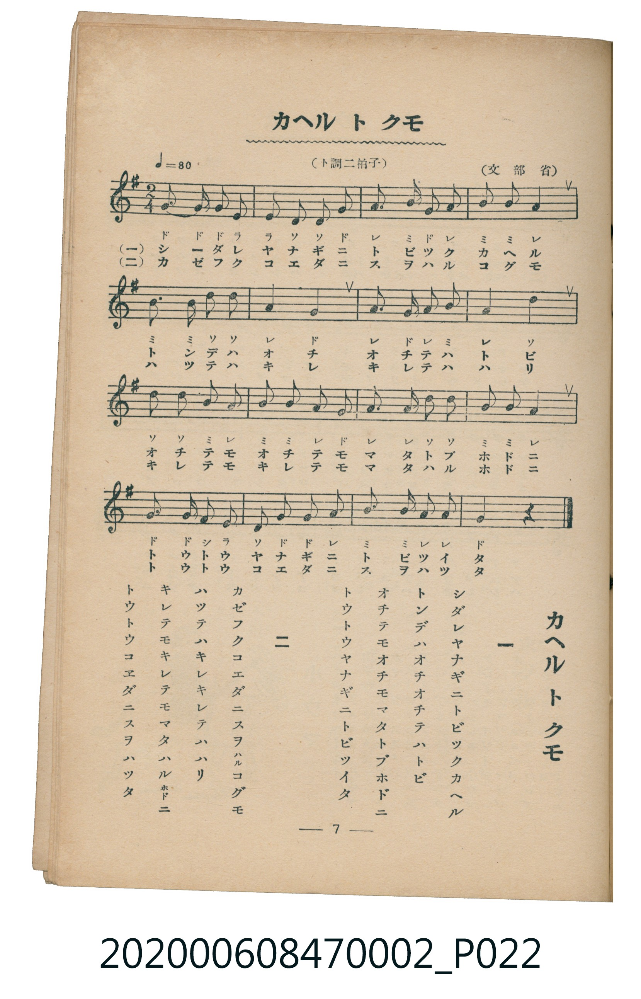

# カヘル ト クモ（青蛙與雲）

> Re:Shōka 使用 AI 協助辨識與重建樂譜，可能會有錯誤。歡迎回報。

- **鋼琴伴奏版**：<br><audio controls src="kaeru_to_kumo.mp3"></audio>
- **NEUTRINO 歌聲合成版**：<br><audio controls src="kaeru_to_kumo_neutrino.mp3"></audio>

- 文部省
- 臺灣教育會公認《新定兒童唱歌》尋常科第二學年用（2020.006.0847.0002）

## 說明

曲目說明
中文解釋：描寫青蛙與天空雲朵，充滿觀察自然的童趣。

原書資訊與歌詞全文（對應 P022.jpg，書頁 p. 7，第一學期第 5 首）：
調性與拍號：ト調二拍子（G 大調 2/4 拍），♩＝80


## 歌詞

```text
一
シダレヤナギニトビツクカヘル
トンデハオチオチテハトビ
オチテモオチテモマタトブホドニ
トウトウヤナギニトビツイタ

二
カゼフクコエダニ　スヲハルコグモ
ハツテハキレキレテハハリ
キレテモキレテモマタハルホドニ
トウトウコエダニスヲハツタ
```

## ABC

<div class="abc-score" data-abc-src="kaeru_to_kumo.abc" aria-label="五線譜載入中"></div>

[下載 ABC 原始檔](kaeru_to_kumo.abc)

## TMD 檔案連結

- [主旋律 TMD 檔案](kaeru_to_kumo.tmd) [[在 TMD Studio 編輯](https://tmdlang.github.io/Tmd-TS/#tmd=s7IKdvYPcrWy4qpTUCpJTLdSSM7PyUlNLsnMz7MqzsjMK0nNjM_KTMmPL87Iz05Ugisry88pzU21Si9KTEmNN4o3MjAyiDcwMIs3sDAxBzIMjBBKi_NLi5JTrYqTM_Lzc-JLUitKkvLzsxHyBUX5Zal5iXlANQVFIBtTwIoQClLLMlNSQdKpKZkl-UWZiTlI7kgtKga7FWxJfElRYl5xclFmAcgDCFUlGalAxybmZeYi64WI5iWWlBaloouWpyYCGUUIYaC96Zl5Vrn5eUmlwLBQ4tLSUnjctPpx84zHzasVHjd3AHnrHzcver-n4-XcSS9mz3zR0f5y9qb3ezoVtLS4FG0VLAy47G0V3LlsjPRN7EDGPpvW_rJ5xfM5jWBLXrTvet64-NnUmS-aNj2b0_y0dc2LVb2PG7qeTdvwdN2sp62Tnq9e-nTKxmdrex43dD_d0P10x47nyyc-X7Pmya6ep2t3PN255fmUFUDLQTGhB4wJPVBMABkGRkAnKHHpayk8m73p-ex1L1atejajj0tBQeHJjrVAJ7xYvvhle_f7PbOe9fc_Xb8a7vanS1Y-X7kL6INnc7a-39PztLX12e79L5Y3PF0__0X7quct257PagE66cW2xY8bmri09LlAVthSC4Dc97Rv_rPZO15sbn-xogvoIKDPX6yc97R1BdDRQH8-3dD7rL1TIcDAyEgvqyAd6ESg4pcLGhUK9BTMgTxQyOxoAIbMsznzgWwFU4WXy6YBgwLoU5DhL1btf9awHGRsd--LmfOBosAoBAoCQxMo8nTtBKAV7gpPlywHiikAY0wBKArW3fNo5sr3e-YCYxMShg0g6nHT9sfNDY-b1zxuXvK4uetx07rHzd1AAx83T37c3AJKGLCUAlYNktj8uLn9cXP_46ZVj5sboWRzG0gErA1iKlx0EQq7ed7jpv1gddMeN89-3NwJtA1mcNMyGInVJUuAOiEu39UDsWP146Y9j5ungh25-XHTCrBHuh83NDxu2vm4eRPYRUA1QKkNQLsh1gCFWqCubVoL8jaEhLofiFZBzIaLAt2PxIa6H2wwTvcjOwbhEqAX9oOUUp7EoEABlHS9E1OLSkPyvUtz860CMhPz8h1qDGqqQfYo2BiaadmBWdjStwIkmb1Y2KOgYaLwdEP_8_UNOvBEqYlFA9A6qGEvZ_U9ndBrBfR1J9jvyORKIFkDpR837UWQYHmQzBowbz6SHpAISAYiBiFBYiCAsFUD6FxNoKVN28EK9oDJBhQDloB5XWBL14HZ3VCZDjBvMphsAcuvh8g0rQaLzQCTIDa6pbt6wJaClTVBLJ2KYsBmMG8FknOgljbtBPM2wRIesLAFKwZJbQALLoLah2RnjYKhgi4QGoJps3ggUQOhTOEESKZGwQhIGkN5IHYNmAfCIB4I1oBN9DEEWbgdKgZyI4hcA9YBCjIQrwtEAoMMxO6GynSAeZPBZAtYfj1EBhgWILEZYBLERrLLCCYPUr8HHFbIOjeDeSuQ3AG1DRhWIN4mMNkPNxmhZwNYbBHcNvwJe1cPhQkbKSkiJWJY8gUBSOKFRBksUSOSM0QvinqwCeipC5KkockTnJKa2yHpBZpQVsGta0RYBxaFiAALJmT1YJMg6kGJHd06SGIGK4bmA1TtTWvh2mHuhonC_IVqHYiGqIc5FJ6OQSkRlB5NQckWnmIhaRsai2ARWPoFqUeoAelAS8PgFAlKBZvBoQRLKZDwgKXuRrjZEFGICMjZSOqhJsHSN1r6BauCpHo0fcCAgOkD5R-YPSBRiAi6PRCTQCIwFxJKuTs6KUu5KEUuoijFVryiF8lgEi21E1kkY6ZHUNGGPaVCZZrngS3aDxaDpP9pUJnZcMdBylJ0S6FFMmaqhFmKUwbFUkguABXsBCytgadhWOmKWtYiymMQRqR3fOUxZtoElW14ZYCOB5WE-8FikNJ5GlRmNpjXCSZBJSp6iYyZQmG24ZRBsQ2lRMZhG950_XT2bOo1NaAtAGhTA6l5QahBgZCBld0wgKtMbloG1oZgk9rMAKkFORKU5HBZCC2VcVpIbBMDbi0eCyHtCxA2BzUloA0MUHqFiWOmb4gIrNQ2wEzNkNQIdC48ZYLZpLYvQGohTofYAHIbetmM0yaS2hYg-7DbVMvFpWungNSsVgBylbkA)]
- [鋼琴伴奏 TMD 檔案](kaeru_to_kumo_piano.tmd) [[在 TMD Studio 編輯](https://tmdlang.github.io/Tmd-TS/#tmd=s7IKdvYPcrWy4tLSUnjctPpx84zHzasVHjd3AHnrHzcver-n42X3nucTtjzZs-Xp0v7nnR3v93QqaGlxKdoqWBhw2dsquHPZGOmb2HHVKSg9m9b-snnF8zmNSiDei_ZdzxsXP5s680XTpmdzmp-2rnmxqvdxQ9ezaRuerpv1tHXS89VLn07Z-Gxtz-OG7qcbup_u2PF8-cTna9Y82dXzdO2Opzu3PJ-yAmi_kYGRgZ6BgZmegYWJOZBhYAR0ghIXl3dialFpSL53aW6-VUBmYl5-kIdDjUFNNZcCENgYmmnZgVn6Wgq26EABZMuOhhcLexQ0TBSebuh_vr5BRyHAwMhIL6sgXROLBi19sGE1CoYKukBoCKbN4oFEDYQyhRMgmRoFIyBpDOWB2DVgHgiDeCBYAzbRx7AGGNTboWKPmxvA5BqwjsfNS8C8LhDZtA7M7obKdIB5k8FkC1h-PUSmaTVYbAaYBLGR7DKCyYPU7wHKT0XRuRnMW4HkDqhtTTvBvE1gsh9uMkLPBrDYIrht-EN-Vw85IQ8KO1AImoICGh7GkNiA2gsWgYU4SD1CDUgHWqiDwxDk7s1A3A73G8hXq-Dx0Qg3GyIKEXnc3IasHmoSLEbQQhysChJPaPqa1sL1gWIcZg9IFCKCbg_EJJAIzIWEwnpHJzlhDQtjWHpFTb2IFA7CiPjAl8Ixww6UWvDKNM8D8Zr2g8Ug6X0aVGY2mNcJJkFpFD2NY4YgzDacMii2oaRxHLbhDfens2eTW7qAsDmoIIEWL6CwhYljxgVEBJYDDDBDHhJyTcsQoQhmk1q6gNSCwg8UPiAIcht6OsdpE0klC8g-7DbVYin0fZALfRNEmf985cqnjUufTZ3xZFf3y0Urnm5f9qyzG1KJIQV3vEK0YSwywzQeyDKNh4mBWeiKwWrQVYOYBphqiTXYBI9ikLFAr-vaKSD5PtoHqBJdyAgspMwFAA)]

## 分析

```text
================================================================================
📊 TMD Song Profile: [ カヘル ト クモ（青蛙與雲） ]
================================================================================
⏱  Duration:       0:24 (24.0s), 16 measures total
🎼 Key & Tempo:    首調基準 G, != 80.0 BPM, <2/4>
   - 分析範圍：      由實際發聲的音符與和弦推測調性；播放脈絡另行呈現
🎤 人聲音域:    D4 (MIDI 62) – D5 (MIDI 74) [跨度: 12 個半音 / 1.0 個八度, 難度: easy]
   - 最低音:  D4 in [KaeruToKumo #1 @ m.2, 0:01]
   - 最高音: D5 in [KaeruToKumo #1 @ m.5, 0:06]
   - 適合: soprano, mezzo-soprano, contralto, tenor, baritone, bass
🏛  結構:      KaeruToKumo (24.0s)
⚡ 編曲密度:        Peak 1 軌道同時演奏
🗝  調性診斷：       D 調性不明確（純淨自然大調，未偵測到可信轉調）
   - 風格氣質:    純淨自然大調（陽光明朗、易唱易記，無明顯調外色彩）
   - 轉調歷程:    全曲維持單一推測調性（未偵測到可信轉調）
   - 核心骨幹音:  A, G, B, D, E
   - 調性數值:    D 調性不明確 [相關度: 0.73, 穩定度: Ambiguous, 自然音純度: 100.0%]
   - 候選調性 (K-S): D 大調 (0.73), G 大調 (0.70), B 小調 (0.53)
   - 五度圈歷程:   +2
   - 各段落調性細節:
     • [KaeruToKumo #1]: D 調性不明確 (r: 0.73, 自然音純度: 100.0%)

  [ 五度圈游移軌跡 ]
               C  
         F            G  
      Bb              [D ]*
      Eb               A  
         Ab           E  
            Db       B  
               F# 
     (* = active key center)

  [ 十二半音累積音高分佈 ]
     C  :                            0.0%
     C# :                            0.0%
     D  : ██████████████            17.7%
     D# :                            0.0%
     E  : ████                       4.8%
     F  :                            0.0%
     F# : █                          1.6%
     G  : ███████████████████       24.2%
     G# :                            0.0%
     A  : ████████████████████████  30.6%
     A# :                            0.0%
     B  : ████████████████          21.0%
--------------------------------------------------------------------------------
Assignment 軌道音域：
  - Piano         : D4 – D5 (12 個半音 / 1.0 個八度, 55 個音符)
================================================================================
```


## 原書掃描頁




