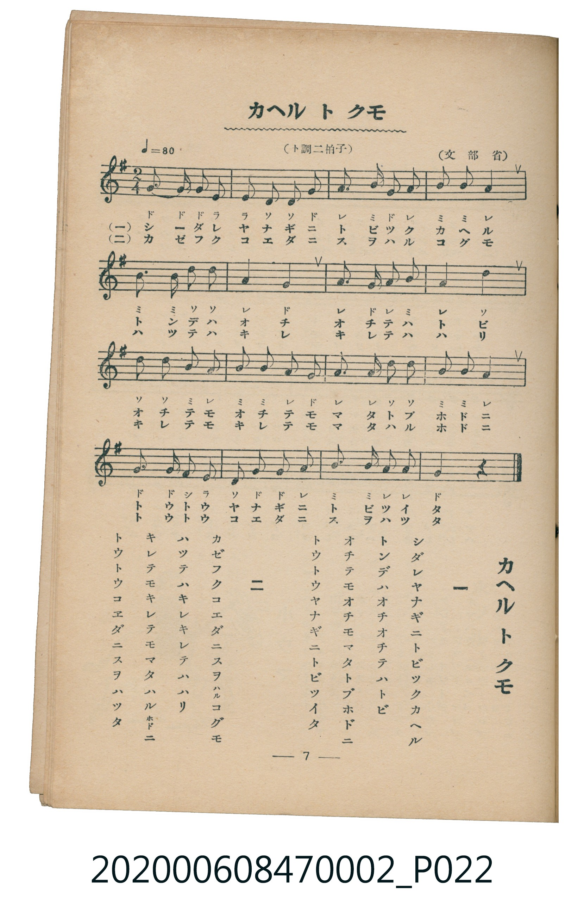

# カヘル ト クモ（青蛙與雲）

> Re:Shōka 使用 AI 協助辨識與重建樂譜，可能會有錯誤。歡迎[回報](https://github.com/TMDLang/reshoka/issues)。

- **鋼琴伴奏版**：<br><audio controls src="kaeru_to_kumo.mp3"></audio>
- **NEUTRINO 歌聲合成版**：<br><audio controls src="kaeru_to_kumo_neutrino.mp3"></audio>

- 文部省
- 臺灣教育會公認《新定兒童唱歌》尋常科第二學年用（2020.006.0847.0002）

## 說明

曲目說明
中文解釋：描寫青蛙與天空雲朵，充滿觀察自然的童趣。

原書資訊與歌詞全文（對應 P022.jpg，書頁 p. 7，第一學期第 5 首）：
調性與拍號：ト調二拍子（G 大調 2/4 拍），♩＝80


## 歌詞

```text
一
シダレヤナギニトビツクカヘル
トンデハオチオチテハトビ
オチテモオチテモマタトブホドニ
トウトウヤナギニトビツイタ

二
カゼフクコエダニ　スヲハルコグモ
ハツテハキレキレテハハリ
キレテモキレテモマタハルホドニ
トウトウコエダニスヲハツタ
```

## ABC

<div class="abc-score" data-abc-src="kaeru_to_kumo.abc" aria-label="五線譜載入中"></div>

[下載 ABC 原始檔](kaeru_to_kumo.abc)

## TMD 檔案連結

- [主旋律 TMD 檔案](kaeru_to_kumo.tmd) [[在 TMD Studio 編輯](https://tmdlang.github.io/Tmd-TS/#tmd=s7IKdvYPcrWy4qpTUCpJTLdSSM7PyUlNLsnMz7MqzsjMK0nNjM_KTMmPL87Iz05Ugisry88pzU21Si9KTEmNN4o3MjAyiDcwMIs3sDAxBzIMjBBKi_NLi5JTrYqTM_Lzc-JLUitKkvLzsxHyBUX5Zal5iXlANQVFIBtTwIoQClLLMlNSQdKpKZkl-UWZiTlI7kgtKga7FWxJfElRYl5xclFmAcgDCFUlGalAxybmZeYi64WI5iWWlBaloouWpyYCGUUIYaC96Zl5Vrn5eUmlwLBAlijJyAeGQ0FGpVVGZjHIgcmJOfHZiXlIwQV1XkFieqpVgIERMHS0tBQeN61-3DzjcfNqhcfNHUDe-sfNi97v6Xg5d9KL2TNfdLS_nL3p_Z5OBS0tLkVbBQsDLntbBXcuGyN9EzuQuc-mtb9sXvF8TiPYlhftu543Ln42deaLpk3P5jQ_bV3zYlXv44auZ9M2PF0362nrpOerlz6dsvHZ2p7HDd1PN3Q_3bHj-fKJz9esebKr5-naHU93bnk-ZQXQclBE6gEjUg8UkUCGgRHQCUpc-loKz2Zvej573YtVq57N6ONSUFB4smMt0Akvli9-2d79fs-sZ_39T9evhrv96ZKVz1fuAvrg2Zyt7_f0PG1tfbZ7_4vlDU_Xz3_Rvup5y7bns1qATnqxbfHjhiYuLX0ukBW21AIg9z3tm_9s9o4Xm9tfrOgCOgjo8xcr5z1tXQF0NNCfTzf0PmvvVADFhV5WQTrQiUDFLxc0KhToKZgDeaCQ2dEADJlnc-YD2QqmCi-XTQMGBdCnIMNfrNr_rGE5yNju3hcz5wNFgVEIFASGJlDk6doJQCvcFZ4uWQ4UUwDGmAJQFKy759HMle_3zAXGJiQMG0DU46btj5sbHjevedy85HFz1-OmdY-bu4EGPm6e_Li5BZQwYCkFrBoksflxc_vj5v7HTaseNzdCyeY2kAhYG8RUuOgiFHbzvMdN-8Hqpj1unv24uRNoG8zgpmUwEqtLlgB1Qly-qwdix-rHTXseN08FO3Lz46YVYI90P25oeNy083HzJrCLgGqAUhuAdkOsAQq1QF3btBbkbQgJdT8QrYKYDRcFuh-JDXU_2GCc7kd2DMIlQC_sBymlPIlBgQIo6XonphaVhuR7l-bmWwVkJublO9QY1FSD7FGwMTTTsgOzsKVvBUgye7GwR0HDROHphv7n6xt04IlSE4sGoHVQw17O6ns6odcK6OtOsN-RyZVAsgZKP27aiyDB8iCZNWDefCQ9IBGQDEQMQoLEQABhqwbQuZpAS5u2gxXsAZMNKAYsAfO6wJauA7O7oTIdYN5kMNkCll8PkWlaDRabASZBbHRLd_WALQUra4JYOhXFgM1g3gok50AtbdoJ5m2CJTxgYQtWDJLaABZcBLUPyc4aBUMFXSA0BNNm8UCiBkKZwgmQTI2CEZA0hvJA7BowD4RBPBCsAZvoYwiycDtUDORGELkGrAMUZCBeF4gEBhmI3Q2V6QDzJoPJFrD8eogMMCxAYjPAJIiNZJcRTB6kfg84rJB1bgbzViC5A2obMKxAvE1gsh9uMkLPBrDYIrht-BP2rh4KEzZSUkRKxLDkCwKQxAuJMliiRiRniF4U9WAT0FMXJElDkyc4JTW3Q9ILNKGsglvXiLAOLAoRARZMyOrBJkHUgxI7unWQxAxWDM0HqNqb1sK1w9wNE4X5C9U6EA1RD3MoPB2DUiIoPZqCki08xULSNjQWwSKw9AtSj1AD0oGWhsEpEpQKNoNDCZZSIOEBS92NcLMhohARkLOR1ENNgqVvtPQLVgVJ9Wj6gAEB0wfKPzB7QKIQEXR7ICaBRGAuJJRyd3RSlnJRilxEUYqteEUvksEkWmonskjGTI-gog17SoXKNM8DW7QfLAZJ_9OgMrPhjoOUpeiWQotkzFQJsxSnDIqlkFwAKtgJWFoDT8Ow0hW1rEWUxyCMSO_4ymPMtAkq2_DKAB0PKgn3g8UgpfM0qMxsMK8TTIJKVPQSGTOFwmzDKYNiG0qJjMM2vOn66ezZ1GtqQFsA0KYGUvOCUIMCIQMru2EAV5nctAysDcEmtZkBUgtyJCjJ4bIQWirjtJDYJgbcWjwWQtoXIGwOakpAGxig9AoTx0zfEBFYqW2AmZohqRHoXHjKBLNJbV-A1EKcDrEB5Db0shmnTSS1LUD2YbeplotL104BqVmtAOQqcwEA)]
- [鋼琴伴奏 TMD 檔案](kaeru_to_kumo_piano.tmd) [[在 TMD Studio 編輯](https://tmdlang.github.io/Tmd-TS/#tmd=s7IKdvYPcrWy4qpTUCpJTLdSyC8qychPL0osyKi0ysgsLskvykxOzInPTsxLVIIrKs4vLUpOjS9ITE-1CjAwMlLi0tJSeNy0-nHzjMfNqxUeN3cAeesfNy96v6fjZfee5xO2PNmz5enS_uedHe_3dCpoaXEp2ipYGHDZ2yq4c9kY6ZvYgYx-Nq39ZfOK53MawRa9aN_1vHHxs6kzXzRtejan-Wnrmhereh83dD2btuHpullPWyc9X7306ZSNz9b2PG7ofrqh--mOHc-XT3y-Zs2TXT1P1-54unPL8ykrgPYbGRgZ6BkYmOkZWJiYAxkGRkAnKHFxeSemFpWG5HuX5uZbBWQm5uUHeTjUGNRUcykAgY2hmZYdmKWvpWCLDhRAtuxoeLGwR0HDROHphv7n6xt0FEABoZdVkK6JRYOWPtiwGgVDBV0gNATTZvFAogZCmcIJkEyNghGQNIbyQOwaMA-EQTwQrAGb6GNYAwzq7VCxx80NYHINWMfj5iVgXheIbFoHZndDZTrAvMlgsgUsvx4i07QaLDYDTILYSHYZweRB6vcA5aei6NwM5q1AcgfUtqadYN4mMNkPNxmhZwNYbBHcNvwhv6uHnJAHhR0oBE1BAQ0PY0hsQO0Fi8BCHKQeoQakAy3UwWEIcvdmIG6H-w3kq1Xw-GiEmw0RhYg8bm5DVg81CRYjaCEOVgWJJzR9TWvh-kAxDrMHJAoRQbcHYhJIBOZCQmG9o5OcsIaFMSy9oqZeRAoHYUR84EvhmGEHSi14ZZrngXhN-8FikPQ-DSozG8zrBJOgNIqexjFDEGYbThkU21DSOA7b8Ib709mzyS1dQNgcVJBAixdQ2MLEMeMCIgLLAQaYIQ8JuaZliFAEs0ktXUBqQeEHCh8QBLkNPZ3jtImkkgVkH3abarEU-j7Ihb4Josx_vnLl08alz6bOeLKr--WiFU-3L3vW2Q2pxJCCO14h2jAWmWEaD2SZxsPEwCx0xWA16KpBTANMtcQabIJHMchYoNd17RSQfB_tA1SJLmQEFlLmAgA)]

## 分析

```text
================================================================================
📊 TMD Song Profile: [ カヘル ト クモ（青蛙與雲） ]
================================================================================
⏱  Duration:       0:24 (24.0s), 16 measures total
🎼 Key & Tempo:    首調基準 G, != 80.0 BPM, <2/4>
   - 分析範圍：      由實際發聲的音符與和弦推測調性；播放脈絡另行呈現
🎤 人聲音域:    D4 (MIDI 62) – D5 (MIDI 74) [跨度: 12 個半音 / 1.0 個八度, 難度: easy]
   - 最低音:  D4 in [KaeruToKumo #1 @ m.2, 0:01]
   - 最高音: D5 in [KaeruToKumo #1 @ m.5, 0:06]
   - 適合: soprano, mezzo-soprano, contralto, tenor, baritone, bass
🏛  結構:      KaeruToKumo (24.0s)
⚡ 編曲密度:        Peak 1 軌道同時演奏
🗝  調性診斷：       D 調性不明確（純淨自然大調，未偵測到可信轉調）
   - 風格氣質:    純淨自然大調（陽光明朗、易唱易記，無明顯調外色彩）
   - 轉調歷程:    全曲維持單一推測調性（未偵測到可信轉調）
   - 核心骨幹音:  A, G, B, D, E
   - 調性數值:    D 調性不明確 [相關度: 0.73, 穩定度: Ambiguous, 自然音純度: 100.0%]
   - 候選調性 (K-S): D 大調 (0.73), G 大調 (0.70), B 小調 (0.53)
   - 五度圈歷程:   +2
   - 各段落調性細節:
     • [KaeruToKumo #1]: D 調性不明確 (r: 0.73, 自然音純度: 100.0%)

  [ 五度圈游移軌跡 ]
               C  
         F            G  
      Bb              [D ]*
      Eb               A  
         Ab           E  
            Db       B  
               F# 
     (* = active key center)

  [ 十二半音累積音高分佈 ]
     C  :                            0.0%
     C# :                            0.0%
     D  : ██████████████            17.7%
     D# :                            0.0%
     E  : ████                       4.8%
     F  :                            0.0%
     F# : █                          1.6%
     G  : ███████████████████       24.2%
     G# :                            0.0%
     A  : ████████████████████████  30.6%
     A# :                            0.0%
     B  : ████████████████          21.0%
--------------------------------------------------------------------------------
Assignment 軌道音域：
  - Piano         : D4 – D5 (12 個半音 / 1.0 個八度, 55 個音符)
================================================================================
```


## 原書掃描頁




