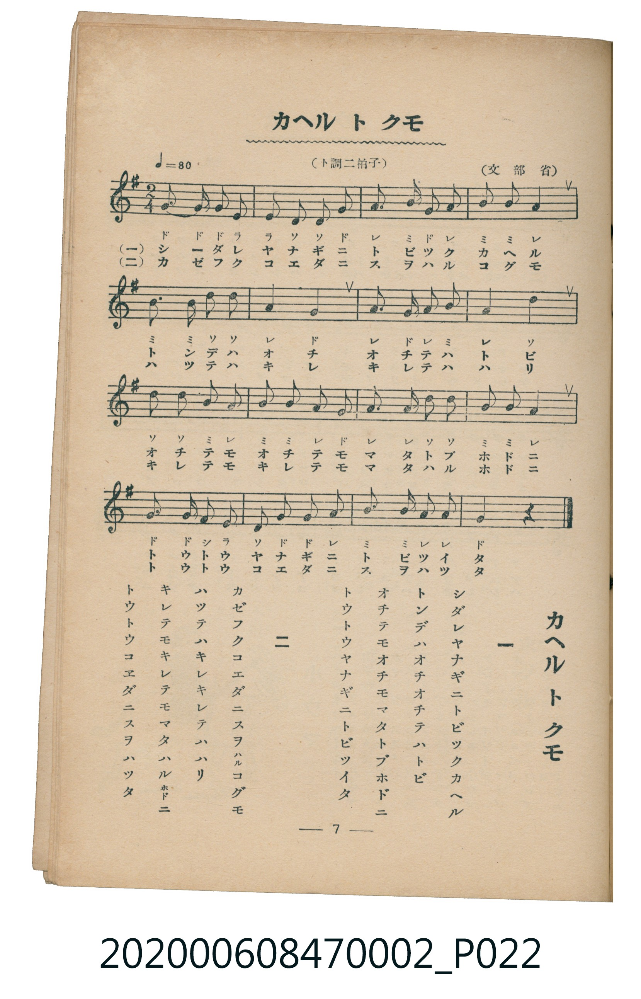

# カヘル ト クモ

<audio controls src="kaeru_to_kumo.mp3"></audio>

- 文部省
- 臺灣教育會公認《新定兒童唱歌》尋常科第二學年用（2020.006.0847.0002）

## 說明

原書資訊與歌詞全文（對應 P022.jpg，書頁 p. 7，第一學期第 5 首）：
調性與拍號：ト調二拍子（G 大調 2/4 拍），♩＝80

## 歌詞

```text
一
シダレヤナギニトビツクカヘル
トンデハオチオチテハトビ
オチテモオチテモマタトブホドニ
トウトウヤナギニトビツイタ

二
カゼフクコエダニ　スヲハルコグモ
ハツテハキレキレテハハリ
キレテモキレテモマタハルホドニ
トウトウコエダニスヲハツタ
```

## 原書掃描頁



## 分析

```text
================================================================================
📊 TMD Song Profile: [ カヘル ト クモ ]
================================================================================
⏱  Duration:       0:24 (24.0s), 16 measures total
🎼 Key & Tempo:    首調基準 G, != 80.0 BPM, <2/4>
   - 分析範圍：      由實際發聲的音符與和弦推測調性；播放脈絡另行呈現
🎤 人聲音域:    D4 (MIDI 62) – G5 (MIDI 79) [跨度: 17 個半音 / 1.4 個八度, 難度: challenging]
   - 最低音:  D4 in [KaeruToKumo #1 @ m.2, 0:01]
   - 最高音: G5 in [KaeruToKumo #1 @ m.13, 0:18]
   - 適合: soprano, mezzo-soprano, tenor, baritone
🏛  結構:      KaeruToKumo (24.0s)
⚡ 編曲密度:        Peak 1 軌道同時演奏
🗝  調性診斷：       D 調性不明確（純淨自然大調，未偵測到可信轉調）
   - 風格氣質:    純淨自然大調（陽光明朗、易唱易記，無明顯調外色彩）
   - 轉調歷程:    全曲維持單一推測調性（未偵測到可信轉調）
   - 核心骨幹音:  A, G, B, D, E
   - 調性數值:    D 調性不明確 [相關度: 0.73, 穩定度: Ambiguous, 自然音純度: 100.0%]
   - 候選調性 (K-S): D 大調 (0.73), G 大調 (0.70), B 小調 (0.53)
   - 五度圈歷程:   +2
   - 各段落調性細節:
     • [KaeruToKumo #1]: D 調性不明確 (r: 0.73, 自然音純度: 100.0%)

  [ 五度圈游移軌跡 ]
               C  
         F            G  
      Bb              [D ]*
      Eb               A  
         Ab           E  
            Db       B  
               F# 
     (* = active key center)

  [ 十二半音累積音高分佈 ]
     C  :                            0.0%
     C# :                            0.0%
     D  : ██████████████            17.7%
     D# :                            0.0%
     E  : ████                       4.8%
     F  :                            0.0%
     F# : █                          1.6%
     G  : ███████████████████       24.2%
     G# :                            0.0%
     A  : ████████████████████████  30.6%
     A# :                            0.0%
     B  : ████████████████          21.0%
--------------------------------------------------------------------------------
Assignment 軌道音域：
  - Piano         : D4 – G5 (17 個半音 / 1.4 個八度, 55 個音符)
================================================================================
```

## ABC

```abc
X:1
T:カヘル ト クモ
C:TMD (Chen, Chih-Han / aguai)
M:2/4
L:1/16
Q:1/4=80
K:G

V:V1 name="Piano" snm="Pia"

[V:V1]
g3 g g2 e2 | e2 d2 d2 g2 | a2 b2 g2 a2 | b2 b2 a4 |
b3 b d2 d2 | a4 g4 | a2 g2 a2 b2 | a4 d4 |
d2 d2 b2 a2 | b2 b2 a2 g2 | a2 a2 d2 d2 | b2 b2 a4 |
g2 g2 f2 e2 | d2 g2 g2 a2 | b2 b2 a2 a2 | g4 z4 |
```

- [主旋律 TMD 檔案](kaeru_to_kumo.tmd)
- [鋼琴伴奏 TMD 檔案](kaeru_to_kumo_piano.tmd)
