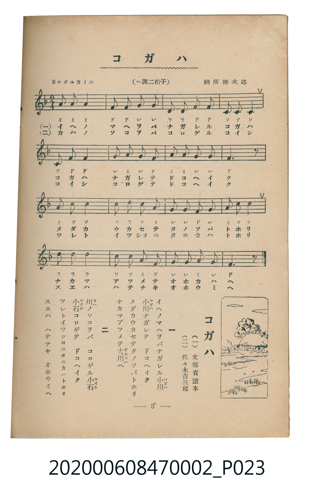

# コガハ

<audio controls src="kogawa.mp3"></audio>

- 詞：（一）文部省讀本、（二）佐々木吉三郎
- 曲：納所辨次郎
- 臺灣教育會公認《新定兒童唱歌》尋常科第二學年用（2020.006.0847.0002）

## 說明

原書資訊與歌詞全文（對應 P023.jpg，書頁 p. 8，第一學期第 6 首）：
調性與拍號：ヘ調二拍子（F 大調 2/4 拍），「カルクユカイニ」

## 歌詞

```text
一
イヘノマヘヲバナガレル小川（コガハ）
小川（コガハ）ナガレテ　ドコヘイク
メダカウカセテタノソバトホリ
ナカマアツメテ大川（オホガハ）ヘ

二
川（カハ）ノソコヲバ　コロゲル小石（コイシ）
小石（コイシ）コロゲテ　ドコヘイク
ツレトイツシヨニタニカハトホリ
スエハ　ハテナキ　オホウミヘ
```

## 原書掃描頁



## 分析

```text
================================================================================
📊 TMD Song Profile: [ コガハ ]
================================================================================
⏱  Duration:       0:17 (17.8s), 16 measures total
🎼 Key & Tempo:    首調基準 F, != 108.0 BPM, <2/4>
   - 分析範圍：      由實際發聲的音符與和弦推測調性；播放脈絡另行呈現
🎤 人聲音域:    C4 (MIDI 60) – F5 (MIDI 77) [跨度: 17 個半音 / 1.4 個八度, 難度: challenging]
   - 最低音:  C4 in [Kogawa #1 @ m.4, 0:03]
   - 最高音: F5 in [Kogawa #1 @ m.5, 0:04]
   - 適合: soprano, mezzo-soprano, contralto, tenor, baritone, bass
🏛  結構:      Kogawa (17.8s)
⚡ 編曲密度:        Peak 1 軌道同時演奏
🗝  調性診斷：       F 大調（純淨自然大調，未偵測到可信轉調）
   - 風格氣質:    純淨自然大調（陽光明朗、易唱易記，無明顯調外色彩）
   - 轉調歷程:    全曲維持單一推測調性（未偵測到可信轉調）
   - 核心骨幹音:  F, C, G, A, D
   - 調性數值:    F 大調 [相關度: 0.86, 穩定度: Moderate, 自然音純度: 100.0%]
   - 候選調性 (K-S): F 大調 (0.86), C 大調 (0.77), A 小調 (0.62)
   - 五度圈歷程:   -1
   - 各段落調性細節:
     • [Kogawa #1]: F 大調 (r: 0.86, 自然音純度: 100.0%)

  [ 五度圈游移軌跡 ]
               C  
        [F ]*          G  
      Bb               D  
      Eb               A  
         Ab           E  
            Db       B  
               F# 
     (* = active key center)

  [ 十二半音累積音高分佈 ]
     C  : ███████████████████████   24.2%
     C# :                            0.0%
     D  : ███████████               11.3%
     D# :                            0.0%
     E  :                            0.0%
     F  : ████████████████████████  25.8%
     F# :                            0.0%
     G  : ██████████████████        19.4%
     G# :                            0.0%
     A  : ██████████████████        19.4%
     A# :                            0.0%
     B  :                            0.0%
--------------------------------------------------------------------------------
Assignment 軌道音域：
  - Piano         : C4 – F5 (17 個半音 / 1.4 個八度, 52 個音符)
================================================================================
```

## ABC

```abc
X:1
T:コガハ
C:曲：納所辨次郎
M:2/4
L:1/16
Q:1/4=108
K:F
V:V1 name="Piano" snm="Pia"
[V:V1]
a2 a2 a4 | f2 f2 g2 g2 | d2 d2 f2 f2 | c2 c2 c4 |
c2 f2 f4 | g2 a2 g2 f2 | a2 a2 g2 g2 | f6 z2 |
a2 c2 c4 | c2 d2 c2 a2 | g2 g2 f2 g2 | a2 c2 c4 |
d2 d2 d4 | c2 c2 a2 f2 | g2 g2 a2 g2 | f6 z2 |
```

- [主旋律 TMD 檔案](kogawa.tmd)
- [鋼琴伴奏 TMD 檔案](kogawa_piano.tmd)
