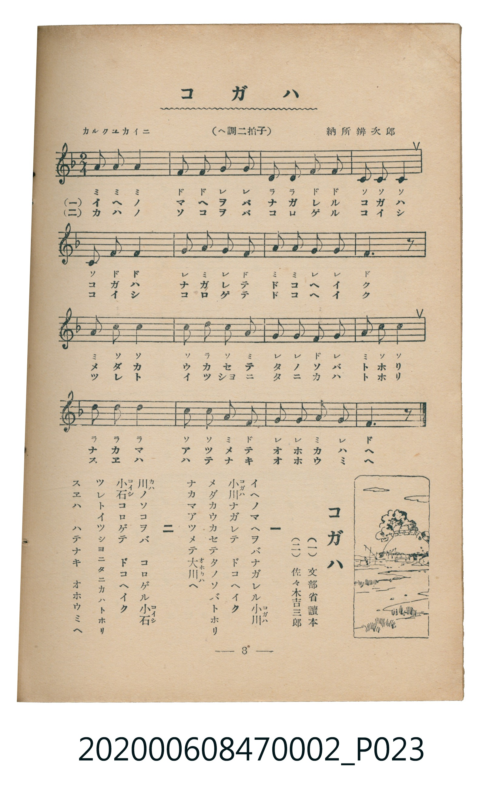

# コガハ（小河）

> Re:Shōka 使用 AI 協助辨識與重建樂譜，可能會有錯誤。歡迎回報。

- **鋼琴伴奏版**：<br><audio controls src="kogawa.mp3"></audio>
- **NEUTRINO 歌聲合成版**：<br><audio controls src="kogawa_neutrino.mp3"></audio>

- 詞：（一）文部省讀本、（二）佐々木吉三郎
- 曲：納所辨次郎
- 臺灣教育會公認《新定兒童唱歌》尋常科第二學年用（2020.006.0847.0002）

## 說明

曲目說明
中文解釋：描寫清澈溪流流過田野、山間的景色。

原書資訊與歌詞全文（對應 P023.jpg，書頁 p. 8，第一學期第 6 首）：
調性與拍號：ヘ調二拍子（F 大調 2/4 拍），「カルクユカイニ」


## 歌詞

```text
一
イヘノマヘヲバナガレル小川（コガハ）
小川（コガハ）ナガレテ　ドコヘイク
メダカウカセテタノソバトホリ
ナカマアツメテ大川（オホガハ）ヘ

二
川（カハ）ノソコヲバ　コロゲル小石（コイシ）
小石（コイシ）コロゲテ　ドコヘイク
ツレトイツシヨニタニカハトホリ
スエハ　ハテナキ　オホウミヘ
```

## ABC

<div class="abc-score" data-abc-src="kogawa.abc" aria-label="五線譜載入中"></div>

[下載 ABC 原始檔](kogawa.abc)

## TMD 檔案連結

- [主旋律 TMD 檔案](kogawa.tmd) [[在 TMD Studio 編輯](https://tmdlang.github.io/Tmd-TS/#tmd=s7IKdvYPcrWy4qpTUCpJTLdSSM7PyUlNLsnMz7MqzsjMK0nNjM_KTMmPL87Iz05Ugisry88pzU21Si9KTEmNN4o3MjAyiDcwMIs3sDAxBzIMjBBKi_NLi5JTrYqTM_Lzc-JLUitKkvLzsxHyBUX5Zal5iXlANQVFIBtTwIoQClLLMlNSQdKpKZkl-UWZiTlI7kgtKga7FWxJfElRYl5xclFmAcgDCFUlGalAx-YllpQWpaKLlieWpBYhBIHmp2fmWeXm5yWVAv2MKZGamZWJxRf5RSUZ-cDgKMiotMrILAa5MzkxJz47MQ8p1KCuLEhMT7UKMDAyVuLS0lJ43LT5cdOax8397_d0PN3Q_2zT5vd7OhW0tLgUbRUMDSy47G0V3LhsjPRN7EDmvFg57_2eWUClT3Y0ANU9m9b-snnF8zmNL9Y1PJuz5nFDI0hqVw9Q6sneCY8bWp_NWfF0QueTHZ0vm_vADnk2exPQgOdbep91NrzYt-LZmoUwmRftu543Ln42deaLpk3P5jQ_bV3zYlXv44auZ9M2PF0362nrpOerlz6dsvHZ2p7HDd1PN3Q_3bHj-fKJz9esAdr3dO2Opzu3PJ-yAmg9KDHoARODHigxABkGRkDXKHHpaykA7X4-e92LVauezejjUlBQeLJjLdADL5YvftneDXTUs_7-p-tXP9vR-mxfx7Ndq55tbQSil419z6dseNneB_Tb040bX06b_HxWy7OZ6190bnrc0MSlpc8FMtmWWgDkrKd985_N3vFic_uLFV0vOtqBHgaG-tPWFUC3guOo91l7pwIo_vSyCtLf7-kBKn65oFGhQE_BAsgDBciOBmCAPJszH8hWMFN4uWwaMASAHgQZ_mLV_mcNy0HGdve-mDkfKPq4eQZQEBiIQJGnaycArXBTeLpkOVBMARjrCkBRsG5gqPc8blr9uHn146b1j5uXgdhNSx43dz9u6OWChGYDiAILznjc3Pe4eR6Yselx84THzV3gRAZEq4GJ7On2uUBrkFJeJ9jf2CSQdLY9bmh43NwJkgWaC7SmaT3YwuaFj5sbwM6BOGo3SGnTfpATmvaCLe943Dz7cfMqiGqgeUBfzHvctOhxcwtYcxvQuzCbV4GUIiyfAfHarh6wA6FqgNohsmALQM4B-xHoOhB77eMmIBfkzefzgXkJ4hugY7cjvIkpgaQTpzeBjgW6C6gNGMAtQG2Pm1eAgh_kUyAJchSqT5t2Pm4CqugHmweUawP7fS3YnRBvLnvcPB_kR6BqypMuFCiAsoR3fnpieaJVQGZiXr5DjUFNNcgKBRsLLTswA1uOUYAk3BcLexQ0TMCBtL5BB57MNbFoAFoENezlrL6nE3qtgGE0HxxSCBIEaoDsTrAIhFwDJ0EyK8E8CIlQBZRp2gsORAQJAgg7NYCO1QRa2bQErGkGmOxDsnIekvgmMDkBKtMFNhLhDGBqgVq5GUmmH4uVu3rAVoKUQxSgWAl1K9gQVCuhYmvB8hAZVCvBnmjajmpljYIxGOoCWYZAaASENQpm8SAE4tcomMZDEVAJWIuPIcjMJWCPg9wG0goKCgh_E9hFkCAAeRPkfZBLIO6AiPQjzDICia8Gi8HNAvoRrBZhFpi3FuwvZLOAbgD6B2QW_iS3q4eyJAcJdKSkA4t_SCxCkiKEDU1YKIkUNTHC9MMAluSGLYlgT1RtSIbCUgA4OYJjGxRO6_FYB01q2JIH9gRFtnXgZARKT6AINgKmNyNw2gKlPEiKA8noKhigJDGU5IKWoNqg7oAkDWDCA7oAYj_InHiU5IWSVNASE2FzCJRmndQozdBKIHg-h5RZUDZIJSLRIZIbImlhMwszeTUvBGtqACsDFREwK5fBRYAVLHJ8N-0H80DFEMwxsHKuA8ybDSZXYbESksSaW5DcDNICsxJSsIJlQZXdciCnG8VOEA-5MCRgJyhJmQIhKKJNge0iUyAflOBAyQ2UzOCyiGQGDA5QYIAsgSSPZZASCRgE0OQBdArI8-ByCVq2dYAdALIepSQD-gSSPDugZoFKSaAYwm8w47rhxR6mcXhT3NPZsylMcci1IYiExQVSXQgtuGCFGXKKQxRpxBVm0EILEoOg-hJm3SJE1ENTJCy1geIUGr9IhSDIOlBZg8s6aGG2E6xtBVwb1DpoTQqyAuYkUMGGbh04C8BzGg7rgPUjGEISGSiJgcoyUCIDlWZYyzJw2QWK73nQhLEImlhAiQ-SyFZB0gC0xINYj1mW7QR7DlEmgqrNNqj5a1HMASZjoEdQzanl4tK1U4C03BSALGUuAA)]
- [鋼琴伴奏 TMD 檔案](kogawa_piano.tmd) [[在 TMD Studio 編輯](https://tmdlang.github.io/Tmd-TS/#tmd=s7IKdvYPcrWy4qpTUCpJTLdSyC8qychPL0osyKi0ysgsLskvykxOzInPTsxLVIIrKs4vLUpOjS9ITE-1CjAwMlbi0tJSeNy0-XHTmsfN_e_3dLzs3vN8wpYne7Y8Xdr_vLPj_Z5OBS0tLkVbBUMDCy57WwU3LhsjfRM7kIEvVs57v2cWUM-THQ1Adc-mtb9sXvF8TuOLdQ3P5qx53NAIktrVA5R6snfC44bWZ3NWPJ3Q-WRH58vmPrCLns3eBDTg-ZbeZ50NL_ateLZmIUzmRfuu542Ln02d-aJp07M5zU9b17xY1fu4oevZtA1P18162jrp-eqlT6dsfLa253FD99MN3U937Hi-fOLzNWuA9j1du-Ppzi3Pp6wAWm9kYGSgZ2BgpmdgYWIOZBgYAV2jxMXlnZ-eWJ5oFZCZmJcf5OFQY1BTzaUABDYWWnZghr6Wgi06UACZv6PhxcIeBQ0Thacb-p-vb9BRAIWiXlZBuiYWDVr6YMNqFIzBUBfIMgRCIyCsUTCLByEQv0bBNB6KgErAWnwMa4DRskThcfMMIO4Da33cPA_K3wTEE8AiXUBVa4A0CK8GiTRthor0I8wyAomvBovBzWraC1GLMAvMWwukQSIIs4BuaNoONgt_wOzqISdggF4GhQDISUbAEDIChwYorCBhBJLRVTBACRQUD6IFQRtYpBPqGWBQAZ0P0rMebE48SoCgeA7N-4TNIZBKOslLJaZACHKNqYIZEBuDQwUUJqCwgMsiwqJ5IRA3gCMX4odlkIhu2g3zQ9N-cJSDoxuaZDqAeDYQr0JNIM0t0DDsgJoFSnxAsabtj5uXA5ndcOO64akJ0zi8wfJ09mxygsUMDCHBAgoUUBIBBQsokWBNIuAkAXLhPKhXFkG9BwouSLCsgrgampBAemZgSSI7gXgFUlID5Z82qPlrUcwBBnzzfDRzalHLGR_kcsYEUc4827sLhLY2Ptuw5eWiFU-3L3vW2Q0pgBFhYBivEG0YC2WYxoNYJkCWCYhhGg8TQ1eMkEHSB2TBQgvNXGx6QGJQtXALcagFmQr0s66dAsTb0T5ARUg8IzBPmQsA)]

## 分析

```text
================================================================================
📊 TMD Song Profile: [ コガハ（小河） ]
================================================================================
⏱  Duration:       0:17 (17.8s), 16 measures total
🎼 Key & Tempo:    首調基準 F, != 108.0 BPM, <2/4>
   - 分析範圍：      由實際發聲的音符與和弦推測調性；播放脈絡另行呈現
🎤 人聲音域:    C4 (MIDI 60) – D5 (MIDI 74) [跨度: 14 個半音 / 1.2 個八度, 難度: moderate]
   - 最低音:  C4 in [Kogawa #1 @ m.4, 0:03]
   - 最高音: D5 in [Kogawa #1 @ m.10, 0:10]
   - 適合: soprano, mezzo-soprano, contralto, tenor, baritone, bass
🏛  結構:      Kogawa (17.8s)
⚡ 編曲密度:        Peak 1 軌道同時演奏
🗝  調性診斷：       F 大調（純淨自然大調，未偵測到可信轉調）
   - 風格氣質:    純淨自然大調（陽光明朗、易唱易記，無明顯調外色彩）
   - 轉調歷程:    全曲維持單一推測調性（未偵測到可信轉調）
   - 核心骨幹音:  F, C, G, A, D
   - 調性數值:    F 大調 [相關度: 0.86, 穩定度: Moderate, 自然音純度: 100.0%]
   - 候選調性 (K-S): F 大調 (0.86), C 大調 (0.77), A 小調 (0.62)
   - 五度圈歷程:   -1
   - 各段落調性細節:
     • [Kogawa #1]: F 大調 (r: 0.86, 自然音純度: 100.0%)

  [ 五度圈游移軌跡 ]
               C  
        [F ]*          G  
      Bb               D  
      Eb               A  
         Ab           E  
            Db       B  
               F# 
     (* = active key center)

  [ 十二半音累積音高分佈 ]
     C  : ███████████████████████   24.2%
     C# :                            0.0%
     D  : ███████████               11.3%
     D# :                            0.0%
     E  :                            0.0%
     F  : ████████████████████████  25.8%
     F# :                            0.0%
     G  : ██████████████████        19.4%
     G# :                            0.0%
     A  : ██████████████████        19.4%
     A# :                            0.0%
     B  :                            0.0%
--------------------------------------------------------------------------------
Assignment 軌道音域：
  - Piano         : C4 – D5 (14 個半音 / 1.2 個八度, 52 個音符)
================================================================================
```


## 原書掃描頁




