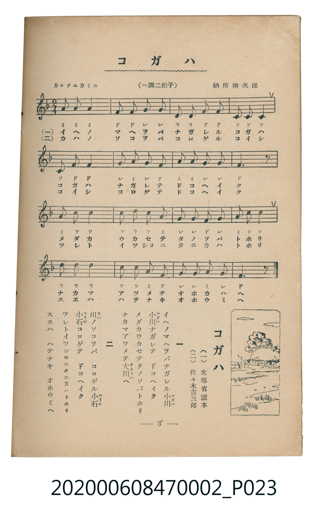

# コガハ（小河）

> Re:Shōka 使用 AI 協助辨識與重建樂譜，可能會有錯誤。歡迎回報。

- **NEUTRINO 歌聲合成版**：<br><audio controls src="kogawa_neutrino.mp3"></audio>
- **鋼琴伴奏版**：<br><audio controls src="kogawa.mp3"></audio>


- 詞：（一）文部省讀本、（二）佐々木吉三郎
- 曲：納所辨次郎
- 臺灣教育會公認《新定兒童唱歌》尋常科第二學年用（2020.006.0847.0002）

## 說明

曲目說明
中文解釋：描寫清澈溪流流過田野、山間的景色。

原書資訊與歌詞全文（對應 P023.jpg，書頁 p. 8，第一學期第 6 首）：
調性與拍號：ヘ調二拍子（F 大調 2/4 拍），「カルクユカイニ」

## 歌詞

```text
一
イヘノマヘヲバナガレル小川（コガハ）
小川（コガハ）ナガレテ　ドコヘイク
メダカウカセテタノソバトホリ
ナカマアツメテ大川（オホガハ）ヘ

二
川（カハ）ノソコヲバ　コロゲル小石（コイシ）
小石（コイシ）コロゲテ　ドコヘイク
ツレトイツシヨニタニカハトホリ
スエハ　ハテナキ　オホウミヘ
```

## ABC

```abc
X:1
T:コガハ（小河）
C:曲：納所辨次郎
M:2/4
L:1/16
Q:1/4=108
K:F
V:V1 name="Piano" snm="Pia"
[V:V1]
A2 A2 A4 | F2 F2 G2 G2 | D2 D2 F2 F2 | C2 C2 C4 |
w: 1.~イ ヘ ノ | マ ヘ ヲ バ | ナ ガ レ ル | コ ガ ハ
w: 2.~カ ハ ノ | ソ コ ヲ バ | コ ロ ゲ ル | コ イ シ
C2 F2 F4 | G2 A2 G2 F2 | A2 A2 G2 G2 | F6 z2 |
w: 1.~コ ガ ハ | ナ ガ レ テ | ド コ ヘ イ | ク
w: 2.~コ イ シ | コ ロ ゲ テ | ド コ ヘ イ | ク
A2 c2 c4 | c2 d2 c2 A2 | G2 G2 F2 G2 | A2 c2 c4 |
w: 1.~メ ダ カ | ウ カ セ テ | タ ノ ソ バ | ト ホ リ
w: 2.~ツ レ ト | イ ツ ショ ニ | タ ニ カ ハ | ト ホ リ
d2 d2 d4 | c2 c2 A2 F2 | G2 G2 A2 G2 | F6 z2 |
w: 1.~ナ カ マ | ア ツ メ テ | オ ホ ガ ハ | ヘ
w: 2.~ス エ ハ | ハ テ ナ キ | オ ホ ウ ミ | ヘ
```

## TMD 檔案連結

- [主旋律 TMD 檔案](kogawa.tmd) [[在 TMD Studio 編輯](https://tmdlang.github.io/Tmd-TS/#tmd=s7IKdvYPcrWy4qpTUCpJTLdSSM7PyUlNLsnMz7MqzsjMK0nNjM_KTMmPL87Iz05Ugisry88pzU21Si9KTEmNN4o3MjAyiDcwMIs3sDAxBzIMjBBKi_NLi5JTrYqTM_Lzc-JLUitKkvLzsxHyBUX5Zal5iXlANQVFIBtTwIoQClLLMlNSQdKpKZkl-UWZiTlI7kgtKga7FWxJfElRYl5xclFmAcgDCFUlGalAx-YllpQWpaKLlieWpBYpcWlpKTxu2vy4ac3j5v73ezqebuh_tmnz-z2dClpaXIq2CoYGFlz2tgpuXDZG-iZ2ICNerJz3fs8soNInOxqA6p5Na3_ZvOL5nMYX6xqezVnzuKERJLWrByj1ZO-Exw2tz-aseDqh88mOzpfNfWA3PJu9CWjA8y29zzobXuxb8WzNQpjMi_ZdzxsXP5s680XTpmdzmp-2rnmxqvdxQ9ezaRuerpv1tHXS89VLn07Z-Gxtz-OG7qcbup_u2PF8-cTna9YA7Xu6dsfTnVueT1kBtB4UK3rAWNEDxQqQYWAEdI0Sl76WAtDu57PXvVi16tmMPi4FBYUnO9YCPfBi-eKX7d1ARz3r73-6fvWzHa3P9nU827Xq2dZGIHrZ2Pd8yoaX7X1Avz3duPHltMnPZ7U8m7n-Reemxw1NXFr6XCCTbakFQM562jf_2ewdLza3v1jR9aKjHehhYKg_bV0BdCs4jnqftXcqBBgYGetlFaS_39MDVPxyQaNCgZ6CBZAHCpAdDcAAeTZnPpCtYKbwctk0YAgAPQgy_MWq_c8aloOM7e59MXM-UPRx8wygIDAQgSJP104AWuGm8HTJcqCYAjDWFYCiYN3AUO953LT6cfPqx03rHzcvA7Gbljxu7n7c0MsFCc0GEAUWnPG4ue9x8zwwY9Pj5gmPm7vAiQyIVgMT2dPtc4HWIKW8TrC_sUkg6Wx73NDwuLkTJAs0F2hN03qwhc0LHzc3gJ0DcdRukNKm_SAnNO0FW97xuHn24-ZVENVA84C-mPe4adHj5haw5jagd2E2rwIpRVg-A-K1XT1gB0LVALVDZMEWgJwD9iPQdSD22sdNQC7Im8_nA_MSxDdAx25HeBNTAkknTm8CHQt0F1AbMIBbgNoeN68ABT_Ip0AS5ChUnzbtfNwEVNEPNg8o1wb2-1qwOyHeXPa4eT7Ij0DVlCddKFAAZQnv_PTE8kSrgMzEvHyHGoOaapAVCjaGZlp2YBa2LKMASbkvFvYoaJiAQ2l9gw48nWti0QC0CWrYy1l9Tyf0WgEDaT44qBAkCNQA2Z1gEQi5Bk6CZFaCeRASoQoo07QXHIoIEgQQdmoAHasJtLJpCVjTDDDZh2TlPCTxTWByAlSmC2wkwhnA5AK1cjOSTD8WK3f1gK0EKYcoQLES6lawIahWQsXWguUhMqhWgj3RtB3VyhoFYwVdOAbBGgVDIAnCRlBco2AWD6TABEyuRsEUxEUQYK1gI30MQXYuAfJBQQMi--BGg4IMIb4JTE6AynSBeMCAAYlByNUQGaD7ETL9qHYZgeRB6iAyKHYBwwqkD6wb1S6o2FqwPEQG1S6w64FhBbMLf5Le1UNZkoZEKlLShKUvSCqBJHUIG5pwUTIBamKH6YcBLMkZWxLEnmjbkAyFpTBwcgenJlB4rcdjHTQpY0t-2BMs2dZBkyMsdUISACjtglI1iIakWVg6R6RsmGoQNEBLwliTHdaE2gaV6URKcOAkDk5IEHcj7AG5FDn5Yk1yWBMpOfYQKI07qVEao5Wg8HIKUuZC2SCViESNSM6IpIvNLMzk27wQrKkBrAxUxMGsXAYXAbYQkNNT034wD1SMwhwDK6c7wLzZYHIVFishSbi5BcnNIC0wKyEVA1gWVFsvB3K6UewE8ZALcwJ2QpKoKRRDEgKIZQYVAclCEjYsUUOSMYYuRDIGBhcomTSAkwmolIMlr2VwEVBwISUvoNNhJSm0DIWX0R1g3mwwuQrVLlBSBoYEIlOA1MLsgtQGYFlIOIG43SjWgXjIRTlu6_Cm6KezZ1OYopFbCyASFtdIbQVowQsrjJFTNKJIJq4whha6kBQCak_ArFuESFrQFA9LzaA0A00_SIU4yDpQWYnLOmhhvBOsbQVcG9Q6aEsDZAXMSaCCGd06cBaD52Qc1gHbC9AkC8KIRAxLwJCyGJaIYeUx3rIYWuZCUgeoCQFLWIsQCQua0GGJGJReoGkHqQyHOBt3WbwTrH4FXD2szIc0LkBmw9wCKpfR7QFnKWDw4LKnlotL104B0nRWALKUuQA)]
- [鋼琴伴奏 TMD 檔案](kogawa_piano.tmd) [[在 TMD Studio 編輯](https://tmdlang.github.io/Tmd-TS/#tmd=s7IKdvYPcrWy4tLSUnjctPlx05rHzf3v93S87N7zfMKWJ3u2PF3a_7yz4_2eTgUtLS5FWwVDAwsue1sFNy4bI30TO646BaUXK-e93zMLqOfJjgagumfT2l82r3g-p_HFuoZnc9Y8bmgESe3qAUo92TvhcUPrszkrnk7ofLKj82VznxLIgGezNwENeL6l91lnw4t9K56tWQiTedG-63nj4mdTZ75o2vRsTvPT1jUvVvU-buh6Nm3D03WznrZOer566dMpG5-t7Xnc0P10Q_fTHTueL5_4fM0aoH1P1-54unPL8ykrgNYbGRgZ6BkYmOkZWJiYAxkGRkDXKHFxeeenJ5YnWgVkJublB3k41BjUVHMpAIGNoZmWHZilr6Vgiw4UQBbsaHixsEdBw0Th6Yb-5-sbdBQCDIyM9bIK0jWxaNDSBxtWo2CsoAvHIFijYAgkQdgIimsUzOKBFJiAydUomIK4CAKsFWykj2ENMN6WAPmPm2eAyT640Y-b5yGJbwKTE6AyXSBe0xqwGIRcDZFp2owk049qlxFIHqQOIoNiV9NesD6wblS7oGJrwfIQGVS7wK5v2g63C3_A7-ohJ-DBwQYLT4iTQaENigcQDQllWMwg4gKmGgQN0AIda0BhDdo2qEwnUhCBIwXsdZBZ65HsAbkUOcCxBhLWYCXHHgKpvJPcVG4KxRDXglhmUBGQLCT0YSEPCWsMXYiwbl4I9ksD2C-gxAMLg2VwkcdNu5HDoGk_mAdKoNCkCU_6HWDebDC5CtUuUHg3t4BlIDEHUguzC5LJwLJN2x83Lwdzu1GsA_GQcwhu6_AG-9PZs8kJdlAAwzAi2GFBDknisGCHJXO8SRyalCH-AZUlsKBYhAgKaNTAgh3kQ6hvkbIGyCxQQsSVxHeC1a-Aq4dlJUgpAzIb5hZQcke3B5wImufjtKcWtaD3QS7oTRDl_LO9u0Boa-OzDVteLlrxdPuyZ53dkBoQEcaG8QrRhrFQhmk8iGUCZJmAGKbxMDF0xQgZJH1AlgGmUlx6QGJQtXALcagFmQr0s66dAsTb0T5ARUg8IzBPmQsA)]

## 分析

```text
================================================================================
📊 TMD Song Profile: [ コガハ（小河） ]
================================================================================
⏱  Duration:       0:17 (17.8s), 16 measures total
🎼 Key & Tempo:    首調基準 F, != 108.0 BPM, <2/4>
   - 分析範圍：      由實際發聲的音符與和弦推測調性；播放脈絡另行呈現
🎤 人聲音域:    C4 (MIDI 60) – D5 (MIDI 74) [跨度: 14 個半音 / 1.2 個八度, 難度: moderate]
   - 最低音:  C4 in [Kogawa #1 @ m.4, 0:03]
   - 最高音: D5 in [Kogawa #1 @ m.10, 0:10]
   - 適合: soprano, mezzo-soprano, contralto, tenor, baritone, bass
🏛  結構:      Kogawa (17.8s)
⚡ 編曲密度:        Peak 1 軌道同時演奏
🗝  調性診斷：       F 大調（純淨自然大調，未偵測到可信轉調）
   - 風格氣質:    純淨自然大調（陽光明朗、易唱易記，無明顯調外色彩）
   - 轉調歷程:    全曲維持單一推測調性（未偵測到可信轉調）
   - 核心骨幹音:  F, C, G, A, D
   - 調性數值:    F 大調 [相關度: 0.86, 穩定度: Moderate, 自然音純度: 100.0%]
   - 候選調性 (K-S): F 大調 (0.86), C 大調 (0.77), A 小調 (0.62)
   - 五度圈歷程:   -1
   - 各段落調性細節:
     • [Kogawa #1]: F 大調 (r: 0.86, 自然音純度: 100.0%)

  [ 五度圈游移軌跡 ]
               C  
        [F ]*          G  
      Bb               D  
      Eb               A  
         Ab           E  
            Db       B  
               F# 
     (* = active key center)

  [ 十二半音累積音高分佈 ]
     C  : ███████████████████████   24.2%
     C# :                            0.0%
     D  : ███████████               11.3%
     D# :                            0.0%
     E  :                            0.0%
     F  : ████████████████████████  25.8%
     F# :                            0.0%
     G  : ██████████████████        19.4%
     G# :                            0.0%
     A  : ██████████████████        19.4%
     A# :                            0.0%
     B  :                            0.0%
--------------------------------------------------------------------------------
Assignment 軌道音域：
  - Piano         : C4 – D5 (14 個半音 / 1.2 個八度, 52 個音符)
================================================================================
```


## 原書掃描頁




