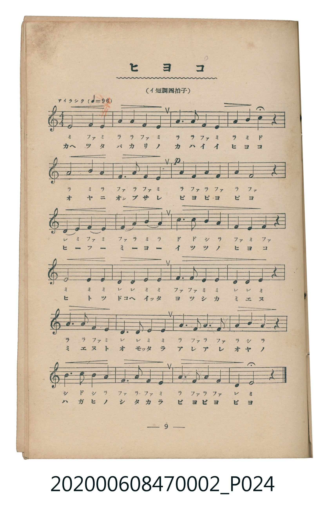
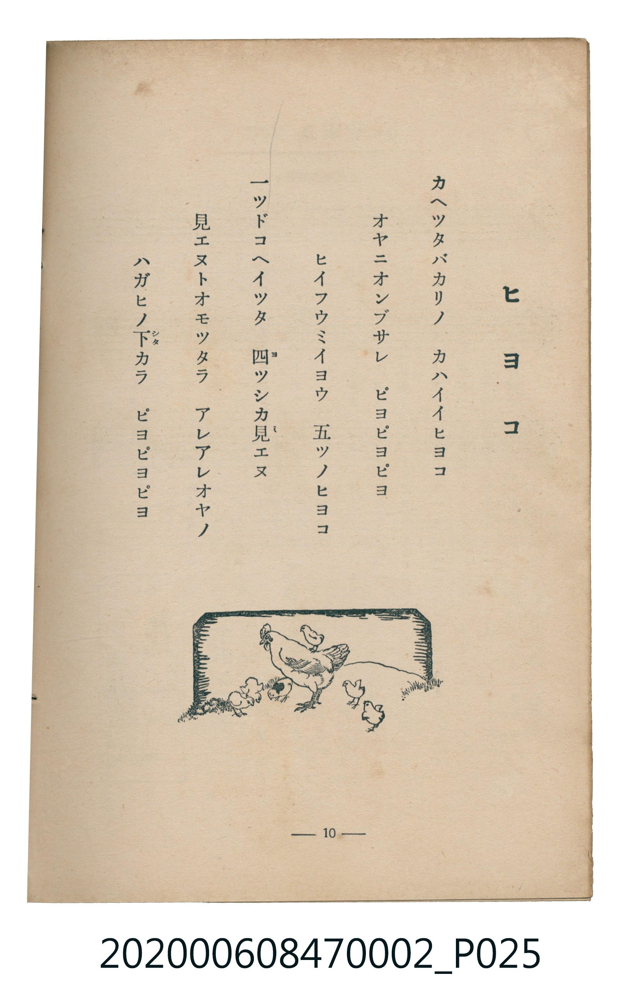

# ヒヨコ（小雞）

> Re:Shōka 使用 AI 協助辨識與重建樂譜，可能會有錯誤。歡迎回報。

- **NEUTRINO 歌聲合成版**：<br><audio controls src="hiyoko_neutrino.mp3"></audio>
- **鋼琴伴奏版**：<br><audio controls src="hiyoko.mp3"></audio>


- 臺灣教育會公認《新定兒童唱歌》尋常科第二學年用（2020.006.0847.0002）

## 說明

曲目說明
中文解釋：描寫小雞的叫聲、動作與可愛模樣。

原書資訊與歌詞全文（對應 P024.jpg – P025.jpg，書頁 pp. 9–10，第一學期第 7 首）：
調性與拍號：イ短調四拍子（A 小調 4/4 拍），「アイラシク（♩＝96）」
註：原譜第 4、5、10 小節第三線 B4 音符下方排印作「ミ」，對照五線譜音高與第 11、20、21 小節應為「シ」（7）。


## 跨冊／重複收錄參照

> 同曲＋同名異曲（《公學校唱歌》與《新定兒童唱歌》第一學年〈ヒヨコ〉為同曲；《新定兒童唱歌》第二學年與《唱歌帖》P070b 為同名異曲）

- **[同名異曲]** 《公學校唱歌》第一學年用（昭和10年／1935）：[**〈ヒヨコ（小雞）〉**](../../../kogakko_shoka/grade_1/5_hiyoko/index.md)（`F` / `4/4` — [原始 TMD](../../../kogakko_shoka/grade_1/5_hiyoko/hiyoko.tmd)）
- **[同名異曲]** 《新定兒童唱歌》尋常科第一學年用（2020.006.0847.0001）：[**〈ヒヨコ（小雞）〉**](../../grade_1_2020.006.0847.0001/1_03_hiyoko/index.md)（`F` / `4/4` — [原始 TMD](../../grade_1_2020.006.0847.0001/1_03_hiyoko/hiyoko.tmd)）
- **[同名異曲]** 楊金土手抄《唱歌帖》第 2 冊・II（2020.006.0843）：[**〈ヒヨコ〉**](../../../shokacho/vol_02/p070b_hiyoko/index.md)（`B,` / `2/4` — [原始 TMD](../../../shokacho/vol_02/p070b_hiyoko/hiyoko.tmd)）
- 總表：[跨冊重複與同名歌曲總索引](../../../duplicate_songs.md)

## 歌詞

```text
カヘツタバカリノ　カハイイヒヨコ
オヤニオンブサレ　ピヨピヨピヨ
ヒイフウミイヨウ　五ツノヒヨコ
一ツドコヘイツタ　四（ヨ）ツシカ見（ミ）エヌ
見エヌトオモツタラ　アレアレオヤノ
ハガヒノ下（シタ）カラ　ピヨピヨピヨ
```

## ABC

```abc
X:1
T:ヒヨコ（小雞）
M:4/4
L:1/16
Q:1/4=96
K:Am
V:V1 name="Piano" snm="Pia"
[V:V1]
E8 F4 E4 | A4 A4 F4 E4 | A6 A2 F4 E4 | A4 B4 c4 z4 |
w: カヘ ツ タ | バ カ リ ノ | カ ハ イ イ | ヒ ヨ コ
A8 B4 A4 | F6 A2 F4 E4 | !p! A4 F4 A4 F4 | A4 F8 z4 |
w: オ ヤ ニ | オン ブ サ レ | ピ ヨ ピ ヨ | ピ ヨ
D4 E4 F4 E4 | F4 A4 B4 A4 | c6 c2 B4 A4 | F4 E4 F4 z4 |
w: ヒ _ フ _ | ミ _ ヨ _ | イ ツ ツ ノ | ヒ ヨ コ
E8 E4 E4 | D4 D4 E4 E4 | F6 F2 E4 E4 | D4 D4 E4 z4 |
w: ヒ ト ツ | ドコ ヘ イッ タ | ヨ ツ シ カ | ミ エ ヌ
A6 A2 F4 E4 | D6 D2 E4 E4 | A6 F2 A6 F2 | A4 B4 A4 z4 |
w: ミ エ ヌ ト | オ モッ タ ラ | ア レ ア レ | オ ヤ ノ
B6 c2 B4 A4 | F6 A2 F4 E4 | A6 F2 A4 F4 | D4 E8 z4 |
w: ハ ガ ヒ ノ | シ タ カ ラ | ピ ヨ ピ ヨ | ピ ヨ
```

## TMD 檔案連結

- [主旋律 TMD 檔案](hiyoko.tmd) [[在 TMD Studio 編輯](https://tmdlang.github.io/Tmd-TS/#tmd=s7IKdvYPcrWy4qpTUCpJTLdSSM7PyUlNLsnMz7MqzsjMK0nNjM_KTMmPL87Iz05Ugisry88pzU21Si9KTEmNN4o3MjAyiDcwMIs3sDAxBzIMjBBKi_NLi5JTrYqTM_Lzc-JLUitKkvLzsxHyBUX5Zal5iXlANQVFIBtTwIoQClLLMlNSQdKpKZkl-UWZiTlI7kgtKga7FWxJfElRYl5xclFmAcgDCFUlGalAxybmZeaC9GppKTxunvS4ecXjps3v93Q83dD_cva893s6FbS0uBRtFSzNuOxtFZy5slMrbRUcc7lsTPRN7EBGvWjf9bxx8bOpM180bXo2p_lp65oXq3ofN3Q9m7bh6bpZT1snPV-99OmUjc_W9jxu6H66ofvpjh3Pl098vmbNk109T9fueLpzy_MpK4AWggJLDxhYeqDAAjIMjICWK3Hpayk8m73p-ex1L1atejajj0tBQeHJjrXPprW_WL74ZXv3-z2znvX3P12_GuLe57NanvavftG46XFD49PuqU_2znnR0f60f_2zltnPVix8tmLx44YmLi19LpCxttQCIDc97Zv_bPaOF5vbX6zoAloJ9O2LlfOetq4AOhQcmL3P2jsVAgyMTPSyCtIVHjVMBnFMQZz3e3qAOl8uaFQoKNBTsARKGRoAxUABtKMBGEDP5swHshXMFV4umwYMEaCHQfa9WLX_WcNykE3dvS9mzgeKPm5a8nz-WqD409mzgYJP104AWuyoAAwXoJgCMLYUgKJgA4AR0fO4aRFQw-PmlY-btj9uWg9U-mjmyvd75lqaAZU8bugF27FiN9BcoM9erJ0DcoIJMFBNgdjQAGTq8_UNYDd2Pt8-S8HJROHl_M3P1yx7sqP72bSdz_omPe3dAAx9kE3N84HmAW0FBsLz1uVPdk0BagCaCFT_cvUMoA9ARhsaAs01MgARhlDDgQH2vGkX2KnbwQZ0mIOd1sQFctvjptWPm2c8bm553LT_cfMEMHfV4-a-xw0NYHY_yHcgD0JTNEQPUAVQqBvM2Py4edrjpq2Pm9eA9DRPAalDIsEagLpBZkx93LQM5A0QG2jYMqAGoDdAlgMtRLYBGGNg0U4gH-Q8kAawCxsagLEC9AJQKcgTIEFgsK9-sQyYgIGCwPgDagHa3AMO92VAF4I4j5s7wE5dBPPnSrD3gNw1MBLiI3C2AHt6Ddg9fcBoABkMsmQ_2GxgkIA1Y_Un5VkAChRAWcsjszI_O98qIDMxL9-hxqCmGmSFgo2Flh2YgS3nKUBS-4uFPQoaJtD414FnF00sGoAWQQ17Oavv6YReK6D354NEwAEBjLCFUIEaIL0SLAghsUhBJLHratoOlu6EGo2wFpLDgdaCEyLUlBawlv1QAyZA0ilYZhWY7IPIgMXAEQZkLwGrApEgPZPA4ivAYptRLa1RMFbQBUMTIAaxaxTMgCQIo4qAxFBFzIHYMA5IGICEwMb5gB0CcjvEUJDrgSTQ9SBNINeDeKvBMqvAZB9EBiwG4kNcD1IFIiGuB4mvAIttBpLxYNvwR_uuHgqjHRKFiLgC8UGOAUcnvriFCSJx0OTgAFu8g6IUEo3gKGzuhkYuqGwBC0wDcraCWWug1k5BxC4SG1UG3U5YlEIiEcSuAUcuaiRXF9TCEwKMhuiEqMWIeVCUQqIRHIVA10MiF-x6iATE_SDWGmj8TkHELxIbVQYEiYn3HZ0UxjsoUCExihG9yBGLliogORlEY00vKAbiiHloJt0DUQhng8yAaIbIQKIZKgPO4JAiAlpMwAoD_FneCBrDiJiGxTAiNYAzNjh_o6YQmD7UmAdnUkgET4WyIC6HicIiEeJqWNEALR5ghQA5WR1YBVKthIcENCy-IUkBOUGgpAS0FIJbH74Ih9jbAY1EaGIC-R1S_IPr-mak0h-Sl2F1Ajipgct9eDJpgiSQHvQoh5XyIBoS5aBEAEsIiEQAilzsanBGeAc0MiFRCHY9SABUBUDdj1wDQBICOPKB7ofVBrDEAnI_SLaHuMgHNpioUs5jLc5BMQiJSfQYhmlCKhEwC3ukggBXCoCkDpCfITEGSQmQghRiJLA9Bol-eInStAjuLJBWZB5MI6zuAJUFKIkAsxoHRS4oihFRDlFjAqcRVT2IRksEkPwN8wAsMSBqAiQPgDgroZKLoJLAkEViw7TBKg9QoUBMAdC6lrI0AI4oPKU3ntoed32Pmv1xpoB-aAoApTFIkQ1rzUEdBYp6aGsP5ihQrU5OjQ-KQywFOma7Dhb9kOoelv8xq3ug6yHRD3E9cmsOlLMhuR7W2oPGPbhOhxTyxNT2tVxcunYKkMa_ApClzAUA)]
- [鋼琴伴奏 TMD 檔案](hiyoko_piano.tmd) [[在 TMD Studio 編輯](https://tmdlang.github.io/Tmd-TS/#tmd=s7IKdvYPcrWy4tLSUnjcPOlx84rHTZvf7-l42b3n-YQtT_Zsebq0_3lnx_s9nQpaWlyKtgqWZlz2tgrOXNmplbYKjrlcNib6JnZcdQpKL9p3PW9c_GzqzBdNm57NaX7auubFqt7HDV3Ppm14um7W09ZJz1cvfTpl47O1PY8bup9u6H66Y8fz5ROfr1nzZFfP07U7nu7c8nzKCqDNRgZGBnoGBmZ6BhYm5kCGgRHQciUuLo_MyvzsfKuAzMS8_CAPhxqDmmouBSCwsdCyAzP0tRRs0YECyPwdDS8W9ihomCg83dD_fH2DjkKAgZGJXlZBuiYWDVr6YMNqFIwVdMHQBIhB7BoFMyAJwqgiIDFUEXMgNowDEgYgIbBxPjUKj5tWP26eATX0cXMLiGzaD9b0uHkCmLcaLLMKTPZBZMBiIH4_kL0ErApEgvRMAouvAIttBpLxYNvwB8WuHnKCAuJNiMdA7Bqwh1E9Xl1QCw8cGA3RCVGLERogb0K8BvZWczfUw6seN4N8AxKaBuRuBbPWQP08BeFnJDaqDAgSExY7OskJCyOojxE-h_kYETrgyAenAdQQg-lDDQlwREI8PBXKAonOh4vCPAUKHVBYQZIPNAnBEgo5yeHp7NmU5AwQDQkCUKDAAgYRKCDPYleDMwA6oJ6DeKkT4hNItgH6_XFzM5gByzWQgAEHRtN2sAwot8AC73ETJJ30EBcYT3ZNIT9vIOcEkCdBXkV4HaLGBE4jigkQjRYYkHgHOR7idEigIHLM4-ZFoHCAhMLj5pVQyUVQyTUobJg2WCYDJRZiEkbrWnLCAuQjLMkes4SEBQakkIClCsxCAljqQQID6CtoAoeVi6D4hqQFWLkJDQlwSQDJCsSUEbWoNYsPcs1igqhZnu1a_Wz-FGBovFi1_-n2Zc86uyF1I1JCiI9XiDaLz41FYiGLGoNYxuiiJiCWSTyqIIhlAA0GXAbDNSKbCyqE4RJIRqOIIUw2AooaoTkNrhS7L7A6AdVUhGnI5uK1C5dCbIGA5C28ZhIRsgh9BEMWm7Eg6-G6QaYC05KunQIkOSkAWcpcAA)]

## 分析

```text
================================================================================
📊 TMD Song Profile: [ ヒヨコ（小雞） ]
================================================================================
⏱  Duration:       1:00 (60.0s), 24 measures total
🎼 Key & Tempo:    首調基準 C, != 96.0 BPM, <4/4>
   - 分析範圍：      由實際發聲的音符與和弦推測調性；播放脈絡另行呈現
🎤 人聲音域:    D4 (MIDI 62) – C5 (MIDI 72) [跨度: 10 個半音 / 0.8 個八度, 難度: easy]
   - 最低音:  D4 in [Hiyoko #1 @ m.9, 0:20]
   - 最高音: C5 in [Hiyoko #1 @ m.4, 0:08]
   - 適合: soprano, mezzo-soprano, contralto, tenor, baritone, bass
🏛  結構:      Hiyoko (60.0s)
⚡ 編曲密度:        Peak 1 軌道同時演奏
🗝  調性診斷：       A 小調（純淨自然小調，未偵測到可信轉調）
   - 風格氣質:    純淨自然小調（陰鬱抒情、旋律集中，無明顯調外色彩）
   - 轉調歷程:    全曲維持單一推測調性（未偵測到可信轉調）
   - 核心骨幹音:  A, E, F, D, B
   - 調性數值:    A 小調 [相關度: 0.74, 穩定度: Moderate, 自然音純度: 100.0%]
   - 候選調性 (K-S): A 小調 (0.74), A 大調 (0.62), D 小調 (0.52)
   - 五度圈歷程:   +3
   - 各段落調性細節:
     • [Hiyoko #1]: A 小調 (r: 0.74, 自然音純度: 100.0%)

  [ 五度圈游移軌跡 ]
               C  
         F            G  
      Bb               D  
      Eb              [A ]*
         Ab           E  
            Db       B  
               F# 
     (* = active key center)

  [ 十二半音累積音高分佈 ]
     C  : ███                        3.9%
     C# :                            0.0%
     D  : ████████                   8.9%
     D# :                            0.0%
     E  : ███████████████████████   26.7%
     F  : ████████████████████      23.9%
     F# :                            0.0%
     G  :                            0.0%
     G# :                            0.0%
     A  : ████████████████████████  28.3%
     A# :                            0.0%
     B  : ███████                    8.3%
--------------------------------------------------------------------------------
Assignment 軌道音域：
  - Piano         : D4 – C5 (10 個半音 / 0.8 個八度, 85 個音符)
================================================================================
```


## 原書掃描頁






