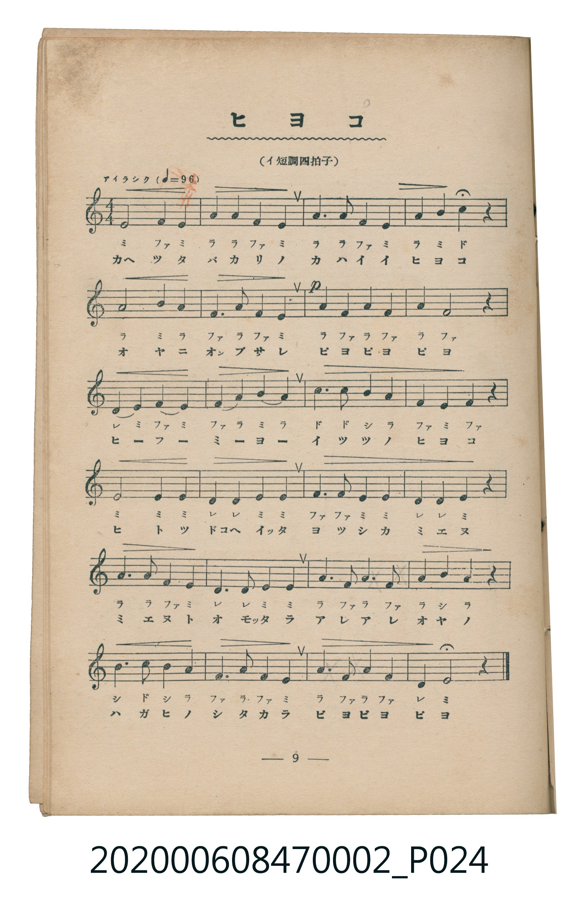
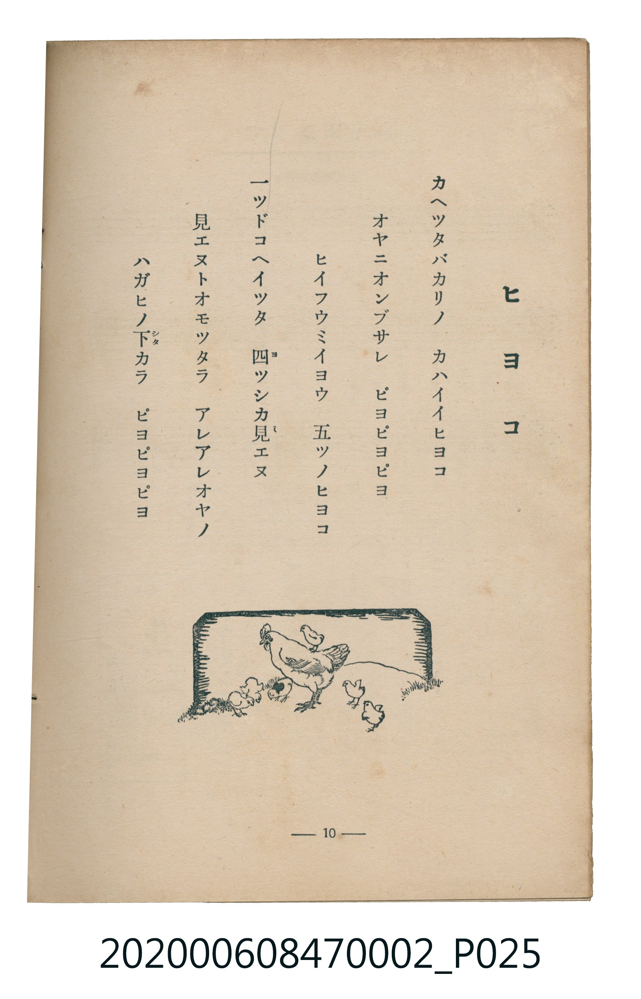

# ヒヨコ

<audio controls src="hiyoko.mp3"></audio>

- 臺灣教育會公認《新定兒童唱歌》尋常科第二學年用（2020.006.0847.0002）

## 說明

原書資訊與歌詞全文（對應 P024.jpg – P025.jpg，書頁 pp. 9–10，第一學期第 7 首）：
調性與拍號：イ短調四拍子（A 小調 4/4 拍），「アイラシク（♩＝96）」
註：原譜第 4、5、10 小節第三線 B4 音符下方排印作「ミ」，對照五線譜音高與第 11、20、21 小節應為「シ」（7）。

## 歌詞

```text
カヘツタバカリノ　カハイイヒヨコ
オヤニオンブサレ　ピヨピヨピヨ
ヒイフウミイヨウ　五ツノヒヨコ
一ツドコヘイツタ　四（ヨ）ツシカ見（ミ）エヌ
見エヌトオモツタラ　アレアレオヤノ
ハガヒノ下（シタ）カラ　ピヨピヨピヨ
```

## ABC

```abc
X:1
T:ヒヨコ
C:TMD (Chen, Chih-Han / aguai)
M:4/4
L:1/16
Q:1/4=96
K:Am
V:V1 name="Piano" snm="Pia"
[V:V1]
E8 F4 E4 | A4 A4 F4 E4 | A6 A2 F4 E4 | A4 B4 c4 z4 |
A8 B4 A4 | F6 A2 F4 E4 | !p! A4 F4 A4 F4 | A4 F8 z4 |
D4 E4 F4 E4 | F4 A4 B4 A4 | c6 c2 B4 A4 | F4 E4 F4 z4 |
E8 E4 E4 | D4 D4 E4 E4 | F6 F2 E4 E4 | D4 D4 E4 z4 |
A6 A2 F4 E4 | D6 D2 E4 E4 | A6 F2 A6 F2 | A4 B4 A4 z4 |
B6 c2 B4 A4 | F6 A2 F4 E4 | A6 F2 A4 F4 | D4 E8 z4 |
```

## TMD 檔案連結

- [主旋律 TMD 檔案](hiyoko.tmd) [[在 TMD Studio 編輯](https://tmdlang.github.io/Tmd-TS/#tmd=s7IKdvYPcrWy4tLSUnjcPOlx84rHTZsVtLS4FG0VLM247G0VnLmyUyttFRxzuWxM9E3suOoUlF6073reuPjZ1JkvmjY9m9P8tHXNi1W9jxu6nk3b8HTdrKetk56vXvp0ysZna3seN3Q_3dD9dMeO58snPl-z5smunqdrdzzdueX5lBXv93QYGRgZ6BkYmOkZWJiYAxkGRu_3dCpxcelrKdhSC3ApKCg87Zv_bPaOF5vbX6zoetHRDnTXi5XznraueDatHeiKpxt6n7V3KgQYGJnoZRWkKzxqmAzimII47_f0AHW-XNCoUFCgp2AJlDI0AIqBvLKjAeiVZ3PmA9kK5govl00Duv39nlkg-16s2v-sYTnIpu7eFzPnA0UfNy15Pn8tUPzp7NlAwadrJwAtdlR4uqEfKKYADFcFoCjYAGCQ9TxuWgTU8Lh55eOm7Y-b1gOVPpq58v2euZZmQCWPG3rBdqzYDTQX6LMXa-eAnGDyuKHRFIgNDUCmPl_fAHZj5_PtsxScTBRezt_8fM2yJzu6n03b-axv0tPeDU_2zgHZ1DwfaB7QVmAgPG9d_mTXFKAGoIlA9S9XzwD6AGS0oSHQXCMDEGEINRwYYM-bdoGduh1sQIc52GlNXCC3PW5a_bh5xuPmlsdN-x83TwBzVz1u7nvc0ABm94N8B_IgNL1B9ABVAIW6wYzNj5unPW7a-rh5DUhP8xSQOiQSrAGoG2TG1MdNy0DeALGBhi0DagB6A2Q50EJkG4AxBhbtBPJBzgNpALuwoQEYK0AvAJWCPAESBAb76hfLusGCwPgDagHa3AMO92VAF4I4j5s7wE5dBPPnSrD3gNw1MBLioz6Ia4GeXgN2Tx8wGkAGgyzZDzYbGCRgzVj9SXkWgAIFLX0uLo_MyvzsfKuAzMS8fIcagxqFapAdCjYWWnZgBraspwBJ7i8W9ihomEATgA48v2hi0QC0CWrYy1l9Tyf0WgH9Px8kAg4JYIwthArUAOmVYEEIiUUKIoldV9N2sHQn1GiEtZAsDrQWnBKhprSAteyHGjABklDBMqvAZB9EBiwGjjEgewlYFYgE6ZkEFl8BFtuMammNgrGCLhiaADGIXaNgBiRBGFUEJIYqYg7EhnFAwgAkBM5CuCNiVw-FEQEJVETogfggz4EDGF9owwSROGhycIAtJkCBDAlYcKA2d0ODG5TdwQLTgJytYNYaqLVTEOGNxEaVQbcTFsiQYAWxa8DBjRrs1QW18KiB0RCdELXExcWOTgrjAuRRSChjBDlyYKPFFCS9g2iscYhiII7YgCblPRCFcDbIDIhmiAwk6KEy4GwAyUjQzATLMvgzhhE01BGhDwt1RAyBkz84F6DGGkwfEbEBLMSpVkRBwgAWFZBYQo4rlEhCizzc-vDFBcTeDmj4QuMZFJiQ8gtcWzUjFV-QpA8r1MCpAFxwwWOwCRJ3PeixASumQDQkNkDxA4sjRPyAwh27GqJKqSlUKaWwFkagAIUELHqAwzQh5R3Mogopy-CKEEhkgYIQEoCQiAEXVlAjgRU8JDbgea9pEdxZIK3IPJhGWMkHyjUocYJZLYDCGhTiiBiAqDGB04iqA0QTkz9a11IWJ-CAw1Pu4Kk7cNceqLkDZ4z0Q2MEFOeQwgZWW0MdBYoKaG0OcxSojiCn_gCFKZaiCLPehkUHpPKAZQ9E5VHLxaVrpwBpcikAWcpcXAA)]
- [鋼琴伴奏 TMD 檔案](hiyoko_piano.tmd) [[在 TMD Studio 編輯](https://tmdlang.github.io/Tmd-TS/#tmd=s7IKdvYPcrWy4tLSUnjcPOlx84rHTZvf7-l42b3n-YQtT_Zsebq0_3lnx_s9nQpaWlyKtgqWZlz2tgrOXNmplbYKjrlcNib6JnZcdQpKL9p3PW9c_GzqzBdNm57NaX7auubFqt7HDV3Ppm14um7W09ZJz1cvfTpl47O1PY8bup9u6H66Y8fz5ROfr1nzZFfP07U7nu7c8nzKCqDNRgZGBnoGBmZ6BhYm5kCGgRHQciUuLo_MyvzsfKuAzMS8_CAPhxqDGoVqLgUgsLHQsgMz9LUUbNGBAsiCHQ0vFvYoaJgoPN3Q_3x9g45CgIGRiV5WQbomFg1a-mDDahSMFXTB0ASIQewaBTMgCcKoIiAxVBFzIDaMAxIGICEu_I7b1UOO4yAWQ6wCsWvATkB1SnVBLdy5MBqiE6KWOPft6CTHfUZQVyBcA3MFwsXgIAKHFKovYPqIcN3T2bMpiVoQDXEdyL0wNyPcC3IHdjVExewU8mMWOR5BdoJsRrgEosYETiOSHYgmJtxa15LjNpANWCIMMwfAHAdJcrBAQyS5WtT87IOSn00Q-fnZrtXP5k8BuvHFqv1Pty971tkNKZKQgis-XiHaLD43FomFLGoMYhmji5qAWCbxqIIglgHQcfgMhmtENheU0eASSEajiCFMNgKKGqE5Da4Uuy-wOgHVVIRpyObitQuXQmyBgOQtvGYSEbIIfQRDFpuxIOvhukGmAhOTrp0CJD0pAFnKXFwA)]

## 分析

```text
================================================================================
📊 TMD Song Profile: [ ヒヨコ ]
================================================================================
⏱  Duration:       1:00 (60.0s), 24 measures total
🎼 Key & Tempo:    首調基準 C, != 96.0 BPM, <4/4>
   - 分析範圍：      由實際發聲的音符與和弦推測調性；播放脈絡另行呈現
🎤 人聲音域:    D4 (MIDI 62) – C5 (MIDI 72) [跨度: 10 個半音 / 0.8 個八度, 難度: easy]
   - 最低音:  D4 in [Hiyoko #1 @ m.9, 0:20]
   - 最高音: C5 in [Hiyoko #1 @ m.4, 0:08]
   - 適合: soprano, mezzo-soprano, contralto, tenor, baritone, bass
🏛  結構:      Hiyoko (60.0s)
⚡ 編曲密度:        Peak 1 軌道同時演奏
🗝  調性診斷：       A 小調（純淨自然小調，未偵測到可信轉調）
   - 風格氣質:    純淨自然小調（陰鬱抒情、旋律集中，無明顯調外色彩）
   - 轉調歷程:    全曲維持單一推測調性（未偵測到可信轉調）
   - 核心骨幹音:  A, E, F, D, B
   - 調性數值:    A 小調 [相關度: 0.74, 穩定度: Moderate, 自然音純度: 100.0%]
   - 候選調性 (K-S): A 小調 (0.74), A 大調 (0.62), D 小調 (0.52)
   - 五度圈歷程:   +3
   - 各段落調性細節:
     • [Hiyoko #1]: A 小調 (r: 0.74, 自然音純度: 100.0%)

  [ 五度圈游移軌跡 ]
               C  
         F            G  
      Bb               D  
      Eb              [A ]*
         Ab           E  
            Db       B  
               F# 
     (* = active key center)

  [ 十二半音累積音高分佈 ]
     C  : ███                        3.9%
     C# :                            0.0%
     D  : ████████                   8.9%
     D# :                            0.0%
     E  : ███████████████████████   26.7%
     F  : ████████████████████      23.9%
     F# :                            0.0%
     G  :                            0.0%
     G# :                            0.0%
     A  : ████████████████████████  28.3%
     A# :                            0.0%
     B  : ███████                    8.3%
--------------------------------------------------------------------------------
Assignment 軌道音域：
  - Piano         : D4 – C5 (10 個半音 / 0.8 個八度, 85 個音符)
================================================================================
```


## 原書掃描頁






