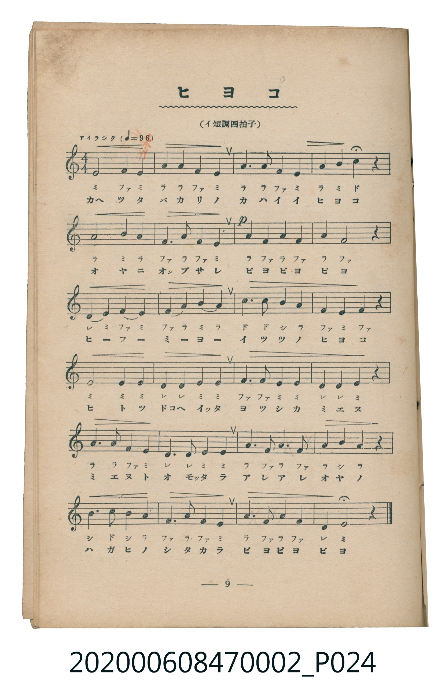
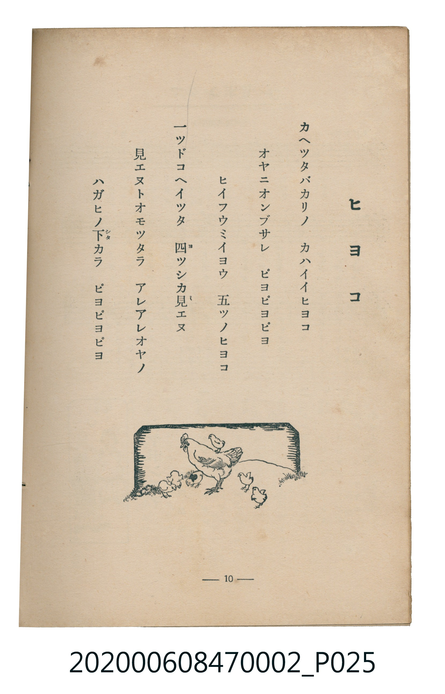

# ヒヨコ（小雞）

> Re:Shōka 使用 AI 協助辨識與重建樂譜，可能會有錯誤。歡迎回報。

- **鋼琴伴奏版**：<br><audio controls src="hiyoko.mp3"></audio>
- **NEUTRINO 歌聲合成版**：<br><audio controls src="hiyoko_neutrino.mp3"></audio>

- 臺灣教育會公認《新定兒童唱歌》尋常科第二學年用（2020.006.0847.0002）

## 說明

曲目說明
中文解釋：描寫小雞的叫聲、動作與可愛模樣。

原書資訊與歌詞全文（對應 P024.jpg – P025.jpg，書頁 pp. 9–10，第一學期第 7 首）：
調性與拍號：イ短調四拍子（A 小調 4/4 拍），「アイラシク（♩＝96）」
註：原譜第 4、5、10 小節第三線 B4 音符下方排印作「ミ」，對照五線譜音高與第 11、20、21 小節應為「シ」（7）。


## 歌詞

```text
カヘツタバカリノ　カハイイヒヨコ
オヤニオンブサレ　ピヨピヨピヨ
ヒイフウミイヨウ　五ツノヒヨコ
一ツドコヘイツタ　四（ヨ）ツシカ見（ミ）エヌ
見エヌトオモツタラ　アレアレオヤノ
ハガヒノ下（シタ）カラ　ピヨピヨピヨ
```

## ABC

<div class="abc-score" data-abc-src="hiyoko.abc" aria-label="五線譜載入中"></div>

[下載 ABC 原始檔](hiyoko.abc)

## TMD 檔案連結

- [主旋律 TMD 檔案](hiyoko.tmd) [[在 TMD Studio 編輯](https://tmdlang.github.io/Tmd-TS/#tmd=s7IKdvYPcrWy4qpTUCpJTLdSSM7PyUlNLsnMz7MqzsjMK0nNjM_KTMmPL87Iz05Ugisry88pzU21Si9KTEmNN4o3MjAyiDcwMIs3sDAxBzIMjBBKi_NLi5JTrYqTM_Lzc-JLUitKkvLzsxHyBUX5Zal5iXlANQVFIBtTwIoQClLLMlNSQdKpKZkl-UWZiTlI7kgtKga7FWxJfElRYl5xclFmAcgDCFUlGalAxybmZeYi6wUalZ6ZZ5Wbn5dUCvQeskRJRj7QawUZlVYZmcUgO5MTc-KzE_OQQgBqY0FieqpVgIGRiS6QMFXi0tJSeNw86XHzisdNm9_v6Xi6of_l7Hnv93QqaGlxKdoqWJpx2dsqOHNlp1baKjjmctmY6JvYgcx80b7reePiZ1Nnvmja9GxO89PWNS9W9T5u6Ho2bcPTdbOetk56vnrp0ykbn63tedzQ_XRD99MdO54vn_h8zZonu3qert3xdOeW51NWAC0ExYQeMCb0QDEBZBgYAS1X4tLXUng2e9Pz2eterFr1bEYfl4KCwpMda59Na3-xfPHL9u73e2Y96-9_un41xL3PZ7U87V_9onHT44bGp91Tn-yd86Kj_Wn_-mcts5-tWPhsxeLHDU1cWvpcIGNtqQVAbnraN__Z7B0vNre_WNEFtBLo2xcr5z1tXQF0KDgwe5-1dyqAQlsvqyBd4VHDZBDHFMR5v6cHqPPlgkaFggI9BUuglKEBUAwUQDsagAH0bM58IFvBXOHlsmnAEAF6GGTfi1X7nzUsB9nU3fti5nyg6OOmJc_nrwWKP509Gyj4dO0EoMWOCsBwAYopAGNLASgKNgAYET2PmxYBNTxuXvm4afvjpvVApY9mrny_Z66lGVDJ44ZesB0rdgPNBfrsxdo5ICeYAAPVFIgNDUCmPl_fAHZj5_PtsxScTBRezt_8fM2yJzu6n03b-axv0tPeDcDQB9nUPB9oHtBWYCA8b13-ZNcUoAagiUD1L1fPAPoAZLShIdBcIwMQYQg1HBhgz5t2gZ26HWxAhznYaU1cILc9blr9uHnG4-aWx037HzdPAHNXPW7ue9zQAGb3g3wH8iA0RUP0AFUAhbrBjM2Pm6c9btr6uHkNSE_zFJA6JBKsAagbZMbUx03LQN4AsYGGLQNqAHoDZDnQQmQbgDEGFu0E8kHOA2kAu7ChARgrQC8AlYI8ARIEBvvqF8uACRgoCIw_oBagzT3gcF8GdCGI87i5A-zURTB_rgR7D8hdAyMhPgJnC7Cn14Dd0weMBpDBIEv2g80GBglYM1Z_Up4FoEABlLU8Mivzs_OtAjIT8_IdagxqqkFWKNhYaNmBGdhyngIktb9Y2KOgYQKNfx14dtHEogFoEdSwl7P6nk7otQJ6fz5IBBwQwAhbCBWoAdIrwYIQEosURBK7rqbtYOlOqNEIayE5HGgtOCFCTWkBa9kPNWACJJ2CZVaByT6IDFgMHGFA9hKwKhAJ0jMJLL4CLLYZ1dIaBWMFXTA0AWIQu0bBDEiCMKoISAxVxByIDeOAhAFICGycD9ghILdDDAW5HkgCXQ_SBHI9iLcaLLMKTPZBZMBiID7E9SBVIBLiepD4CrDYZiAZD7YNf7Tv6qEw2iFRiIgrEB_kGHB04otbmCASB00ODrDFOyhKIdEIjsLmbmjkgsoWsMA0IGcrmLUGau0UROwisVFl0O2ERSkkEkHsGnDkokZydUEtPCHAaIhOiFqMmAdFKSQawVEIdD0kcsGuh0hA3A9irYHG7xRE_CKxUWVAkJh439FJYbyDAhUSoxjRixyxaKkCkpNBNNb0gmIgjpiHZtI9EIVwNsgMiGaIDCSaoTLgDA4pIqDFBKwwwJ_ljaAxjIhpWAwjUgM4Y4PzN2oKgelDjXlwJoVE8FQoC-JymCgsEiGuhhUN0OIBVgiQk9WBVSDVSnhIQMPiG5IUkBMESkpASyG49eGLcIi9HdBIhCYmkN8hxT-4rm9GKv0heRlWJ4CTGrjchyeTJkgC6UGPclgpD6IhUQ5KBLCEgEgEoMjFrgZnhHdAIxMShWDXgwRAVQDU_cg1ACQhgCMf6H5YbQBLLCD3g2R7iIt8YIOJKuU81uIcFIOQmESPYZgmpBIBs7BHKghwpQBI6gD5GRJjkJQAKUghRgLbY5Doh5coTYvgzgJpRebBNMLqDlBZgJIIMKtxUOSCohgR5RA1JnAaUdWDaLREAMnfMA_AEgOiJkDyAIizEiq5CCoJDFkkNkwbrPIAFQrEFACtaylLA-CIwlN646ntcdf3qNkfZwroh6YAUBqDFNmw1hzUUaCoh7b2YI4C1erk1PigOMRSoGO262DRD6nuYfkfs7oHuh4S_RDXI7fmQDkbkuthrT1o3IPrdEghT0xtX8vFpWunAGn8KwBZylwA)]
- [鋼琴伴奏 TMD 檔案](hiyoko_piano.tmd) [[在 TMD Studio 編輯](https://tmdlang.github.io/Tmd-TS/#tmd=s7IKdvYPcrWy4qpTUCpJTLdSyC8qychPL0osyKi0ysgsLskvykxOzInPTsxLVIIrKs4vLUpOjS9ITE-1CjAwMtEFEqZKXFpaCo-bJz1uXvG4afP7PR0vu_c8n7DlyZ4tT5f2P-_seL-nU0FLi0vRVsHSjMveVsGZKzu10lbBMZfLxkTfxA5k-Iv2Xc8bFz-bOvNF06Znc5qftq55sar3cUPXs2kbnq6b9bR10vPVS59O2fhsbc_jhu6nG7qf7tjxfPnE52vWPNnV83Ttjqc7tzyfsgJos5GBkYGegYGZnoGFiTmQYWAEtFyJi8sjszI_O98qIDMxLz_Iw6HGoKaaSwEIbCy07MAMfS0FW3SgADJ_R8OLhT0KGiYKTzf0P1_foKMA8rZeVkG6JhYNWvpgw2oUjBV0wdAEiEHsGgUzIAnCqCIgMVQRcyA2jAMSBiAhsHE-NQqPm1Y_bp4BNfRxcwuIbNoP1vS4eQKYtxosswpM9kFkwGIgfj-QvQSsCkSC9EwCi68Ai20GkvFg2_AHxa4ecoIC4k2Ix0DsGrCHUT1eXVALDxwYDdEJUYsRGiBvQrwG9lZzN9TDqx43g3wDEpoG5G4Fs9ZA_TwF4WckNqoMCBITFjs6yQkLI6iPET6H-RgROuDIB6cB1BCD6UMNCXBEQjw8FcoCic6Hi8I8BQodUFhBkg80CcESCjnJ4ens2ZTkDBANCQJQoMACBhEoIM9iV4MzADqgnoN4qRPiE0i2Afr9cXMzmAHLNZCAAQdG03awDCi3wALvcRMknfQQFxhPdk0hP28g5wSQJ0FeRXgdosYETiOKCRCNFhiQeAc5HuJ0SKAgcszj5kWgcICEwuPmlVDJRVDJNShsmDZYJgMlFmISRutacsIC5CMsyR6zhIQFBqSQgKUKzEICWOpBAgPoK2gCh5WLoPiGpAVYuQkNCXBJAMkKxJQRtag1iw9yzWKCqFme7Vr9bP4UYGi8WLX_6fZlzzq7IXUjUkKIj1eINovPjUViIYsag1jG6KImIJZJPKogiGUADQZcBsM1IpsLKoThEkhGo4ghTDYCihqhOQ2uFLsvsDoB1VSEacjm4rULl0JsgYDkLbxmEhGyCH0EQxabsSDr4bpBpgLTkq6dAiQ5KQBZylwA)]

## 分析

```text
================================================================================
📊 TMD Song Profile: [ ヒヨコ（小雞） ]
================================================================================
⏱  Duration:       1:00 (60.0s), 24 measures total
🎼 Key & Tempo:    首調基準 C, != 96.0 BPM, <4/4>
   - 分析範圍：      由實際發聲的音符與和弦推測調性；播放脈絡另行呈現
🎤 人聲音域:    D4 (MIDI 62) – C5 (MIDI 72) [跨度: 10 個半音 / 0.8 個八度, 難度: easy]
   - 最低音:  D4 in [Hiyoko #1 @ m.9, 0:20]
   - 最高音: C5 in [Hiyoko #1 @ m.4, 0:08]
   - 適合: soprano, mezzo-soprano, contralto, tenor, baritone, bass
🏛  結構:      Hiyoko (60.0s)
⚡ 編曲密度:        Peak 1 軌道同時演奏
🗝  調性診斷：       A 小調（純淨自然小調，未偵測到可信轉調）
   - 風格氣質:    純淨自然小調（陰鬱抒情、旋律集中，無明顯調外色彩）
   - 轉調歷程:    全曲維持單一推測調性（未偵測到可信轉調）
   - 核心骨幹音:  A, E, F, D, B
   - 調性數值:    A 小調 [相關度: 0.74, 穩定度: Moderate, 自然音純度: 100.0%]
   - 候選調性 (K-S): A 小調 (0.74), A 大調 (0.62), D 小調 (0.52)
   - 五度圈歷程:   +3
   - 各段落調性細節:
     • [Hiyoko #1]: A 小調 (r: 0.74, 自然音純度: 100.0%)

  [ 五度圈游移軌跡 ]
               C  
         F            G  
      Bb               D  
      Eb              [A ]*
         Ab           E  
            Db       B  
               F# 
     (* = active key center)

  [ 十二半音累積音高分佈 ]
     C  : ███                        3.9%
     C# :                            0.0%
     D  : ████████                   8.9%
     D# :                            0.0%
     E  : ███████████████████████   26.7%
     F  : ████████████████████      23.9%
     F# :                            0.0%
     G  :                            0.0%
     G# :                            0.0%
     A  : ████████████████████████  28.3%
     A# :                            0.0%
     B  : ███████                    8.3%
--------------------------------------------------------------------------------
Assignment 軌道音域：
  - Piano         : D4 – C5 (10 個半音 / 0.8 個八度, 85 個音符)
================================================================================
```


## 原書掃描頁






