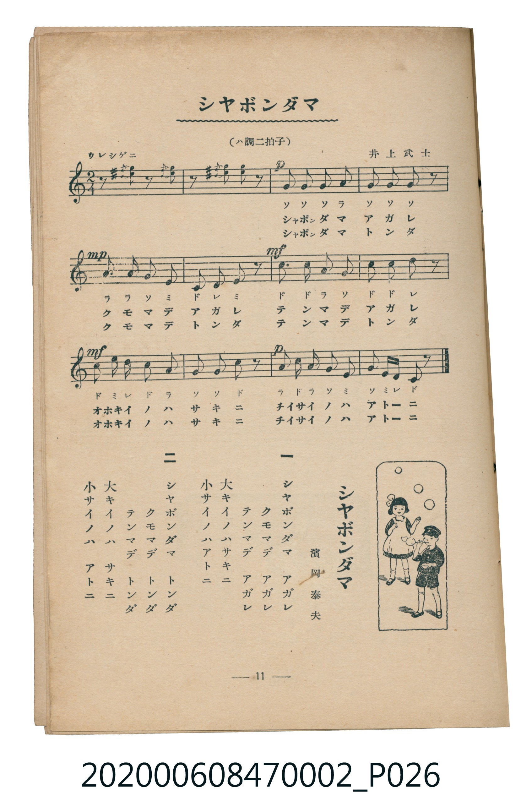

# シヤボンダマ（肥皂泡）

> Re:Shōka 使用 AI 協助辨識與重建樂譜，可能會有錯誤。歡迎[回報](https://github.com/TMDLang/reshoka/issues)。

- **鋼琴伴奏版**：<br><audio controls src="shabondama.mp3"></audio>
- **NEUTRINO 歌聲合成版**：<br><audio controls src="shabondama_neutrino.mp3"></audio>

- 詞：濱岡泰夫
- 曲：井上武士
- 臺灣教育會公認《新定兒童唱歌》尋常科第二學年用（2020.006.0847.0002）

## 說明

曲目說明
中文解釋：描寫孩子吹起肥皂泡，泡泡在陽光下飛舞、破裂。

原書資訊與歌詞全文（對應 P026.jpg，書頁 p. 11，第一學期第 8 首）：
調性與拍號：ハ調二拍子（C 大調 2/4 拍），「ウレシゲニ」


## 歌詞

```text
一
シヤボンダマ　アガレ
クモマデ　アガレ
テンマデ　アガレ
大キイノハサキニ
小サイノハアトニ

二
シヤボンダマ　トンダ
クモマデ　トンダ
テンマデ　トンダ
大キイノハ　サキニ
小サイノハ　アトニ
```

## ABC

<div class="abc-score" data-abc-src="shabondama.abc" aria-label="五線譜載入中"></div>

[下載 ABC 原始檔](shabondama.abc)

## TMD 檔案連結

- [主旋律 TMD 檔案](shabondama.tmd) [[在 TMD Studio 編輯](https://tmdlang.github.io/Tmd-TS/#tmd=s7IKdvYPcrWy4qpTUCpJTLdSSM7PyUlNLsnMz7MqzsjMK0nNjM_KTMmPL87Iz05Ugisry88pzU21Si9KTEmNN4o3MjAyiDcwMIs3sDAxBzIMjBBKi_NLi5JTrYqTM_Lzc-JLUitKkvLzsxHyBUX5Zal5iXlANQVFIBtTwIoQClLLMlNSQdKpKZkl-UWZiTlI7kgtKga7FWxJfElRYl5xclFmAcgDCFUlGalAx-YllpQWpSJEgUalZ-ZZlSRmAj0H8mB5YnxuYmZeTmJeCrKqkox8oD8LMiqtMjKLQQ5ITsyJz07MQwoOqPUFiempVgEGRmZKXFpaCo-btj9uXvK4ec7j5s2PmxseN897v6fjRdPS57Oanm1e-H5Pp4KWFpeirYKhgQWXva2CM5eNkb6JHcjMFyuBSmc927_x6aaFzzZveLpkNdiqZ7M3AYWf7Jr6ZEfXs7XLni6GCL9o3_W8cfGzqTNfNG16Nqf5aeuaF6t6Hzd0PZu24em6WU9bJz1fvfTplI3P1vY8buh-uqH76Y4dz5dPfL5mzZNdPU_X7ni6c8vzKSuATgNFoh4wEvVAkQhkGBgB3ajEpa-lALT4-ex1L1atejajj0tBQeHJjrXPprW_WL74ZXs3yKH9_U_Xr366duXTtROeTtj5Yut2JF_2AEkgejpnxcuZe5-2dj7Z0f1y8ewXHfMeNzQ-X7DlxeKmxw1NXFr6XCCLbKkFQK582jf_2ewdLza3v1jR9aKjHeh_YLg-bV0BdDrQt0839D5r71QAxZZeVkE6yKGzd7xc0KhQoKdgaAjkggJoRwMwgJ7NmQ9kK1govFw2DRgiQA-DTH-xav-zhuUgc7t7X8ycDxR93NwPFAQGKlAEGBJAO5wVni5ZDhRTAEasAlAUrBsYCz2Pm5Y9bl4DSiBNmx43dz9u6OWChGsDiMJMOI8bGh43LXrctAaoC6Ji_ePmRSCJ5nYMueY2sD5sckDnPG5a-7gJaHgf0LmPm7aCuM3dYLkNED5cDmh-B0gO7LJdPbhdBlIG4mJzGYocmsuQ5dBdBnI4HsdB_AVxH1Ca8gQDBQqghBickZiUn5eSmJtoFZCZmJfvUGNQUw2yRsHG0EzLDszCllgVIEnmxcIeBQ0TkJOfr2_QQU5hTyesftrZ-3Rpv4IRVFoTiylAJ0BteDmr7-mEXisFDYguTZAwDNTgEH3ctBccDUhk80ocMiCAsE0D6HZNK2TT4IZiEwOnhcVA00GJAUg1gK2aB5VbBLZkDVgMRKJbtauHWlY1d4B5m8EkSAbJqhoFAwVdBeM4IAFnIInBJWoUqgtqFUyBLBg2A4sii4DVgU31MaxRiAfykDE2EaizdWEOBzEawOQ8qPwiEA8YSiAxEAnWB7HDiEp2AIMHxEPIQOzAn4h39eBIxMSlV0iKg5LQNDgfGludYB4kYYDEoDEMFYeQCH3oMtiSEjjVAssdsAJwugMnDWAhA0082NIiyOA2pIRDWAdG6sVjJdY0iddK_Km4OheYPEFJEpQwQYnRGBy5hkDSCMqDJuPctFoFQ1Cy1gVRIC0g5UClIDEwYQRP9PDEDPIJSAfIL5CEA3IXniQK9glEByg_EqEDnqjx2IU9qeKzi6zEvaOTwsQNSYrzwd5DTrJoRSxYBhbxkAzRCWahZQk4D2EeenqDJvFVYIWzgay1QLwEzOuDWtAPtngrmFwLlumGSDSChZaAJbFrAkVEBxDvgWnDktTpbDVySgaW0sA0C2ailspgIUTxDZIEp3lEBoGwjMAZBT3JrwJ5B5RSIR4CuQyUivqhqXgrVA4k1o2UFhtBikFSEC-hawMnfmiyhGtDSvz0tLWWi0vXTgHRmlEA8pS5AA)]
- [鋼琴伴奏 TMD 檔案](shabondama_piano.tmd) [[在 TMD Studio 編輯](https://tmdlang.github.io/Tmd-TS/#tmd=s7IKdvYPcrWy4qpTUCpJTLdSyC8qychPL0osyKi0ysgsLskvykxOzInPTsxLVIIrKs4vLUpOjS9ITE-1CjAwMlPi0tJSeNy0_XHzksfNcx43b37c3PC4ed77PR0vu_c8n7DlyZ4tT5f2P-_seL-nU0FLi0vRVsHQwILL3lbBmcvGSN_EDmTyi5VADbOe7d_4dNPCZ5s3PF2yGmzhs9mbgMJPdk19sqPr2dplTxdDhF-073reuPjZ1JkvmjY9m9P8tHXNi1W9jxu6nk3b8HTdrKetk56vXvp0ysZna3seN3Q_3dD9dMeO58snPl-z5smunqdrdzzdueX5lBVABxoZGBnoGRiY6RlYmJgDGQZGQDcqcXEFZyQm5eelJOYmWgVkJublB3k41BjUVHMpAIGNoZmWHZilr6Vgiw4UQJbsaHixsEdBw0Th6Yb-5-sbdBRAwaSXVZD-fk_P0wmrn3b2AgNEwQgqrYnFFC19sA01CgYKugrGcUACzkASg0vUKFQX1CqYAlkwbAYWRRYBqwOb6mNYoxAP5CFjbCLgOF0MZEKiFcxoAJPzoPKLQLymNWAxEAnWB7HDiEp2NHeAeQgZiB34I2BXD44IwBvW1bnAQAQFHCj4QEFmDHaCIZA0gvKggZ2bVqtgCAp8XRAF0gJSDlQKEgMTRvCogQf546b1YB2PmxdBvfe4uR1fQALZbVAdm4nTAQ96PHZhD1B8dpEVBTs6yYsCWMgC0zYwDMFM1LQMFkIkepAkOA4QEQZhGYEjDj0KVj1ung0OubVAvATonz6wr_qhoboVKgcS60YKm0aQYpDUVqzawJEBDSa4NqTIoKettZjFlw9y8WWCKL1e7Jn6fHbHs83AEnfhy8Utz7aue7p92bPObkiJjYgVw3iFaMNYCMMAGu5oYshZyAQoZYKsHBSpyILRpvFAFkqUo2uBGgO2wTQeygL5TddOAeG9aB-gMJqIEVhEmQsA)]

## 分析

```text
================================================================================
📊 TMD Song Profile: [ シヤボンダマ（肥皂泡） ]
================================================================================
⏱  Duration:       0:13 (13.3s), 12 measures total
🎼 Key & Tempo:    首調基準 C, != 108.0 BPM, <2/4>
   - 分析範圍：      由實際發聲的音符與和弦推測調性；播放脈絡另行呈現
🎤 人聲音域:    C4 (MIDI 60) – E5 (MIDI 76) [跨度: 16 個半音 / 1.3 個八度, 難度: moderate]
   - 最低音:  C4 in [Shabondama #1 @ m.6, 0:05]
   - 最高音: E5 in [Shabondama #1 @ m.1, 0:00]
   - 適合: soprano, mezzo-soprano, contralto, tenor, baritone, bass
🏛  結構:      Shabondama (13.3s)
⚡ 編曲密度:        Peak 1 軌道同時演奏
🗝  調性診斷：       C 大調（純淨自然大調，未偵測到可信轉調）
   - 風格氣質:    純淨自然大調（陽光明朗、易唱易記，無明顯調外色彩）
   - 轉調歷程:    全曲維持單一推測調性（未偵測到可信轉調）
   - 核心骨幹音:  G, C, E, A, D
   - 調性數值:    C 大調 [相關度: 0.86, 穩定度: High, 自然音純度: 100.0%]
   - 候選調性 (K-S): C 大調 (0.86), G 大調 (0.72), E 小調 (0.69)
   - 五度圈歷程:   +0
   - 各段落調性細節:
     • [Shabondama #1]: C 大調 (r: 0.86, 自然音純度: 100.0%)

  [ 五度圈游移軌跡 ]
              [C ]*
         F            G  
      Bb               D  
      Eb               A  
         Ab           E  
            Db       B  
               F# 
     (* = active key center)

  [ 十二半音累積音高分佈 ]
     C  : ███████████████████       24.4%
     C# :                            0.0%
     D  : ██████                     7.7%
     D# :                            0.0%
     E  : ████████████████          20.5%
     F  :                            0.0%
     F# :                            0.0%
     G  : ████████████████████████  30.8%
     G# :                            0.0%
     A  : █████████████             16.7%
     A# :                            0.0%
     B  :                            0.0%
--------------------------------------------------------------------------------
Assignment 軌道音域：
  - Piano         : C4 – E5 (16 個半音 / 1.3 個八度, 42 個音符)
================================================================================
```


## 原書掃描頁




