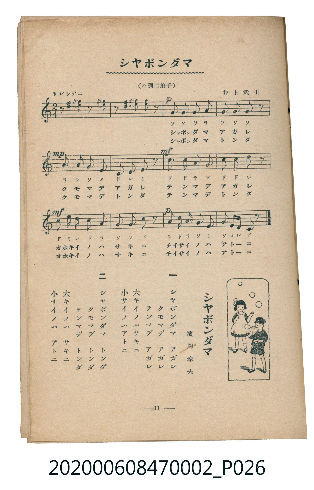

# シヤボンダマ（肥皂泡）

> Re:Shōka 使用 AI 協助辨識與重建樂譜，可能會有錯誤。歡迎回報。

- **鋼琴伴奏版**：<br><audio controls src="shabondama.mp3"></audio>
- **NEUTRINO 歌聲合成版**：<br><audio controls src="shabondama_neutrino.mp3"></audio>

- 詞：濱岡泰夫
- 曲：井上武士
- 臺灣教育會公認《新定兒童唱歌》尋常科第二學年用（2020.006.0847.0002）

## 說明

曲目說明
中文解釋：描寫孩子吹起肥皂泡，泡泡在陽光下飛舞、破裂。

原書資訊與歌詞全文（對應 P026.jpg，書頁 p. 11，第一學期第 8 首）：
調性與拍號：ハ調二拍子（C 大調 2/4 拍），「ウレシゲニ」


## 歌詞

```text
一
シヤボンダマ　アガレ
クモマデ　アガレ
テンマデ　アガレ
大キイノハサキニ
小サイノハアトニ

二
シヤボンダマ　トンダ
クモマデ　トンダ
テンマデ　トンダ
大キイノハ　サキニ
小サイノハ　アトニ
```

## ABC

<div class="abc-score" data-abc-src="shabondama.abc" aria-label="五線譜載入中"></div>

[下載 ABC 原始檔](shabondama.abc)

## TMD 檔案連結

- [主旋律 TMD 檔案](shabondama.tmd) [[在 TMD Studio 編輯](https://tmdlang.github.io/Tmd-TS/#tmd=s7IKdvYPcrWy4qpTUCpJTLdSSM7PyUlNLsnMz7MqzsjMK0nNjM_KTMmPL87Iz05Ugisry88pzU21Si9KTEmNN4o3MjAyiDcwMIs3sDAxBzIMjBBKi_NLi5JTrYqTM_Lzc-JLUitKkvLzsxHyBUX5Zal5iXlANQVFIBtTwIoQClLLMlNSQdKpKZkl-UWZiTlI7kgtKga7FWxJfElRYl5xclFmAcgDCFUlGalAx-YllpQWpSJEgUalZ-ZZlSRmAj0H8mB5YnxuYmZeTmJeihKXlpbC46btj5uXPG6e87h58-PmhsfN897v6XjRtPT5rKZnmxe-39OpoKXFpWirYGhgwWVvq-DMZWOkb2IHMv_FSqDSWc_2b3y6aeGzzRueLlkNtvbZ7E1A4Se7pj7Z0fVs7bKniyHCL9p3PW9c_GzqzBdNm57NaX7auubFqt7HDV3Ppm14um7W09ZJz1cvfTpl47O1PY8bup9u6H66Y8fz5ROfr1nzZFfP07U7nu7c8nzKCqDTQLGgB4wFPVAsABkGRkA3KnHpaykALX4-e92LVauezejjUlBQeLJj7bNp7S-WL37Z3g1yaH__0_Wrn65d-XTthKcTdr7Yuh3Jlz1AEoiezlnxcubep62dT3Z0v1w8-0XHvMcNjc8XbHmxuOlxQxOXlj4XyCJbagGQK5_2zX82e8eLze0vVnS96GgH-h8Yrk9bVwCdDvTt0w29z9o7FQIMjMz0sgrSQQ6dvePlgkaFAj0FQ0MgFxRAOxqAAfRsznwgW8FC4eWyacAQAXoYZPqLVfufNSwHmdvd-2LmfKDo4-Z-oCAwUIEiwJAA2uGs8HTJcqCYAjBiFYCiYN3AWOh53LTscfMaUAJp2vS4uftxQy8XJFwbQBRmwnnc0PC4adHjpjVAXRAV6x83LwJJNLdjyDW3gfVhkwM653HT2sdNQMP7gM593LQVxG3uBsttgPDhckDzO0ByYJft6sHtMpAyEBeby1Dk0FyGLIfuMpDD8TgO4i-I-4DSlCcYKFAAJcTgjMSk_LyUxNxEq4DMxLx8hxqDmmqQNQo2hmZadmAWtsSqAEkyLxb2KGiYgJz8fH2DDnIKezph9dPO3qdL-xWMoNKaWEwBOgFqw8tZfU8n9FopaEB0aYKEYaAGh-jjpr3gaEAim1fikAEBhG0aQLdrWiGbBjcUmxg4LSwGmg5KDECqAWzVPKjcIrAla8BiIBLdql091LKquQPM2wwmQTJIVtUoGCjoKhjHAQk4A0kMLlGjUF1Qq2AKZMGwGVgUWQSsDmyqj2GNQjyQh4yxiUCdrQtzOIjRACbnQeUXgXjAUAKJgUiwPogdRlSyAxg8IB5CBmIH_kS8qwdHIiYuvUJSHJSEpsH50NjqBPMgCQMkBo1hqDiEROhDl8GWlMCpFljugBWA0x04aQALGWjiwZYWQQa3ISUcwjowUi8eK7GmSbxW4k_F1bnA5AlKkqCECUqMxuDINQSSRlAeNBnnptUqGIKStS6IAmkBKQcqBYmBCSN4oocnZpBPQDpAfoEkHJC78CRRsE8gOkD5kQgd8ESNxy7sSRWfXWQl7h2dFCZuSFKcD_YecpJFK2LBMrCIh2SITjALLUvAeQjz0NMbNImvAiucDWStBeIlYF4f1IJ-sMVbweRasEw3RKIRLLQELIldEygiOoB4D0wblqROZ6uRUzKwlAamWTATtVQGCyGKb5AkOM0jMgiEZQTOKOhJfhXIO6CUCvEQyGWgVNQPTcVboXIgsW6ktNgIUgySgngJXRs48UOTJVwbUuKnp621XFy6dgqI1owCkKfMBQA)]
- [鋼琴伴奏 TMD 檔案](shabondama_piano.tmd) [[在 TMD Studio 編輯](https://tmdlang.github.io/Tmd-TS/#tmd=s7IKdvYPcrWy4tLSUnjctP1x85LHzXMeN29-3NzwuHne-z0dL7v3PJ-w5cmeLU-X9j_v7Hi_p1NBS4tL0VbB0MCCy95WwZnLxkjfxI6rTkHpxUqghlnP9m98umnhs80bni5ZrQQSfjZ7E1D4ya6pT3Z0PVu77OliiPCL9l3PGxc_mzrzRdOmZ3Oan7auebGq93FD17NpG56um_W0ddLz1UufTtn4bG3P44bupxu6n-7Y8Xz5xOdr1jzZ1fN07Y6nO7c8n7IC6EAjAyMDPQMDMz0DCxNzIMPACOhGJS6u4IzEpPy8lMTcRKuAzMS8_CAPhxqDmmouBSCwMTTTsgOz9LUUbNGBAsiSHQ0vFvYoaJgoPN3Q_3x9g45CgIGRmV5WQfr7PT1PJ6x-2tkLDBAFI6i0JhZTtPTBNtQoGCjoKhjHAQk4A0kMLlGjUF1Qq2AKZMGwGVgUWQSsDmyqj2GNQjyQh4yxiYDjdDGQCYlWMKMBTM6Dyi8C8ZrWgMVAJFgfxA4jKtnR3AHmIWQgduCPgF09OCIAb1hX5wIDERRwoOADBZkx2AmGQNIIyoMGdm5arYIhKPB1QRRIC0g5UClIDEwYwaMGHuSPm9aDdTxuXgT13uPmdnwBCWS3QXVsJk4HPOjx2IU9QPHZRVYU7OgkLwpgIQtM28AwBDNR0zJYCJHoQZLgOEBEGIRlBI449ChY9bh5Njjk1gLxEqB_-sC-6oeG6laoHEisGylsGkGKQVJbsWoDRwY0mODakCKDnrbWYhZfPsjFlwmi9HqxZ-rz2R3PNgNL3IUvF7c827ru6fZlzzq7ISU2IlYM4xWiDWMhDANouKOJIWchE6CUCbJyUKQiC0abxgNZKFGOrgVqDNgG03goC-Q3XTsFhPeifYDCaCJGYBFlLgA)]

## 分析

```text
================================================================================
📊 TMD Song Profile: [ シヤボンダマ（肥皂泡） ]
================================================================================
⏱  Duration:       0:13 (13.3s), 12 measures total
🎼 Key & Tempo:    首調基準 C, != 108.0 BPM, <2/4>
   - 分析範圍：      由實際發聲的音符與和弦推測調性；播放脈絡另行呈現
🎤 人聲音域:    C4 (MIDI 60) – E5 (MIDI 76) [跨度: 16 個半音 / 1.3 個八度, 難度: moderate]
   - 最低音:  C4 in [Shabondama #1 @ m.6, 0:05]
   - 最高音: E5 in [Shabondama #1 @ m.1, 0:00]
   - 適合: soprano, mezzo-soprano, contralto, tenor, baritone, bass
🏛  結構:      Shabondama (13.3s)
⚡ 編曲密度:        Peak 1 軌道同時演奏
🗝  調性診斷：       C 大調（純淨自然大調，未偵測到可信轉調）
   - 風格氣質:    純淨自然大調（陽光明朗、易唱易記，無明顯調外色彩）
   - 轉調歷程:    全曲維持單一推測調性（未偵測到可信轉調）
   - 核心骨幹音:  G, C, E, A, D
   - 調性數值:    C 大調 [相關度: 0.86, 穩定度: High, 自然音純度: 100.0%]
   - 候選調性 (K-S): C 大調 (0.86), G 大調 (0.72), E 小調 (0.69)
   - 五度圈歷程:   +0
   - 各段落調性細節:
     • [Shabondama #1]: C 大調 (r: 0.86, 自然音純度: 100.0%)

  [ 五度圈游移軌跡 ]
              [C ]*
         F            G  
      Bb               D  
      Eb               A  
         Ab           E  
            Db       B  
               F# 
     (* = active key center)

  [ 十二半音累積音高分佈 ]
     C  : ███████████████████       24.4%
     C# :                            0.0%
     D  : ██████                     7.7%
     D# :                            0.0%
     E  : ████████████████          20.5%
     F  :                            0.0%
     F# :                            0.0%
     G  : ████████████████████████  30.8%
     G# :                            0.0%
     A  : █████████████             16.7%
     A# :                            0.0%
     B  :                            0.0%
--------------------------------------------------------------------------------
Assignment 軌道音域：
  - Piano         : C4 – E5 (16 個半音 / 1.3 個八度, 42 個音符)
================================================================================
```


## 原書掃描頁




