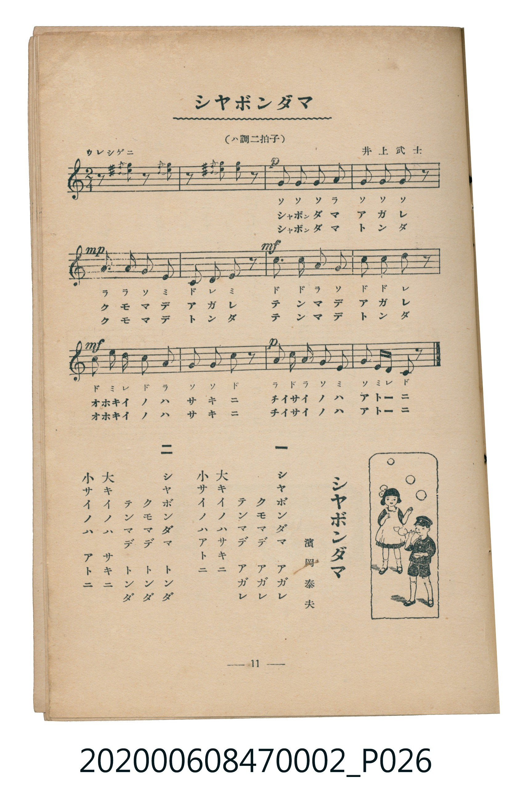

# シヤボンダマ

<audio controls src="shabondama.mp3"></audio>

- 詞：濱岡泰夫
- 曲：井上武士
- 臺灣教育會公認《新定兒童唱歌》尋常科第二學年用（2020.006.0847.0002）

## 說明

原書資訊與歌詞全文（對應 P026.jpg，書頁 p. 11，第一學期第 8 首）：
調性與拍號：ハ調二拍子（C 大調 2/4 拍），「ウレシゲニ」

## 跨冊／重複收錄參照

> 同名異曲（各冊收錄之不同詞曲版本）

- **[同名異曲]** 楊金土手抄《唱歌帖》第 7 冊・VII（2020.006.0843）：[**〈シャボン玉（肥皂泡）〉**](../../../shokacho/vol_07/p233_shabondama/index.md)（`E,` / `2/4` — [原始 TMD](../../../shokacho/vol_07/p233_shabondama/shabondama.tmd)）
- **[同名異曲]** 楊金土手抄《唱歌帖》第 7 冊・VII（2020.006.0843）：[**〈しゃぼん玉 (肥皂泡)〉**](../../../shokacho/vol_07/p252_shabondama/index.md)（`E,` / `2/4` — [原始 TMD](../../../shokacho/vol_07/p252_shabondama/shabondama.tmd)）
- 總表：[跨冊重複與同名歌曲總索引](../../../duplicate_songs.md)

## 歌詞

```text
一
シヤボンダマ　アガレ
クモマデ　アガレ
テンマデ　アガレ
大キイノハサキニ
小サイノハアトニ

二
シヤボンダマ　トンダ
クモマデ　トンダ
テンマデ　トンダ
大キイノハ　サキニ
小サイノハ　アトニ
```

## ABC

```abc
X:1
T:シヤボンダマ
C:曲：井上武士
M:2/4
L:1/16
Q:1/4=108
K:C
V:V1 name="Piano" snm="Pia"
[V:V1]
z2 e2 z2 e2 | z2 e2 e2 z2 | !p! G2 G2 G2 A2 | G2 G2 G2 z2 |
!mp! A3 A G2 E2 | C2 D2 E2 z2 | !mf! c3 c A2 G2 | c2 c2 d2 z2 |
!mf! c2 e d c2 A2 | G2 G2 c2 z2 | !p! A2 c A G2 E2 | G2 E D C2 z2 |
```

## TMD 檔案連結

- [主旋律 TMD 檔案](shabondama.tmd) [[在 TMD Studio 編輯](https://tmdlang.github.io/Tmd-TS/#tmd=s7IKdvYPcrWy4tLSUnjctP1x85LHzXMeN29-3NzwuHmegpYWl6KtgqGBBZe9rYIzl42RvokdV52C0ouV897vmfVs_8anmxY-27zh6ZLVSiDhZ7M3AYWf7Jr6ZEfXs7XLni6GCL9o3_W8cfGzqTNfNG16Nqf5aeuaF6t6Hzd0PZu24em6WU9bJz1fvfTplI3P1vY8buh-uqH76Y4dz5dPfL5mzZNdPU_X7ni6c8vzKSve7-kwMjAy0DMwMNMzsDAxBzIMjN7v6VTi4tLXUrClFuBSUFB42jf_2ewdLza3v1jR9aKjHeguoH-ftq54Nq0d6IqnG3qftXcqBBgYmellFaS_39MDVPxyQaNCgZ6CoSGQC3L4jgagw5_NmQ9kK1govFw2DehSYNCATH-xav-zhuUgc7t7X8ycDxR93NwPFAR6FijydO0EoB3OCk-XLAeKKQADXAEoCtYNDJ2ex03LHjevAcVU06bHzd2PG3q5QGYC7QNRmDH4uKHhcdOix01rgLogKtY_bl4Ekmhux5BrbgPrwyYHdM7jprWPm4CG9wGd-7hpK4jb3A2W2wDhw-WA5neA5MAu29WD22UgZSAuNpehyKG5DFkO3WUgh-NxHMRfEPcBpSlPMFCgoKXPxRWckZiUn5eSmJtoFZCZmJfvUGNQo1ANskfBxtBMyw7MwpZaFSBp5sXCHgUNE5Cbn69v0EFOYk8nrH7a2ft0ab-CEVRaE4spQDdAbXg5q-_phF4rBQ2ILk2QMAzU4BB93LQXHA9IZPNKHDIggLBNA-h2TStk0-CGYhMDJ4bFQNNBqQFINYCtmgeVWwS2ZA1YDESiW7Wrh1pWNXeAeZvBJEgGyaoaBQMFXQXjOCABZyCJwSWA8VtQq2AKZMGwGVgUWQSsDpwbcEf-rh4ckU9cPENiCkpC424-1Jed8KCEiEFDBioOIRH60GWwRQE4toEZFqwAHF_gIAXmTmigY4tDkMFtSAFOWAdGrOOxEmtc4rUSf-xX5wKjFRSVoAgFRaIxOFoNgaQRlAeN_ty0WgVDUHLQBVEgLSDlQKUgMTBhBE8sBBLBjk4KEwEkyuaDwxA5atGyMFgGFkCQhNMJZqElHTgPYR56vECTwiqwwtlA1logXgLm9UEt6AdbvBVMrgXLdEMkGsFCS8CS2DUtAkfT4-Y9MG1YkgSdrUaOcWApAIxbMBM114OFEMUDSBKcNhAJCcIyAicoSNKo5eLStVNAVCEKQJ4yFxcA)]
- [鋼琴伴奏 TMD 檔案](shabondama_piano.tmd) [[在 TMD Studio 編輯](https://tmdlang.github.io/Tmd-TS/#tmd=s7IKdvYPcrWy4tLSUnjctP1x85LHzXMeN29-3NzwuHne-z0dL7v3PJ-w5cmeLU-X9j_v7Hi_p1NBS4tL0VbB0MCCy95WwZnLxkjfxI6rTkHpxUqghlnP9m98umnhs80bni5ZrQQSfjZ7E1D4ya6pT3Z0PVu77OliiPCL9l3PGxc_mzrzRdOmZ3Oan7auebGq93FD17NpG56um_W0ddLz1UufTtn4bG3P44bupxu6n-7Y8Xz5xOdr1jzZ1fN07Y6nO7c8n7IC6EAjAyMDPQMDMz0DCxNzIMPACOhGJS6u4IzEpPy8lMTcRKuAzMS8_CAPhxqDGoVqLgUgsDE007IDs_S1FGzRgQLIlh0NLxb2KGiYKDzd0P98fYOOQoCBkZleVkH6-z09TyesftrZCwwRBSOotCYWU7T0wTbUKBgo6CoYxwEJOANJDC4BdFtBrYIpkAXDZmBRZBGwOi78Dt_Vg8PheN1YnQu0HGQhyFqQVcZgyw2BpBGUB3VkblqtgiHI0bogCqQFpByoFCQGJozgXiLg1B2d5DkV5gJg2AHtAjNRwwoshAhUkCTYrQiPQVhGYA9CnFqLmWZ8UNKMCSLJvNgz9fnsjmebgel84cvFLc-2rnu6fdmzzm5IPkE41TBeIdowFsIwgDoGTQw5_E2AUibIykE-RRaMNo0HslDCAV0L1BiwDabxUBbIc7p2Cgj_KWDwlLm4AA)]

## 分析

```text
================================================================================
📊 TMD Song Profile: [ シヤボンダマ ]
================================================================================
⏱  Duration:       0:13 (13.3s), 12 measures total
🎼 Key & Tempo:    首調基準 C, != 108.0 BPM, <2/4>
   - 分析範圍：      由實際發聲的音符與和弦推測調性；播放脈絡另行呈現
🎤 人聲音域:    C4 (MIDI 60) – E5 (MIDI 76) [跨度: 16 個半音 / 1.3 個八度, 難度: moderate]
   - 最低音:  C4 in [Shabondama #1 @ m.6, 0:05]
   - 最高音: E5 in [Shabondama #1 @ m.1, 0:00]
   - 適合: soprano, mezzo-soprano, contralto, tenor, baritone, bass
🏛  結構:      Shabondama (13.3s)
⚡ 編曲密度:        Peak 1 軌道同時演奏
🗝  調性診斷：       C 大調（純淨自然大調，未偵測到可信轉調）
   - 風格氣質:    純淨自然大調（陽光明朗、易唱易記，無明顯調外色彩）
   - 轉調歷程:    全曲維持單一推測調性（未偵測到可信轉調）
   - 核心骨幹音:  G, C, E, A, D
   - 調性數值:    C 大調 [相關度: 0.86, 穩定度: High, 自然音純度: 100.0%]
   - 候選調性 (K-S): C 大調 (0.86), G 大調 (0.72), E 小調 (0.69)
   - 五度圈歷程:   +0
   - 各段落調性細節:
     • [Shabondama #1]: C 大調 (r: 0.86, 自然音純度: 100.0%)

  [ 五度圈游移軌跡 ]
              [C ]*
         F            G  
      Bb               D  
      Eb               A  
         Ab           E  
            Db       B  
               F# 
     (* = active key center)

  [ 十二半音累積音高分佈 ]
     C  : ███████████████████       24.4%
     C# :                            0.0%
     D  : ██████                     7.7%
     D# :                            0.0%
     E  : ████████████████          20.5%
     F  :                            0.0%
     F# :                            0.0%
     G  : ████████████████████████  30.8%
     G# :                            0.0%
     A  : █████████████             16.7%
     A# :                            0.0%
     B  :                            0.0%
--------------------------------------------------------------------------------
Assignment 軌道音域：
  - Piano         : C4 – E5 (16 個半音 / 1.3 個八度, 42 個音符)
================================================================================
```


## 原書掃描頁




