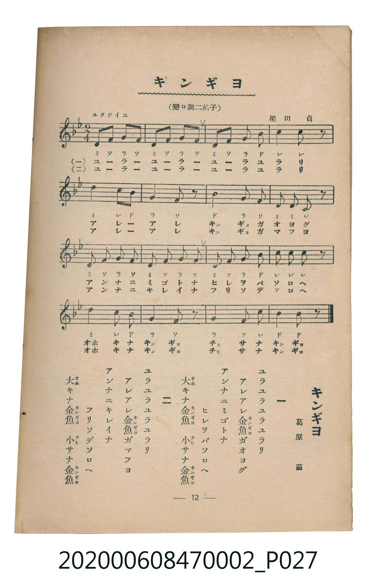

# キンギヨ（金魚）

> Re:Shōka 使用 AI 協助辨識與重建樂譜，可能會有錯誤。歡迎回報。

- **NEUTRINO 歌聲合成版**：<br><audio controls src="kingyo_neutrino.mp3"></audio>
- **鋼琴伴奏版**：<br><audio controls src="kingyo.mp3"></audio>


- 詞：葛原幽
- 曲：梁田貞
- 臺灣教育會公認《新定兒童唱歌》尋常科第二學年用（2020.006.0847.0002）

## 說明

曲目說明
中文解釋：描寫金魚在水中游動、閃耀的模樣。

原書資訊與歌詞全文（對應 P027.jpg，書頁 p. 12，第一學期第 9 首）：
調性與拍號：變ロ調二拍子（降 B 大調 2/4 拍），「ユクワイニ」


## 歌詞

```text
一
ユラユラユラユラリ
アレアレ金魚（キンギヨ）ガオヨグ
アンナニミゴトナ　ヒレヲバソロヘ
大（オホ）キナ金魚（キンギヨ）　小（チヒ）サナ金魚（キンギヨ）

二
ユラユラユラユラリ
アレアレ金魚（キンギヨ）ガマフヨ
アンナニキレイナ　フリソデソロヘ
大（オホ）キナ金魚（キンギヨ）　小（チヒ）サナ金魚（キンギヨ）
```

## ABC

```abc
X:1
T:キンギヨ（金魚）
C:曲：梁田貞
M:2/4
L:1/16
Q:1/4=108
K:Bb
V:V1 name="Piano" snm="Pia"
[V:V1]
D,2 F,2 G,2 F,2 | D,2 F,2 G,2 F,2 | D,2 F,2 G,2 B,2 | C4 C2 z2 |
w: 1.~ユ _ ラ _ | ユ _ ラ _ | ユ _ ラ ユ | ラ リ
w: 2.~ユ _ ラ _ | ユ _ ラ _ | ユ _ ラ ユ | ラ リ
D4 C2 B,2 | G,4 F,2 z2 | B,4 G,2 F,2 | D,2 D,2 C,2 z2 |
w: 1.~ア レ _ | ア レ | キン ギョ ガ | オ ヨ グ
w: 2.~ア レ _ | ア レ | キン ギョ ガ | マ フ ヨ
D,2 F,2 G,2 F,2 | D,2 F,2 G,2 F,2 | D,2 F,2 G,2 B,2 | C2 C2 C2 z2 |
w: 1.~ア ン ナ ニ | ミ ゴ ト ナ | ヒ レ ヲ バ | ソ ロ ヘ
w: 2.~ア ン ナ ニ | キ レ イ ナ | フ リ ソ デ | ソ ロ ヘ
D4 C2 B,2 | G,4 F,2 z2 | G,2 F,2 C,2 B,,2 | B,,6 z2 |
w: 1.~オホ キ ナ | キン ギョ | チヒ サ ナ キン | ギョ
w: 2.~オホ キ ナ | キン ギョ | チヒ サ ナ キン | ギョ
```

## TMD 檔案連結

- [主旋律 TMD 檔案](kingyo.tmd) [[在 TMD Studio 編輯](https://tmdlang.github.io/Tmd-TS/#tmd=s7IKdvYPcrWy4qpTUCpJTLdSSM7PyUlNLsnMz7MqzsjMK0nNjM_KTMmPL87Iz05Ugisry88pzU21Si9KTEmNN4o3MjAyiDcwMIs3sDAxBzIMjBBKi_NLi5JTrYqTM_Lzc-JLUitKkvLzsxHyBUX5Zal5iXlANQVFIBtTwIoQClLLMlNSQdKpKZkl-UWZiTlI7kgtKga7FWxJfElRYl5xclFmAcgDCFUlGalAxybmZeYi6wUalZ6ZZ1WSmAn0HMiD5YnxuYmZeTmJeSlKXFpaCo-b1j5u3vy4ad3j5hXv93S8bJ_4cu2s93s6FbS0uBRtFQwNLLjsbRWcdLhsjPRN7EDmvlg57_2eWS8mzn7aN__pzr1gu57N3gQUe7ao8fmUDS82zQOLvWjf9bxx8bOpM180bXo2p_lp65oXq3ofN3Q9m7bh6bpZT1snPV-99OmUjc_W9jxu6H66ofvpjh3Pl098vmbNk109T9fueLpzy_MpICeBwl0PGO56oHAHMgyMgM5T4tLXUgDa-nz2uherVj2b0celoKDwZMfaZ9PaXyxf_LK9G-Sc_v6n61dDfPR0zopnG7aAFOzY8bR76uOGxpfTml80NDyf1fJsxcJnKxY_bmji0tLnAhlrSy0AchMwkJ7N3vFic_uLFV0vOtqBvgWG39PWFUCHAv32dEPvs_ZOhQADI3O9rIL093t6gIpfLmhUKNBTMAT6swcUHDsagMHxbM58IFvBUuHlsmlA_wO9BzL9xar9zxqWg8zt7n0xcz4oXtZ1PW5eCxQHhiJQ8OnaCaBYndmr4KTwdMlyoLgCMB4VgDJgQ4BB3_O4ednjpvWPm9c_blryuLn7cUMvFyQwG0AUSLZ5JTZyFVi6adHj5jUQEpZ2OlDTVOfjJqCCVUD246YNcD2bHzcDHdr9uHn-46Ytj5s7QNyGhsfNk0DGNW963DzhcdNeoE8eN88AB-OS5WCDgcbMBhsJlOjCaWFDw9MN_SDx5kagiWD1W_Goh_h3Vw8V_ds873HzVCAXw78gpUD9wJCG-BeoaBXYp-109C_QAspTNxQogHKNd2ZeemW-VUBmYl6-Q41BTTXICgUbQzMtOzALW65SgKTtFwt7FDRMFIAeeL6-QQeeFTSxaADaBDXs5ay-pxN6rYCxNR8cwHvBMbcSzq4hTaa5EyqzBmQ-WATGQtipAXSsJsjKZWAFe5C0g9gg7aTIgERAMiAexMpVWKzc1UNPK2sUjOMVdBVMQYQZnEWkqCFY0AhIgiCINgCJgA32MYS4CCIHcgGERawohA9xO0x8FZAEOwRigxEtbcCfiHf1UCERQyIElOwQyREeUeDECokhiCxENZZkDSVxJ9-mRWiWQdMLmjjUMnDBAXUDsPRYDqRAsiAZUNoBlidgqQ1YrIMkXWpZ1zwPrHYq3FIk64BJESnVQdIhOEmCIDiBglMiWAYEMRIxmDCCK0QkWaArYYlhDSLpoIlCDIK6HSoBcT2IAVIBCS6Q-hVgsQ2YSZd6NgFDCqR-Ktw-YpLwjs5BVw4jk-hpCykpQxIMsLYDk90oRm8Bi3XA5UEyk5CM3gQmJ0DTHsQha8HkDCyWIiVorJY2QbSCjW5agmIpJNmCcwzUmnbCllKpNIZhbEkbko5A7gSR3dAENB-cnLaAxTrg8pDAgyVFUOCByAnQJLkXzFsLJmfgSN5YbQOGGtxMYKgh2wZJwuCMAzW_Ha9teJP409mz6VpKI5I6unpY-Q0DWBI2qNkHNROSNKAJCaN8hNkGavcBxbbCFUOVgvTAFWKzEJqo6WIhseU0IlmDy2RDSAIHUzCInpjB7oeViJB0AU1FWAtLaEEK8QVIfCsiYcI0wH2CsBU9UdPT1louLl07hWp7XUOjWgUgC9LkBrGUuQA)]
- [鋼琴伴奏 TMD 檔案](kingyo_piano.tmd) [[在 TMD Studio 編輯](https://tmdlang.github.io/Tmd-TS/#tmd=s7IKdvYPcrWy4tLSUnjctPZx8-bHTeseN694v6fjZfee5xO2PNmz5enS_uedHe_3dCpoaXEp2ioYGlhw2dsqOOlw2Rjpm9hx1SkovVg57_2eWS8mzn7aN__pzr1KILFnszcBxZ4tanw-ZcOLTfPAYi_adz1vXPxs6swXTZuezWl-2rrmxarexw1dz6ZteLpu1tPWSc9XL306ZeOztT2PG7qfbuh-umPH8-UTn69Z82RXz9O1O57u3PJ8CshtRgZGBnoGBmZ6BhYm5kCGgRHQeUpcXN6ZeemV-VYBmYl5-UEeDjUGNdVcCkBgY2imZQdm6Wsp2KIDBZAFOxpeLOxR0DBReLqh__n6Bh2FAAMjc72sgnRNLBq09MGG1SgYK-gqmAKxGZQmJGIYBxYyAlEgCGYYgMTABvoY1ig8bl4GlXzcvBLKIlYUwgeJw9Q8bl4FJOMRNhjR0gb8Qbyrh6wgRgkraACCwhIEQeEKDj6IBAiiBjwIG2GGcdMiuOvXIPyKJgr2EzRbwCRAuWM5mAFSAZIF-R6YY8BiGzDDmno2Nc8Dq58Kt4-YMN_RSe9kjSCwhTnEg4-bu8BkN9Rn88H-3AIW64DLg2QmwcPocfMmMDkBGlZ7wby1YHIGjnDHalsTRA_YzKYlKLZBwhYco1Dz2_Hahjfsn86eTcP0DosIUOI2BIuASBhED_pVj5tnQ6Vg_of6GWuag6bH5kZoBDRtRQQjTANIL1Q5DKJHAT1trUUt_X2QS38TROH_rGnBsx07nm3Y8mzzoqfblz3r7IbUcIjwN4xXiDaMRWeYxeeCmKbx8cCwhfgRSYUJBgOHQnLNNI2HagIpBHpV106h2l7X0KhWAciC-DvaB6gaiWcE5ilzAQA)]

## 分析

```text
================================================================================
📊 TMD Song Profile: [ キンギヨ（金魚） ]
================================================================================
⏱  Duration:       0:17 (17.8s), 16 measures total
🎼 Key & Tempo:    首調基準 B,, != 108.0 BPM, <2/4>
   - 分析範圍：      由實際發聲的音符與和弦推測調性；播放脈絡另行呈現
🎤 人聲音域:    A#2 (MIDI 46) – D4 (MIDI 62) [跨度: 16 個半音 / 1.3 個八度, 難度: moderate]
   - 最低音:  A#2 in [Kingyo #1 @ m.15, 0:16]
   - 最高音: D4 in [Kingyo #1 @ m.5, 0:04]
   - 適合: tenor, baritone, bass
🏛  結構:      Kingyo (17.8s)
⚡ 編曲密度:        Peak 1 軌道同時演奏
🗝  調性診斷：       A# 調性不明確（純淨自然大調，未偵測到可信轉調）
   - 風格氣質:    純淨自然大調（陽光明朗、易唱易記，無明顯調外色彩）
   - 轉調歷程:    全曲維持單一推測調性（未偵測到可信轉調）
   - 核心骨幹音:  F, D, G, C, A#
   - 調性數值:    A# 調性不明確 [相關度: 0.74, 穩定度: Ambiguous, 自然音純度: 100.0%]
   - 候選調性 (K-S): A# 大調 (0.74), F 大調 (0.74), G 小調 (0.67)
   - 五度圈歷程:   -2
   - 各段落調性細節:
     • [Kingyo #1]: A# 調性不明確 (r: 0.74, 自然音純度: 100.0%)

  [ 五度圈游移軌跡 ]
               C  
         F            G  
     [Bb]*              D  
      Eb               A  
         Ab           E  
            Db       B  
               F# 
     (* = active key center)

  [ 十二半音累積音高分佈 ]
     C  : █████████████████         17.2%
     C# :                            0.0%
     D  : █████████████████████     20.7%
     D# :                            0.0%
     E  :                            0.0%
     F  : ████████████████████████  24.1%
     F# :                            0.0%
     G  : █████████████████████     20.7%
     G# :                            0.0%
     A  :                            0.0%
     A# : █████████████████         17.2%
     B  :                            0.0%
--------------------------------------------------------------------------------
Assignment 軌道音域：
  - Piano         : A#2 – D4 (16 個半音 / 1.3 個八度, 50 個音符)
================================================================================
```


## 原書掃描頁




