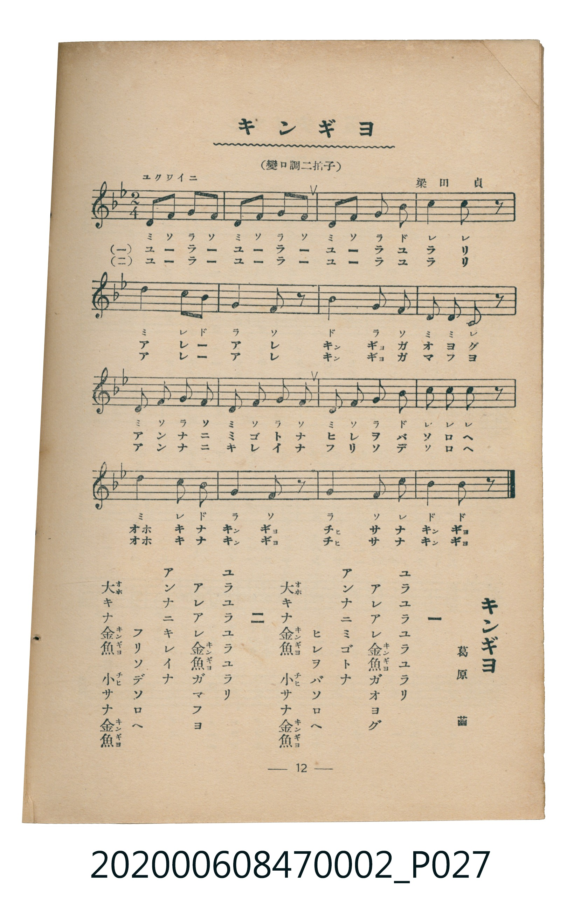

# キンギヨ（金魚）

> Re:Shōka 使用 AI 協助辨識與重建樂譜，可能會有錯誤。歡迎[回報](https://github.com/TMDLang/reshoka/issues)。

- **鋼琴伴奏版**：<br><audio controls src="kingyo.mp3"></audio>
- **NEUTRINO 歌聲合成版**：<br><audio controls src="kingyo_neutrino.mp3"></audio>

- 詞：葛原𦱳
- 曲：梁田貞
- 臺灣教育會公認《新定兒童唱歌》尋常科第二學年用（2020.006.0847.0002）

## 說明

曲目說明
中文解釋：描寫金魚在水中游動、閃耀的模樣。

原書資訊與歌詞全文（對應 P027.jpg，書頁 p. 12，第一學期第 9 首）：
調性與拍號：變ロ調二拍子（降 B 大調 2/4 拍），「ユクワイニ」


## 歌詞

```text
一
ユラユラユラユラリ
アレアレ金魚（キンギヨ）ガオヨグ
アンナニミゴトナ　ヒレヲバソロヘ
大（オホ）キナ金魚（キンギヨ）　小（チヒ）サナ金魚（キンギヨ）

二
ユラユラユラユラリ
アレアレ金魚（キンギヨ）ガマフヨ
アンナニキレイナ　フリソデソロヘ
大（オホ）キナ金魚（キンギヨ）　小（チヒ）サナ金魚（キンギヨ）
```

## ABC

<div class="abc-score" data-abc-src="kingyo.abc" aria-label="五線譜載入中"></div>

[下載 ABC 原始檔](kingyo.abc)

## TMD 檔案連結

- [主旋律 TMD 檔案](kingyo.tmd) [[在 TMD Studio 編輯](https://tmdlang.github.io/Tmd-TS/#tmd=s7IKdvYPcrWy4qpTUCpJTLdSSM7PyUlNLsnMz7MqzsjMK0nNjM_KTMmPL87Iz05Ugisry88pzU21Si9KTEmNN4o3MjAyiDcwMIs3sDAxBzIMjBBKi_NLi5JTrYqTM_Lzc-JLUitKkvLzsxHyBUX5Zal5iXlANQVFIBtTwIoQClLLMlNSQdKpKZkl-UWZiTlI7kgtKga7FWxJfElRYl5xclFmAcgDCFUlGalAxybmZeYi6wUalZ6ZZ1WSmAn0HMiD5YnxuYmZeTmJeSnIqkoy8oH-LMiotMrILAY5IDkxJz47MQ8pOKDWFySmp1oFGBiZK3FpaSk8blr7uHnz46Z1j5tXvN_T8bJ94su1s97v6VTQ0uJStFUwNLDgsrdVcNLhsjHSN7EDmfVi5bz3e2a9mDj7ad_8pzv3gs1_NnsTUOzZosbnUza82DQPLPaifdfzxsXPps580bTp2Zzmp61rXqzqfdzQ9WzahqfrZj1tnfR89dKnUzY-W9vzuKH76Ybupzt2PF8-8fmaNU929Txdu-Ppzi3Pp4CcBIo2PWC06YGiDcgwMAI6T4lLX0sBaOvz2eterFr1bEYfl4KCwpMda59Na3-xfPHL9m6Qc_r7n65fDfHR0zkrnm3YAlKwY8fT7qmPGxpfTmt-0dDwfFbLsxULn61Y_LihiUtLnwtkrC21AMhNwEB6NnvHi83tL1Z0vehoB_oWGH5PW1cAHQr029MNvc_aOxVAsaGXVZD-fk8PUPHLBY0KBXoKhkB_9oCCY0cDMDiezZkPZCtYKrxcNg3of6D3QKa_WLX_WcNykLndvS9mzgfFy7qux81rgeLAUAQKPl07ARSrM3sVnBSeLlkOFFcAxqMCUAZsCDDoex43L3vctP5x8_rHTUseN3c_bujlggRmA4gCyTavxEauAks3LXrcvAZCwtJOB2qa6nzcBFSwCsh-3LQBrmfz42agQ7sfN89_3LTlcXMHiNvQ8Lh5Esi45k2Pmyc8btoL9Mnj5hngYFyyHGww0JjZYCOBEl04LWxoeLqhHyTe3Ag0Eax-Kx71EP_u6qGif5vnPW6eCuRi-BekFKgfGNIQ_wIVrQL7tJ2O_gVaQHnqhgIFUK7xzsxLr8y3CshMzMt3qDGoqQZZoWBjoWUHZmDLVAqQpP1iYY-ChokC0P3P1zfowHOCJhYNQIughr2c1fd0Qq8VMLLmg8N3LzjiVsLZNaTJNHdCZdaAzAeLwFgIOzWAjtUEWbkMrGAPknYQG6SdFBmQCEgGxINYuQqLlbt66GlljYJxvIJpvIIZmMTJMwRyjBR0gdhAoQas0ccQYqMu2HRdqP3YeCAWxA0g_ioFoMEQE4woMQF_ItvVQ4VEBgkwULJAJBd4QIITEyQEIbIQ1ViSHZTEnbyaFqFZBo1PNHGoZeB8DXUDMHMvB1IgWZAMKG6B2R0stQGLdZCkRS3rmueB1U6FW4pkHTDpgFMLKN0Ak48uKBkBUw6Qr4ucuIDICCyBSFJAV4AieQ0kCcB5IA1QtwAFEC6BeBtkP8jLKEmLdJOAPgL5B2Qa4SS2o3PQlWPIJHrcIyU1SIQCKwsw2Y1i9BawWAdcHiQzCcnoTWByAjRtQByyFkzOwGIpUoLDamkTRCvY6KYlKJZCkhU4RUOtaSdsKUmlGQiiJz2QK0FuALkQEiigIAEFCEgUEhgg94ICAhQMEPeAXANyC3ryQzMN6FuwXqBPYaaBEhsw-YLNaMdiGt4k-HT2bLqWcoikiK4eVv7BAJaEB2rVQM2ERB00ojHKF5htoGYNUGwrXDFUKUgPXCE2C6GJji4W4irnIEkOWLYZghIekNAFQtTEBnYfqAQCxTY4NaAVSuCCCuEqcEJCcxHIVNRER01Ta7m4dO0Uqu11DY1qFYAsSIsPxFLmAgA)]
- [鋼琴伴奏 TMD 檔案](kingyo_piano.tmd) [[在 TMD Studio 編輯](https://tmdlang.github.io/Tmd-TS/#tmd=s7IKdvYPcrWy4qpTUCpJTLdSyC8qychPL0osyKi0ysgsLskvykxOzInPTsxLVIIrKs4vLUpOjS9ITE-1CjAwMlfi0tJSeNy09nHz5sdN6x43r3i_p-Nl957nE7Y82bPl6dL-550d7_d0KmhpcSnaKhgaWHDZ2yo46XDZGOmb2IEMfbFy3vs9s15MnP20b_7TnXvBFj2bvQko9mxR4_MpG15smgcWe9G-63nj4mdTZ75o2vRsTvPT1jUvVvU-buh6Nm3D03WznrZOer566dMpG5-t7Xnc0P10Q_fTHTueL5_4fM2aJ7t6nq7d8XTnludTQG4zMjAy0DMwMNMzsDAxBzIMjIDOU-Li8s7MS6_MtwrITMzLD_JwqDGoqeZSAAIbCy07MENfS8EWHSiAzN_R8GJhj4KGicLTDf3P1zfoKICCRS-rIF0TiwYtfbBhNQrGCqYKZkCMyTKMAzKN4hR0QYSBQg1Yg49hjcLj5mVAwcfNK4Ekbh6IBeKDxB83r1KIh5lgRIkJ-INgVw9ZQQD1I9jDZkC2Kci7IK4uPECMFYxQw6BpEdhVayBuhvOAboSmQpAAKCEuB1JrwKKrgCpWAOkNqGFBuknN84B4Ktg0wmGyo5M2yQKC0MME5NzHzV1A3A126Xyg6BYg3QEWBYlMAvvucfMmIJ4A9uNeIGstEM_ACBc005pAqoB6m5bATQOFAjBcwWa0YzENb9g8nT2biukFFEhGCoaglAMU00ULmlWPm2eDIxLkNrDb0eIWHN_NjeAAatoK8TZECUgtWAnIVNQgoqaptaiFjw9y4WOCKHyeNS14tmPHsw1bnm1e9HT7smed3ZACFhE-hvEK0Yax6Ayz-FwQ0zQ-Hh4ySCpMMBg4FJJrpmk8VBNIIdCrunYK1fa6hka1CkAWxN_RPkDVSDwjME-ZCwA)]

## 分析

```text
================================================================================
📊 TMD Song Profile: [ キンギヨ（金魚） ]
================================================================================
⏱  Duration:       0:17 (17.8s), 16 measures total
🎼 Key & Tempo:    首調基準 B,, != 108.0 BPM, <2/4>
   - 分析範圍：      由實際發聲的音符與和弦推測調性；播放脈絡另行呈現
🎤 人聲音域:    A#2 (MIDI 46) – D4 (MIDI 62) [跨度: 16 個半音 / 1.3 個八度, 難度: moderate]
   - 最低音:  A#2 in [Kingyo #1 @ m.15, 0:16]
   - 最高音: D4 in [Kingyo #1 @ m.5, 0:04]
   - 適合: tenor, baritone, bass
🏛  結構:      Kingyo (17.8s)
⚡ 編曲密度:        Peak 1 軌道同時演奏
🗝  調性診斷：       A# 調性不明確（純淨自然大調，未偵測到可信轉調）
   - 風格氣質:    純淨自然大調（陽光明朗、易唱易記，無明顯調外色彩）
   - 轉調歷程:    全曲維持單一推測調性（未偵測到可信轉調）
   - 核心骨幹音:  F, D, G, C, A#
   - 調性數值:    A# 調性不明確 [相關度: 0.74, 穩定度: Ambiguous, 自然音純度: 100.0%]
   - 候選調性 (K-S): A# 大調 (0.74), F 大調 (0.74), G 小調 (0.67)
   - 五度圈歷程:   -2
   - 各段落調性細節:
     • [Kingyo #1]: A# 調性不明確 (r: 0.74, 自然音純度: 100.0%)

  [ 五度圈游移軌跡 ]
               C  
         F            G  
     [Bb]*              D  
      Eb               A  
         Ab           E  
            Db       B  
               F# 
     (* = active key center)

  [ 十二半音累積音高分佈 ]
     C  : █████████████████         17.2%
     C# :                            0.0%
     D  : █████████████████████     20.7%
     D# :                            0.0%
     E  :                            0.0%
     F  : ████████████████████████  24.1%
     F# :                            0.0%
     G  : █████████████████████     20.7%
     G# :                            0.0%
     A  :                            0.0%
     A# : █████████████████         17.2%
     B  :                            0.0%
--------------------------------------------------------------------------------
Assignment 軌道音域：
  - Piano         : A#2 – D4 (16 個半音 / 1.3 個八度, 50 個音符)
================================================================================
```


## 原書掃描頁




