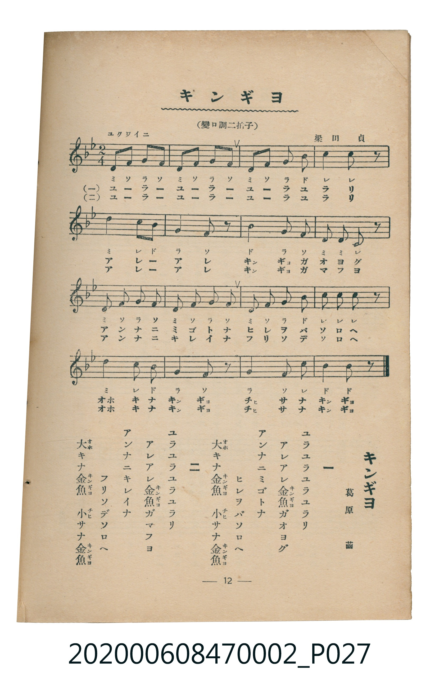

# キンギヨ

<audio controls src="kingyo.mp3"></audio>

- 詞：葛原幽
- 曲：梁田貞
- 臺灣教育會公認《新定兒童唱歌》尋常科第二學年用（2020.006.0847.0002）

## 說明

原書資訊與歌詞全文（對應 P027.jpg，書頁 p. 12，第一學期第 9 首）：
調性與拍號：變ロ調二拍子（降 B 大調 2/4 拍），「ユクワイニ」

## 歌詞

```text
一
ユラユラユラユラリ
アレアレ金魚（キンギヨ）ガオヨグ
アンナニミゴトナ　ヒレヲバソロヘ
大（オホ）キナ金魚（キンギヨ）　小（チヒ）サナ金魚（キンギヨ）

二
ユラユラユラユラリ
アレアレ金魚（キンギヨ）ガマフヨ
アンナニキレイナ　フリソデソロヘ
大（オホ）キナ金魚（キンギヨ）　小（チヒ）サナ金魚（キンギヨ）
```

## ABC

```abc
X:1
T:キンギヨ
C:曲：梁田貞
M:2/4
L:1/16
Q:1/4=108
K:Bb
V:V1 name="Piano" snm="Pia"
[V:V1]
d2 f2 g2 f2 | d2 f2 g2 f2 | d2 f2 g2 b2 | c'4 c'2 z2 |
d'4 c'2 b2 | g4 f2 z2 | b4 g2 f2 | d2 d2 c2 z2 |
d2 f2 g2 f2 | d2 f2 g2 f2 | d2 f2 g2 b2 | c'2 c'2 c'2 z2 |
d'4 c'2 b2 | g4 f2 z2 | g2 f2 c2 b2 | b6 z2 |
```

## TMD 檔案連結

- [主旋律 TMD 檔案](kingyo.tmd)
- [鋼琴伴奏 TMD 檔案](kingyo_piano.tmd)

## 分析

```text
================================================================================
📊 TMD Song Profile: [ キンギヨ ]
================================================================================
⏱  Duration:       0:17 (17.8s), 16 measures total
🎼 Key & Tempo:    首調基準 B,, != 108.0 BPM, <2/4>
   - 分析範圍：      由實際發聲的音符與和弦推測調性；播放脈絡另行呈現
🎤 人聲音域:    A#4 (MIDI 70) – D6 (MIDI 86) [跨度: 16 個半音 / 1.3 個八度, 難度: moderate]
   - 最低音:  A#4 in [Kingyo #1 @ m.15, 0:16]
   - 最高音: D6 in [Kingyo #1 @ m.5, 0:04]
   - 適合: soprano, tenor
🏛  結構:      Kingyo (17.8s)
⚡ 編曲密度:        Peak 1 軌道同時演奏
🗝  調性診斷：       A# 調性不明確（純淨自然大調，未偵測到可信轉調）
   - 風格氣質:    純淨自然大調（陽光明朗、易唱易記，無明顯調外色彩）
   - 轉調歷程:    全曲維持單一推測調性（未偵測到可信轉調）
   - 核心骨幹音:  F, D, G, C, A#
   - 調性數值:    A# 調性不明確 [相關度: 0.74, 穩定度: Ambiguous, 自然音純度: 100.0%]
   - 候選調性 (K-S): A# 大調 (0.74), F 大調 (0.74), G 小調 (0.67)
   - 五度圈歷程:   -2
   - 各段落調性細節:
     • [Kingyo #1]: A# 調性不明確 (r: 0.74, 自然音純度: 100.0%)

  [ 五度圈游移軌跡 ]
               C  
         F            G  
     [Bb]*              D  
      Eb               A  
         Ab           E  
            Db       B  
               F# 
     (* = active key center)

  [ 十二半音累積音高分佈 ]
     C  : █████████████████         17.2%
     C# :                            0.0%
     D  : █████████████████████     20.7%
     D# :                            0.0%
     E  :                            0.0%
     F  : ████████████████████████  24.1%
     F# :                            0.0%
     G  : █████████████████████     20.7%
     G# :                            0.0%
     A  :                            0.0%
     A# : █████████████████         17.2%
     B  :                            0.0%
--------------------------------------------------------------------------------
Assignment 軌道音域：
  - Piano         : A#4 – D6 (16 個半音 / 1.3 個八度, 50 個音符)
================================================================================
```


## 原書掃描頁




