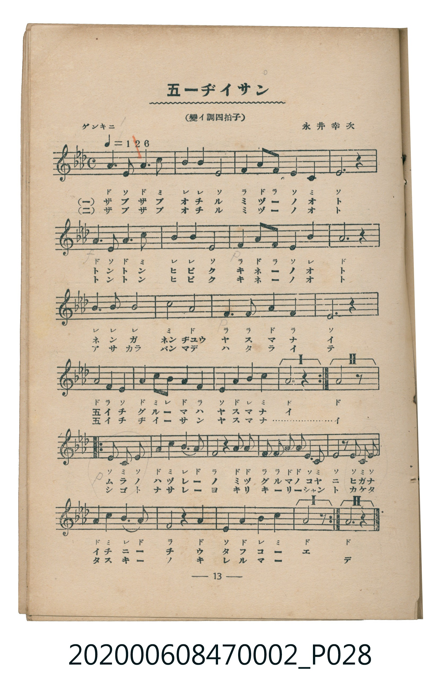
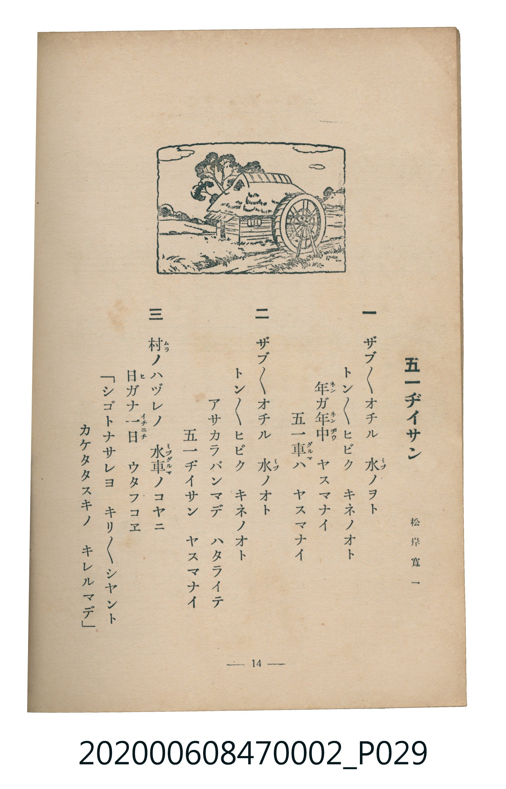

# 五一ヂイサン（五一老爺爺）

> Re:Shōka 使用 AI 協助辨識與重建樂譜，可能會有錯誤。歡迎回報。

- **鋼琴伴奏版**：<br><audio controls src="goichi_jiisan.mp3"></audio>
- **NEUTRINO 歌聲合成版**：<br><audio controls src="goichi_jiisan_neutrino.mp3"></audio>

- 詞：松岸寬一
- 曲：永井幸次
- 臺灣教育會公認《新定兒童唱歌》尋常科第二學年用（2020.006.0847.0002）

## 說明

曲目說明
中文解釋：描寫一位老爺爺的生活與親切形象。

原書資訊與歌詞全文（對應 P028.jpg – P029.jpg，書頁 pp. 13–14，第一學期第 10 首）：
調性與拍號：變イ調四拍子（降 A 大調 4/4 拍），「ゲンキニ（♩＝126）」


## 歌詞

```text
一
ザブ／＼オチル　水（ミヅ）ノヲト
トン／＼ヒビク　キネノオト
年（ネン）ガ年中（ネンヂウ）　ヤスマナイ
五一車（グルマ）ハ　ヤスマナイ

二
ザブ／＼オチル　水（ミヅ）ノオト
トン／＼ヒビク　キネノオト
アサカラバンマデ　ハタライテ
五一ヂイサン　ヤスマナイ

三
村（ムラ）ノハヅレノ　水車（ミヅグルマ）ノコヤニ
日（ヒ）ガナ一日（イチニチ）　ウタフコエ
「シゴトナサレヨ　キリ／＼シヤント
カケタタスキノ　キレルマデ」
```

## ABC

<div class="abc-score" data-abc-src="goichi_jiisan.abc" aria-label="五線譜載入中"></div>

[下載 ABC 原始檔](goichi_jiisan.abc)

## TMD 檔案連結

- [主旋律 TMD 檔案](goichi_jiisan.tmd) [[在 TMD Studio 編輯](https://tmdlang.github.io/Tmd-TS/#tmd=s7IKdvYPcrWy4qpTUCpJTLdSSM7PyUlNLsnMz7MqzsjMK0nNjM_KTMmPL87Iz05Ugisry88pzU21Si9KTEmNN4o3MjAyiDcwMIs3sDAxBzIMjBBKi_NLi5JTrYqTM_Lzc-JLUitKkvLzsxHyBUX5Zal5iXlANQVFIBtTwIoQClLLMlNSQdKpKZkl-UWZiTlI7kgtKga7FWxJfElRYl5xclFmAcgDCFUlGalAx6Yl5mbmVCJEgUalZ-ZZlSRmAj0H8mB5YnxuYmZeTmJeCrKqkox8oD8LMiqtMjKLQQ5ITsyJz07MQwoOqPUFiempVgEGRha6QMJSiUtLS-HJrilPdjQ8bm563LTkcdPWx82b3-_pgAi-aGh83rELiN7v6VTQ0uJStFUwNDLjsrdVcNThsjHRN7EDmf9i5bz3e2Y9m7vv6aYdT9evAeoDW_ts9iaQ8IYdT3ZNfbpzx7M1C8HCL9p3PW9c_GzqzBdNm57NaX7auubFqt7HDV3Ppm14um7W09ZJz1cvfTpl47O1PY8bup9u6H66Y8fz5ROfr1nzZFfP07U7nu7c8nzKCqALQRGqB4xQPVCEAhkGRkBHKnHpaykALX4-e92LVauezejjUlBQeLJj7bNp7S-WL37Z3g1yUX__0_Wrga58srcX7sHns1qeT5n_bMvuFx3tL5atetrR_nTvohcbFz5uaOLS0ucCGWtLLQBy09O--c9m73ixuf3Fii6glUDfAkPxaesKoEOBfnu6ofdZe6cCKJ70sgrSFR41TAZxLEGc93t6gDpfLmhUKCjQUzA0BsoZmgAFQSG0owEYQs_mzAeyFQwNFF4umwYME6CXQTa-WLX_WcNykF3dvS9mzgeKvljXBYxyoPjT2bOBgk_XTgBa_XJmr4KjwtMly4HiCsAYVgDKgA0BRkfP46ZNwOTxuGnt42ZgSHY8mrny_Z65wBQBVPC4oZcLEtgNIOpx07bHzUDb-9_v2fO4adXj5sbHzasfNzQ827AFqPFx8_zHza0gXc19j5uBZnaA9TQDJYCJD6ynedLj5smPm9YD9YDt6wUpBRkEVgpMBWBjgKJADZ2Pm9YARYDxDBcEJ-dlYHcBkzYwXe983DzvcTPIw2BXQpL37i6QhqYNILc1AxMx0D39WDRAdPSQ6C-4Y0nw1-OmRaAs2AR0zsrHzRPAHgG6oh3sqP7HTftB4sBs2tyG8AVyzsXl-B2dIOrZ3IlgRy4AmgIL_H6ggx83rwGxwb6AhgnYI6ghA3Qm0DVAu7vBZk1fClY3CRL8QMuAToEKghwIDJduIAmNgaZlYLdPBRnRtALsU1Bq2v64aQs4dIAuBTofaMoKWLisgoXxdrCdQJuhAbT6cdNGkGEgtBOsFORyMAOoH-RacHj1glRTnlehQAFUBrjnZyZnZHplZhYn5lkFZCbm5TvUGNRUgyxSsLHQsgMzsBUUCpC8-WJhj4KGicLTDf3P1zfowHO3JhYNQOughr2c1fd0Qq8VMBF1gkSAAbAXwW6er1ADJNeA2WASKAsBIPGVYPFOMAsiA9IBloOrQwCEnRpAx2oCrWzaBrVmGgobpH0VmN0IJlcjWQkyHphygHgPEPeBnQRSC5LrwGvlrh56WlmjYKigC4Sm8VCGMVDICEiDMFAQJKQLFDIDMQ1BFFjQGETUIBSAoAFICGyojyHIndvAojAfwNgQH4DYjWByNdwKkA9AIq1gsg9EglVC3I-wB2w1xB4j2tuDPzHv6hkUiRmkCiQHMQFLNCMlZmhaABYlKGyQ9klg9mSwlesRVjatBYv3kp2Y6WUlmYkZJAvTijUpQ5MFzP0wNsT9IPZkcCJaj0hiQPeDxHtJS8o0todAudxJYVIGJUJIYoSxEeUSRAaWPGHJGCQGTMRgcYgIsSUy0McQ7cCQakK2DNTmgUo1PW5eCqxwoRJLIKJNO4HseWD5Lqh9EBlc9kGL40VQ7VvBNS_U9SBzQW0TqIWgChcu3g_VsB-WZcH2gGTacNkHSaug9AihQfFoDGXBUic08eqCKJAYmIe_IAanDmiqAoYVohgEhxWEiwgthPQSiAw0xEBquqCJDiKDvTReBNUFDyiEgeCggtkHDiyEXD9UGyS4QCyQJZDgIikdA9vwVCiSYXEGKV5BIogaFlIwY6ZZmBhEHtq-IKZIBjZf4QkEWrE3bYBqB1XwoDIQnL7AJChhwRI0KHIQMiQkaCxWNjchaYdaCYxFSCYj20pIuQpOpeA0CuJBUjUojaOnYBAfJA6Sx1siN22BpxFoBQ8MMUh6gVX0sEQLSlmw5AxyPEKGmOSMYQ8wmFB1gQIJkrtIt4dA42IKjpQM6-V2Plu3lchUjdTqJZSqIekaknbhDQ1oOQ3G4MYKuJECLasRpoNYKOm7E1xaL4AaCiLBdTk8FbciWQ5KchAVEGeBG7PAeAXFKSgsQTLAjhM4jEEquqHqwW0IYMkGCmlMy5u2g6W3gJWCmg6IVAtJ3aiWr4BWq8CeF5QGNUCAbBAN6oQtBkY1ohUCLOTA5EZw2QVP9IhGMo5UD073oCQOboaAC3NDkFqgHnhpbgA3BkgjF-gLwMkKXExCKn14Ioe0aWGFPESe2MCEJEtoUwManMhZYTtYHJwhwI0LRMKGZABkW9FDESQGbo2DQxDIgbRqIG0UoKXAUARJQkKRUAnfupZ6-QJaZqPnAUQLBZErKCzpIYkRucAFpV9IwgNpB4lBUhSoyQKzbj9YzVSwOKgYhqtvWkGMdWDtkBIb2qSGWQfKhhDrQOJQ66A-glQ6kBIeph7SssFiHaScRk7b0DYKqMhGNFtILN-RS1xI0oQkcJAIyCSUpgrQmyB1U8HisCYGJIxwl-xgPZByGpxAYTaAMhTEBmRRUOKG1C2QUh0mDmvDIGyo5eLStVNAHiNRAPKVuQA)]
- [鋼琴伴奏 TMD 檔案](goichi_jiisan_piano.tmd) [[在 TMD Studio 編輯](https://tmdlang.github.io/Tmd-TS/#tmd=s7IKdvYPcrWy4qpTUCpJTLdSyC8qychPL0osyKi0ysgsLskvykxOzInPTsxLVIIrKs4vLUpOjS9ITE-1CjAwstAFEpZKXFpaCk92TXmyo-Fxc9PjpiWPm7Y-bt78fk_Hy-49zydsebJny9Ol_c87O97v6VTQ0uJStFUwNDLjsrdVcNThsjHRN7EDmf9i5bz3e2Y9m7vv6aYdT9evARoGtvbZ7E0g4Q07nuya-nTnjmdrFoKFX7Tvet64-NnUmS-aNj2b0_y0dc2LVb2PG7qeTdvwdN2sp62Tnq9e-nTKxmdrex43dD_d0P10x47nyyc-X7Pmya6ep2t3PN255fmUFUAXGhkYGegZGJjpGViYmAMZBkZARypxcbnnZyZnZHplZhYn5lkFZCbm5Qd5ONQY1FRzKQCBjYWWHZihr6Vgiw4UQLbsaHixsEdBw0Th6Yb-5-sbdBRAoaWXVZCuiUWDlj7YsBoFQwVdIDSNhzKMgUJGQBqEgYIgIV2gkBmIaQiiwILGIKIGoQAEDUBCYEN9DGsUHjdtA4s-bp6GwgbJrAKzG8HkargVj5vng0SadoHF-8BskEqQTAeSPWCrIfYY0d4e_EG-q4duQQ6ShWnFGuBQxwNzAQobJDMJzJ4M9up6REA0rQWL95IW4DS2h0Aa7yQnwEFhBwpBCA2y2RjKgoUnNLh1QRRIDMzDn8DB_oGGQ9MahG-be0FCEO7jph2Pm5c-blqGJL0EKrMTyJ4HNqALGkwQGeypfBFU11YgXv24eSWSgROQ7Gue97i5HUmuH6ptP5AN0gOxBCTTRlrIP509m9ykDg5LcEiCeJCwB8UEejiD-CBxkDzelN60Be4TaPZu2gD1FSybw4IW5H9YoIOCHCFDTKBj2rMDTRcoQiBpgHR7CBQtU3CE9_s9PZCc8GzdVrxhjyipcQQ-OPhBIQ0uZcAp3xCkFqgHnvQN4MYAaeTUvwDsO3CaguRpWFhDC1ZYjoDIQ4pdkBworkDxBAofkMzjJlA5sgSsohsaOtCSBJirQOGHHCPbweLgeAGXHYjwhcQDsq0roGXP4-ZV8DIIXCU0bX_cvBheaEGKIKClTaDE87hpIzi7EMoOrWspjR5QDCDHBrQIAqV1RKlEYsZASqrQwIQkS5AIyCSUkgjoS5C6qWBxWAkCEl-BZAN6lgDrgSRwcJDCbAAlAYgNyKKg6IBkSkh2gInDiiiEDbXY2j8-yO0fE0T759mGLS92d73oaHq-cTMw8IEtvafblz3r7Ia0-pCCOF4h2jAWRoFCE8gyjY9FMGoUTIAsE1xqDKB-J8koJBGELoRJ2HSimw41CUoR7SgoA7s2PE4iZA62MDKAc1ENAVsF8wRCERFuASYBXTsF5FQQ7QOUxRAzAospcwEA)]

## 分析

```text
================================================================================
📊 TMD Song Profile: [ 五一ヂイサン（五一老爺爺） ]
================================================================================
⏱  Duration:       0:45 (45.7s), 24 measures total
🎼 Key & Tempo:    首調基準 A,, != 126.0 BPM, <4/4>
   - 分析範圍：      由實際發聲的音符與和弦推測調性；播放脈絡另行呈現
🎤 人聲音域:    C4 (MIDI 60) – C5 (MIDI 72) [跨度: 12 個半音 / 1.0 個八度, 難度: easy]
   - 最低音:  C4 in [GoichiJiisan #1 @ m.3, 0:05]
   - 最高音: C5 in [GoichiJiisan #1 @ m.1, 0:01]
   - 適合: soprano, mezzo-soprano, contralto, tenor, baritone, bass
🏛  結構:      GoichiJiisan (45.7s)
⚡ 編曲密度:        Peak 1 軌道同時演奏
🗝  調性診斷：       G# 大調（純淨自然大調，未偵測到可信轉調）
   - 風格氣質:    純淨自然大調（陽光明朗、易唱易記，無明顯調外色彩）
   - 轉調歷程:    全曲維持單一推測調性（未偵測到可信轉調）
   - 核心骨幹音:  G#, D#, A#, C, F
   - 調性數值:    G# 大調 [相關度: 0.91, 穩定度: High, 自然音純度: 100.0%]
   - 候選調性 (K-S): G# 大調 (0.91), D# 大調 (0.69), F 小調 (0.58)
   - 五度圈歷程:   -4
   - 各段落調性細節:
     • [GoichiJiisan #1]: G# 大調 (r: 0.91, 自然音純度: 100.0%)

  [ 五度圈游移軌跡 ]
               C  
         F            G  
      Bb               D  
      Eb               A  
        [Ab]*          E  
            Db       B  
               F# 
     (* = active key center)

  [ 十二半音累積音高分佈 ]
     C  : ████████                  12.3%
     C# :                            0.0%
     D  :                            0.0%
     D# : ████████████████          24.0%
     E  :                            0.0%
     F  : ████████                  11.7%
     F# :                            0.0%
     G  :                            0.0%
     G# : ████████████████████████  36.3%
     A  :                            0.0%
     A# : ██████████                15.6%
     B  :                            0.0%
--------------------------------------------------------------------------------
Assignment 軌道音域：
  - Piano         : C4 – C5 (12 個半音 / 1.0 個八度, 80 個音符)
================================================================================
```


## 原書掃描頁






