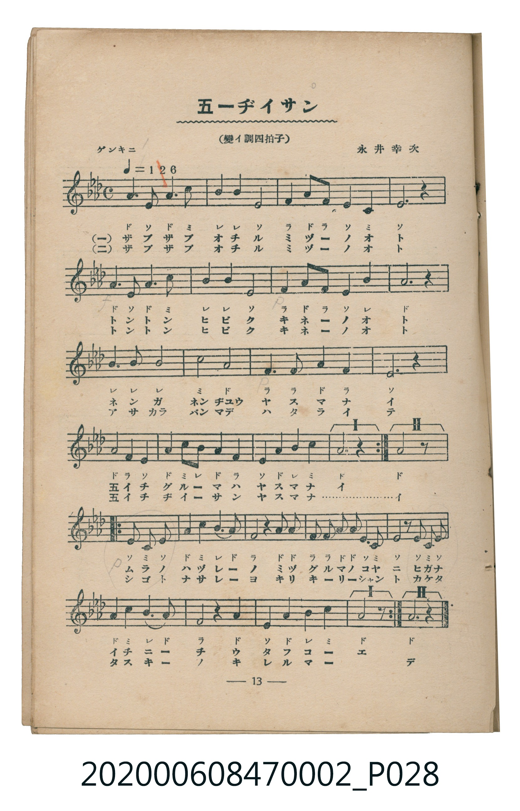
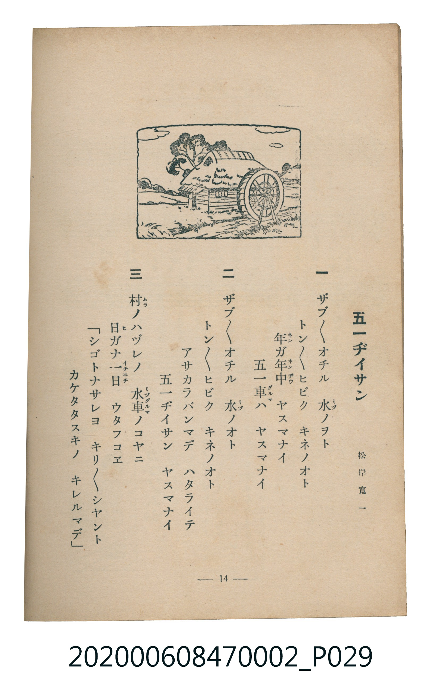

# 五一ヂイサン

> Re:Shoka 使用 AI 協助辨識與重建樂譜，可能會有錯誤。歡迎回報。

<audio controls src="goichi_jiisan.mp3"></audio>

- 詞：松岸寬一
- 曲：永井幸次
- 臺灣教育會公認《新定兒童唱歌》尋常科第二學年用（2020.006.0847.0002）

## 說明

原書資訊與歌詞全文（對應 P028.jpg – P029.jpg，書頁 pp. 13–14，第一學期第 10 首）：
調性與拍號：變イ調四拍子（降 A 大調 4/4 拍），「ゲンキニ（♩＝126）」

## 歌詞

```text
一
ザブ／＼オチル　水（ミヅ）ノヲト
トン／＼ヒビク　キネノオト
年（ネン）ガ年中（ネンヂウ）　ヤスマナイ
五一車（グルマ）ハ　ヤスマナイ

二
ザブ／＼オチル　水（ミヅ）ノオト
トン／＼ヒビク　キネノオト
アサカラバンマデ　ハタライテ
五一ヂイサン　ヤスマナイ

三
村（ムラ）ノハヅレノ　水車（ミヅグルマ）ノコヤニ
日（ヒ）ガナ一日（イチニチ）　ウタフコエ
「シゴトナサレヨ　キリ／＼シヤント
カケタタスキノ　キレルマデ」
```

## ABC

```abc
X:1
T:五一ヂイサン
C:曲：永井幸次
M:4/4
L:1/16
Q:1/4=126
K:Ab
V:V1 name="Piano" snm="Pia"
[V:V1]
A6 E2 A6 c2 | B4 B4 E8 | F4 A2 F2 E4 C4 | E12 z4 |
A6 E2 A6 c2 | B4 B4 E8 | F4 A2 F2 E4 B4 | A12 z4 |
B6 B2 B8 | c8 A8 | F6 F2 A4 F4 | E12 z4 |
A4 F4 E4 A4 | c4 B4 A4 F4 | E4 A4 B4 c4 | A12 z4 |
E4 C4 E4 A4 | c4 B4 A6 F2 | A2 A2 F2 F2 A2 A2 E2 C2 | E6 z2 E4 C2 E2 |
A4 c4 B4 A4 | F4 z4 A8 | E4 A4 B4 c4 | A12 z4 |
```

## TMD 檔案連結

- [主旋律 TMD 檔案](goichi_jiisan.tmd) [[在 TMD Studio 編輯](https://tmdlang.github.io/Tmd-TS/#tmd=s7IKdvYPcrWy4qpTUCpJTLdSSM7PyUlNLsnMz7MqzsjMK0nNjM_KTMmPL87Iz05Ugisry88pzU21Si9KTEmNN4o3MjAyiDcwMIs3sDAxBzIMjBBKi_NLi5JTrYqTM_Lzc-JLUitKkvLzsxHyBUX5Zal5iXlANQVFIBtTwIoQClLLMlNSQdKpKZkl-UWZiTlI7kgtKga7FWxJfElRYl5xclFmAcgDCFUlGalAx6Yl5mbmVCpxaWkpPNk15cmOhsfNTY-bljxu2vq4ebOClhaXoq2CoZEZl72tgqMOl42JvokdyIQXK-e93zPr2dx9TzfteLp-DVAf2OBnszeBhDfseLJr6tOdO56tWQgWftG-63nj4mdTZ75o2vRsTvPT1jUvVvU-buh6Nm3D03WznrZOer566dMpG5-t7Xnc0P10Q_fTHTueL5_4fM2aJ7t6nq7d8XTnludTVrzf0wEKUT1giOqBQhTIMDB6v6dTiYtLX0vBllqAS0FB4Wnf_Gezd7zY3P5iRdeLjnagu4D-fdq64tm0dqArnm7ofdbeqRBgYGShl1WQrvCoYTKIYwnivN_TA9T5ckGjQkGBnoKhMVDO0AQoCPLLjgagX57NmQ9kKxgaKLxcNg3oemBwgWx8sWr_s4blILu6e1_MnA8UfbGuCxgPQPGns2cDBZ-unQC0-uXMXgVHhadLlgPFFYBxoQCUARsCDLiex02bgHH2uGnt4-ZuoNpHM1e-3zMXGHdABY8berlA1gDdAKIeN2173Ay0vf_9nj2Pm1Y9bm583Lz6cUPDsw1bgBofN89_3NwK0tXc97gZaGYHWE8zUGIzVE_zpMfNkx83rQfqAdvXC1IKMgisFBhfYGOAokANnY-b1gBFnuxYCxcEp7FlYHcB0xswse183DzvcTPIw2BXghPii91dIA1NG0BuawYmN6B7-rFogOjoIdFfcMeS4K_HTYtA-aIJ6JyVj5sngD0CdEU72FH9j5v2g8SBeae5DeEL5OyEy_E7OkHUs7kTwY5cADQFFvj9QAc_bl4DYoN9AQ0TsEdQQwboTKBrgHZ3g82avhSsbhIk-IGWAZ0CFQQ5EBgu3UASGgNNy8BunwoyomkF2Keg1LT9cdMWcOgAXQp0PtCUFbBwWQUL4-1gO4E2QwNo9eOmjSDDQGgnWCnI5WAGUD_IteDw6gWppjyvQoGClj4Xl3t-ZnJGpldmZnFinlVAZmJevkONQY1CNcgmBRsLLTswA1tJoQDJnC8W9ihomCg83dD_fH2DDjx7a2LRALQPatjLWX1PJ_RaAVNRJ0gEGAJ7Eezm-Qo1QHINmA0mgbIQABJfCRbvBLMgMiAdYDm4OgRA2KkBdKwm0MqmbVBrpqGwQdpXgdmNYHI1kpUg44FJB4j3AHEf2EkgtSC5DrxW7uqhp5U1CoYKukBoGg9lGAOFjIA0CAMFQUK6QCEzENMQRIEFjUFEDUIBCBqAhMD5DHfk7-oZFJEPUgWSg5iAJViQIh8adqBKGpkN0j4JzJ4MtnI9wsqmtWDxXrIjn15Wkhn5IFmYVuKjfkcnhVEPijRI5MHYiHQPkYFFJyzaQWLASAeLQ0SIzfHAkIRoB8ZAE7JloEoVKtX0uHkpsESHSiyBiDbtBLLngeW7oPZBZHDZB83ui6Dat4KLdqjrQeaCKj-ohaASHS7eD9WwH5bEwfaAZNpw2QeJW1D8QWhQLBpDWbDYhEa2LogCiYF5pGd0YFOKChkd5jNIpgWJIMo5SHbHjFmYGEQeWsoTk9GBrQh4MEKL16YNUO2gYhaUs8CxACZBwQ-LdlCkI2RIiHYsVjY3IWmHWglMFJCkSLaVkNwKjktwTIJ4kLgHpQT0eAbxQeIgedLz-a4pOGIe1jjvfLZuK5GpAKmuJpQKIOkAEtfw4h6a-8EYXGWAqwpoCYAwHcRCSQ-d4DJgAdRQEAkuUeGx3opkOSiKICogzgJXwcCUA0o1oAgCyQDbe-CIA6nohqoHl-TAsgUUfZiWN20HS28BKwUV4IhYhqQGVMtXQCsBYIMRSoOqASAbRIPajouB6QdRFwDLGDC5EVyAwBMJomrHkUrA6QSUJMCVAbiIMASpBeqBlxEGcGOANKFionUt9RILNOOjJwxEZYBIKhQWF5AYQs61oEiFxAZIO0gMEsyg2gFm3X6wmqlgcVBehqtvWkGMdWDtkGwPre1h1oHSJsQ6kDjUOqiPICUXpJiAqYdUIlisg2R25AiHVgegfI-oIYgqJGq5uHTtFJD7CgpAvjIXFwA)]
- [鋼琴伴奏 TMD 檔案](goichi_jiisan_piano.tmd) [[在 TMD Studio 編輯](https://tmdlang.github.io/Tmd-TS/#tmd=s7IKdvYPcrWy4tLSUniya8qTHQ2Pm5seNy153LT1cfPm93s6XnbveT5hy5M9W54u7X_e2fF-T6eClhaXoq2CoZEZl72tgqMOl42JvokdV52C0ouV897vmfVs7r6nm3Y8Xb8GaJgSSPjZ7E0g4Q07nuya-nTnjmdrFoKFX7Tvet64-NnUmS-aNj2b0_y0dc2LVb2PG7qeTdvwdN2sp62Tnq9e-nTKxmdrex43dD_d0P10x47nyyc-X7Pmya6ep2t3PN255fmUFUAXGhkYGegZGJjpGViYmAMZBkZARypxcbnnZyZnZHplZhYn5lkFZCbm5Qd5ONQY1ChUcykAgY2Flh2Yoa-lYIsOFEDW7Gh4sbBHQcNE4emG_ufrG3QUAgyMLPSyCtI1sWjQ0gcbVqNgqKALhKbxUIYxUMgISIMwUBAkpAsUMgMxDUEUWNAYRNQgFICgAUiIC78Td_XQzYkgWZhW4h24o5McB4LsAtkIoUH2GkNZMPuhztMFUSAxMI_0AHw6eza5AQi2EWwfiAdxIci96K4B8UHiIHnSw2_XFBzue7-nBxK-z9ZtxetWRPrC4Viwc0EuA8c1ODwNQWqBeuABagA3BkgTCtPWtZS6GeQsZCdCYxsUYIgEQFTo1mIrB3xQygETRDnwbMOWF7u7XnQ0Pd-4GehyYJH3dPuyZ53dkOIPyX3xCtGGsTAK5BQgyzQ-FsGoUTABskxwqTEAOo1ko5BEELoQJmHTiW461CQoRbSjoAzs2vA4iZA52MLIAM5FNQRsFcwTCEVEuAWYBnTtFJCTgQKQr8zFBQA)]

## 分析

```text
================================================================================
📊 TMD Song Profile: [ 五一ヂイサン ]
================================================================================
⏱  Duration:       0:45 (45.7s), 24 measures total
🎼 Key & Tempo:    首調基準 A,, != 126.0 BPM, <4/4>
   - 分析範圍：      由實際發聲的音符與和弦推測調性；播放脈絡另行呈現
🎤 人聲音域:    C4 (MIDI 60) – C5 (MIDI 72) [跨度: 12 個半音 / 1.0 個八度, 難度: easy]
   - 最低音:  C4 in [GoichiJiisan #1 @ m.3, 0:05]
   - 最高音: C5 in [GoichiJiisan #1 @ m.1, 0:01]
   - 適合: soprano, mezzo-soprano, contralto, tenor, baritone, bass
🏛  結構:      GoichiJiisan (45.7s)
⚡ 編曲密度:        Peak 1 軌道同時演奏
🗝  調性診斷：       G# 大調（純淨自然大調，未偵測到可信轉調）
   - 風格氣質:    純淨自然大調（陽光明朗、易唱易記，無明顯調外色彩）
   - 轉調歷程:    全曲維持單一推測調性（未偵測到可信轉調）
   - 核心骨幹音:  G#, D#, A#, C, F
   - 調性數值:    G# 大調 [相關度: 0.91, 穩定度: High, 自然音純度: 100.0%]
   - 候選調性 (K-S): G# 大調 (0.91), D# 大調 (0.69), F 小調 (0.58)
   - 五度圈歷程:   -4
   - 各段落調性細節:
     • [GoichiJiisan #1]: G# 大調 (r: 0.91, 自然音純度: 100.0%)

  [ 五度圈游移軌跡 ]
               C  
         F            G  
      Bb               D  
      Eb               A  
        [Ab]*          E  
            Db       B  
               F# 
     (* = active key center)

  [ 十二半音累積音高分佈 ]
     C  : ████████                  12.3%
     C# :                            0.0%
     D  :                            0.0%
     D# : ████████████████          24.0%
     E  :                            0.0%
     F  : ████████                  11.7%
     F# :                            0.0%
     G  :                            0.0%
     G# : ████████████████████████  36.3%
     A  :                            0.0%
     A# : ██████████                15.6%
     B  :                            0.0%
--------------------------------------------------------------------------------
Assignment 軌道音域：
  - Piano         : C4 – C5 (12 個半音 / 1.0 個八度, 80 個音符)
================================================================================
```


## 原書掃描頁






