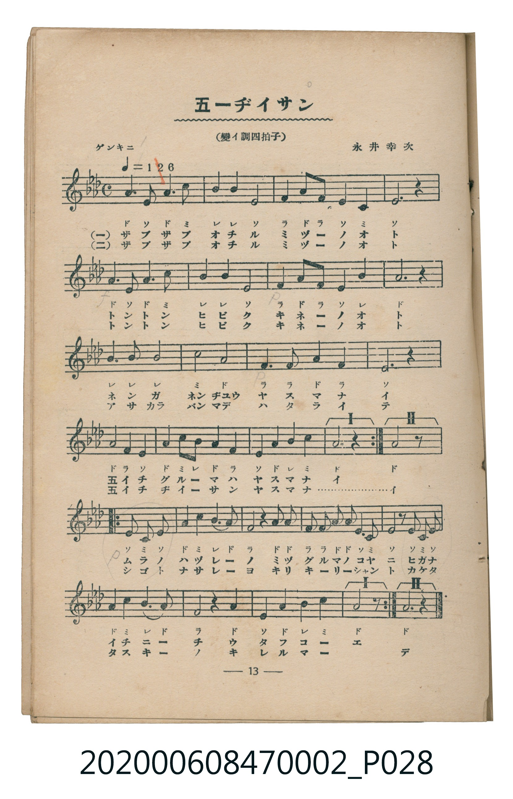
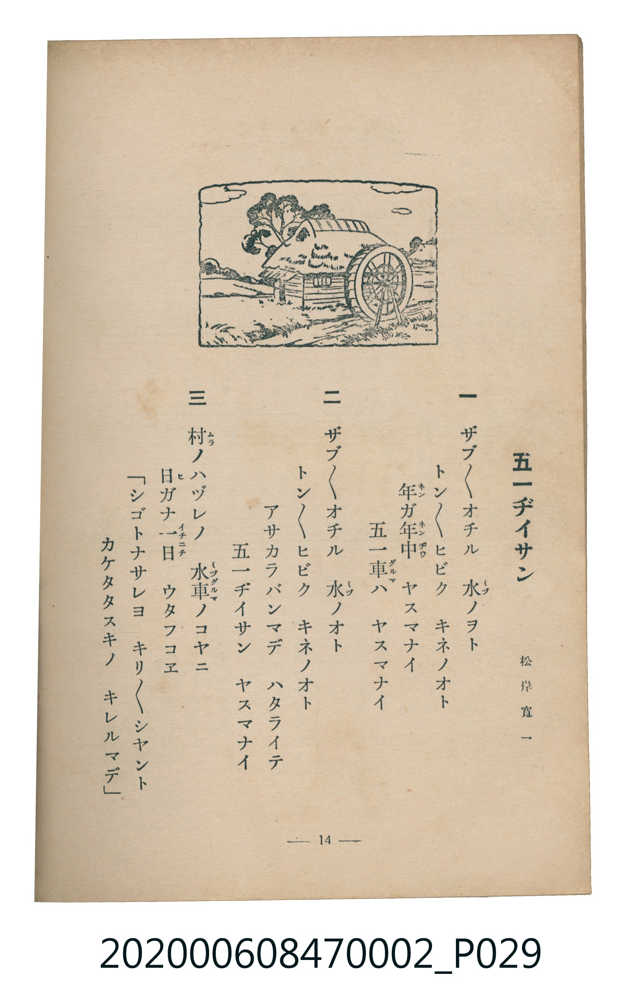

# 五一ヂイサン（五一老爺爺）

> Re:Shōka 使用 AI 協助辨識與重建樂譜，可能會有錯誤。歡迎回報。

- **NEUTRINO 歌聲合成版**：<br><audio controls src="goichi_jiisan_neutrino.mp3"></audio>
- **鋼琴伴奏版**：<br><audio controls src="goichi_jiisan.mp3"></audio>


- 詞：松岸寬一
- 曲：永井幸次
- 臺灣教育會公認《新定兒童唱歌》尋常科第二學年用（2020.006.0847.0002）

## 說明

曲目說明
中文解釋：描寫一位老爺爺的生活與親切形象。

原書資訊與歌詞全文（對應 P028.jpg – P029.jpg，書頁 pp. 13–14，第一學期第 10 首）：
調性與拍號：變イ調四拍子（降 A 大調 4/4 拍），「ゲンキニ（♩＝126）」


## 歌詞

```text
一
ザブ／＼オチル　水（ミヅ）ノヲト
トン／＼ヒビク　キネノオト
年（ネン）ガ年中（ネンヂウ）　ヤスマナイ
五一車（グルマ）ハ　ヤスマナイ

二
ザブ／＼オチル　水（ミヅ）ノオト
トン／＼ヒビク　キネノオト
アサカラバンマデ　ハタライテ
五一ヂイサン　ヤスマナイ

三
村（ムラ）ノハヅレノ　水車（ミヅグルマ）ノコヤニ
日（ヒ）ガナ一日（イチニチ）　ウタフコエ
「シゴトナサレヨ　キリ／＼シヤント
カケタタスキノ　キレルマデ」
```

## ABC

```abc
X:1
T:五一ヂイサン（五一老爺爺）
C:曲：永井幸次
M:4/4
L:1/16
Q:1/4=126
K:Ab
V:V1 name="Piano" snm="Pia"
[V:V1]
A6 E2 A6 c2 | B4 B4 E8 | F4 A2 F2 E4 C4 | E12 z4 |
w: 1.~ザ ブ ザ ブ | オ チ ル | ミ ヅ _ ノ オ | ト
w: 2.~ザ ブ ザ ブ | オ チ ル | ミ ヅ _ ノ オ | ト
A6 E2 A6 c2 | B4 B4 E8 | F4 A2 F2 E4 B4 | A12 z4 |
w: 1.~ト ン ト ン | ヒ ビ ク | キ ネ _ ノ オ | ト
w: 2.~ト ン ト ン | ヒ ビ ク | キ ネ _ ノ オ | ト
B6 B2 B8 | c8 A8 | F6 F2 A4 F4 | E12 z4 |
w: 1.~ネ ン ガ | ネン ヂュウ | ヤ ス マ ナ | イ
w: 2.~ア サ カラ | バン マデ | ハ タ ラ イ | テ
A4 F4 E4 A4 | c4 B4 A4 F4 | E4 A4 B4 c4 | A12 z4 |
w: 1.~ゴ イ チ グ | ル _ マ ハ | ヤ ス マ ナ | イ
w: 2.~ゴ イ チ ヂ | イ _ サ ン | ヤ ス マ ナ | イ
E4 C4 E4 A4 | c4 B4 A6 F2 | A2 A2 F2 F2 A2 A2 E2 C2 | E6 z2 E4 C2 E2 |
w: 1.~ム ラ ノ ハ | ヅ レ _ ノ | ミ ヅ グ ル マ ノ コ ヤ | ニ ヒ ガ ナ
w: 2.~シ ゴ ト ナ | サ レ _ ヨ | キ リ キ _ リ _ シャ ン | ト カ ケ タ
A4 c4 B4 A4 | F4 z4 A8 | E4 A4 B4 c4 | A12 z4 |
w: 1.~イ チ ニ _ | チ ウ | タ フ コ _ | エ
w: 2.~タ ス キ _ | ノ キ | レ ル マ _ | デ
```

## TMD 檔案連結

- [主旋律 TMD 檔案](goichi_jiisan.tmd) [[在 TMD Studio 編輯](https://tmdlang.github.io/Tmd-TS/#tmd=s7IKdvYPcrWy4qpTUCpJTLdSSM7PyUlNLsnMz7MqzsjMK0nNjM_KTMmPL87Iz05Ugisry88pzU21Si9KTEmNN4o3MjAyiDcwMIs3sDAxBzIMjBBKi_NLi5JTrYqTM_Lzc-JLUitKkvLzsxHyBUX5Zal5iXlANQVFIBtTwIoQClLLMlNSQdKpKZkl-UWZiTlI7kgtKga7FWxJfElRYl5xclFmAcgDCFUlGalAx6Yl5mbmVCpxaWkpPNk15cmOhsfNTY-bljxu2vq4efP7PR0QwRcNjc87dgHR-z2dClpaXIq2CoZGZlz2tgqOOlw2JvomdiBjX6yc937PrGdz9z3dtOPp-jVAfWDbns3eBBLesOPJrqlPd-54tmYhWPhF-67njYufTZ35omnTsznNT1vXvFjV-7ih69m0DU_XzXraOun56qVPp2x8trbncUP30w3dT3fseL584vM1a57s6nm6dsfTnVueT1kBdCEomPWAwawHCmYgw8AI6EglLn0tBaDFz2eve7Fq1bMZfVwKCgpPdqx9Nq39xfLFL9u7QS7q73-6fjXQlU_29sI9-HxWy_Mp859t2f2io_3FslVPO9qf7l30YuPCxw1NXFr6XCBjbakFQG562jf_2ewdLza3v1jRBbQS6FtgKD5tXQF0KNBvTzf0PmvvVAgwMLLQyypIV3jUMBnEsQRx3u_pAep8uaBRoaBAT8HQGChnaAIUBIXQjgZgCD2bMx_IVjA0UHi5bBowTIBeBtn4YtX-Zw3LQXZ1976YOR8o-mJdFzDKgeJPZ88GCj5dOwFo9cuZvQqOCk-XLAeKKwBjWAEoAzYEGB09j5s2AZPH46a1j5uBIdnxaObK93vmAlMEUMHjhl4uSGA3gKjHTdseNwNt73-_Z8_jplWPmxsfN69-3NDwbMMWoMbHzfMfN7eCdDX3PW4GmtkB1tMMlAAmPrCe5kmPmyc_bloP1AO2rxekFGQQWCkwFYCNAYoCNXQ-bloDFAHGM1wQnJyXgd0FTNrAdL3zcfO8x80gD4NdCUneu7tAGpo2gNzWDEzEQPf0Y9EA0dFDor_gjiXBX4-bFoGyYBPQOSsfN08AewToinawo_ofN-0HiQOzaXMbwhfIOReX43d0gqhncyeCHbkAaAos8PuBDn7cvAbEBvsCGiZgj6CGDNCZQNcA7e4GmzV9KVjdJEjwAy0DOgUqCHIgMFy6gSQ0BpqWgd0-FWRE0wqwT0Gpafvjpi3g0AG6FOh8oCkrYOGyChbG28F2Am2GBtDqx00bQYaB0E6wUpDLwQygfpBrweHVC1JNeV6FAgVQGeCen5mckemVmVmcmGcVkJmYl-9QY1BTDbJIwcZCyw7MwFZQKEDy5ouFPQoaJgpPN_Q_X9-gA8_dmlg0AK2DGvZyVt_TCb1WwETUCRIBBsBeBLt5vkINkFwDZoNJoCwEgMRXgsU7wSyIDEgHWA6uDgEQdmoAHasJtLJpG9SaaShskPZVYHYjmFyNZCXIeGDKAeI9QNwHdhJILUiuA6-Vu3roaWWNgqGCLhCaxkMZxkAhIyANwkBBkJAuUMgMxDQEUWBBYxBRg1AAggYgIbChPoYgd24Di8J8AGNDfABiN4LJ1XArQD4AibSCyT4QCVYJcT_CHrDVEHuMaG8P_sS8q2dQJGaQKpAcxAQs0YyUmKFpAViUoLBB2ieB2ZPBVq5HWNm0FizeS3ZippeVZCZmkCxMK9akDE0WMPfD2BD3g9iTwYloPSKJAd0PEu8lLSnT2B4C5XInhUkZlAghiRHGRpRLEBlY8oQlY5AYMBGDxSEixJbIQB9DtANDqgnZMlCbByrV9Lh5KbDChUosgYg27QSy54Hlu6D2QWRw2QctjhdBtW8F17xQ14PMBbVNoBaCKly4eD9Uw35YlgXbA5Jpw2UfJK2C0iOEBsWjMZQFS53QxKsLokBiYB7-ghicOqCpChhWiGIQHFYQLiK0ENJLIDLQEAOp6YImOogM9tJ4EVQXPKAQBoKDCmYfOLAQcv1QbZDgArFAlkCCi6R0DGzDU6FIhsUZpHgFiSBqWEjBjJlmYWIQeWj7gpgiGdh8hScQaMXetAGqHVTBg8pAcPoCk6CEBUvQoMhByJCQoLFY2dyEpB1qJTAWIZmMbCsh5So4lYLTKIgHSdWgNI6egkF8kDhIHm-J3LQFnkagFTwwxCDpBVbRwxItKGXBkjPI8QgZYpIzhj3AYELVBQokSO4i3R4CjYspOFIyrJfb-WzdViJTNVKrl1CqhqRrSNqFNzSg5TQYgxsr4EYKtKxGmA5ioaTvTnBpvQBqKIgE1-XwVNyKZDkoyUFUQJwFbswC4xUUp6CwBMkAO07gMAap6IaqB7chgCUbKKQxLW_aDpbeAlYKajogUi0kdaNavgJarQJ7XlAa1AABskE0qBO2GBjViFYIsJADkxvBZRc80SMayThSPTjdg5I4uBkCLswNQWqBeuCluQHcGCCNXKAvACcrcDEJqfThiRzSpoUV8hB5YgMTkiyhTQ1ocCJnhe1gcXCGADcuEAkbkgGQbUUPRZAYuDUODkEgB9KqgbRRgJYCQxEkCQlFQiV861rq5QtomY2eBxAtFESuoLCkhyRG5AIXlH4hCQ-kHSQGSVGgJgvMuv1gNVPB4qBiGK6-aQUx1oG1Q0psaJMaZh0oG0KsA4lDrYP6CFLpQEp4mHpIywaLdZByGjltQ9sooCIb0WwhsXxHLnEhSROSwEEiIJNQmipAb4LUTQWLw5oYkDDCXbKD9UDKaXAChdkAylAQG5BFQYkbUrdASnWYOKwNg7ChlotL104BeYxEAchX5gIA)]
- [鋼琴伴奏 TMD 檔案](goichi_jiisan_piano.tmd) [[在 TMD Studio 編輯](https://tmdlang.github.io/Tmd-TS/#tmd=s7IKdvYPcrWy4tLSUniya8qTHQ2Pm5seNy153LT1cfPm93s6XnbveT5hy5M9W54u7X_e2fF-T6eClhaXoq2CoZEZl72tgqMOl42JvokdV52C0ouV897vmfVs7r6nm3Y8Xb8GaJgSSPjZ7E0g4Q07nuya-nTnjmdrFoKFX7Tvet64-NnUmS-aNj2b0_y0dc2LVb2PG7qeTdvwdN2sp62Tnq9e-nTKxmdrex43dD_d0P10x47nyyc-X7Pmya6ep2t3PN255fmUFUAXGhkYGegZGJjpGViYmAMZBkZARypxcbnnZyZnZHplZhYn5lkFZCbm5Qd5ONQY1FRzKQCBjYWWHZihr6Vgiw4UQLbsaHixsEdBw0Th6Yb-5-sbdBQCDIws9LIK0jWxaNDSBxtWo2CooAuEpvFQhjFQyAhIgzBQECSkCxQyAzENQRRY0BhE1CAUgKABSAhsqI9hjcLjpm1g0cfN01DYIJlVYHYjmFwNt-Jx83ywSCuY7AORYJUgmQ4ke8BWQ-wxor09-IN8Vw_dghwkC9OKNcChjgfmAhQ2SGYSmD0Z7NX1iIBoWgsW7yUtwGlsD4E03klOgIPCDhSCEBpkszGUBQtPaHDrgiiQGJiHP4GD_QMNh6Y1CN8294KEIFxQ2dS89HHTMiTpJRCZpp1A9jywmi5oMEFksKfyRVBdW4F49ePmlUgGTkC2b97j5nYkuX6otv1ANkgPxBKQTBtpIf909mxykzo4LMEhCeJBwh4UE-jhDOKDxEHyeFN60xa4T6DZu2kD1FewbA4LWpD_YYEOCnKEDDGBjmFPcxOaLlCEQNIA6fYQKFqm4Ajv93t6IDnh2bqteMMeUVLjCHxw8INCGlzKgFO-IUgtUA886RvAjQHSyKl_Adh34DQFydPwsIYUrLAcAZGHFLsgOVBcgeIJFD4gmcdNoHJkCVhFNzR0oCUJMFeBwg85RraDxcHxAi47EOELiQdkW1dAy57HzavgZRC4Smja_rh5MbzQghRBQEubQInncdNGcHYhlB1a11IaPaAYQI4NaBEESuuIUonEjIGcVCGBCYkSkAjIJJSSCOhLkLqpYHFYCQISX4FkA3qWAOuBJHBwkMJsACUBiA3IoqDogGRKSHaAicOKKIQNtdjaPz7I7R8TRPvn2YYtL3Z3vehoer5xMzDwgS29p9uXPevshrT6kII4XiHaMBZGgUITyDKNj0UwahRMgCwTXGoMoH4nySgkEYQuhEnYdKKbDjUJShHtKCgDuzY8TiJkDrYwMoBzUQ0BWwXzBEIREW4BJgFdOwXkVBDtA5TFEDMCiylzAQA)]

## 分析

```text
================================================================================
📊 TMD Song Profile: [ 五一ヂイサン（五一老爺爺） ]
================================================================================
⏱  Duration:       0:45 (45.7s), 24 measures total
🎼 Key & Tempo:    首調基準 A,, != 126.0 BPM, <4/4>
   - 分析範圍：      由實際發聲的音符與和弦推測調性；播放脈絡另行呈現
🎤 人聲音域:    C4 (MIDI 60) – C5 (MIDI 72) [跨度: 12 個半音 / 1.0 個八度, 難度: easy]
   - 最低音:  C4 in [GoichiJiisan #1 @ m.3, 0:05]
   - 最高音: C5 in [GoichiJiisan #1 @ m.1, 0:01]
   - 適合: soprano, mezzo-soprano, contralto, tenor, baritone, bass
🏛  結構:      GoichiJiisan (45.7s)
⚡ 編曲密度:        Peak 1 軌道同時演奏
🗝  調性診斷：       G# 大調（純淨自然大調，未偵測到可信轉調）
   - 風格氣質:    純淨自然大調（陽光明朗、易唱易記，無明顯調外色彩）
   - 轉調歷程:    全曲維持單一推測調性（未偵測到可信轉調）
   - 核心骨幹音:  G#, D#, A#, C, F
   - 調性數值:    G# 大調 [相關度: 0.91, 穩定度: High, 自然音純度: 100.0%]
   - 候選調性 (K-S): G# 大調 (0.91), D# 大調 (0.69), F 小調 (0.58)
   - 五度圈歷程:   -4
   - 各段落調性細節:
     • [GoichiJiisan #1]: G# 大調 (r: 0.91, 自然音純度: 100.0%)

  [ 五度圈游移軌跡 ]
               C  
         F            G  
      Bb               D  
      Eb               A  
        [Ab]*          E  
            Db       B  
               F# 
     (* = active key center)

  [ 十二半音累積音高分佈 ]
     C  : ████████                  12.3%
     C# :                            0.0%
     D  :                            0.0%
     D# : ████████████████          24.0%
     E  :                            0.0%
     F  : ████████                  11.7%
     F# :                            0.0%
     G  :                            0.0%
     G# : ████████████████████████  36.3%
     A  :                            0.0%
     A# : ██████████                15.6%
     B  :                            0.0%
--------------------------------------------------------------------------------
Assignment 軌道音域：
  - Piano         : C4 – C5 (12 個半音 / 1.0 個八度, 80 個音符)
================================================================================
```


## 原書掃描頁






