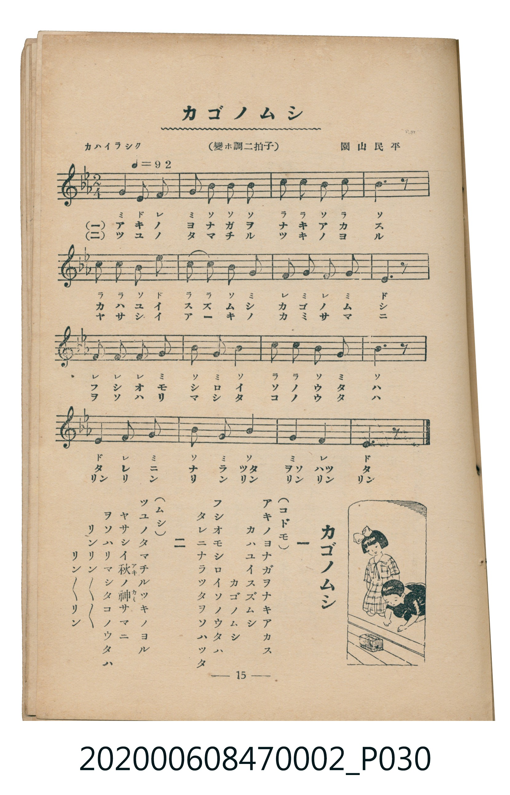

# カゴノムシ

<audio controls src="kago_no_mushi.mp3"></audio>

- 曲：園山民平
- 臺灣教育會公認《新定兒童唱歌》尋常科第二學年用（2020.006.0847.0002）

- note

原書資訊與歌詞全文（對應 P030.jpg，書頁 p. 15，第二學期第 1 首）：
調性與拍號：變ホ調二拍子（降 E 大調 2/4 拍），「カハイラシク（♩＝92）」

## 歌詞

```text
一（コドモ）
アキノヨナガヲナキアカス
カハユイスズムシ　カゴノムシ
フシオモシロイソノウタハ
タレニナラツタヲソハツタ

二（ムシ）
ツユノタマチルツキノヨル
ヤサシイ秋（アキ）ノ神（カミ）サマニ
ヲソハリマシタコノウタハ
リンリン～～　リン～～リン
```

## 原書掃描頁



## 調性分析

```text
================================================================================
📊 TMD Song Profile: [ カゴノムシ ]
================================================================================
⏱  Duration:       0:20 (20.9s), 16 measures total
🎼 Key & Tempo:    首調基準 E,, != 92.0 BPM, <2/4>
   - 分析範圍：      由實際發聲的音符與和弦推測調性；播放脈絡另行呈現
🎤 人聲音域:    D#4 (MIDI 63) – D#5 (MIDI 75) [跨度: 12 個半音 / 1.0 個八度, 難度: easy]
   - 最低音:  D#4 in [KagoNoMushi #1 @ m.1, 0:00]
   - 最高音: D#5 in [KagoNoMushi #1 @ m.5, 0:06]
   - 適合: soprano, mezzo-soprano, contralto, tenor, baritone, bass
🏛  結構:      KagoNoMushi (20.9s)
⚡ 編曲密度:        Peak 1 軌道同時演奏
🗝  調性診斷：       A# 大調（純淨自然大調，未偵測到可信轉調）
   - 風格氣質:    純淨自然大調（陽光明朗、易唱易記，無明顯調外色彩）
   - 轉調歷程:    全曲維持單一推測調性（未偵測到可信轉調）
   - 核心骨幹音:  A#, G, D#, F, C
   - 調性數值:    A# 大調 [相關度: 0.83, 穩定度: Moderate, 自然音純度: 100.0%]
   - 候選調性 (K-S): A# 大調 (0.83), D# 大調 (0.76), G 小調 (0.69)
   - 五度圈歷程:   -2
   - 各段落調性細節:
     • [KagoNoMushi #1]: A# 大調 (r: 0.83, 自然音純度: 100.0%)

  [ 五度圈游移軌跡 ]
               C  
         F            G  
     [Bb]*              D  
      Eb               A  
         Ab           E  
            Db       B  
               F# 
     (* = active key center)

  [ 十二半音累積音高分佈 ]
     C  : ███████████               15.0%
     C# :                            0.0%
     D  :                            0.0%
     D# : █████████████             16.7%
     E  :                            0.0%
     F  : █████████████             16.7%
     F# :                            0.0%
     G  : ███████████████           20.0%
     G# :                            0.0%
     A  :                            0.0%
     A# : ████████████████████████  31.7%
     B  :                            0.0%
--------------------------------------------------------------------------------
Assignment 軌道音域：
  - Piano         : D#4 – D#5 (12 個半音 / 1.0 個八度, 46 個音符)
================================================================================
```

## ABC

```abc
X:1
T:カゴノムシ
C:曲：園山民平
M:2/4
L:1/16
Q:1/4=92
K:Eb

V:V1 name="Piano" snm="Pia"

[V:V1]
g2 e2 f4 | g2 b2 b2 b2 | c2 c2 b2 c2 | b6 z2 |
c2 c2 b2 e2 | c2 c2 b2 g2 | f2 g2 f2 g2 | e6 z2 |
f2 f2 f2 g2 | b2 g2 b4 | c2 c2 b2 g2 | b6 z2 |
e4 f2 g2 | b2 g2 b4 | g4 f4 | e6 z2 |
```

- [主旋律 TMD 檔案](kago_no_mushi.tmd)
- [鋼琴伴奏 TMD 檔案](kago_no_mushi_piano.tmd)
