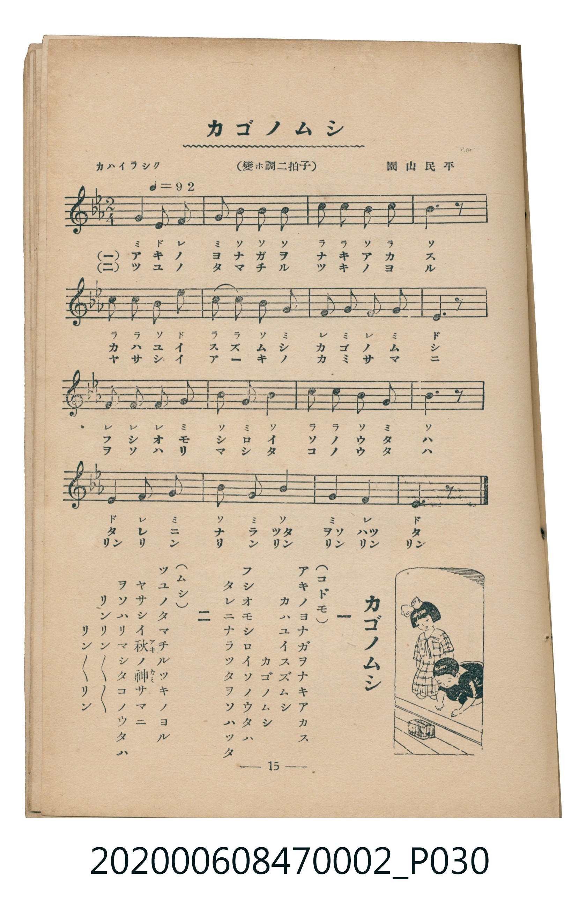

# カゴノムシ（籠中蟲）

> Re:Shōka 使用 AI 協助辨識與重建樂譜，可能會有錯誤。歡迎回報。

- **鋼琴伴奏版**：<br><audio controls src="kago_no_mushi.mp3"></audio>
- **NEUTRINO 歌聲合成版**：<br><audio controls src="kago_no_mushi_neutrino.mp3"></audio>

- 曲：園山民平
- 臺灣教育會公認《新定兒童唱歌》尋常科第二學年用（2020.006.0847.0002）

## 說明

曲目說明
中文解釋：描寫被關在籠中的昆蟲，以及孩子對牠的觀察。

原書資訊與歌詞全文（對應 P030.jpg，書頁 p. 15，第二學期第 1 首）：
調性與拍號：變ホ調二拍子（降 E 大調 2/4 拍），「カハイラシク（♩＝92）」


## 歌詞

```text
一（コドモ）
アキノヨナガヲナキアカス
カハユイスズムシ　カゴノムシ
フシオモシロイソノウタハ
タレニナラツタヲソハツタ

二（ムシ）
ツユノタマチルツキノヨル
ヤサシイ秋（アキ）ノ神（カミ）サマニ
ヲソハリマシタコノウタハ
リンリン～～　リン～～リン
```

## ABC

<div class="abc-score" data-abc-src="kago_no_mushi.abc" aria-label="五線譜載入中"></div>

[下載 ABC 原始檔](kago_no_mushi.abc)

## TMD 檔案連結

- [主旋律 TMD 檔案](kago_no_mushi.tmd) [[在 TMD Studio 編輯](https://tmdlang.github.io/Tmd-TS/#tmd=s7IKdvYPcrWy4qpTUCpJTLdSSM7PyUlNLsnMz7MqzsjMK0nNjM_KTMmPL87Iz05Ugisry88pzU21Si9KTEmNN4o3MjAyiDcwMIs3sDAxBzIMjBBKi_NLi5JTrYqTM_Lzc-JLUitKkvLzsxHyBUX5Zal5iXlANQVFIBtTwIoQClLLMlNSQdKpKZkl-UWZiTlI7kgtKga7FWxJfElRYl5xclFmAcgDCFUlGalAxybmZeYi6wUalZ6ZZ1WSmAn0HMiD5YnxuYmZeTmJeSlKXFpaCo-bVj9u2vK4ue9x84LHTdvf7-l4vnHBkx1rX8zf9H5Pp4KWFpeirYKlEZe9rYKrDpeNkb6JHcjwZ7OB0rOezpn0dOPGZxsmPt25GWzni_ZdzxsXP5s680XTpmdzmp-2rnmxqvdxQ9ezaRuerpv1tHXS89VLn07Z-Gxtz-OG7qcbup_u2PF8-cTna9Y82dXzdO2Opzu3PJ-yAugGUFjrAcNaDxTWQIaBEdAxSlz6WgpAi5_PXvdi1apnM_q4FBQUgE59Nq39xfLFL9u7gS561t__dP3qF4tWv5w-5-mcFRC_PJ_V8mxGG9hHPU92L33a3_V07cqnayc83dD7vHMBUPbF8oan6-c_bmji0tLnAtliSy0AcuLTvvnPZu94sbn9xYquFx3tQM-_WDnvaesKoLuBXgU64ll7p0KAgbGBXlZBOtCJQMUvFzQqFOgpGJoCufDQeTZnPpCtYKjwctk0YHAAfQsy_cWq_c8aloPM7e59MXM-UPTFuq7HzbOB4kBtQEGgR4HWvJzZq-Cq8HTJcqC4AjAWFYAyYEOAMdEDSgTN_Y-bljxuXglMBI-b1gN1PJq58v2euZagkH_c0MsFCewGoMTjps2PmzsfNy8CyoBEHzctety0FpyEVjxu7nrctOZx8yYwYy1YCpjAdkLUgW1pXgayqGnn46ZdkDT3uKEBLRWCVTdPBTtlFdAiEKMZaBhQ216QoiagEfuBZkFMBbKANnaDbAQ6v7kFLLIJrBRoG4gLcfyuHpDjockc4nKgLNA5IBOBWuY9bm583Ax0I1AL3DurIeqANm8FO2fJ8-XAdAYMA5CfQUHT3Pd86TywCFAnMPg7QSpBZnVDdMIdAvTIPLAR-8EBiOYLkDRQFES-3zsPiEChgswFs0FKKU-UUKAASuzeien5fvm-pcCC0CogMzEv36HGoKYaZI-CjYWWHZiBLUMogJLljoYXC3sUNEwUnm7of76-QQeeijWxaADaBjXs5ay-pxN6rYCeng_2eieYXAOSBYIamHjTXjQSJLMSrBZMQmTAbKAMmIcMEPZpAB2qCbSuaRFY21qwtj4k61aARbrAsiBnAGMNKgMRA-uA6l4NtW4nHut29YCsa24BG7UM3bqm_WCReWCyEUxCDYXoQHIgxGkgGZAKLNbVKBgDCwQjBV0wyxQMaxTMgNAUiGuApC4QGijUgFX7GIKsXwS2AmQBSBfICpA_QT4H-Rvia7AKsMrVUN-CzImHmWMEcSzIc3BzgN4CeQrkJZBzoSqgNoFsgXgDZg7-lLWrh8KUhZlOQKkMewoCpTaQDCTqIWkSwQbJgPRiCX3ktAWKIGBmBpPgKG9aAo1uUEoBFnZgmQVg9naoDFhP0xak6AbJg2RAKnBZCE1dIOOBZQ3cQISF4ITavAcshkhLcAuhuQusE5wKQT7sxm4hLC0ZxsGZxkCWEZAE4Rpg4sNMYKvBAQFOHEA3QYIAFAAg74HcClUD9DgkaSyAehkziS0BuxMkBzNpEVANLFHB7JoPUQX0C8QnxCWxHZ0UJjFIEkEmockFKVkhiiW8SY-Iwqt5KlJMrwJrBsUzLLEA60ewDCgNQK2DWgFOWE2QJAkqeUAOASVTXNZBkxeoBIQZAUnVIEtBmsEFF9QhIANh1m0m1TpQOgJBUDoCpStQYYWcyrAUXsBQgKSGVWD_Q3wP8jvI55BiaC8kVQGdAHIAxHrMlLUJqhKUTldBvQUxeT_UnM14zMGbsp7Onk1hyoIVN8SmK5AIQj1MlIhCCxZ9MItApQC82oMm12aYMnCwwSwGN2maYeJwg7DZBU1QoPYLVCsk-YJ4IDMRPCRFYAkkHVjF0WyDlEbo6ckYLAZiYSurQLEN8j3I79CqD-hvqK8h9SPYzyBVYB_D6jrMJAV2FkgdKG1uhnoNxIJLoarCEIMYWMvFpWungNQuUwBylbkA)]
- [鋼琴伴奏 TMD 檔案](kago_no_mushi_piano.tmd) [[在 TMD Studio 編輯](https://tmdlang.github.io/Tmd-TS/#tmd=s7IKdvYPcrWy4tLSUnjctPpx05bHzX2Pmxc8btr-fk_Hy-49zydsebJny9Ol_c87O97v6VTQ0uJStFWwNOKyt1Vw1eGyMdI3seOqU1B6NnvT-z2zns6Z9HTjxmcbJj7duVkJJPyifdfzxsXPps580bTp2Zzmp61rXqzqfdzQ9WzahqfrZj1tnfR89dKnUzY-W9vzuKH76Ybupzt2PF8-8fmaNU929Txdu-Ppzi3Pp6wAusTIwMhAz8DATM_AwsQcyDAwAjpGiYvLOzE93y_ft7Q4I9MqIDMxLz_Iw6HGoKaaSwEIbCy07MAMfS0FW3SgALJkR8OLhT0KGiYKTzf0P1_foKMQYGBsoJdVkK6JRYOWPtiwGgVjBUMFIwVdMMsUDGsUzIDQFIhrgKQuEBoo1IBV-xjWAAN2ERCvVQAGLVjX4-YVQNwFFFsDpDeBRUA8oAqwytUgkaadYHPiYeYYgVS1APEyhDlN-4HseUDcCMRgXSAVUJtAtoBEVsPNwR8Wu3rICQuIvw3j4ExjIMsISIJwDTCgMANjNdBR_RCPNC2BevVx0y6gyAIgvR0sAlTTtAXqjQVgke1YgmMJUHwrWA5m0iKgGlgAwOyaD1EFDCiQnm4ig2NHJznBYQSGIJ-DQgKUFJDDBUvSaJ4Kdf8qIHsR1KePm0FJYQk0kvdCwqEJFF77wX7oxxIWm6AqQSG7CqwKmDDAJu-HmrMZjzl4w-Lp7NnkhAUo7tHDwhgsBmJhSxkglz5uBmWKblimaF4JxM1wTzRvAvkSpKofKAzPBZjBsepx82awOlC4bgZrhbDgUqiqMMQgBtZiKWJ8kIsYE0QR83x599Mlc17M3_Ry85Znu1a_XLbi6fZlzzq7IeUnUrjEK0QbxiIzTIAME6gILESQREEMsDrTeCDLNB5DJao4wky4JoRSTMtBDBQzgX7WtVNA8na0D1AhupARWEiZCwA)]

## 分析

```text
================================================================================
📊 TMD Song Profile: [ カゴノムシ（籠中蟲） ]
================================================================================
⏱  Duration:       0:20 (20.9s), 16 measures total
🎼 Key & Tempo:    首調基準 E,, != 92.0 BPM, <2/4>
   - 分析範圍：      由實際發聲的音符與和弦推測調性；播放脈絡另行呈現
🎤 人聲音域:    D#4 (MIDI 63) – D#5 (MIDI 75) [跨度: 12 個半音 / 1.0 個八度, 難度: easy]
   - 最低音:  D#4 in [KagoNoMushi #1 @ m.1, 0:00]
   - 最高音: D#5 in [KagoNoMushi #1 @ m.5, 0:06]
   - 適合: soprano, mezzo-soprano, contralto, tenor, baritone, bass
🏛  結構:      KagoNoMushi (20.9s)
⚡ 編曲密度:        Peak 1 軌道同時演奏
🗝  調性診斷：       A# 大調（純淨自然大調，未偵測到可信轉調）
   - 風格氣質:    純淨自然大調（陽光明朗、易唱易記，無明顯調外色彩）
   - 轉調歷程:    全曲維持單一推測調性（未偵測到可信轉調）
   - 核心骨幹音:  A#, G, D#, F, C
   - 調性數值:    A# 大調 [相關度: 0.83, 穩定度: Moderate, 自然音純度: 100.0%]
   - 候選調性 (K-S): A# 大調 (0.83), D# 大調 (0.76), G 小調 (0.69)
   - 五度圈歷程:   -2
   - 各段落調性細節:
     • [KagoNoMushi #1]: A# 大調 (r: 0.83, 自然音純度: 100.0%)

  [ 五度圈游移軌跡 ]
               C  
         F            G  
     [Bb]*              D  
      Eb               A  
         Ab           E  
            Db       B  
               F# 
     (* = active key center)

  [ 十二半音累積音高分佈 ]
     C  : ███████████               15.0%
     C# :                            0.0%
     D  :                            0.0%
     D# : █████████████             16.7%
     E  :                            0.0%
     F  : █████████████             16.7%
     F# :                            0.0%
     G  : ███████████████           20.0%
     G# :                            0.0%
     A  :                            0.0%
     A# : ████████████████████████  31.7%
     B  :                            0.0%
--------------------------------------------------------------------------------
Assignment 軌道音域：
  - Piano         : D#4 – D#5 (12 個半音 / 1.0 個八度, 46 個音符)
================================================================================
```


## 原書掃描頁




