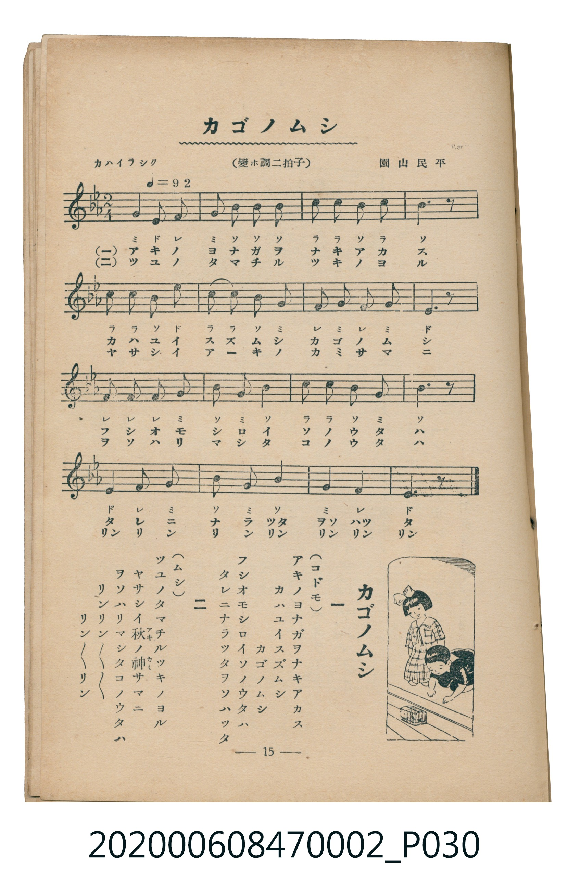

# カゴノムシ（籠中蟲）

> Re:Shōka 使用 AI 協助辨識與重建樂譜，可能會有錯誤。歡迎[回報](https://github.com/TMDLang/reshoka/issues)。

- **鋼琴伴奏版**：<br><audio controls src="kago_no_mushi.mp3"></audio>
- **NEUTRINO 歌聲合成版**：<br><audio controls src="kago_no_mushi_neutrino.mp3"></audio>

- 曲：園山民平
- 臺灣教育會公認《新定兒童唱歌》尋常科第二學年用（2020.006.0847.0002）

## 說明

曲目說明
中文解釋：描寫被關在籠中的昆蟲，以及孩子對牠的觀察。

原書資訊與歌詞全文（對應 P030.jpg，書頁 p. 15，第二學期第 1 首）：
調性與拍號：變ホ調二拍子（降 E 大調 2/4 拍），「カハイラシク（♩＝92）」


## 歌詞

```text
一（コドモ）
アキノヨナガヲナキアカス
カハユイスズムシ　カゴノムシ
フシオモシロイソノウタハ
タレニナラツタヲソハツタ

二（ムシ）
ツユノタマチルツキノヨル
ヤサシイ秋（アキ）ノ神（カミ）サマニ
ヲソハリマシタコノウタハ
リンリン～～　リン～～リン
```

## ABC

<div class="abc-score" data-abc-src="kago_no_mushi.abc" aria-label="五線譜載入中"></div>

[下載 ABC 原始檔](kago_no_mushi.abc)

## TMD 檔案連結

- [主旋律 TMD 檔案](kago_no_mushi.tmd) [[在 TMD Studio 編輯](https://tmdlang.github.io/Tmd-TS/#tmd=s7IKdvYPcrWy4qpTUCpJTLdSSM7PyUlNLsnMz7MqzsjMK0nNjM_KTMmPL87Iz05Ugisry88pzU21Si9KTEmNN4o3MjAyiDcwMIs3sDAxBzIMjBBKi_NLi5JTrYqTM_Lzc-JLUitKkvLzsxHyBUX5Zal5iXlANQVFIBtTwIoQClLLMlNSQdKpKZkl-UWZiTlI7kgtKga7FWxJfElRYl5xclFmAcgDCFUlGalAxybmZeYi6wUalZ6ZZ1WSmAn0HMiD5YnxuYmZeTmJeSnIqkoy8oH-LMiotMrILAY5IDkxJz47MQ8pOKDWFySmp1oFGBgbKHFpaSk8blr9uGnL4-a-x80LHjdtf7-n4_nGBU92rH0xf9P7PZ0KWlpcirYKlkZc9rYKrjpcNkb6JnYgA5_NBkrPejpn0tONG59tmPh052awPS_adz1vXPxs6swXTZuezWl-2rrmxarexw1dz6ZteLpu1tPWSc9XL306ZeOztT2PG7qfbuh-umPH8-UTn69Z82RXz9O1O57u3PJ8ygqgG0BRpQeMKj1QVAEZBkZAxyhx6WspAC1-Pnvdi1Wrns3o41JQUAA69dm09hfLF79s7wa66Fl__9P1q18sWv1y-pync1ZA_PJ8VsuzGW1gH_U82b30aX_X07Urn66d8HRD7_POBUDZF8sbnq6f_7ihiUtLnwtkiy21AMiJT_vmP5u948Xm9hcrul50tAM9_2LlvKetK4DuBnoV6Ihn7Z0KoAjRyypIBzoRqPjlgkaFAj0FQ1MgFx46z-bMB7IVDBVeLpsGDA6gb0Gmv1i1_1nDcpC53b0vZs4Hir5Y1_W4eTZQHKgNKAj0KNCalzN7FVwVni5ZDhRXAMaiAlAGbAgwJnpAiaC5_3HTksfNK4GJ4HHTeqCORzNXvt8z1xIU8o8berkggd0AlHjctPlxc-fj5kVAGZDo46ZFj5vWgpPQisfNXY-b1jxu3gRmrAVLARPYTog6sC3Ny0AWNe183LQLkuYeNzSgpUKw6uapYKesAloEYjQDDQNq2wtS1AQ0Yj_QLIipQBbQxm6QjUDnN7eARTaBlQJtA3Ehjt_VA3I8NJlDXA6UBToHZCJQy7zHzY2Pm4FuBGqBe2c1RB3Q5q1g5yx5vhyYzoBhAPIzKGia-54vnQcWAeoEBn8nSCXIrG6ITrhDgB6ZBzZiPzgA0XwBkgaKgsj3e-cBEShUkLlgNkgp5YkSChRAid07MT3fL9-3FFiOWgVkJublO9QY1FSD7FGwsdCyAzOwZQgFULLc0fBiYY-ChonC0w39z9c36MBTsSYWDUDboIa9nNX3dEKvFdDT88Fe7wSTa0CyQFADE2_ai0aCZFaC1YJJiAyYDZQB85ABwj4NoEM1gdY1LQJrWwvW1odk3QqwSBdYFuQMYKxBZSBiYB1Q3auh1u3EY92uHpB1zS1go5ahW9e0HywyD0w2gkmooRAdSA6EOA0kA1KBxboaBWNggWCkoAtmmYJhjYIZEJoCcQ2Q1AVCA4UasGofQ5D1i8BWgCwA6QJZAfInyOcgf0N8DVYBVrka6luQOfEwc4wgjgV5Dm4O0FsgT4G8BHIuVAXUJpAtEG_AzMGfsnb1UJiyMNMJKJVhT0Gg1AaSgUQ9JE0i2CAZkF4soY-ctkARBMzMYBIc5U1LoNENSinAwg4sswDM3g6VAetp2oIU3SB5kAxIBS4LoakLZDywrIEbiLAQnFCb94DFEGkJbiE0d4F1glMhyIfd2C2EpSXDODjTGMgyApIgXANMfJgJbDU4IMCJA-gmSBCAAgDkPZBboWqAHockjQVQL2MmsSVgd4LkYCYtAqqBJSqYXfMhqoB-gfiEuCS2o5PCJAZJIsgkNLkgJStEsYQ36RFReDVPRYrpVWDNoHiGJRZg_QiWAaUBqHVQK8AJqwmSJEElD8ghoGSKyzpo8gKVgDAjIKkaZClIM7jggjoEZCDMus2kWgdKRyAISkegdAUqrJBTGZbCCxgKkNSwCux_iO9Bfgf5HFIM7YWkKqATQA6AWI-ZsjZBVYLS6SqotyAm74easxmPOXhT1tPZsylMWbDihth0BRJBqIeJElFowaIPZhGoFIBXe9Dk2gxTBg42mMXgJk0zTBxuEDa7oAkK1H6BaoUkXxAPZCaCh6QILIGkA6s4mm2Q0gg9PRmDxUAsbGUVKLZBvgf5HVr1Af0N9TWkfgT7GaQK7GNYXYeZpMDOAqkDpc3NUK-BWHApVFUYYhADa7m4dO0UkNplCkCuMhcA)]
- [鋼琴伴奏 TMD 檔案](kago_no_mushi_piano.tmd) [[在 TMD Studio 編輯](https://tmdlang.github.io/Tmd-TS/#tmd=s7IKdvYPcrWy4qpTUCpJTLdSyC8qychPL0osyKi0ysgsLskvykxOzInPTsxLVIIrKs4vLUpOjS9ITE-1CjAwNlDi0tJSeNy0-nHTlsfNfY-bFzxu2v5-T8fL7j3PJ2x5smfL06X9zzs73u_pVNDS4lK0VbA04rK3VXDV4bIx0jexAxn7bPam93tmPZ0z6enGjc82THy6czPYthftu543Ln42deaLpk3P5jQ_bV3zYlXv44auZ9M2PF0362nrpOerlz6dsvHZ2p7HDd1PN3Q_3bHj-fKJz9esebKr5-naHU93bnk-ZQXQJUYGRgZ6BgZmegYWJuZAhoER0DFKXFzeien5fvm-pcUZmVYBmYl5-UEeDjUGNdVcCkBgY6FlB2boaynYogMFkCU7Gl4s7FHQMFF4uqH_-foGHQVQYOhlFaRrYtGgpQ82rEbBWMFQwUhBF8wyBcMaBTMgNAXiGiCpC4QGCjVg1T6GNcCAXQTEaxWAQQvW9bh5BRB3AcXWAOlNYBEQD6gCrHI1SKRpJ9iceJg5RiBVLUC8DGFO034gex4QNwIxWBdIBdQmkC0gkdVwc_CHxa4ecsIC4m_DODjTGMgyApIgXAMMKMzAWA10VD_EI01LoF593LQLKLIASG8HiwDVNG2BemMBWGQ7luBYAhTfCpaDmbQIqAYWADC75kNUAQMKpKebyODY0UlOcBiBIcjnoJAAJQXkcMGSNJqnQt2_CsheBPXp42ZQUlgCjeS9kHBoAoXXfrAf-rGExSaoSlDIrgKrAiYMsMn7oeZsxmMO3rB4Ons2OWEBinv0sDAGi4FY2FIGyKWPm0GZohuWKZpXAnEz3BPNm0C-BKnqBwrDcwFmcKx63LwZrA4UrpvBWiEsuBSqKgwxiIG1WIoYH-QixgRRxDxf3v10yZwX8ze93Lzl2a7VL5eteLp92bPObkj5iRQu8QrRhrHIDBMgwwQqAgsRJFEQA6zONB7IMo3HUIkqjjATrgmhFNNyEAPFTKCfde0UkLwd7QNUiC5kBBZS5gIA)]

## 分析

```text
================================================================================
📊 TMD Song Profile: [ カゴノムシ（籠中蟲） ]
================================================================================
⏱  Duration:       0:20 (20.9s), 16 measures total
🎼 Key & Tempo:    首調基準 E,, != 92.0 BPM, <2/4>
   - 分析範圍：      由實際發聲的音符與和弦推測調性；播放脈絡另行呈現
🎤 人聲音域:    D#4 (MIDI 63) – D#5 (MIDI 75) [跨度: 12 個半音 / 1.0 個八度, 難度: easy]
   - 最低音:  D#4 in [KagoNoMushi #1 @ m.1, 0:00]
   - 最高音: D#5 in [KagoNoMushi #1 @ m.5, 0:06]
   - 適合: soprano, mezzo-soprano, contralto, tenor, baritone, bass
🏛  結構:      KagoNoMushi (20.9s)
⚡ 編曲密度:        Peak 1 軌道同時演奏
🗝  調性診斷：       A# 大調（純淨自然大調，未偵測到可信轉調）
   - 風格氣質:    純淨自然大調（陽光明朗、易唱易記，無明顯調外色彩）
   - 轉調歷程:    全曲維持單一推測調性（未偵測到可信轉調）
   - 核心骨幹音:  A#, G, D#, F, C
   - 調性數值:    A# 大調 [相關度: 0.83, 穩定度: Moderate, 自然音純度: 100.0%]
   - 候選調性 (K-S): A# 大調 (0.83), D# 大調 (0.76), G 小調 (0.69)
   - 五度圈歷程:   -2
   - 各段落調性細節:
     • [KagoNoMushi #1]: A# 大調 (r: 0.83, 自然音純度: 100.0%)

  [ 五度圈游移軌跡 ]
               C  
         F            G  
     [Bb]*              D  
      Eb               A  
         Ab           E  
            Db       B  
               F# 
     (* = active key center)

  [ 十二半音累積音高分佈 ]
     C  : ███████████               15.0%
     C# :                            0.0%
     D  :                            0.0%
     D# : █████████████             16.7%
     E  :                            0.0%
     F  : █████████████             16.7%
     F# :                            0.0%
     G  : ███████████████           20.0%
     G# :                            0.0%
     A  :                            0.0%
     A# : ████████████████████████  31.7%
     B  :                            0.0%
--------------------------------------------------------------------------------
Assignment 軌道音域：
  - Piano         : D#4 – D#5 (12 個半音 / 1.0 個八度, 46 個音符)
================================================================================
```


## 原書掃描頁




