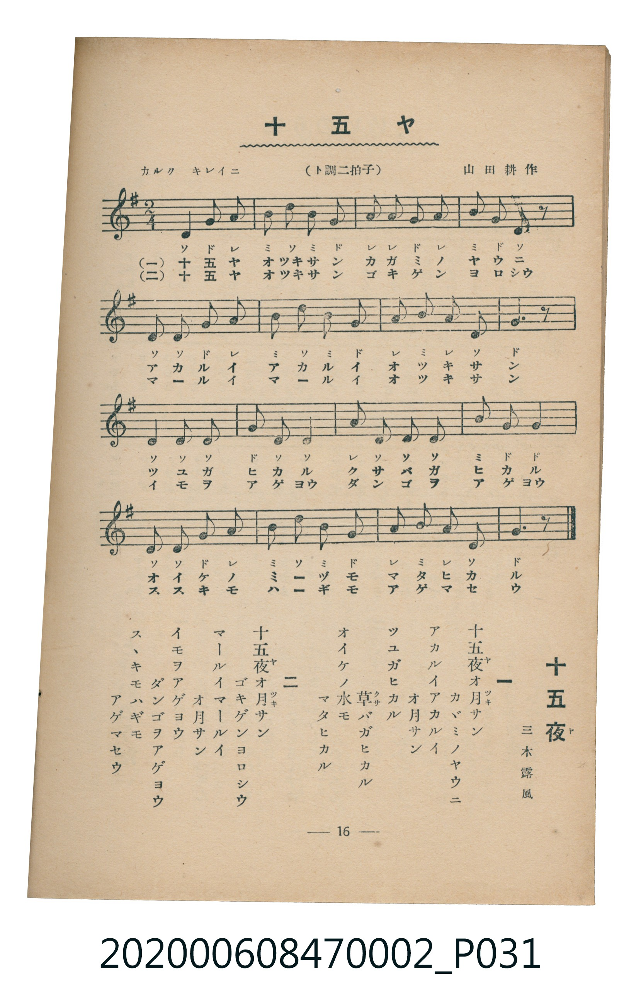

# 十五ヤ

<audio controls src="jugoya.mp3"></audio>

- 詞：三木露風
- 曲：山田耕作
- 臺灣教育會公認《新定兒童唱歌》尋常科第二學年用（2020.006.0847.0002）

## 說明

原書資訊與歌詞全文（對應 P031.jpg，書頁 p. 16，第二學期第 2 首）：
調性與拍號：ト調二拍子（G 大調 2/4 拍），「カルク キレイニ」

## 跨冊／重複收錄參照

> 同名異曲（各冊收錄之不同詞曲版本）

- **[同名異曲]** 楊金土手抄《唱歌帖》第 1 冊（2020.006.0843）：[**〈十五夜お月さん〉**](../../../shokacho/vol_01/p152_jugoya_otsukisan/index.md)（`C` / `4/4` — [原始 TMD](../../../shokacho/vol_01/p152_jugoya_otsukisan/jugoya_otsukisan.tmd)）
- 總表：[跨冊重複與同名歌曲總索引](../../../duplicate_songs.md)

## 歌詞

```text
一
十五夜（ヤ）オ月（ツキ）サン　カゞミノヤウニ
アカルイアカルイ　オ月サン
ツユガヒカル　草（クサ）バガヒカル
オイケノ水モ　マタヒカル

二
十五夜（ヤ）オ月（ツキ）サン　ゴキゲンヨロシウ
マールイマールイ　オ月サン
イモヲアゲヨウ　ダンゴヲアゲヨウ
スヽキモハギモ　アゲマセウ
```

## ABC

```abc
X:1
T:十五ヤ
C:曲：山田耕作
M:2/4
L:1/16
Q:1/4=96
K:G
V:V1 name="Piano" snm="Pia"
[V:V1]
D4 G2 A2 | B2 d2 B2 G2 | A2 A2 G2 A2 | B2 G2 D2 z2 |
D2 D2 G2 A2 | B2 d2 B2 G2 | A2 B2 A2 D2 | G6 z2 |
D2 D2 D2 G2 | D2 D2 A2 D2 | D2 D2 B2 G2 | G8 |
D2 D2 G2 A2 | B2 d2 B2 G2 | A2 B2 A2 D2 | G6 z2 |
```

## TMD 檔案連結

- [主旋律 TMD 檔案](jugoya.tmd) [[在 TMD Studio 編輯](https://tmdlang.github.io/Tmd-TS/#tmd=s7IKdvYPcrWy4qpTUCpJTLdSSM7PyUlNLsnMz7MqzsjMK0nNjM_KTMmPL87Iz05Ugisry88pzU21Si9KTEmNN4o3MjAyiDcwMIs3sDAxBzIMjBBKi_NLi5JTrYqTM_Lzc-JLUitKkvLzsxHyBUX5Zal5iXlANQVFIBtTwIoQClLLMlNSQdKpKZkl-UWZiTlI7kgtKga7FWxJfElRYl5xclFmAcgDCFUlGalAxxanJhbn5xUrcWlpKTztbXyya8rj5iUKWlpcirYKlmZc9rYK7lw2RvomdiB9L1bOe79n1pMdnc_mrHg5Z9PLRSvAxj2bvQko_HTjxudTNrxomPpk7xyw8Iv2Xc8bFz-bOvNF06Znc5qftq55sar3cUPXs2kbnq6b9bR10vPVS59O2fhsbc_jhu6nG7qf7tjxfPnE52vWPNnV83Ttjqc7tzyfsuL9ng5QOOoBw1EPFI5AhoHR-z2dSlxc-loKttQCXAoKCk_75j-bvePF5vYXK7pedLQD3QX079PWFc-mtQNd8XRD77P2ToUAA2NDvayC9Pd7eoCKXy5oVCjQUzA0A3LhDn82Zz6QrWCk8HLZNKBLgUEDMv3Fqv3PGpaDzO3ufTFzPlD0cXMHUBCoByjydO0EoB3uCk-XLAeKKQADXAEoCtYNDJ2ex02rHzevfty0XuFx09rHzWseNy153Nz9uKGXC2T0kx0NYPeDo-_pkjlAk4CRCNT8uGnVszkdYG4LUCNYZOvj5s2PGxpAJjbNe9w8_3FzH1Dx46ZlQANBpjxuWgSzDSiKxAbpARkHMQKsFGhq87LHTWseN0-CqmtoeNELdDNQ0XqgOpCFzROQFUBsWAU2eyPQ6mcbtjxuXgQyu3ne46b9CHVgf-3qIcNfW0BB1LQJxG1e8bgZyN4O9B3EvUAP74F6B5mNxWsgFYseN28CBwHQsBWgEAI5E4g2gyxBlYLo2fm4eS84goA6-x83rYN6DaoO6MHdUKWUJ1goUNDS5-LyKk3Pr0y0CshMzMt3qDGoUagG2aFgY2imZQdmYcspCqD0uqPhxcIeBQ0Thacb-p-vb9CBJ29NLBqAVkENezmr7-mEXiugj_eCRMBB2wkm1wDJGiA9HxweIFkoGywPkgGpgJFY9EDE4OYi7NQAOlbTCpQYoFLANAHWsASivWkVNEU2rQVytoI5m6FSq8FmQuyE2NIHtROkGRgnYLFuLHbu6iHXzi1gk9eCyU3IMs0rwDyIDChpIltao2Aar6ALhoZAbATENQrGQNIUiEE0SLQGLA7CqGpAPLB2A5AQOAvhjvpdPVSIelgUkxb5EDEwG6wKJANSgQwwIh6Yi8AawHHZDIlRWDTgloFGEFJcgGIJZCEoNnBZCI51YIYFa96DaSxuGdIthMY4mCAU5SAeiAYrrgFLwCAxUb6jk3pRjhTxIG8ji6FELIoMamIgHOWQcGwGZ09o9p0ENRY5skFVDZAzASqFUIisrAbNNjQLIVEOjkZgqQ0mwbkWnLZApkLyMKisB1KgSgCax0E-QahEUYfbSuRIh8c8siBSLCMEEYkBOeZBkEDMP509e6hldnA-gkRH00awEbAiG2JgK1JEgfIhPFc27QeLIaIfJAOicVkIjfmdYA0QEpxxwYaDNPfDLQFW6cgyKDEOsXw3VAZSqGNYSNXMXsvFpWunAKn8FYAsZS4uAA)]
- [鋼琴伴奏 TMD 檔案](jugoya_piano.tmd) [[在 TMD Studio 編輯](https://tmdlang.github.io/Tmd-TS/#tmd=s7IKdvYPcrWy4tLSUnja2_hk15THzUve7-l42b3n-YQtT_Zsebq0_3lnx_s9nQpaWlyKtgqWZlz2tgruXDZG-iZ2XHUKSi9Wznu_Z9aTHZ3P5qx4OWfTy0UrlEDCz2ZvAgo_3bjx-ZQNLxqmPtk7Byz8on3X88bFz6bOfNG06dmc5qeta16s6n3c0PVs2oan62Y9bZ30fPXSp1M2Plvb87ih--mG7qc7djxfPvH5mjVPdvU8Xbvj6c4tz6esALrPyMDIQM_AwEzPwMLEHMgwMAI6UYmLy6s0Pb8y0SogMzEvP8jDocagRqGaSwEIbAzNtOzALH0tBVt0oACyYUfDi4U9ChomCk839D9f36CjEGBgbKiXVZCuiUWDlj7YsBoF03gFXTA0BGIjIK5RMAaSpkAMokGiNWBxEEZVA-KBtRuAhLjwu25XD9muAxOEnAfigWiw4hqwBAwS47wdnZQ5D-5GZEEk9yAEEc5GdiMIEnDj09mzBzgIa1ETqA9KAjVBpM9n-1qe7et4NqfjaWvn0-3LnnV2Q3IiwlGG8QrRhrHIDNN4IMs0HipmALSNbJWoClB1k2Aq0Le6dgoQDyugsJS5uAA)]

## 分析

```text
================================================================================
📊 TMD Song Profile: [ 十五ヤ ]
================================================================================
⏱  Duration:       0:20 (20.0s), 16 measures total
🎼 Key & Tempo:    首調基準 G, != 96.0 BPM, <2/4>
   - 分析範圍：      由實際發聲的音符與和弦推測調性；播放脈絡另行呈現
🎤 人聲音域:    D4 (MIDI 62) – D5 (MIDI 74) [跨度: 12 個半音 / 1.0 個八度, 難度: easy]
   - 最低音:  D4 in [Jugoya #1 @ m.1, 0:00]
   - 最高音: D5 in [Jugoya #1 @ m.2, 0:01]
   - 適合: soprano, mezzo-soprano, contralto, tenor, baritone, bass
🏛  結構:      Jugoya (20.0s)
⚡ 編曲密度:        Peak 1 軌道同時演奏
🗝  調性診斷：       G 大調（純淨自然大調，未偵測到可信轉調）
   - 風格氣質:    純淨自然大調（陽光明朗、易唱易記，無明顯調外色彩）
   - 轉調歷程:    全曲維持單一推測調性（未偵測到可信轉調）
   - 核心骨幹音:  D, G, A, B
   - 調性數值:    G 大調 [相關度: 0.86, 穩定度: Moderate, 自然音純度: 100.0%]
   - 候選調性 (K-S): G 大調 (0.86), D 大調 (0.77), B 小調 (0.57)
   - 五度圈歷程:   +1
   - 各段落調性細節:
     • [Jugoya #1]: G 大調 (r: 0.86, 自然音純度: 100.0%)

  [ 五度圈游移軌跡 ]
               C  
         F           [G ]*
      Bb               D  
      Eb               A  
         Ab           E  
            Db       B  
               F# 
     (* = active key center)

  [ 十二半音累積音高分佈 ]
     C  :                            0.0%
     C# :                            0.0%
     D  : ████████████████████████  32.8%
     D# :                            0.0%
     E  :                            0.0%
     F  :                            0.0%
     F# :                            0.0%
     G  : ████████████████████████  32.8%
     G# :                            0.0%
     A  : █████████████             18.0%
     A# :                            0.0%
     B  : ████████████              16.4%
--------------------------------------------------------------------------------
Assignment 軌道音域：
  - Piano         : D4 – D5 (12 個半音 / 1.0 個八度, 53 個音符)
================================================================================
```


## 原書掃描頁




