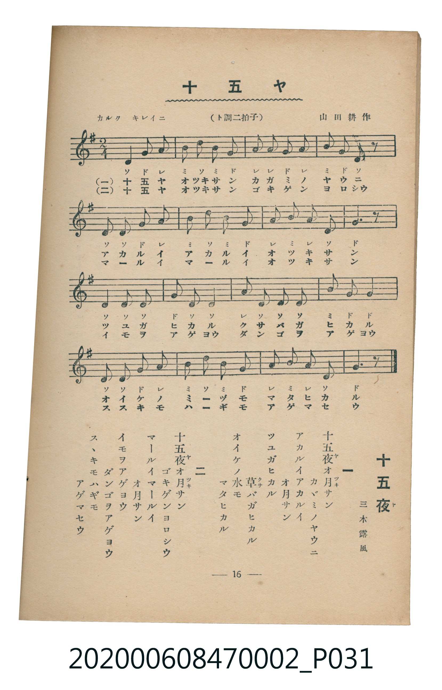

# 十五ヤ（十五夜）

> Re:Shōka 使用 AI 協助辨識與重建樂譜，可能會有錯誤。歡迎回報。

- **鋼琴伴奏版**：<br><audio controls src="jugoya.mp3"></audio>
- **NEUTRINO 歌聲合成版**：<br><audio controls src="jugoya_neutrino.mp3"></audio>

- 詞：三木露風
- 曲：山田耕作
- 臺灣教育會公認《新定兒童唱歌》尋常科第二學年用（2020.006.0847.0002）

## 說明

曲目說明
中文解釋：描寫滿月之夜、月色明亮與秋夜賞月的情景。

原書資訊與歌詞全文（對應 P031.jpg，書頁 p. 16，第二學期第 2 首）：
調性與拍號：ト調二拍子（G 大調 2/4 拍），「カルク キレイニ」


## 歌詞

```text
一
十五夜（ヤ）オ月（ツキ）サン　カゞミノヤウニ
アカルイアカルイ　オ月サン
ツユガヒカル　草（クサ）バガヒカル
オイケノ水モ　マタヒカル

二
十五夜（ヤ）オ月（ツキ）サン　ゴキゲンヨロシウ
マールイマールイ　オ月サン
イモヲアゲヨウ　ダンゴヲアゲヨウ
スヽキモハギモ　アゲマセウ
```

## ABC

<div class="abc-score" data-abc-src="jugoya.abc" aria-label="五線譜載入中"></div>

[下載 ABC 原始檔](jugoya.abc)

## TMD 檔案連結

- [主旋律 TMD 檔案](jugoya.tmd) [[在 TMD Studio 編輯](https://tmdlang.github.io/Tmd-TS/#tmd=s7IKdvYPcrWy4qpTUCpJTLdSSM7PyUlNLsnMz7MqzsjMK0nNjM_KTMmPL87Iz05Ugisry88pzU21Si9KTEmNN4o3MjAyiDcwMIs3sDAxBzIMjBBKi_NLi5JTrYqTM_Lzc-JLUitKkvLzsxHyBUX5Zal5iXlANQVFIBtTwIoQClLLMlNSQdKpKZkl-UWZiTlI7kgtKga7FWxJfElRYl5xclFmAcgDCFUlGalAxxanJhbn5xUjhIFmpWfmWZUkZgJ9B_JheWJ8bmJmXk5iXooSl5aWwtPexie7pjxuXvJ-TweE_XTJnPd7OhW0tLgUbRUszbjsbRXcuWyM9E3sQKa-WDnv_Z5ZT3Z0Ppuz4uWcTS8XrQBb9mz2JqDw040bn0_Z8KJh6pO9c8DCL9p3PW9c_GzqzBdNm57NaX7auubFqt7HDV3Ppm14um7W09ZJz1cvfTpl47O1PY8bup9u6H66Y8fz5ROfr1nzZFfP07U7nu7c8nzKCqDLQIGvBwx8PVDgAxkGRkAnKnHpaykALX4-e92LVauezejjUlBQeLJj7bNp7S-WL37Z3g100bP-_qfrVz_bvf_ZnI4nO7uBfnvc0Ahkv-jcBNTwZNe6Fx3tz5eDxF9sngcUfz6r5Vlz67OZ6x83NHFp6XOBrLClFgC572nf_Gezd7zY3P5iRRfQbqDPgSH6tHUF0NGgGNjQ-6y9UyHAwNhQL6sg_f2eHqDilwsaFQr0FAzNgFx40DybMx_IVjBSeLlsGjAsgF4Fmf5i1f5nDctB5nb3vpg5Hyj6uLkDKAjUAxR5unYC0A53hadLlgPFFIBRqgAUBesGhn_P46bVj5tXP25ar_C4ae3j5jWPm5Y8bu5-3NDLBQnYBrD7EWmkA5xqOh83rQIGHJjbAtQIFtn6uHnz44YGkIlN8x43z3_c3AdU_LhpGdBAkCmPmxbBbAOKIrFBekDGQYwAKwWa2rzscdOax82ToOoaGl70At0MVLQeqA5kYfMEZAUQG1aBzd4ItPrZhi2PmxeBzG6e97hpP0Id2F-7esjw1xZQEDVtAnGbVzxuBrK3A30HcS_Qw3ug3kFmY_EaSMWix82bwEEANGwFKIRAzgSizSBLUKUgenY-bt4LjiCgzv7HTeugXoOqA3pwN1Qp5QkWChRAGcGrND2_MtEqIDMxL9-hxqCmGmSFgo2hmZYdmIUtoyiAkuuOhhcLexQ0TBSebuh_vr5BB566NbFoANoENezlrL6nE3qtgB7eCxIBh2wnmFwDJGuA9HxwcIBkoWywPEgGpAJGYtEDEYObi7BTA-hYTStQWoBKAZMEWMMSiPamVdAE2bQWyNkK5myGSq0GmwmxE2JLH9ROkGZglIDFurHYuauHXDu3gE1eCyY3Ics0rwDzIDKglIlsaY2CabyCLhgaArERENcoGANJUyAG0SDRGrA4CKOqAfHA2g1AQmDzfAxBbtnxuHkpyCKIwSC3AUmgJ0AaQZ4A8cCeAEluBXM3QyVXg8XWgMXmg8k-iAxYO8RQUNDpKoAshlpqRKGlYKVQmU3IMsCwA_EgMuCwg9mLP53v6qFCOoelZ9JSOkQMzAarAsmAVCADjFQOLDHAGsAJtxmSfGFpDrcMNDUiJTxQkgRZCEp6uCwEJ3Fg4QTWvAfTWNwypFsITd5gglD6BvFANFhxDVgCBtHT9yJwegAnVaALQWxYMsMtA02ASCkNlAYhbkfYhJaogWEBTc6opuESJ8kWAkV1J_WSMFJCBjkSWQwloaLIoCZuwkkYki6awWUrtOydBDUWOfGCmglAzgSoFEIhsrIaNNvQLIQkYXCyBNa4YBJc5ILzCshUSAEMqqeBVAMo8CEFNMgnCJUo6nBbiVRGI1IzIoEii8HTL7IgLJnDNCClZHBKgaQjcMEKLnhB4pNg4khpGeSx9fA0BQpCdB3IqpFsAhfPoBQKsQmcR4DBgMgxEJsgJS84MCBGNoAFQAkXVpoja0LTALEPb5p-Onv2UCuWwSUeJKE1bQQbAWtJQAxsBZOQJAgqMeHlZ9N-sBgiYYNkQDQuC6FpeidYA4QEF7Fgw0Ga--GWABuayDIoaRli-W6oDKStgWEhjYplcOEHTmigwEJuO4BaEpDE1wpPgrBiFBRUIDFEAoYEFc5CGRg6IJUQElzIws3rhyfmdcjiKOkVYuduqAws6SLsqeXi0rVTgDSxFYAsZS4A)]
- [鋼琴伴奏 TMD 檔案](jugoya_piano.tmd) [[在 TMD Studio 編輯](https://tmdlang.github.io/Tmd-TS/#tmd=s7IKdvYPcrWy4tLSUnja2_hk15THzUve7-l42b3n-YQtT_Zsebq0_3lnx_s9nQpaWlyKtgqWZlz2tgruXDZG-iZ2XHUKSi9Wznu_Z9aTHZ3P5qx4OWfTy0UrlEDCz2ZvAgo_3bjx-ZQNLxqmPtk7Byz8on3X88bFz6bOfNG06dmc5qeta16s6n3c0PVs2oan62Y9bZ30fPXSp1M2Plvb87ih--mG7qc7djxfPvH5mjVPdvU8Xbvj6c4tz6esALrPyMDIQM_AwEzPwMLEHMgwMAI6UYmLy6s0Pb8y0SogMzEvP8jDocagpppLAQhsDM207MAsfS0FW3SgALJgR8OLhT0KGiYKTzf0P1_foKMQYGBsqJdVkK6JRYOWPtiwGgXTeAVdMDQEYiMgrlEwBpKmQAyiQaI1YHEQRlUD4oG1G4CEwOb5GNYoPG7a8bh56eOmZVCDHzdtAZHNS8AaHzetAvNaHjetBUtuBXM3QyVXg8XWgMXmg8k-iAxYO8TQx83dQBJkMdRSIwotBSuFymxClmleAeZBZLZDTIfYiz8qdvWQHRVgglBcgHggGqy4BiwBg-hxsQjsdnCwNkMCFxYkuGWggYUUKqDwAoUHKFxgEC0CmufBgh7VNFziJNlCIOV3UpTyEeGOCEpkMXhIIwvCIgSmASnMwX6C-BicXMHJGSQ-CSaOFOqgkFgP9_3j5gkYOpBVI9kETvSgsITYBI7NZlDqhcUtxCZIel4BSbsgIxvAAqAghuURZE1oGiD24Q39p7NnD5rEDk5S4EB53LQR7A9Y6QEqSyAB1QoPLljifNy0HyyGCGyQDCy4sST1pp1glRASnHTh5vXDA34dsjhK2ELs3A2VgQUzwp5a1GrAB7kaMEHUAs_2tTzb1_FsTsfT1s6n25c96-yGVHeIMDaMV4g2jEVmmMYDWabxUDEDqKfIUomqAFU3CaYCPatrpwDxb7QPUBESzwjMU-YCAA)]

## 分析

```text
================================================================================
📊 TMD Song Profile: [ 十五ヤ（十五夜） ]
================================================================================
⏱  Duration:       0:20 (20.0s), 16 measures total
🎼 Key & Tempo:    首調基準 G, != 96.0 BPM, <2/4>
   - 分析範圍：      由實際發聲的音符與和弦推測調性；播放脈絡另行呈現
🎤 人聲音域:    D4 (MIDI 62) – D5 (MIDI 74) [跨度: 12 個半音 / 1.0 個八度, 難度: easy]
   - 最低音:  D4 in [Jugoya #1 @ m.1, 0:00]
   - 最高音: D5 in [Jugoya #1 @ m.2, 0:01]
   - 適合: soprano, mezzo-soprano, contralto, tenor, baritone, bass
🏛  結構:      Jugoya (20.0s)
⚡ 編曲密度:        Peak 1 軌道同時演奏
🗝  調性診斷：       G 大調（純淨自然大調，未偵測到可信轉調）
   - 風格氣質:    純淨自然大調（陽光明朗、易唱易記，無明顯調外色彩）
   - 轉調歷程:    全曲維持單一推測調性（未偵測到可信轉調）
   - 核心骨幹音:  D, G, A, B
   - 調性數值:    G 大調 [相關度: 0.85, 穩定度: Moderate, 自然音純度: 100.0%]
   - 候選調性 (K-S): G 大調 (0.85), D 大調 (0.79), B 小調 (0.58)
   - 五度圈歷程:   +1
   - 各段落調性細節:
     • [Jugoya #1]: G 大調 (r: 0.85, 自然音純度: 100.0%)

  [ 五度圈游移軌跡 ]
               C  
         F           [G ]*
      Bb               D  
      Eb               A  
         Ab           E  
            Db       B  
               F# 
     (* = active key center)

  [ 十二半音累積音高分佈 ]
     C  :                            0.0%
     C# :                            0.0%
     D  : ████████████████████████  34.4%
     D# :                            0.0%
     E  :                            0.0%
     F  :                            0.0%
     F# :                            0.0%
     G  : ██████████████████████    31.1%
     G# :                            0.0%
     A  : █████████████             18.0%
     A# :                            0.0%
     B  : ███████████               16.4%
--------------------------------------------------------------------------------
Assignment 軌道音域：
  - Piano         : D4 – D5 (12 個半音 / 1.0 個八度, 53 個音符)
================================================================================
```


## 原書掃描頁




