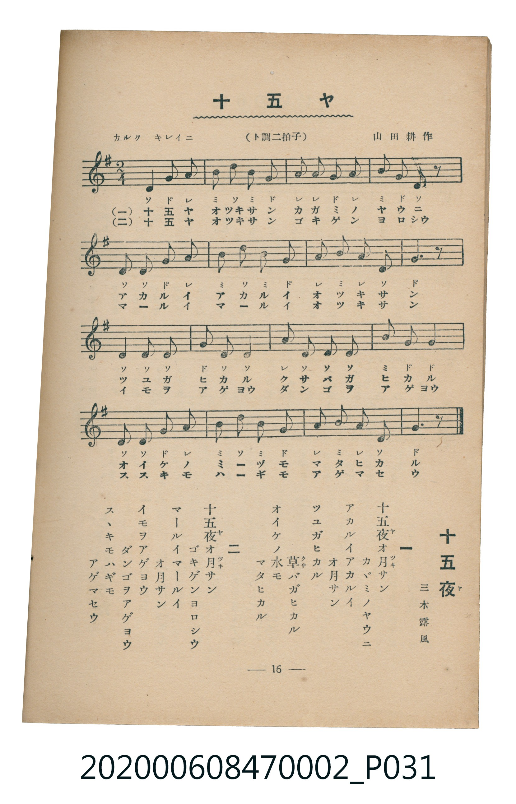

# 十五ヤ（十五夜）

> Re:Shōka 使用 AI 協助辨識與重建樂譜，可能會有錯誤。歡迎[回報](https://github.com/TMDLang/reshoka/issues)。

- **鋼琴伴奏版**：<br><audio controls src="jugoya.mp3"></audio>
- **NEUTRINO 歌聲合成版**：<br><audio controls src="jugoya_neutrino.mp3"></audio>

- 詞：三木露風
- 曲：山田耕筰
- 臺灣教育會公認《新定兒童唱歌》尋常科第二學年用（2020.006.0847.0002）

## 說明

曲目說明
中文解釋：描寫滿月之夜、月色明亮與秋夜賞月的情景。

原書資訊與歌詞全文（對應 P031.jpg，書頁 p. 16，第二學期第 2 首）：
調性與拍號：ト調二拍子（G 大調 2/4 拍），「カルク キレイニ」


## 歌詞

```text
一
十五夜（ヤ）オ月（ツキ）サン　カゞミノヤウニ
アカルイアカルイ　オ月サン
ツユガヒカル　草（クサ）バガヒカル
オイケノ水モ　マタヒカル

二
十五夜（ヤ）オ月（ツキ）サン　ゴキゲンヨロシウ
マールイマールイ　オ月サン
イモヲアゲヨウ　ダンゴヲアゲヨウ
スヽキモハギモ　アゲマセウ
```

## ABC

<div class="abc-score" data-abc-src="jugoya.abc" aria-label="五線譜載入中"></div>

[下載 ABC 原始檔](jugoya.abc)

## TMD 檔案連結

- [主旋律 TMD 檔案](jugoya.tmd) [[在 TMD Studio 編輯](https://tmdlang.github.io/Tmd-TS/#tmd=s7IKdvYPcrWy4qpTUCpJTLdSSM7PyUlNLsnMz7MqzsjMK0nNjM_KTMmPL87Iz05Ugisry88pzU21Si9KTEmNN4o3MjAyiDcwMIs3sDAxBzIMjBBKi_NLi5JTrYqTM_Lzc-JLUitKkvLzsxHyBUX5Zal5iXlANQVFIBtTwIoQClLLMlNSQdKpKZkl-UWZiTlI7kgtKga7FWxJfElRYl5xclFmAcgDCFUlGalAxxanJhbn5xUjhIFmpWfmWZUkZgJ9B_JheWJ8bmJmXk5iXgqyqpKMfKBHCzIqrTIyi0EuSE7Mic9OzEMKD6j9BYnpqVYBBsaGSlxaWgpPexuf7JryuHnJ-z0dEPbTJXPe7-lU0NLiUrRVsDTjsrdVcOeyMdI3sQOZ9GLlvPd7Zj3Z0flszoqXcza9XLQCbMGz2ZuAwk83bnw-ZcOLhqlP9s4BC79o3_W8cfGzqTNfNG16Nqf5aeuaF6t6Hzd0PZu24em6WU9bJz1fvfTplI3P1vY8buh-uqH76Y4dz5dPfL5mzZNdPU_X7ni6c8vzKSuALgPFnR4w7vRAcQdkGBgBnajEpa-lALT4-ex1L1atejajj0tBQeHJjrXPprW_WL74ZXs30EXP-vufrl_9bPf-Z3M6nuzsBvrtcUMjkP2icxNQw5Nd6150tD9fDhJ_sXkeUPz5rJZnza3PZq5_3NDEpaXPBbLClloA5L6nffOfzd7xYnP7ixVdQLuBPgeG6NPWFUBHg2JgQ--z9k4FUOzoZRWkv9_TA1T8ckGjQoGegqEZkAsPmmdz5gPZCkYKL5dNA4YF0Ksg01-s2v-sYTnI3O7eFzPnA0UfN3cABYF6gCJP104A2uGu8HTJcqCYAjBKFYCiYN3A8O953LT6cfPqx03rFR43rX3cvOZx05LHzd2PG3q5IAHbAHY_Io10gFNN5-OmVcCAA3NbgBrBIlsfN29-3NAAMrFp3uPm-Y-b-4CKHzctAxoIMuVx0yKYbUBRJDZID8g4iBFgpUBTm5c9blrzuHkSVF1Dw4teoJuBitYD1YEsbJ6ArABiwyqw2RuBVj_bsOVx8yKQ2c3zHjftR6gD-2tXDxn-2gIKoqZNIG7zisfNQPZ2oO8g7gV6eA_UO8hsLF4DqVj0uHkTOAiAhq0AhRDImUC0GWQJqhREz87HzXvBEQTU2f-4aR3Ua1B1QA_uhiqlPMFCgQIoI3iVpudXJloFZCbm5TvUGNRUg6xQsLHQsgMzsOUTBVBq3dHwYmGPgoaJwtMN_c_XN-jAE7cmFg1Ai6CGvZzV93RCrxXQv3tBIuCA7QSTa4BkDZCeDw4NkCyUDZYHyYBUwEgseiBicHMRdmoAHatpBUoKUClgigBrWALR3rQKmh6b1gI5W8GczVCp1WAzIXZCbOmD2gnSDIwRsFg3Fjt39ZBr5xawyWvB5CZkmeYVYB5EBpQwkS2tUTCNV9BVMASWHTUKxgqmQGwIZBkBIUzMEKTEQKEGrN7HEGTXjsfNS0EG6YLtBTkP4jgkp4GshwQFKCBAwQAKBEgQgLSCvB8PM9SIREOB0mCRTTARoB9BPoT6D2Qu_nS4q4cK6RCW3khLiRAxMBusCiQDUoEMMFIhMEODNYATVjMkecHSBG4ZaGpBShigJAOyEJQ0cFkIToLAsgOseQ-msbhlSLcQnPyACDP9GQMxUKIGyNUFQtT0twiSsIC2g-zGLgJOONB0shXqBpBJKIkO6BdgckPoQufjNYVAUddJvSSGlNBAjkIWQ0lIKDKoiY9wEoPEWzO4bIKWXZOgxiInLlAtC-RMgEohFCIrq0GzDc1CSBIDJxtghQUmwUUWOC2DTIUUYKBqDkg1gAIdUsCBfIJQiaIOt5XQMg6S0iAJCsYGpzEYB5T0QJJIKQ0YJqD0AHQF0KMg_iRw8QRJaSCHgppHkOBAqIDJw00CF29LwCYB0ynQA5AUCzIJVIJBnQ_0KDh5QUo_mCIkJSDz8Ka5p7NnD7ViDVxiQBJC00awEbCaEmJgK5iEJBFQiQMvf5r2g8UQCQ8kA6JxWQhNczvBGiAkuIgCGw7S3A-3BNiOQpZBSWsQy3dDZSB1KYaFZBZrwMIGGBSggIDVlfPBiaYV7BaI10EehyUyiJcxCjWg7yAYWGhB9fWDE9s6GB-erkDm7Yb6BGZOLReXrp0CpIWnAGQpcwEA)]
- [鋼琴伴奏 TMD 檔案](jugoya_piano.tmd) [[在 TMD Studio 編輯](https://tmdlang.github.io/Tmd-TS/#tmd=s7IKdvYPcrWy4qpTUCpJTLdSyC8qychPL0osyKi0ysgsLskvykxOzInPTsxLVIIrKs4vLUpOjS9ITE-1CjAwNlTi0tJSeNrb-GTXlMfNS97v6XjZvef5hC1P9mx5urT_eWfH-z2dClpaXIq2CpZmXPa2Cu5cNkb6JnYg816snPd-z6wnOzqfzVnxcs6ml4tWgK15NnsTUPjpxo3Pp2x40TD1yd45YOEX7bueNy5-NnXmi6ZNz-Y0P21d82JV7-OGrmfTNjxdN-tp66Tnq5c-nbLx2dqexw3dTzd0P92x4_nyic_XrHmyq-fp2h1Pd255PmUF0H1GBkYGegYGZnoGFibmQIaBEdCJSlxcXqXp-ZWJVgGZiXn5QR4ONQY11VwKQGBjoWUHZuhrKdiiAwWQ-TsaXizsUdAwUXi6of_5-gYdBVC46GUVpGti0aClDzasRsE0XkFXwVDBCMg0VjAFYkMgywgIYWKGICUGCjVg9T6GNQqPm3Y8bl76uGkZUOPjpi0KwPAGKnzctArIannctBbI3ApkbgYLrgbiNUDefCDuA4kAFYO0Pm7uVoiHGWpEoqFAabDIJphI8wogBolsB5kAMhd_UO3qITOogAgzrIyBGChRA-TqAiFqWC2CBEIzKCAgXsIUAXsS6qetYP9sBpuEEkDN80BBg9CFzsdrCoGU00l2yoGECcTrMDY4NGAcUCCBJJHCBOhKkMuBiQCYNED8SeBIh4QJyCfrobE9AUkFTB5uEjjRLAGbBAzR5k3QsAWZBEoXK0ApAaS1ARwQkDQFU4SkBGQe3tB5Ons23RILMAqBXnrctBGeW-aDPbQL7ElIpD9u2g8PEJAIKEjQkkrTTigGJgWovn6wOetgfHgYgMzbDRYBBQXEnFrUUsgHuRQyQZRCz_a1PNvX8WxOx9PWzqfblz3r7IaUtogwMIxXiDaMRWaYxgNZpvFQMZjnyVKJqgBVNwmmAj2ra6cA8W-0D1AREs8IzFPmAgA)]

## 分析

```text
================================================================================
📊 TMD Song Profile: [ 十五ヤ（十五夜） ]
================================================================================
⏱  Duration:       0:20 (20.0s), 16 measures total
🎼 Key & Tempo:    首調基準 G, != 96.0 BPM, <2/4>
   - 分析範圍：      由實際發聲的音符與和弦推測調性；播放脈絡另行呈現
🎤 人聲音域:    D4 (MIDI 62) – D5 (MIDI 74) [跨度: 12 個半音 / 1.0 個八度, 難度: easy]
   - 最低音:  D4 in [Jugoya #1 @ m.1, 0:00]
   - 最高音: D5 in [Jugoya #1 @ m.2, 0:01]
   - 適合: soprano, mezzo-soprano, contralto, tenor, baritone, bass
🏛  結構:      Jugoya (20.0s)
⚡ 編曲密度:        Peak 1 軌道同時演奏
🗝  調性診斷：       G 大調（純淨自然大調，未偵測到可信轉調）
   - 風格氣質:    純淨自然大調（陽光明朗、易唱易記，無明顯調外色彩）
   - 轉調歷程:    全曲維持單一推測調性（未偵測到可信轉調）
   - 核心骨幹音:  D, G, A, B
   - 調性數值:    G 大調 [相關度: 0.85, 穩定度: Moderate, 自然音純度: 100.0%]
   - 候選調性 (K-S): G 大調 (0.85), D 大調 (0.79), B 小調 (0.58)
   - 五度圈歷程:   +1
   - 各段落調性細節:
     • [Jugoya #1]: G 大調 (r: 0.85, 自然音純度: 100.0%)

  [ 五度圈游移軌跡 ]
               C  
         F           [G ]*
      Bb               D  
      Eb               A  
         Ab           E  
            Db       B  
               F# 
     (* = active key center)

  [ 十二半音累積音高分佈 ]
     C  :                            0.0%
     C# :                            0.0%
     D  : ████████████████████████  34.4%
     D# :                            0.0%
     E  :                            0.0%
     F  :                            0.0%
     F# :                            0.0%
     G  : ██████████████████████    31.1%
     G# :                            0.0%
     A  : █████████████             18.0%
     A# :                            0.0%
     B  : ███████████               16.4%
--------------------------------------------------------------------------------
Assignment 軌道音域：
  - Piano         : D4 – D5 (12 個半音 / 1.0 個八度, 53 個音符)
================================================================================
```


## 原書掃描頁




