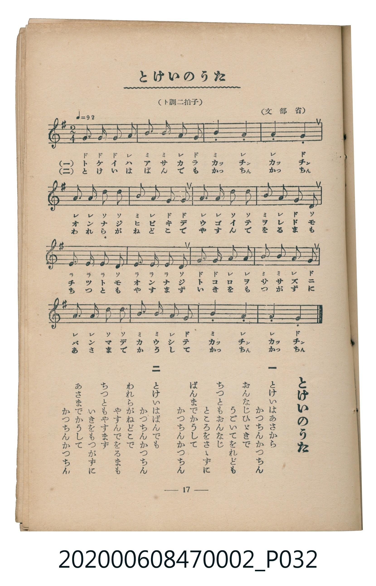

# とけいのうた（時鐘之歌）

> Re:Shōka 使用 AI 協助辨識與重建樂譜，可能會有錯誤。歡迎回報。

- **鋼琴伴奏版**：<br><audio controls src="tokei_no_uta.mp3"></audio>
- **NEUTRINO 歌聲合成版**：<br><audio controls src="tokei_no_uta_neutrino.mp3"></audio>

- 文部省
- 臺灣教育會公認《新定兒童唱歌》尋常科第二學年用（2020.006.0847.0002）

## 說明

曲目說明
中文解釋：描寫時鐘滴答走動與報時，呈現規律的時間感。

原書資訊與歌詞全文（對應 P032.jpg，書頁 p. 17，第二學期第 3 首）：
調性與拍號：ト調二拍子（G 大調 2/4 拍）


## 歌詞

```text
一
とけいはあさから　かつちんかつちん
おんなじひゞきで　うごいてをれども
ちつともおんなじ　ところをさゝずに
ばんまでかうして　かつちんかつちん

二
とけいはばんでも　かつちんかつちん
われらがねどこで　やすんでをるまも
ちつともやすまず　いきをもつかずに
あさまでかうして　かつちんかつちん
```

## ABC

<div class="abc-score" data-abc-src="tokei_no_uta.abc" aria-label="五線譜載入中"></div>

[下載 ABC 原始檔](tokei_no_uta.abc)

## TMD 檔案連結

- [主旋律 TMD 檔案](tokei_no_uta.tmd) [[在 TMD Studio 編輯](https://tmdlang.github.io/Tmd-TS/#tmd=s7IKdvYPcrWy4qpTUCpJTLdSSM7PyUlNLsnMz7MqzsjMK0nNjM_KTMmPL87Iz05Ugisry88pzU21Si9KTEmNN4o3MjAyiDcwMIs3sDAxBzIMjBBKi_NLi5JTrYqTM_Lzc-JLUitKkvLzsxHyBUX5Zal5iXlANQVFIBtTwIoQClLLMlNSQdKpKZkl-UWZiTlI7kgtKga7FWxJfElRYl5xclFmAcgDCFUlGalAx4IlC_KLkIyGSqQmZ-Tl5-SnVyJkgPakZ-ZZ5ebnJZUC_Y4sUZKRD_R3QUalVUZmMchByYk58dmJeUjBA3VOQWJ6qlWAgTEwNLS0FB43rnjcOPFxY8vjxnWPG9seN85_v6fj2cymlxNmPNnZ_Wxtz_s9nQpaWlyKtgqWRlz2tgruXDZG-iZ2IFOfTWt_2bzi-ZxGsB0v2nc9b1z8bOrMF02bns1pftq65sWq3scNXc-mbXi6btbT1knPVy99OmUj0MjHDd1PN3Q_3bHj-fKJz9esebKr5-naHU93bnk-ZQXQclC06QGjTQ8UbUCGgRHQCUpc-loKz2Zvej573YtVq57N6ONSUFB4smMt0Akvli9-2d79fs-sZ_39T9evhrj92e4tz9dOebF1w9PuqS862p8u2AgUf7-n5-nEjuf9-14s63-6r_v5rBaQ4mmTn7XMf9zQxKWlzwWyxZZaAOTEp33zn83e8WJz-4sVXUB3AD3_YuW8p60rgO4GevXpht5n7Z0KoMjQyypIB7oPqPjlgkaFAj0FQ3MgFx46z-bMB7IVjBVeLpsGDA6gb0Gmv1i1_1nDcpC53b0vZgJjbtbj5g6gIFAPUOTp2glAO9wVni5ZDhRTAMaaAlAUqJsLEngNIAop_tc_bmx63Dj1cWP346bOxw0NIEbjkseNCx83TUZmQ7R1gUVXPW6c8bhx0-OmeY8bex83LgdrA6aiKWATlz1umvS4qedx48rHTU0QbQvBxqwA8lGMAGkDOmTy46ZekB6gK5rmPm6c9bhxNUTbBrDSfSAbQC4B2jAdZDweR4L9uKsH048Qo5aDXEDAj039IMcDw6IR6IW1IF8AHQjxYxPQrJkwg4B-BOrch82PEHUgh88C2wbkgj0I8j5QDVAbwo-QwCfFj0BtlCdTKFAAJf-Q_OzUTL_80JJEq4DMxLx8hxqDmmqQNQo2Flp2YEaNgiEYGgFZxkBoBGSDWLpAli6QBSINQSywah_DGlDwA_FEIG4B4vVANUC_AvFUIO4GhnInWATkLaA2iM_AJmERg5hphN3MDUCzJgPp5UC6iUQzQe42UjAFQpBfQH4C-QpdzDQexVtdUAtXAfEMsOGbgHgzEPeCnQESaQPiKVBnLgOJNE0C4h4gbyXEmQgvNfVDZIABAkxxYN1rIeoaId4CqQGZMxPuUZh5wGBs3IdkXo2CWTwUgdyMxoNEH0oEIvlqIRAvgQQwNBgx_QkKfKBIE9CfQPtBIqDIBOFZQLwaJaIwzIP5AeRioHqQGpAIxCyYnSAdIF8hm4caIcQlPViiANkFiRGQqaBYmQ6LEZKTHizxUm5mLReXrp0CItcpAHnKXAA)]
- [鋼琴伴奏 TMD 檔案](tokei_no_uta_piano.tmd) [[在 TMD Studio 編輯](https://tmdlang.github.io/Tmd-TS/#tmd=s7IKdvYPcrWy4qpTUCpJTLdSyC8qychPL0osyKi0ysgsLskvykxOzInPTsxLVIIrKs4vLUpOjS9ITE-1CjAwNlLi0tJSeNy44nHjxMeNLY8b1z1ubHvcOP_9no6X3XueT9jyZM-Wp0v7n3d2vN_TqaClxaVoq2BpxGVvq-DOZWOkb2IHMvjZtPaXzSuez2kEW_OifdfzxsXPps580bTp2Zzmp61rXqzqfdzQ9WzahqfrZj1tnfR89dKnUzY-W9vzuKH76Ybupzt2PF8-8fmaNU929Txdu-Ppzi3Pp6wA2m9kYGSgZ2BgpmdgYWIOZBgYAZ2gxMUVkp-dmumXH1qSaBWQmZiXH-ThUGNQU82lAAQ2Flp2YEaNgiEYGgFZxkBoBGSDWLpAli6QBSINQSywah_DGlAYAPFEIG4B4vVANY8bm4B4KhB3Kzxu6gSLdD9uXALU9rhx4eOmyWCTsIhBzDTCbuYGoFmTgfRyIN1EopkgdxspmAIhyC8gP4F8hS5mGo_irS6ohauAeAbY8E1AvBmIe8HOAIm0AfEUqDOXgUSaJgFxD5C3EuJMhJea-iEywAB53NgD1r0Woq4R4i2QGpA5M-EehZkHDMbGfUjm1SiYxUMRyM1oPEj0oUQgkq8WAvESSABDgxHTn6DAB4o0Af0JtB8kAopMEJ4FxKtRIgrDPJgfQC4GqgepAYlAzILZCdIB8hWyeagRQlzSgyUKkF2QGAGZCoqV6bAYITnpwRIv5WbWYmY6H-RMZ4LIdPEK0Yax6AzTeBDLNB4qBlUL5kOk4KqxiEFVm4BkTMAySEwk9cQYj80xQM_p2ikg_BftAxRGEzECiyhzAQA)]

## 分析

```text
================================================================================
📊 TMD Song Profile: [ とけいのうた（時鐘之歌） ]
================================================================================
⏱  Duration:       0:20 (20.9s), 16 measures total
🎼 Key & Tempo:    首調基準 G, != 92.0 BPM, <2/4>
   - 分析範圍：      由實際發聲的音符與和弦推測調性；播放脈絡另行呈現
🎤 人聲音域:    D4 (MIDI 62) – D5 (MIDI 74) [跨度: 12 個半音 / 1.0 個八度, 難度: easy]
   - 最低音:  D4 in [TokeiNoUta #1 @ m.8, 0:10]
   - 最高音: D5 in [TokeiNoUta #1 @ m.5, 0:05]
   - 適合: soprano, mezzo-soprano, contralto, tenor, baritone, bass
🏛  結構:      TokeiNoUta (20.9s)
⚡ 編曲密度:        Peak 1 軌道同時演奏
🗝  調性診斷：       D 大調（純淨自然大調，未偵測到可信轉調）
   - 風格氣質:    純淨自然大調（陽光明朗、易唱易記，無明顯調外色彩）
   - 轉調歷程:    全曲維持單一推測調性（未偵測到可信轉調）
   - 核心骨幹音:  A, G, B, D, E
   - 調性數值:    D 大調 [相關度: 0.68, 穩定度: Moderate, 自然音純度: 100.0%]
   - 候選調性 (K-S): D 大調 (0.68), G 大調 (0.64), A 大調 (0.55)
   - 五度圈歷程:   +2
   - 各段落調性細節:
     • [TokeiNoUta #1]: D 大調 (r: 0.68, 自然音純度: 100.0%)

  [ 五度圈游移軌跡 ]
               C  
         F            G  
      Bb              [D ]*
      Eb               A  
         Ab           E  
            Db       B  
               F# 
     (* = active key center)

  [ 十二半音累積音高分佈 ]
     C  :                            0.0%
     C# :                            0.0%
     D  : ██████████                14.1%
     D# :                            0.0%
     E  : ███████                    9.4%
     F  :                            0.0%
     F# :                            0.0%
     G  : ████████████████          23.4%
     G# :                            0.0%
     A  : ████████████████████████  34.4%
     A# :                            0.0%
     B  : █████████████             18.7%
--------------------------------------------------------------------------------
Assignment 軌道音域：
  - Piano         : D4 – D5 (12 個半音 / 1.0 個八度, 56 個音符)
================================================================================
```


## 原書掃描頁




