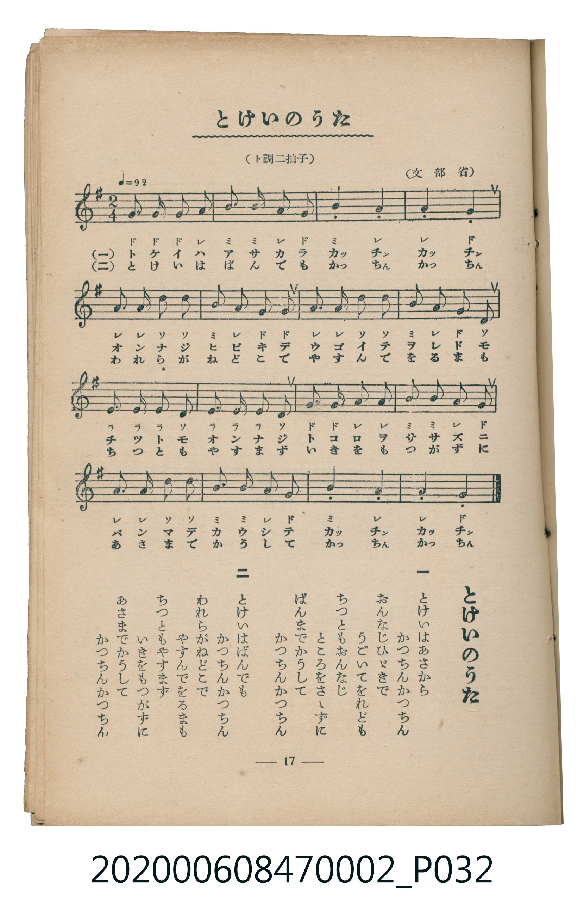

# とけいのうた

> Re:Shoka 使用 AI 協助辨識與重建樂譜，可能會有錯誤。歡迎回報。

<audio controls src="tokei_no_uta.mp3"></audio>

- 文部省
- 臺灣教育會公認《新定兒童唱歌》尋常科第二學年用（2020.006.0847.0002）

## 說明

原書資訊與歌詞全文（對應 P032.jpg，書頁 p. 17，第二學期第 3 首）：
調性與拍號：ト調二拍子（G 大調 2/4 拍）

## 歌詞

```text
一
とけいはあさから　かつちんかつちん
おんなじひゞきで　うごいてをれども
ちつともおんなじ　ところをさゝずに
ばんまでかうして　かつちんかつちん

二
とけいはばんでも　かつちんかつちん
われらがねどこで　やすんでをるまも
ちつともやすまず　いきをもつかずに
あさまでかうして　かつちんかつちん
```

## ABC

```abc
X:1
T:とけいのうた
M:2/4
L:1/16
Q:1/4=92
K:G
V:V1 name="Piano" snm="Pia"
[V:V1]
G2 G2 G2 A2 | B2 B2 A2 G2 | B4 A4 | A4 G4 |
A2 A2 D2 D2 | B2 A2 G2 G2 | A2 A2 D2 D2 | B2 A2 G2 D2 |
E2 E2 E2 D2 | E2 E2 E2 D2 | G2 A2 A2 B2 | B2 A2 G4 |
A2 A2 D2 D2 | B2 B2 A2 G2 | B4 A4 | A4 G4 |
```

## TMD 檔案連結

- [主旋律 TMD 檔案](tokei_no_uta.tmd) [[在 TMD Studio 編輯](https://tmdlang.github.io/Tmd-TS/#tmd=s7IKdvYPcrWy4qpTUCpJTLdSSM7PyUlNLsnMz7MqzsjMK0nNjM_KTMmPL87Iz05Ugisry88pzU21Si9KTEmNN4o3MjAyiDcwMIs3sDAxBzIMjBBKi_NLi5JTrYqTM_Lzc-JLUitKkvLzsxHyBUX5Zal5iXlANQVFIBtTwIoQClLLMlNSQdKpKZkl-UWZiTlI7kgtKga7FWxJfElRYl5xclFmAcgDCFUlGalAx4IlC_KLkIyGSqQmZ-Tl5-SnVypxaWkpPG5c8bhx4uPGlseN6x43tj1unK-gpcWlaKtgacRlb6vgzmVjpG9iBzLj2bT2l80rns9pBJv4on3X88bFz6bOfNG06dmc5qeta16s6n3c0PVs2oan62Y9bZ30fPXSp1M2Plvb87ih--mG7qc7djxfPvH5mjVPdvU8Xbvj6c4tz6eseL-nAxSYesDA1AMFJpBhYPR-T6cSF5e-loIttQCXgoLC0775z2bveLG5_cWKrhcd7UB3vVg572nrCqCvgK54uqH3WXunQoCBsZFeVkH6-z09QMUvFzQqFOgpGJoDuXCHP5szH8hWMFZ4uWwa0KXv98wCmf5i1f5nDctB5nb3vpg5Hyj6uLkDKAjUAxR5unYC0A53hadLlgPFFIABqgAUBermAul9sqMBRCFFxPrHjU2PG6c-bux-3NT5uKEBxGhc8rhx4eOmychsiLYusOiqx40zHjduetw073Fj7-PG5WBtwOicAjZx2eOmSY-beh43rnzc1ATRthBszAogH8UIkDagQyY_buoF6QG6omnu48ZZjxtXQ7RtACvdB7IB5BKgDdNBxuNxJNiPu3ow_QgxajnIBQT82NQPcjwwLBqBXlgL8gXQgRA_NgHNmgkzCOhHoM592PwIUQdy-CywbUAu2IMg7wPVALUh_AgJfFL8CNRGeTKFAgUtfS6ukPzs1Ey__NCSRKuAzMS8fIcagxqFapA9CjaGZlp2YFaNgqGCLhwbAXENMGHqgjGIBxKFiIAgSAQEa-AskDxYBGoaSByETeNhBEQ3zCyIeYRUQYSgRpqBOAgCqhy7KMwTIAwyENVYYhxKusdrubh07RQQoa0A5ClzcQEA)]
- [鋼琴伴奏 TMD 檔案](tokei_no_uta_piano.tmd) [[在 TMD Studio 編輯](https://tmdlang.github.io/Tmd-TS/#tmd=s7IKdvYPcrWy4tLSUnjcuOJx48THjS2PG9c9bmx73Dj__Z6Ol917nk_Y8mTPlqdL-593drzf06mgpcWlaKtgacRlb6vgzmVjpG9ix1WnoPRsWvvL5hXP5zQqgXgv2nc9b1z8bOrMF02bns1pftq65sWq3scNXc-mbXi6btbT1knPVy99OmXjs7U9jxu6n27ofrpjx_PlE5-vWfNkV8_TtTue7tzyfMoKoP1GBkYGegYGZnoGFibmQIaBEdAJSlxcIfnZqZl--aEliVYBmYl5-UEeDjUGNQrVXApAYGNopmUHZtUoGCrowrERENcoGANJEAbxQKIQERAEiYBgDZwFkgeLQE0DiYOwaTyMgOiGmQUxj5AqiBDUSDMQB0FAlWMXhXkChEEGohpLjENJ93gtZmD7oAS2CSKs4xWiDWPRGabxIJZpPFQMqhbMh0jBVWMRg6o2AcmYgGWQmEjqiTEem2OAvtO1U0B4UAHIU-biAgA)]

## 分析

```text
================================================================================
📊 TMD Song Profile: [ とけいのうた ]
================================================================================
⏱  Duration:       0:20 (20.9s), 16 measures total
🎼 Key & Tempo:    首調基準 G, != 92.0 BPM, <2/4>
   - 分析範圍：      由實際發聲的音符與和弦推測調性；播放脈絡另行呈現
🎤 人聲音域:    D4 (MIDI 62) – B4 (MIDI 71) [跨度: 9 個半音 / 0.8 個八度, 難度: easy]
   - 最低音:  D4 in [TokeiNoUta #1 @ m.5, 0:05]
   - 最高音: B4 in [TokeiNoUta #1 @ m.2, 0:01]
   - 適合: soprano, mezzo-soprano, contralto, tenor, baritone, bass
🏛  結構:      TokeiNoUta (20.9s)
⚡ 編曲密度:        Peak 1 軌道同時演奏
🗝  調性診斷：       D 大調（純淨自然大調，未偵測到可信轉調）
   - 風格氣質:    純淨自然大調（陽光明朗、易唱易記，無明顯調外色彩）
   - 轉調歷程:    全曲維持單一推測調性（未偵測到可信轉調）
   - 核心骨幹音:  A, G, B, D, E
   - 調性數值:    D 大調 [相關度: 0.68, 穩定度: Moderate, 自然音純度: 100.0%]
   - 候選調性 (K-S): D 大調 (0.68), G 大調 (0.64), A 大調 (0.55)
   - 五度圈歷程:   +2
   - 各段落調性細節:
     • [TokeiNoUta #1]: D 大調 (r: 0.68, 自然音純度: 100.0%)

  [ 五度圈游移軌跡 ]
               C  
         F            G  
      Bb              [D ]*
      Eb               A  
         Ab           E  
            Db       B  
               F# 
     (* = active key center)

  [ 十二半音累積音高分佈 ]
     C  :                            0.0%
     C# :                            0.0%
     D  : ██████████                14.1%
     D# :                            0.0%
     E  : ███████                    9.4%
     F  :                            0.0%
     F# :                            0.0%
     G  : ████████████████          23.4%
     G# :                            0.0%
     A  : ████████████████████████  34.4%
     A# :                            0.0%
     B  : █████████████             18.7%
--------------------------------------------------------------------------------
Assignment 軌道音域：
  - Piano         : D4 – B4 (9 個半音 / 0.8 個八度, 55 個音符)
================================================================================
```


## 原書掃描頁




