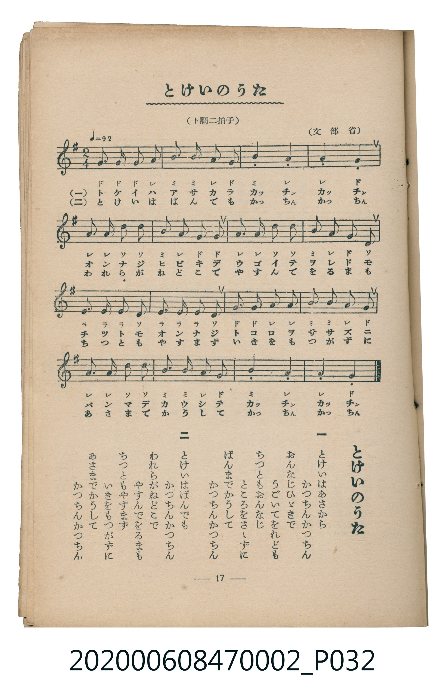

# とけいのうた（時鐘之歌）

> Re:Shōka 使用 AI 協助辨識與重建樂譜，可能會有錯誤。歡迎回報。

- **鋼琴伴奏版**：<br><audio controls src="tokei_no_uta.mp3"></audio>
- **NEUTRINO 歌聲合成版**：<br><audio controls src="tokei_no_uta_neutrino.mp3"></audio>

- 文部省
- 臺灣教育會公認《新定兒童唱歌》尋常科第二學年用（2020.006.0847.0002）

## 說明

曲目說明
中文解釋：描寫時鐘滴答走動與報時，呈現規律的時間感。

原書資訊與歌詞全文（對應 P032.jpg，書頁 p. 17，第二學期第 3 首）：
調性與拍號：ト調二拍子（G 大調 2/4 拍）


## 歌詞

```text
一
とけいはあさから　かつちんかつちん
おんなじひゞきで　うごいてをれども
ちつともおんなじ　ところをさゝずに
ばんまでかうして　かつちんかつちん

二
とけいはばんでも　かつちんかつちん
われらがねどこで　やすんでをるまも
ちつともやすまず　いきをもつかずに
あさまでかうして　かつちんかつちん
```

## ABC

<div class="abc-score" data-abc-src="tokei_no_uta.abc" aria-label="五線譜載入中"></div>

[下載 ABC 原始檔](tokei_no_uta.abc)

## TMD 檔案連結

- [主旋律 TMD 檔案](tokei_no_uta.tmd) [[在 TMD Studio 編輯](https://tmdlang.github.io/Tmd-TS/#tmd=s7IKdvYPcrWy4qpTUCpJTLdSSM7PyUlNLsnMz7MqzsjMK0nNjM_KTMmPL87Iz05Ugisry88pzU21Si9KTEmNN4o3MjAyiDcwMIs3sDAxBzIMjBBKi_NLi5JTrYqTM_Lzc-JLUitKkvLzsxHyBUX5Zal5iXlANQVFIBtTwIoQClLLMlNSQdKpKZkl-UWZiTlI7kgtKga7FWxJfElRYl5xclFmAcgDCFUlGalAx4IlC_KLkIyGSqQmZ-Tl5-SnVyJkgPakZ-ZZ5ebnJZUC_a7EpaWl8LhxxePGiY8bWx43rnvc2Pa4cf77PR3PZja9nDDjyc7uZ2t73u_pVNDS4lK0VbA04rK3VXDnsjHSN7EDGfpsWvvL5hXP5zSCrXjRvut54-JnU2e-aNr0bE7z09Y1L1b1Pm7oejZtw9N1s562Tnq-eunTKRuBRj5u6H66ofvpjh3Pl098vmbNk109T9fueLpzy_MpK4CWg8JdDxjueqBwBzIMjIBOUOLS11J4NnvT89nrXqxa9WxGH5eCgsKTHWuBTnixfPHL9u73e2Y96-9_un41xO3Pdm95vnbKi60bnnZPfdHR_nTBRqD4-z09Tyd2PO_f92JZ_9N93c9ntYAUT5v8rGX-44YmLi19LpAtttQCICc-7Zv_bPaOF5vbX6zoAroD6PkXK-c9bV0BdDfQq0839D5r71QIMDA20ssqSAe6D6j45YJGhQI9BUNzIBceOs_mzAeyFYwVXi6bBgwOoG9Bpr9Ytf9Zw3KQud29L2YCY27W4-YOoCBQD1Dk6doJQDvcFZ4uWQ4UUwDGmgJQFKibCxJ4DSAKKf7XP25setw49XFj9-OmzscNDSBG45LHjQsfN01GZkO0dYFFVz1unPG4cdPjpnmPG3sfNy4HawOmoilgE5c9bpr0uKnncePKx01NEG0LwcasAPJRjABpAzpk8uOmXpAeoCua5j5unPW4cTVE2waw0n0gG0AuAdowHWQ8HkeC_birB9OPEKOWg1xAwI9N_SDHA8OiEeiFtSBfAB0I8WMT0KyZMIOAfgTq3IfNjxB1IIfPAtsG5II9CPI-UA1QG8KPkMAnxY9AbZQnUyhQACX_kPzs1Ey__NCSRKuAzMS8fIcag5pqkDUKNoZmWnZgVo2CoYIuHBsBcQ0wXeqCMYgHEoWIgCBIBARr4CyQPFgEbJqPYQ0ofoB8YBSByRYwuR6sBxgoYN5UMNkNIps6oTKgcIAaBQkOuE145CB2GuG3cwPYHpAeYFyA2SBXUGYnxP8gbArFkDCChRgk1PCrMY1HC7YuJIeuApMzoI7ZBOZtBpO9cI-AZNrAvClI3l4GkWmaBDatByy2EuFtRJA19SNUgKMBmDGgpq5F6GpEBBxID8SOmWhBirAPHKmN-9Dsq1EwA3kWQUD8jkMUOTHiSJBIobYQbCMorqCJAB69uMMTkljAMk3g8AS7HiQDSZoQchaYXI0aarjtQw4bSAiATQDpgcggbEK4EWIOJNTQ7cOVgCjJmsiZAeJGWEqCuAGSnqaDSWhKojhrImd62tpZy8Wla6eAKPYUgDxlLgA)]
- [鋼琴伴奏 TMD 檔案](tokei_no_uta_piano.tmd) [[在 TMD Studio 編輯](https://tmdlang.github.io/Tmd-TS/#tmd=s7IKdvYPcrWy4tLSUnjcuOJx48THjS2PG9c9bmx73Dj__Z6Ol917nk_Y8mTPlqdL-593drzf06mgpcWlaKtgacRlb6vgzmVjpG9ix1WnoPRsWvvL5hXP5zQqgXgv2nc9b1z8bOrMF02bns1pftq65sWq3scNXc-mbXi6btbT1knPVy99OmXjs7U9jxu6n27ofrpjx_PlE5-vWfNkV8_TtTue7tzyfMoKoP1GBkYGegYGZnoGFibmQIaBEdAJSlxcIfnZqZl--aEliVYBmYl5-UEeDjUGNdVcCkBgY2imZQdm1SgYKujCsREQ1ygYA0kQBvFAohAREASJgGANnAWSB4uATfMxrAEFEpAPDCcw2QIm14P1PG5sAvOmgsluENnUCZXpfty4BGrU48aFj5smw23CIwex0wi_nRvA9oD0PG5cDmaDXEGZnRD_g7ApFEPCCBZikFDDr8Y0Hi3YupAcugpMzoA6ZhOYtxlM9sI9ApJpA_OmIHl7GUSmaRLYtB6w2EqEtxFB1tSPUAGOhseNIDbI1LUIXY2IgAPpgdgxEy1IEfaBI7VxH5p9NQpmIM8iCIjfcYgiJ0YcCRIp1BaCbQTFFTQRwKMXd3hCEgtYpgkcnmDXg2QgSRNCzgKTq1FDDbd9yGEDCQGwCSA9EBmETQg3QsyBhBq6fbgSECVZEzkzQNwIS0kQN0DS03QwCU1JFGdN5ExPWztrMUs9H-RSzwRR6MUrRBvGojNM40Es03ioGFQtmA-RgqvGIgZVbQKSMQHLIDGR1BNjPDbHAD2na6eA8F-0D1AYTcQILKLMBQA)]

## 分析

```text
================================================================================
📊 TMD Song Profile: [ とけいのうた（時鐘之歌） ]
================================================================================
⏱  Duration:       0:20 (20.9s), 16 measures total
🎼 Key & Tempo:    首調基準 G, != 92.0 BPM, <2/4>
   - 分析範圍：      由實際發聲的音符與和弦推測調性；播放脈絡另行呈現
🎤 人聲音域:    D4 (MIDI 62) – D5 (MIDI 74) [跨度: 12 個半音 / 1.0 個八度, 難度: easy]
   - 最低音:  D4 in [TokeiNoUta #1 @ m.8, 0:10]
   - 最高音: D5 in [TokeiNoUta #1 @ m.5, 0:05]
   - 適合: soprano, mezzo-soprano, contralto, tenor, baritone, bass
🏛  結構:      TokeiNoUta (20.9s)
⚡ 編曲密度:        Peak 1 軌道同時演奏
🗝  調性診斷：       D 大調（純淨自然大調，未偵測到可信轉調）
   - 風格氣質:    純淨自然大調（陽光明朗、易唱易記，無明顯調外色彩）
   - 轉調歷程:    全曲維持單一推測調性（未偵測到可信轉調）
   - 核心骨幹音:  A, G, B, D, E
   - 調性數值:    D 大調 [相關度: 0.68, 穩定度: Moderate, 自然音純度: 100.0%]
   - 候選調性 (K-S): D 大調 (0.68), G 大調 (0.64), A 大調 (0.55)
   - 五度圈歷程:   +2
   - 各段落調性細節:
     • [TokeiNoUta #1]: D 大調 (r: 0.68, 自然音純度: 100.0%)

  [ 五度圈游移軌跡 ]
               C  
         F            G  
      Bb              [D ]*
      Eb               A  
         Ab           E  
            Db       B  
               F# 
     (* = active key center)

  [ 十二半音累積音高分佈 ]
     C  :                            0.0%
     C# :                            0.0%
     D  : ██████████                14.1%
     D# :                            0.0%
     E  : ███████                    9.4%
     F  :                            0.0%
     F# :                            0.0%
     G  : ████████████████          23.4%
     G# :                            0.0%
     A  : ████████████████████████  34.4%
     A# :                            0.0%
     B  : █████████████             18.7%
--------------------------------------------------------------------------------
Assignment 軌道音域：
  - Piano         : D4 – D5 (12 個半音 / 1.0 個八度, 56 個音符)
================================================================================
```


## 原書掃描頁




