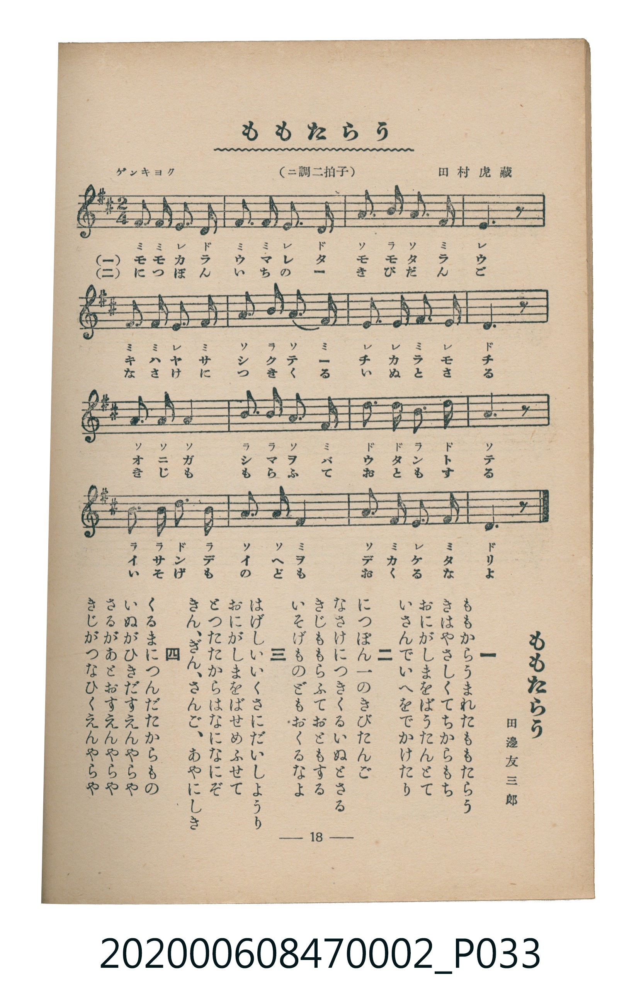

# ももたらう（桃太郎）

> Re:Shōka 使用 AI 協助辨識與重建樂譜，可能會有錯誤。歡迎回報。

- **鋼琴伴奏版**：<br><audio controls src="momotaro.mp3"></audio>
- **NEUTRINO 歌聲合成版**：<br><audio controls src="momotaro_neutrino.mp3"></audio>

- 詞：田邊友三郎
- 曲：田村虎藏
- 臺灣教育會公認《新定兒童唱歌》尋常科第二學年用（2020.006.0847.0002）

## 說明

曲目說明
中文解釋：日本民間故事，描寫桃太郎帶著同伴出發討伐鬼怪。

原書資訊與歌詞全文（對應 P033.jpg，書頁 p. 18，第二學期第 4 首）：
調性與拍號：ニ調二拍子（D 大調 2/4 拍），「ゲンキヨク」


## 歌詞

```text
一
ももからうまれたももたらう
きはやさしくてちからもち
おにがしまをばうたんとて
いさんでいへをでかけたり

二
につぽん一のきびだんご
なさけにつきくるいぬとさる
きじももらふておともする
いそげものどもおくるなよ

三
はげしいいくさにだいしようり
おにがしまをばせめふせて
とつたたからはなになにぞ
きん、ぎん、さんご、あやにしき

四
くるまにつんだたからもの
いぬがひきだすえんやらや
さるがあとおすえんやらや
きじがつなひくえんやらや
```

## ABC

<div class="abc-score" data-abc-src="momotaro.abc" aria-label="五線譜載入中"></div>

[下載 ABC 原始檔](momotaro.abc)

## TMD 檔案連結

- [主旋律 TMD 檔案](momotaro.tmd) [[在 TMD Studio 編輯](https://tmdlang.github.io/Tmd-TS/#tmd=s7IKdvYPcrWy4qpTUCpJTLdSSM7PyUlNLsnMz7MqzsjMK0nNjM_KTMmPL87Iz05Ugisry88pzU21Si9KTEmNN4o3MjAyiDcwMIs3sDAxBzIMjBBKi_NLi5JTrYqTM_Lzc-JLUitKkvLzsxHyBUX5Zal5iXlANQVFIBtTwIoQClLLMlNSQdKpKZkl-UWZiTlI7kgtKga7FWxJfElRYl5xclFmAcgDCFUlGalAx6bl52Tn5BelIsSBhqVn5lnlpmZmZSK5TEtL4XFTEwg1zn_c1Pm4se39no5nC5ufLln1srnv_Z5OBS0tLkVbBUMDCy57WwUXLhsjfRM7kKkvVs57v2fW8ykbXjZ1Pe3vfrKjE6gBbN-z2ZsgMs_mTnwxs-_F9H6w8Iv2Xc8bFz-bOvNF06Znc5qftq55sar3cUPXs2kbnq6b9bR10vPVS59O2fhsbc_jhu6nG7qf7tjxfPnE52vWPNnV83Ttjqc7tzyfsgLoOlAE6AEjQA8UAUCGgRHQmUpc-loKQIufz173YtWqZzP6uBQUFJ7sWPtsWvuL5YtftncDXfRs-tJnc9Y82zDx5bTJz6a2PtkFFOx51t__dP1quI-f7tj2YuL0pxN6nuzZ8hTo4Jl7Xqzoe7Jnwss1e541rHrc0MSlpc8FssuWWgDk0Kd985_N3vFic_uLFV0vOtqBQQAM3aetK4CuB3r46YbeZ-2dCgEGxsZ6WQXpIEfP3vFyQaNCgZ6CoQWQCw-jZ3PmA9kKJgovl00DBgrQzyDTX6za_6xhOcjc7t4XM-cDRR83dwMFgXqAIk_XTgDa4aLwdMlyoJgCMHoVgKJg3cCI6HnctOlx8-bHTWsfN6943LT-cUMvFyRoG0AULO10Q9LO48Z9j5t6wEkJJU2BlTb2Pm5c_7ip5XHj1MeN0x839j9uXPa4cSFUM0j1Qoi6rseNqx83Ao0BKgKaN-lx4waw2UDDJj9uXAHUBlEHNgkktBzM3gFWCmR3P26cCFbdBXHqrh6IeqChSx437gVqAbr-ceM6sIs2P25cADZkCkTRKrDzgPohqoEq-h83AU0EWrAGbDnQym64f2ZAPQry5Vawf4COB4YT0DMz4eqAWuc-bpwEFgVauhLMAKqDGLzqcVMHNEg7IerXgxSDPA_UCETAcAK6COicBWDudKB6UHAAfYc7tGY_bmoEu2g2PLSATgf6Zz4YQaILaA_Qt0DNEHIezFfA0GgA6u6DMSCBPAXMBnoV6AagaqBtkJTwdPZsiEaId_ZBQw6kBehgmGVgv8ODAxiSQAdvAgchUNHMx40dIA1Ao0FKWyDqQAENVgfUCnQ80J_Y1YGjAaQO6D2gT4CmAkMMQx3lGRUKFEAFgG9-bn5JYlG-VUBmYl6-Q41BTTXIEgUbQzMtOzCrRsFYQRcIjRWMgKQhEGMTMQWLmEFpY6AISA4GDUBqwKb5GNaA8hpYFEQDQxXM6gSbAkwOEJnGfUCxHjBrPkQGRQ9IDKILoQcC4xE2GYHkVkPNWwLEe8F6JkNtaoHKLATidVDdIPFeqPhmIF4AtWcyWGYKdnuMQXLrobomAfF0MAtkPrI9_aCUAGaB3ASSgZoOVAHJDFBuG9i7XdgtMwFp7Ic6qxscUMhGLoE7GGY8RBwaYMDAhgQ1JCBBMjCvo9qDGsUgNmoUQ0QgUWwE5oHYNeDEgCPS4QG7Hmg3KFAgwQGSAQUYLIiWIbl6IZqrIYkAIYM9yldBdU0F4onYQgfoEkgYgkIQNZLWgMoXZLeBVeCKdEgcgcwHZlswC-QTkAwoVkDmg5LDBiQfzYaKNwLZW8E6QCIgGZi_scU3susg9myC6oKF6QIgnolkDzQtgdIBJKxhGQzMwxbfkNg1hdIgtWZgGjm-DePAQkAKJAfmwTRij3L0AII5DxbhoFw-CcwCBRJy_p8PzamQ6MATQOAohwXDDHg5gVpmdMKDG2QKsstWQFVBgo9QhIPcAitNIFkKe_aClAfIiREUAiA2IjHOw24POMJBiQ-WwZHDDeofkKvBPoC7mowIh0UvOBpBHEhUwmIbYiWsOEeUAvhyOCydAnMeNPKWQ50Hye87wA4DRTjMQyB5aMBB8yqsuMdR_oGjG-YlYHMETIJMhEU3pESDNE6QLILFN7CIAccwJDZAmiAhhz2-oekKXJz2QVkQ88AlOdSTsHoBKYaAoQ6JaUSRADELe3wjpV-U-AYVWLB0A2oOIEmREuG1XFy6dgqwql4ByFbmAgA)]
- [鋼琴伴奏 TMD 檔案](momotaro_piano.tmd) [[在 TMD Studio 編輯](https://tmdlang.github.io/Tmd-TS/#tmd=s7IKdvYPcrWy4tLSUnjc1ARCjfMfN3U-bmx7v6fjZfee5xO2PNmz5enS_uedHe_3dCpoaXEp2ioYGlhw2dsquHDZGOmb2HHVKSi9WDnv_Z5Zz6dseNnU9bS_-8mOzpfNfUogmWezN0Fkns2d-GJm34vp_WDhF-27njcufjZ15oumTc_mND9tXfNiVe_jhq5n0zY8XTfraeuk56uXPp2y8dnanscN3U83dD_dseP58onP16x5sqvn6dodT3dueT5lBdCNRgZGBnoGBmZ6BhYm5kCGgRHQmUpcXL75ufkliUX5VgGZiXn5QR4ONQY11VwKQGBjaKZlB2bVKBgr6AKhsYIRkDQEYmwipmARMyhtDBQBycGgAUgN2DQfwxpQGIJFQfTjxm4wqxNsCjBEITKN-4BiPWDWfIgMih6QGEQXQg8ExiNsMgLJrYaatwSI94L1TIba1AKVWQjE66C6QeK9UPHNQLwAas9ksMwU7PYYg-TWQ3VNAuLpYBbIfGR7-oF4KpgFchNIBmo6UAVQz-OmDii3DezdLuyWmYA09kOd1Q0OKGQjl8AdDDMeIg4NMGBgQ4IaEpAgGZjXUe1BjWIQGzWKISKQKDYC80DsGnBiwBHp8IBdD7QbFCiQ4ADJgAIMFkTLkFy9EM3VkESAkMEe5auguqYC8URsoQN0CSQMQSGIGklrgHgFstvAKnBFOiSOQOY_boQkVpBPQDKgWAGZD0oOG5B8NBsq3ghkbwXrAImAZGD-xhbfyK6D2LMJqgsWpguAeCaSPdC0BEoHkLCGZTAwD1t8Q2LXFEqD1JqBaeT4NowDCwEpkByYB9OIPcrRAwjmPFiEg3L5JDALFEjI-X8-NKdCogNPAIGjHBYMM-DlBGqZ0QkPbpApyC5bAVUFCT5CEQ5yC6w0gWQp7NkLUh4gJ0ZQCIDYiMQ4D7s94AgHJT5YBkcON6h_QK4G-wDuajIiHBa94GgEcSBRCYttiJWw4hxRCuDL4bB0Csx50MhbDnUeJL_vADsMFOEwD4HkoQEHzauw4h5H-QeObpiXHjfOBZMgE2HRDSnRHjeuREkJ8PgGFjHgGIbEBkgTJOSwxzc0XYGL0z4oC2IeuCSHehJWLyDFEDDUITGNKBIgZmGPb6T0ixLfoAILlm42wcp90iO8Fr2m90Gu6U3gFb1hvEK0aXwsBssQxDCNh4lhVY2mBiRmgKIUrMAEmWGCoQ5ZFJeJQM_o2inA_BPtA1SGwjdC4xuj8YHmA_nKXAA)]

## 分析

```text
================================================================================
📊 TMD Song Profile: [ ももたらう（桃太郎） ]
================================================================================
⏱  Duration:       0:17 (17.8s), 16 measures total
🎼 Key & Tempo:    首調基準 D, != 108.0 BPM, <2/4>
   - 分析範圍：      由實際發聲的音符與和弦推測調性；播放脈絡另行呈現
🎤 人聲音域:    D4 (MIDI 62) – D5 (MIDI 74) [跨度: 12 個半音 / 1.0 個八度, 難度: easy]
   - 最低音:  D4 in [Momotaro #1 @ m.1, 0:00]
   - 最高音: D5 in [Momotaro #1 @ m.11, 0:11]
   - 適合: soprano, mezzo-soprano, contralto, tenor, baritone, bass
🏛  結構:      Momotaro (17.8s)
⚡ 編曲密度:        Peak 1 軌道同時演奏
🗝  調性診斷：       D 調性不明確（純淨自然大調，未偵測到可信轉調）
   - 風格氣質:    純淨自然大調（陽光明朗、易唱易記，無明顯調外色彩）
   - 轉調歷程:    全曲維持單一推測調性（未偵測到可信轉調）
   - 核心骨幹音:  A, F#, D, E, B
   - 調性數值:    D 調性不明確 [相關度: 0.81, 穩定度: Ambiguous, 自然音純度: 100.0%]
   - 候選調性 (K-S): D 大調 (0.81), A 大調 (0.79), F# 小調 (0.72)
   - 五度圈歷程:   +2
   - 各段落調性細節:
     • [Momotaro #1]: D 調性不明確 (r: 0.81, 自然音純度: 100.0%)

  [ 五度圈游移軌跡 ]
               C  
         F            G  
      Bb              [D ]*
      Eb               A  
         Ab           E  
            Db       B  
               F# 
     (* = active key center)

  [ 十二半音累積音高分佈 ]
     C  :                            0.0%
     C# :                            0.0%
     D  : █████████████████         20.0%
     D# :                            0.0%
     E  : ██████████████            16.7%
     F  :                            0.0%
     F# : ████████████████████      23.3%
     G  :                            0.0%
     G# :                            0.0%
     A  : ████████████████████████  28.3%
     A# :                            0.0%
     B  : ██████████                11.7%
--------------------------------------------------------------------------------
Assignment 軌道音域：
  - Piano         : D4 – D5 (12 個半音 / 1.0 個八度, 50 個音符)
================================================================================
```


## 原書掃描頁




