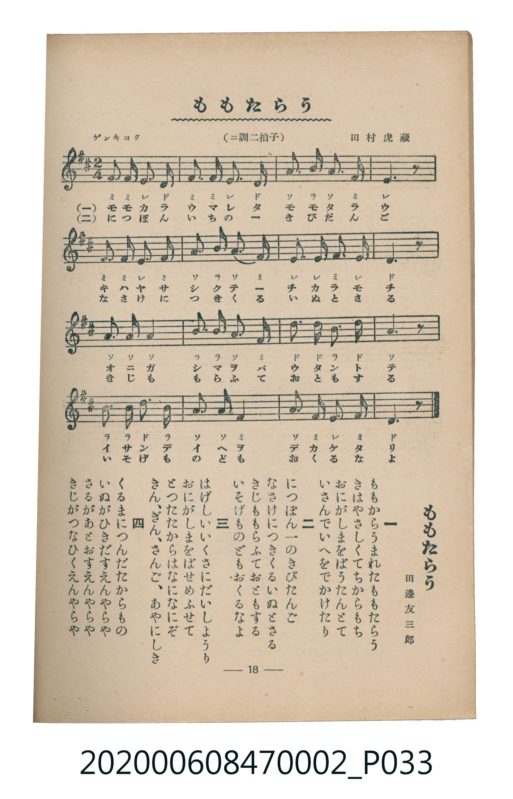

# ももたらう（桃太郎）

> Re:Shōka 使用 AI 協助辨識與重建樂譜，可能會有錯誤。歡迎回報。

- **鋼琴伴奏版**：<br><audio controls src="momotaro.mp3"></audio>
- **NEUTRINO 歌聲合成版**：<br><audio controls src="momotaro_neutrino.mp3"></audio>

- 詞：田邊友三郎
- 曲：田村虎藏
- 臺灣教育會公認《新定兒童唱歌》尋常科第二學年用（2020.006.0847.0002）

## 說明

曲目說明
中文解釋：日本民間故事，描寫桃太郎帶著同伴出發討伐鬼怪。

原書資訊與歌詞全文（對應 P033.jpg，書頁 p. 18，第二學期第 4 首）：
調性與拍號：ニ調二拍子（D 大調 2/4 拍），「ゲンキヨク」


## 歌詞

```text
一
ももからうまれたももたらう
きはやさしくてちからもち
おにがしまをばうたんとて
いさんでいへをでかけたり

二
につぽん一のきびだんご
なさけにつきくるいぬとさる
きじももらふておともする
いそげものどもおくるなよ

三
はげしいいくさにだいしようり
おにがしまをばせめふせて
とつたたからはなになにぞ
きん、ぎん、さんご、あやにしき

四
くるまにつんだたからもの
いぬがひきだすえんやらや
さるがあとおすえんやらや
きじがつなひくえんやらや
```

## ABC

<div class="abc-score" data-abc-src="momotaro.abc" aria-label="五線譜載入中"></div>

[下載 ABC 原始檔](momotaro.abc)

## TMD 檔案連結

- [主旋律 TMD 檔案](momotaro.tmd) [[在 TMD Studio 編輯](https://tmdlang.github.io/Tmd-TS/#tmd=s7IKdvYPcrWy4qpTUCpJTLdSSM7PyUlNLsnMz7MqzsjMK0nNjM_KTMmPL87Iz05Ugisry88pzU21Si9KTEmNN4o3MjAyiDcwMIs3sDAxBzIMjBBKi_NLi5JTrYqTM_Lzc-JLUitKkvLzsxHyBUX5Zal5iXlANQVFIBtTwIoQClLLMlNSQdKpKZkl-UWZiTlI7kgtKga7FWxJfElRYl5xclFmAcgDCFUlGalAx6bl52Tn5BelIsSBhqVn5lnlpmZmZWJxWX5RSUY-0IsFGZVWGZnFILuTE3PisxPzkEICanNBYnqqVYCBsbESl5aWwuOmJhBqnP-4qfNxY9v7PR3PFjY_XbLqZXPf-z2dClpaXIq2CoYGFlz2tgouXDZG-iZ2IANfrJz3fs-s51M2vGzqetrf_WRHJ1AD2KpnszdBZJ7NnfhiZt-L6f1g4Rftu543Ln42deaLpk3P5jQ_bV3zYlXv44auZ9M2PF0362nrpOerlz6dsvHZ2p7HDd1PN3Q_3bHj-fKJz9esebKr5-naHU93bnk-ZQXQdaD40wPGnx4o_oAMAyOgM5W49LUUgBY_n73uxapVz2b0cSkoKDzZsfbZtPYXyxe_bO8GuujZ9KXP5qx5tmHiy2mTn01tfbILKNjzrL__6frVcB8_3bHtxcTpTyf0PNmz5SnQwTP3vFjR92TPhJdr9jxrWPW4oYlLS58LZJcttQDIoU_75j-bvePF5vYXK7pedLQDgwAYuk9bVwBdD_Tw0w29z9o7FUARppdVkA5y9OwdLxc0KhToKRhaALnwMHo2Zz6QrWCi8HLZNGCgAP0MMv3Fqv3PGpaDzO3ufTFzPlD0cXM3UBCoByjydO0EoB0uCk-XLAeKKQCjVwEoCtYNjIiex02bHjdvfty09nHzisdN6x839HJBgrYBRMHSTjck7Txu3Pe4qQeclFDSFFhpY-_jxvWPm1oeN0593Dj9cWP_48ZljxsXQjWDVC-EqOt63Lj6cSPQGKAioHmTHjduAJsNNGzy48YVQG0QdWCTQELLwewdYKVAdvfjxolg1V0Qp-7qgagHGrrkceNeoBag6x83rgO7aPPjxgVgQ6ZAFK0COw-oH6IaqKL_cRPQRKAFa8CWA63shvtnBtSjIF9uBfsH6HhgOAE9MxOuDqh17uPGSWBRoKUrwQygOojBqx43dUCDtBOifj1IMcjzQI1ABAwnoIuAzlkA5k4HqgcFB9B3uENr9uOmRrCLZsNDC-h0oH_mgxEkuoD2AH0L1Awh58F8BQyNBqDuPhgDEshTwGygV4FuAKoG2gZJCU9nz4ZohHhnHzTkQFqADoZZBvY7PDiAIQl08CZwEAIVzXzc2AHSADQapLQFog4U0GB1QK1AxwP9iV0dOBpA6oDeA_oEaCowxDDUUZ5RoUABVAD45ufmlyQW5VsFZCbm5TvUGNRUgyxRsDE007IDs2oUjBV0gdBYwQhIGgIxNhFTsIgZlDYGioDkYNAApAZsmo9hDSivgUVBNDBUwaxOsCnA5ACRadwHFOsBs-ZDZFD0gMQguhB6IDAeYZMRSG411LwlQLwXrGcy1KYWqMxCIF4H1Q0S74WKbwbiBVB7JoNlpmC3xxgktx6qaxIQTwezQOYj29MPSglgFshNIBmo6UAVkMwA5baBvduF3TITkMZ-qLO6wQGFbOQSuINhxkPEoQEGDGxIUEMCEiQD8zqqPahRDGKjRjFEBBLFRmAeiF0DTgw4Ih0esOuBdoMCBRIcIBlQgMGCaBmSqxeiuRqSCBAy2KN8FVTXVCCeiC10gC6BhCEoBFEjaQ2ofEF2G1gFrkiHxBHIfGC2BbNAPgHJgGIFZD4oOWxA8tFsqHgjkL0VrAMkApKB-RtbfCO7DmLPJqguWJguAOKZSPZA0xIoHUDCGpbBwDxs8Q2JXVMoDVJrBqaR49swDiwEpEByYB5MI_YoRw8gmPNgEQ7K5ZPALFAgIef_-dCcCokOPAEEjnJYMMyAlxOoZUYnPLhBpiC7bAVUFST4CEU4yC2w0gSSpbBnL0h5gJwYQSEAYiMS4zzs9oAjHJT4YBkcOdyg_gG5GuwDuKvJiHBY9IKjEcSBRCUstiFWwopzRCmAL4fD0ikw50EjbznUeZD8vgPsMFCEwzwEkocGHDSvwop7HOUfOLphXgI2R8AkyERYdENKNEjjBMkiWHwDixhwDENiA6QJEnLY4xuarsDFaR-UBTEPXJJDPQmrF5BiCBjqkJhGFAkQs7DHN1L6RYlvUIEFSzeg5gCSFCkRXsvFpWunAKvqFYBsZS4A)]
- [鋼琴伴奏 TMD 檔案](momotaro_piano.tmd) [[在 TMD Studio 編輯](https://tmdlang.github.io/Tmd-TS/#tmd=s7IKdvYPcrWy4qpTUCpJTLdSyC8qychPL0osyKi0ysgsLskvykxOzInPTsxLVIIrKs4vLUpOjS9ITE-1CjAwNlbi0tJSeNzUBEKN8x83dT5ubHu_p-Nl957nE7Y82bPl6dL-550d7_d0KmhpcSnaKhgaWHDZ2yq4cNkY6ZvYgYx9sXLe-z2znk_Z8LKp62l_95MdnS-b-8AWPpu9CSLzbO7EFzP7XkzvBwu_aN_1vHHxs6kzXzRtejan-Wnrmhereh83dD2btuHpullPWyc9X7306ZSNz9b2PG7ofrqh--mOHc-XT3y-Zs2TXT1P1-54unPL8ykrgG40MjAy0DMwMNMzsDAxBzIMjIDOVOLi8s3PzS9JLMq3CshMzMsP8nCoMaip5lIAAhtDMy07MKtGwVhBFwiNFYyApCEQYxMxBYuYQWljoAhIDgYNQGrApvkY1oDCECwKoh83doNZnWBTgCEKkWncBxTrAbPmQ2RQ9IDEILoQeiAwHmGTEUhuNdS8JUC8F6xnMtSmFqjMQiBeB9UNEu-Fim8G4gVQeyaDZaZgt8cYJLceqmsSEE8Hs0DmI9vTD8RTwSyQm0AyUNOBKoB6Hjd1QLltYO92YbfMBKSxH-qsbnBAIRu5BO5gmPEQcWiAAQMbEtSQgATJwLyOag9qFIPYqFEMEYFEsRGYB2LXgBMDjkiHB-x6oN2gQIEEB0gGFGCwIFqG5OqFaK6GJAKEDPYoXwXVNRWIJ2ILHaBLIGEICkHUSFoDxCuQ3QZWgSvSIXEEMv9xIySxgnwCkgHFCsh8UHLYgOSj2VDxRiB7K1gHSAQkA_M3tvhGdh3Enk1QXbAwXQDEM5HsgaYlUDqAhDUsg4F52OIbErumUBqk1gxMI8e3YRxYCEiB5MA8mEbsUY4eQDDnwSIclMsngVmgQELO__OhORUSHXgCCBzlsGCYAS8nUMuMTnhwg0xBdtkKqCpI8BGKcJBbYKUJJEthz16Q8gA5MYJCAMRGJMZ52O0BRzgo8cEyOHK4Qf0DcjXYB3BXkxHhsOgFRyOIA4lKWGxDrIQV54hSAF8Oh6VTYM6DRt5yqPMg-X0H2GGgCId5CCQPDThoXoUV9zjKP3B0w7z0uHEumASZCItuSIn2uHElSkqAxzewiAHHMCQ2QJogIYc9vqHpClyc9kFZEPPAJTnUk7B6ASmGgKEOiWlEkQAxC3t8I6VflPgGFViwdLMJVu6THuG16DW9D3JNbwKv6A3jFaJN42MxWIYghmk8TAyrajQ1IDEDFKVgBSbIDBMMdciiuEwEekbXTgHmn2gfoDIUvhEa3xiNDzQfyFfmAgA)]

## 分析

```text
================================================================================
📊 TMD Song Profile: [ ももたらう（桃太郎） ]
================================================================================
⏱  Duration:       0:17 (17.8s), 16 measures total
🎼 Key & Tempo:    首調基準 D, != 108.0 BPM, <2/4>
   - 分析範圍：      由實際發聲的音符與和弦推測調性；播放脈絡另行呈現
🎤 人聲音域:    D4 (MIDI 62) – D5 (MIDI 74) [跨度: 12 個半音 / 1.0 個八度, 難度: easy]
   - 最低音:  D4 in [Momotaro #1 @ m.1, 0:00]
   - 最高音: D5 in [Momotaro #1 @ m.11, 0:11]
   - 適合: soprano, mezzo-soprano, contralto, tenor, baritone, bass
🏛  結構:      Momotaro (17.8s)
⚡ 編曲密度:        Peak 1 軌道同時演奏
🗝  調性診斷：       D 調性不明確（純淨自然大調，未偵測到可信轉調）
   - 風格氣質:    純淨自然大調（陽光明朗、易唱易記，無明顯調外色彩）
   - 轉調歷程:    全曲維持單一推測調性（未偵測到可信轉調）
   - 核心骨幹音:  A, F#, D, E, B
   - 調性數值:    D 調性不明確 [相關度: 0.81, 穩定度: Ambiguous, 自然音純度: 100.0%]
   - 候選調性 (K-S): D 大調 (0.81), A 大調 (0.79), F# 小調 (0.72)
   - 五度圈歷程:   +2
   - 各段落調性細節:
     • [Momotaro #1]: D 調性不明確 (r: 0.81, 自然音純度: 100.0%)

  [ 五度圈游移軌跡 ]
               C  
         F            G  
      Bb              [D ]*
      Eb               A  
         Ab           E  
            Db       B  
               F# 
     (* = active key center)

  [ 十二半音累積音高分佈 ]
     C  :                            0.0%
     C# :                            0.0%
     D  : █████████████████         20.0%
     D# :                            0.0%
     E  : ██████████████            16.7%
     F  :                            0.0%
     F# : ████████████████████      23.3%
     G  :                            0.0%
     G# :                            0.0%
     A  : ████████████████████████  28.3%
     A# :                            0.0%
     B  : ██████████                11.7%
--------------------------------------------------------------------------------
Assignment 軌道音域：
  - Piano         : D4 – D5 (12 個半音 / 1.0 個八度, 50 個音符)
================================================================================
```


## 原書掃描頁




