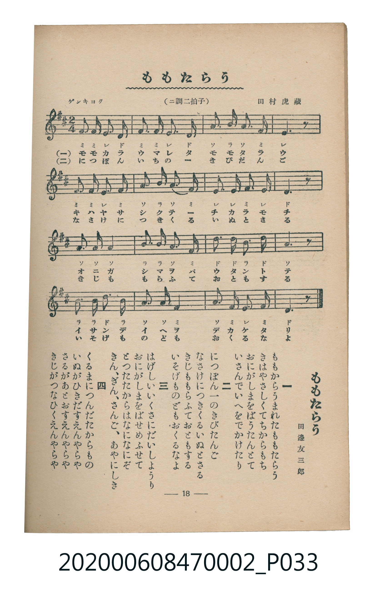

# ももたらう

<audio controls src="momotaro.mp3"></audio>

- 詞：田邊友三郎
- 曲：田村虎藏
- 臺灣教育會公認《新定兒童唱歌》尋常科第二學年用（2020.006.0847.0002）

- note

原書資訊與歌詞全文（對應 P033.jpg，書頁 p. 18，第二學期第 4 首）：
調性與拍號：ニ調二拍子（D 大調 2/4 拍），「ゲンキヨク」

## 歌詞

```text
一
ももからうまれたももたらう
きはやさしくてちからもち
おにがしまをばうたんとて
いさんでいへをでかけたり

二
につぽん一のきびだんご
なさけにつきくるいぬとさる
きじももらふておともする
いそげものどもおくるなよ

三
はげしいいくさにだいしようり
おにがしまをばせめふせて
とつたたからはなになにぞ
きん、ぎん、さんご、あやにしき

四
くるまにつんだたからもの
いぬがひきだすえんやらや
さるがあとおすえんやらや
きじがつなひくえんやらや
```

## 原書掃描頁



## 調性分析

```text
================================================================================
📊 TMD Song Profile: [ ももたらう ]
================================================================================
⏱  Duration:       0:17 (17.8s), 16 measures total
🎼 Key & Tempo:    首調基準 D, != 108.0 BPM, <2/4>
   - 分析範圍：      由實際發聲的音符與和弦推測調性；播放脈絡另行呈現
🎤 人聲音域:    D4 (MIDI 62) – D5 (MIDI 74) [跨度: 12 個半音 / 1.0 個八度, 難度: easy]
   - 最低音:  D4 in [Momotaro #1 @ m.1, 0:00]
   - 最高音: D5 in [Momotaro #1 @ m.11, 0:11]
   - 適合: soprano, mezzo-soprano, contralto, tenor, baritone, bass
🏛  結構:      Momotaro (17.8s)
⚡ 編曲密度:        Peak 1 軌道同時演奏
🗝  調性診斷：       D 調性不明確（純淨自然大調，未偵測到可信轉調）
   - 風格氣質:    純淨自然大調（陽光明朗、易唱易記，無明顯調外色彩）
   - 轉調歷程:    全曲維持單一推測調性（未偵測到可信轉調）
   - 核心骨幹音:  A, F#, D, E, B
   - 調性數值:    D 調性不明確 [相關度: 0.81, 穩定度: Ambiguous, 自然音純度: 100.0%]
   - 候選調性 (K-S): D 大調 (0.81), A 大調 (0.79), F# 小調 (0.72)
   - 五度圈歷程:   +2
   - 各段落調性細節:
     • [Momotaro #1]: D 調性不明確 (r: 0.81, 自然音純度: 100.0%)

  [ 五度圈游移軌跡 ]
               C  
         F            G  
      Bb              [D ]*
      Eb               A  
         Ab           E  
            Db       B  
               F# 
     (* = active key center)

  [ 十二半音累積音高分佈 ]
     C  :                            0.0%
     C# :                            0.0%
     D  : █████████████████         20.0%
     D# :                            0.0%
     E  : ██████████████            16.7%
     F  :                            0.0%
     F# : ████████████████████      23.3%
     G  :                            0.0%
     G# :                            0.0%
     A  : ████████████████████████  28.3%
     A# :                            0.0%
     B  : ██████████                11.7%
--------------------------------------------------------------------------------
Assignment 軌道音域：
  - Piano         : D4 – D5 (12 個半音 / 1.0 個八度, 50 個音符)
================================================================================
```

## ABC

```abc
X:1
T:ももたらう
C:曲：田村虎藏
M:2/4
L:1/16
Q:1/4=108
K:D

V:V1 name="Piano" snm="Pia"

[V:V1]
f3 f e2 d2 | f3 f e2 d2 | a3 b a3 f | e6 z2 |
f3 f e2 f2 | a3 b a2 f2 | e3 e f2 e2 | d6 z2 |
a3 a a4 | b3 b a2 f2 | d3 d b2 d2 | a6 z2 |
b3 b d2 b2 | a2 a2 f4 | a3 f e2 f2 | d6 z2 |
```

- [主旋律 TMD 檔案](momotaro.tmd)
- [鋼琴伴奏 TMD 檔案](momotaro_piano.tmd)
