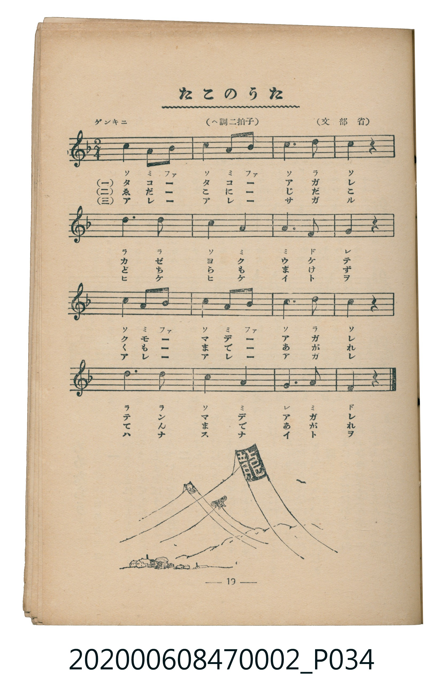

# たこのうた（風箏之歌）

> Re:Shōka 使用 AI 協助辨識與重建樂譜，可能會有錯誤。歡迎回報。

- **鋼琴伴奏版**：<br><audio controls src="tako_no_uta.mp3"></audio>
- **NEUTRINO 歌聲合成版**：<br><audio controls src="tako_no_uta_neutrino.mp3"></audio>

- 文部省
- 臺灣教育會公認《新定兒童唱歌》尋常科第二學年用（2020.006.0847.0002）

## 說明

曲目說明
中文解釋：描寫風箏乘風飛上天空、越飛越高。

原書資訊與歌詞全文（對應 P034.jpg，書頁 p. 19，第二學期第 5 首）：
調性與拍號：ヘ調二拍子（F 大調 2/4 拍），「ゲンキニ」


## 歌詞

```text
一
タコタコあがれ
カゼよくうけて
クモまであがれ
テンまであがれ

二
ゑだこにじだこ
どちらもうまい
もつとあがれ
ぐんとあがれ

三
アレサガツタ
ヒケヒケイトヲ
アレマタアガツタ
ハナセイトヲ
```

## ABC

<div class="abc-score" data-abc-src="tako_no_uta.abc" aria-label="五線譜載入中"></div>

[下載 ABC 原始檔](tako_no_uta.abc)

## TMD 檔案連結

- [主旋律 TMD 檔案](tako_no_uta.tmd) [[在 TMD Studio 編輯](https://tmdlang.github.io/Tmd-TS/#tmd=s7IKdvYPcrWy4qpTUCpJTLdSSM7PyUlNLsnMz7MqzsjMK0nNjM_KTMmPL87Iz05Ugisry88pzU21Si9KTEmNN4o3MjAyiDcwMIs3sDAxBzIMjBBKi_NLi5JTrYqTM_Lzc-JLUitKkvLzsxHyBUX5Zal5iXlANQVFIBtTwIoQClLLMlNSQdKpKZkl-UWZiTlI7kgtKga7FWxJfElRYl5xclFmAcgDCFUlGalAxybmZeYi6wUalZ6ZZ5Wbn5dUCvQeskRJRj7QawUZlVYZmcUgO5MTc-KzE_OQQgBqY0FieqpVgIGxiRKXlpbC48b5jxsnP25c97ixDch-v6fj5aIVz9f1P9nZ_Wxtz_s9nQpaWlyKtgqGBhZc9rYKblw2RvomdiAzn01rf9m84vmcRrANL9p3PW9c_GzqzBdNm57NaX7auubFqt7HDV3Ppm14um7W09ZJz1cvfTplI9DMxw3dTzd0P92x4_nyic_XrHmyq-fp2h1Pd255PmUF0HZQvOgB40UPFC9AhoER0A1KXPpaCs9mb3o-e92LVauezejjUlBQeLJjLdAJL5Yvftne_X7PrGf9_U_Xr4Y5fgaQ8XLx7Cc7up4uWfl85a7HDY0vtnUBRUDk6hmPG5q4tPS5QMbaUguA3PS0b_6z2TtebG5_saLrRUc70LcvVs572roC6FCg355u6H3W3qkACnu9rIL093t6gIpfLmhUKNBTMLQEcuHB8WzOfCBbwVTh5bJpQP8DvQcy_cWq_c8aloPM7e59MRMYV7MeN88ACgL1AEWerp0AtMNN4emS5UAxBWA0KQBFwbqBYd7zuGnT4-bNj5vWPm7uftzQywUJwgYQ9bhp_-MmoBSYbGx63AhU3AORWP24ac_jpo7Hjf3g9DHxceMyiMT6x82LHjfue9y4HFVHcxvIFjQJsF27oEYCzVgATnKrHzfOgLDBEo0rHzcufNzU-bgJqA1oF9CIFogOIH_J48YVqBY1TnjcBDQESRTio06InkWPm9c8btr6uGnN4-YWoNcgjpv0uGkjlGxa8ri543HzJiTlzfPAYbAITVP_4-aux027UXRQnlygQAGUDEMSs_P98kNLEq0CMhPz8h1qDGqqQbYo2Fho2YEZNcC0oKtgrGCCwdJVMIOyDIC4Bqzax7AGlLGBfGDggkQxeE1gncCAA_GaeoDseIRuI5DYRLD8Aqh6kD5gjEF5M6C6F8DlkHQbw8yHmFsDUQtlP26cCrMZGKlwhyG01wC9g-wpY7A2EKmrYAhkGWHxaDfUyDlgz3SA2f1Q69qgchPBvGWYHm1cCVWxEKy7E-xYkPORde8D81qweHQTivkgHogN0Q1SD-KvAJs8Cc2fpEcoyE8It-0Dm72c2AglXzdGhMJ0g2IORTcpUQqKSBC7BhitmF4FRRTIwslkeZVs3WCvroeqWAVWPxvKxh-ltVxcunYK8HysAOQocwEA)]
- [鋼琴伴奏 TMD 檔案](tako_no_uta_piano.tmd) [[在 TMD Studio 編輯](https://tmdlang.github.io/Tmd-TS/#tmd=s7IKdvYPcrWy4qpTUCpJTLdSyC8qychPL0osyKi0ysgsLskvykxOzInPTsxLVIIrKs4vLUpOjS9ITE-1CjAwNlHi0tJSeNw4_3Hj5MeN6x43tgHZ7_d0vOze83zClid7tjxd2v-8s-P9nk4FLS0uRVsFQwMLLntbBTcuGyN9EzuQsc-mtb9sXvF8TiPYkhftu543Ln42deaLpk3P5jQ_bV3zYlXv44auZ9M2PF0362nrpOerlz6dsvHZ2p7HDd1PN3Q_3bHj-fKJz9esebKr5-naHU93bnk-ZQXQAUYGRgZ6BgZmegYWJuZAhoER0A1KXFwhidn5fvmhJYlWAZmJeflBHg41BjXVXApAYGOhZQdm1CiYKugqGCuYYLB0FcygLAMgrgGr9jGsAQUAkA8MA5AoBq8JrPNxYw-I19QDZMcjdBuBxCaC5RdA1YP0PW5cDeXNgOpeAJdD0m0MMx9ibg1ELZT9uHEqzObHjUvgDkNorwF6B9lTxmBtIFJXwRDIMsLi0W6okXPAnukAs_uh1rVB5SaCecswPdq4EqpiIVh3J9ixIOcj694H5rVg8egmFPNBPBAbohukHsRfATZ5Epo_SY9QkJ8QbtsHNns5sRFKvm6MCIXpBsUcim5SohQUkSB2DTBaMb0KiiiQhZPJ8irZusFeXQ9VsQqsfjaUjT9KazGysQ9yNjaBZ2PDeIVow1h0hgmUYQAPMhMkUTQNpvHICsk3EGROtGk8kkqgL3TtFOAeifYBqkMVMEIXMAYLKHMBAA)]

## 分析

```text
================================================================================
📊 TMD Song Profile: [ たこのうた（風箏之歌） ]
================================================================================
⏱  Duration:       0:17 (17.8s), 16 measures total
🎼 Key & Tempo:    首調基準 F, != 108.0 BPM, <2/4>
   - 分析範圍：      由實際發聲的音符與和弦推測調性；播放脈絡另行呈現
🎤 人聲音域:    F4 (MIDI 65) – D5 (MIDI 74) [跨度: 9 個半音 / 0.8 個八度, 難度: easy]
   - 最低音:  F4 in [TakoNoUta #1 @ m.7, 0:07]
   - 最高音: D5 in [TakoNoUta #1 @ m.3, 0:03]
   - 適合: soprano, mezzo-soprano, contralto, tenor, baritone, bass
🏛  結構:      TakoNoUta (17.8s)
⚡ 編曲密度:        Peak 1 軌道同時演奏
🗝  調性診斷：       C 大調（流行色彩大調，未偵測到可信轉調）
   - 風格氣質:    流行大調（略帶和弦色彩音與裝飾副屬和弦）
   - 轉調歷程:    全曲維持單一推測調性（未偵測到可信轉調）
   - 核心骨幹音:  C, A, D, G, A#
   - 調性數值:    C 大調 [相關度: 0.71, 穩定度: Moderate, 自然音純度: 92.9%]
   - 候選調性 (K-S): C 大調 (0.71), A 小調 (0.67), F 大調 (0.61)
   - 五度圈歷程:   +0
   - 各段落調性細節:
     • [TakoNoUta #1]: C 大調 (r: 0.71, 自然音純度: 92.9%, 調外音: A#)

  [ 五度圈游移軌跡 ]
              [C ]*
         F            G  
      Bb               D  
      Eb               A  
         Ab           E  
            Db       B  
               F# 
     (* = active key center)

  [ 十二半音累積音高分佈 ]
     C  : ████████████████████████  39.3%
     C# :                            0.0%
     D  : ███████████               17.9%
     D# :                            0.0%
     E  :                            0.0%
     F  : ███                        5.4%
     F# :                            0.0%
     G  : █████                      8.9%
     G# :                            0.0%
     A  : █████████████             21.4%
     A# : ████                       7.1%
     B  :                            0.0%
--------------------------------------------------------------------------------
Assignment 軌道音域：
  - Piano         : F4 – D5 (9 個半音 / 0.8 個八度, 32 個音符)
================================================================================
```


## 原書掃描頁




