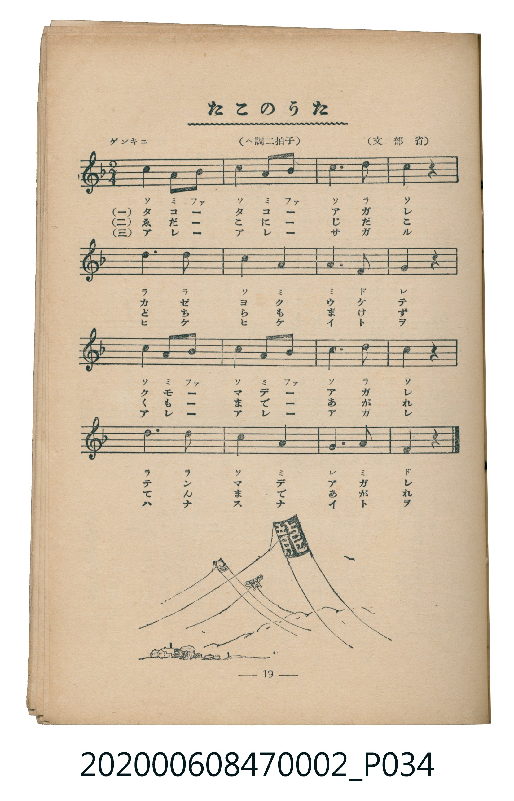

# たこのうた

<audio controls src="tako_no_uta.mp3"></audio>

- 文部省
- 臺灣教育會公認《新定兒童唱歌》尋常科第二學年用（2020.006.0847.0002）

## 說明

原書資訊與歌詞全文（對應 P034.jpg，書頁 p. 19，第二學期第 5 首）：
調性與拍號：ヘ調二拍子（F 大調 2/4 拍），「ゲンキニ」

## 歌詞

```text
一
タコタコあがれ
カゼよくうけて
クモまであがれ
テンまであがれ

二
ゑだこにじだこ
どちらもうまい
もつとあがれ
ぐんとあがれ

三
アレサガツタ
ヒケヒケイトヲ
アレマタアガツタ
ハナセイトヲ
```

## ABC

```abc
X:1
T:たこのうた
M:2/4
L:1/16
Q:1/4=108
K:F
V:V1 name="Piano" snm="Pia"
[V:V1]
c4 A2 B2 | c4 A2 B2 | c6 d2 | c4 z4 |
d6 d2 | c4 A4 | A6 F2 | G4 z4 |
c4 A2 B2 | c4 A2 B2 | c6 d2 | c4 z4 |
d6 d2 | c4 A4 | G6 A2 | F4 z4 |
```

## TMD 檔案連結

- [主旋律 TMD 檔案](tako_no_uta.tmd) [[在 TMD Studio 編輯](https://tmdlang.github.io/Tmd-TS/#tmd=s7IKdvYPcrWy4tLSUnjcOP9x4-THjeseN7YB2QpaWlyKtgqGBhZc9rYKblw2Rvomdlx1CkrPprW_bF7xfE6jEoj3on3X88bFz6bOfNG06dmc5qeta16s6n3c0PVs2oan62Y9bZ30fPXSp1M2Plvb87ih--mG7qc7djxfPvH5mjVPdvU8Xbvj6c4tz6eseL-nw8jAyEDPwMBMz8DCxBzIMDB6v6dTiYtLX0vBllqAS0FB4Wnf_Gezd7zY3P5iRdeLjnagu16snPe0dQXQV0BXPN3Q-6y9UyHAwNhEL6sg_f2eHqDilwsaFQr0FAwtgVy4w5_NmQ9kK5gqvFw2DejS93tmgUx_sWr_s4blIHO7e1_MnA8Ufdw8AygI1AMUebp2AtAON4WnS5YDxRSAAaoAFAXrBoZOz-OmTY-bNz9uWvu4uftxQy8XyMAnOxpA1OOm_Y-bgFJgsrHpcSNQcQ9EYvXjpj2PmzoeN_aD423i48ZlEIn1j5sXPW7c97hxOaqO5jaQLWgSYLt2QY0EmrEAnBRWP26cAWGDJRpXPm5c-Lip83ETUBvQLqARLRAdQP6Sx40rUC1qnPC4CWgIkijER50QPYseN6953LT1cdOax80tQK9BHDfpcdNGKNm05HFzx-PmTUjKm-eBw2ARmqb-x81dj5t2o-igPLlAgYKWPhdXSGJ2vl9-aEmiVUBmYl6-Q41BjUI1yBoFG0MzLTswqwaYGnTB0BiITYAYnwgImqGIGEDpGqhpIFnsKkGmgVXCWSBoCBYxwmEa_d0GcwlMtAbsQlTTarm4dO0U4KGrAOQoc3EBAA)]
- [鋼琴伴奏 TMD 檔案](tako_no_uta_piano.tmd) [[在 TMD Studio 編輯](https://tmdlang.github.io/Tmd-TS/#tmd=s7IKdvYPcrWy4tLSUnjcOP9x4-THjeseN7YB2e_3dLzs3vN8wpYne7Y8Xdr_vLPj_Z5OBS0tLkVbBUMDCy57WwU3LhsjfRM7rjoFpWfT2l82r3g-p1EJxHvRvut54-JnU2e-aNr0bE7z09Y1L1b1Pm7oejZtw9N1s562Tnq-eunTKRufre153ND9dEP30x07ni-f-HzNmie7ep6u3fF055bnU1YAHWBkYGSgZ2BgpmdgYWIOZBgYAd2gxMUVkpid75cfWpJoFZCZmJcf5OFQY1CjUM2lAAQ2hmZadmBWjYKpgi4YGgOxCRDjEwFBMxQRAyhdAzUNJItdJcg0sEo4CwQNwSJGOEyjv9tgLoGJ1oBdiGpaLUbg-qAErgk8bA3jFaINY9EZJlCGAdxlJkiiaBpM45EVkm8gyJxo03gklUBv6NopwH2iAOQoc3EBAA)]

## 分析

```text
================================================================================
📊 TMD Song Profile: [ たこのうた ]
================================================================================
⏱  Duration:       0:17 (17.8s), 16 measures total
🎼 Key & Tempo:    首調基準 F, != 108.0 BPM, <2/4>
   - 分析範圍：      由實際發聲的音符與和弦推測調性；播放脈絡另行呈現
🎤 人聲音域:    F4 (MIDI 65) – D5 (MIDI 74) [跨度: 9 個半音 / 0.8 個八度, 難度: easy]
   - 最低音:  F4 in [TakoNoUta #1 @ m.7, 0:07]
   - 最高音: D5 in [TakoNoUta #1 @ m.3, 0:03]
   - 適合: soprano, mezzo-soprano, contralto, tenor, baritone, bass
🏛  結構:      TakoNoUta (17.8s)
⚡ 編曲密度:        Peak 1 軌道同時演奏
🗝  調性診斷：       C 大調（流行色彩大調，未偵測到可信轉調）
   - 風格氣質:    流行大調（略帶和弦色彩音與裝飾副屬和弦）
   - 轉調歷程:    全曲維持單一推測調性（未偵測到可信轉調）
   - 核心骨幹音:  C, A, D, G, A#
   - 調性數值:    C 大調 [相關度: 0.71, 穩定度: Moderate, 自然音純度: 92.9%]
   - 候選調性 (K-S): C 大調 (0.71), A 小調 (0.67), F 大調 (0.61)
   - 五度圈歷程:   +0
   - 各段落調性細節:
     • [TakoNoUta #1]: C 大調 (r: 0.71, 自然音純度: 92.9%, 調外音: A#)

  [ 五度圈游移軌跡 ]
              [C ]*
         F            G  
      Bb               D  
      Eb               A  
         Ab           E  
            Db       B  
               F# 
     (* = active key center)

  [ 十二半音累積音高分佈 ]
     C  : ████████████████████████  39.3%
     C# :                            0.0%
     D  : ███████████               17.9%
     D# :                            0.0%
     E  :                            0.0%
     F  : ███                        5.4%
     F# :                            0.0%
     G  : █████                      8.9%
     G# :                            0.0%
     A  : █████████████             21.4%
     A# : ████                       7.1%
     B  :                            0.0%
--------------------------------------------------------------------------------
Assignment 軌道音域：
  - Piano         : F4 – D5 (9 個半音 / 0.8 個八度, 32 個音符)
================================================================================
```


## 原書掃描頁




