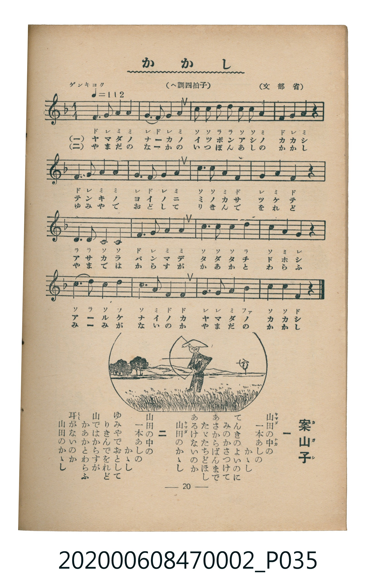

# かかし（稻草人）

> Re:Shōka 使用 AI 協助辨識與重建樂譜，可能會有錯誤。歡迎回報。

- **鋼琴伴奏版**：<br><audio controls src="kakashi.mp3"></audio>
- **NEUTRINO 歌聲合成版**：<br><audio controls src="kakashi_neutrino.mp3"></audio>

- 文部省
- 臺灣教育會公認《新定兒童唱歌》尋常科第二學年用（2020.006.0847.0002）

## 說明

曲目說明
中文解釋：描寫稻草人站在田裡守護農作物。

原書資訊與歌詞全文（對應 P035.jpg，書頁 p. 20，第二學期第 6 首）：
調性與拍號：ヘ調四拍子（F 大調 4/4 拍），「ゲンキヨク（♩＝112）」


## 歌詞

```text
一
山田のなかの　一ぽんあしの　かかし
てんきがよいのに　みの笠着けて
あさからばんまで　ただたちどほし
あされないか　はなせないか
山田のなかの　一ぽんあしの　かかし

二
山田のなかの　一ぽんあしの　かかし
ゆみやでをどして　田を荒すなと
よるからあさまで　ただたちどほし
ねむくはないか　さびしくないか
山田のなかの　一ぽんあしの　かかし
```

## ABC

```abc
X:1
T:かかし（稻草人）
M:4/4
L:1/16
Q:1/4=112
K:F
V:V1 name="Piano" snm="Pia"
[V:V1]
F6 G2 A4 A4 | G6 F2 G4 A4 | c2 c2 d2 d2 c2 c2 A4 | F4 G4 A4 z4 |
w: 1.~や ま だ の | な _ か の | い つ ぽ ん あ し の | か か し
w: 2.~や ま だ の | な _ か の | い つ ぽ ん あ し の | か か し
F6 G2 A4 A4 | G6 F2 G4 A4 | c6 c2 A4 F4 | G4 A4 F4 z4 |
w: 1.~て ん き の | よ い の に | み の か さ | つ け て
w: 2.~ゆ み や で | お ど し て | り き ん で | を れ ど
D6 D2 C4 C4 | F6 G2 A4 A4 | c6 c2 c4 d4 | c4 A4 G4 z4 |
w: 1.~あ さ か ら | ば ん ま で | た だ た ち | ど ほ し
w: 2.~や ま で は | か ら す が | か あ か と | わ ら ふ
c6 d2 c4 d4 | c6 A2 F4 F4 | G6 G2 A4 B4 | c4 c4 F4 z4 |
w: 1.~あ _ る け | な い の か | や ま だ の | か か し
w: 2.~み _ み が | な い の か | や ま だ の | か か し
```

## TMD 檔案連結

- [主旋律 TMD 檔案](kakashi.tmd) [[在 TMD Studio 編輯](https://tmdlang.github.io/Tmd-TS/#tmd=s7IKdvYPcrWy4qpTUCpJTLdSSM7PyUlNLsnMz7MqzsjMK0nNjM_KTMmPL87Iz05Ugisry88pzU21Si9KTEmNN4o3MjAyiDcwMIs3sDAxBzIMjBBKi_NLi5JTrYqTM_Lzc-JLUitKkvLzsxHyBUX5Zal5iXlANQVFIBtTwIoQClLLMlNSQdKpKZkl-UWZiTlI7kgtKga7FWxJfElRYl5xclFmAcgDCFUlGalAx5bnFyFZCzQoPTPPKjc_L6kU6DlMidTMrEwk52ppKTxu7Aaj6e_3dDxfsftFb-eTXbve7-lU0NLiUrRVMDQ04rK3VXDjsjHRN7EDmfdsWvvL5hXP5zSCTX_Rvut54-JnU2e-aNr0bE7z09Y1L1b1Pm7oejZtw9N1s562Tnq-eunTKRufre153ND9dEP30x07ni-f-HzNmie7ep6u3fF055bnU1YArQYFth4wsPVAgQ1kGBgB3aDEpa-l8Gz2puez171YterZjD4uBQWFJzvWAp3wYvnil-3d7_fMetbf_3T9arjLn6-e-XTOiudTNrxYvPDpuo4Xa7e_2Lfpyd45zztXPm5o4tLS5wKZaUstAHLQ0775z2bveLG5_cWKrhcd7UCvvlg572nrCqArgR57uqH3WXunQoCBsaleVkH6-z09QMUvFzQqFOgpGBkAufCweDZnPpCtYKbwctk0oOeBfgOZ_mLV_mcNy0Hmdve-mDkfKPq4eQZQ8Ons2UCRp2snAO1wU3i6ZDlQTAEYRwpAUbBuYID3PG7a9Lh58-OmtY-bVzxuWg9U-mjmyvd75gJjFajmcUMvFyREG8D-2LgRGG6PG9c9blwFThLrHjc0AOUeN-593DT5cWMTMJFABOFpBqTtceMysHTv40agfR2PG1vARqwGq9sPZD9fs-D5XCB7IlAlRAPQpKkgA5o6HzduAGve97hxOVjD_MeNC8DkwseNKx837oZbAtbT1AN2G9CGbrDq9WDubLggud4Ah8KuHkpCoakN5NsmoCuWP26aBHY8UN0yoDqQcU2TXvQCBWeCDV0B0dDxuAlsACgUICFCOBTWPm4CSvfDfA4PCKDmzWALgVIUhgVQG-X5AgoUQPnNOzE7EVjsWgVkJublO9QY1FSD7FCwsdCyAzNqFAwVdIHQSMEYSIJwDZANEjEE02ARsEofwxpguLWA5YChBcQLwKx1YD1AP4JlQCLdCHGITiNyddYomAKhGRCCaIjrQO6FucwA1XWNLUC8BIj3Au2bDEq3QDwdySaI-RByOpCMR3UjBfpJDMfGZRAfg23pRQ6Npg5oWIDcAhID5ma0kGyDqtgPDVVgwoW6rwsqsxLqPog9iLAEyULCEeRaiAthPPSw3A81ax3cx1OhtiwB8ybCzUcLxSaYK3rB_kNyX9MksJ97oG5EDT8zEEcXRJmCWGACS6giubAJas9UmAubOqEu3IAUuvsQLsCRGkFywEwN1QsyCWIWsMgAy4Dcix6GINoMrAPEArkMFJboYTgfassCKBtYpkBtAfkeWLaASWwpEeoKcAqEhP4KaBj2w336uHErWhhCXAfKLciuA7kPFI7gOMcIP5BpEBtAMYrIj8gpECSP7DpI2oCkQXgIEdAJyw-QuDSBuw6EsaQ_POUFgVxMss5aLi5dOwVoSakAZCpzAQA)]
- [鋼琴伴奏 TMD 檔案](kakashi_piano.tmd) [[在 TMD Studio 編輯](https://tmdlang.github.io/Tmd-TS/#tmd=s7IKdvYPcrWy4tLSUnjc2A1G09_v6XjZvef5hC1P9mx5urT_eWfH-z2dClpaXIq2CoaGRlz2tgpuXDYm-iZ2XHUKSs-mtb9sXvF8TqMSiPeifdfzxsXPps580bTp2Zzmp61rXqzqfdzQ9WzahqfrZj1tnfR89dKnUzY-W9vzuKH76Ybupzt2PF8-8fmaNU929Txdu-Ppzi3Pp6wAOsDIwMhAz8DATM_AwsQcyDAwArpBiYvLOzE7sTgj0yogMzEvP8jDocagpppLAQhsLLTswIwaBUMFXSA0UjAGkiBcA2SDRAzBNFgErNLHsEbhcVMLWO5x4z4gXgBmrQPredy4CiwDEulGiEN0GpGrs0bBFAjNgBBEQ1wHci_MZQaormtsAeIlQLwXaN9kIN0ExNORbIKYDyGnA8l4VDdSoJ_EcGxcBvEx2JZe5NBo6oCGBcgtILHHjavRQrINqmI_NFQfNy6Huq8LKrMS6j6IPYiwBMlCwhHkWogLYTz0sNwPNWsd3MdTobYsAfMmws1HC8UmmCt6wf5Dcl_TJLCfe6BuRA0_MxBHF0SZglhgAkuoIrmwCWrPVJgLmzqhLtyAFLr7EC7AkRpBco8b10P1gkyCmPW4cSZYBuRe9DAE0WZgHSAWyGWgsEQPw_lQWxZA2Y8bF0JtAfn-ceNuMIktJUJdAU6BkNBfAQ3DfrhPHzduRQtDiOtAuQXZdSD3gcIRHOcY4QcyDWIDKEYR-RE5BYLkkV0HSRuQNAgPIQI6YfkBEpcmcNeBMJb0h6e8IJCLSdZZi1ZQ-iAXlCaIgjJeIdowFkYBHR8PZJnGI0RwqAMywEqBHAOciog1DK4O1TgToKgJqp3I2ggaBiJQHAc0kIBhcM1wRg1YHhT2IKOAoaprpwAN2GgfkAwS1wjMVeYCAA)]

## 分析

```text
================================================================================
📊 TMD Song Profile: [ かかし（稻草人） ]
================================================================================
⏱  Duration:       0:34 (34.3s), 16 measures total
🎼 Key & Tempo:    首調基準 F, != 112.0 BPM, <4/4>
   - 分析範圍：      由實際發聲的音符與和弦推測調性；播放脈絡另行呈現
🎤 人聲音域:    C4 (MIDI 60) – D5 (MIDI 74) [跨度: 14 個半音 / 1.2 個八度, 難度: moderate]
   - 最低音:  C4 in [Kakashi #1 @ m.9, 0:18]
   - 最高音: D5 in [Kakashi #1 @ m.3, 0:04]
   - 適合: soprano, mezzo-soprano, contralto, tenor, baritone, bass
🏛  結構:      Kakashi (34.3s)
⚡ 編曲密度:        Peak 1 軌道同時演奏
🗝  調性診斷：       F 調性不明確（純淨自然大調，未偵測到可信轉調）
   - 風格氣質:    純淨自然大調（陽光明朗、易唱易記，無明顯調外色彩）
   - 轉調歷程:    全曲維持單一推測調性（未偵測到可信轉調）
   - 核心骨幹音:  C, A, F, G, D
   - 調性數值:    F 調性不明確 [相關度: 0.80, 穩定度: Ambiguous, 自然音純度: 100.0%]
   - 候選調性 (K-S): F 大調 (0.80), C 大調 (0.79), A 小調 (0.72)
   - 五度圈歷程:   -1
   - 各段落調性細節:
     • [Kakashi #1]: F 調性不明確 (r: 0.80, 自然音純度: 100.0%)

  [ 五度圈游移軌跡 ]
               C  
        [F ]*          G  
      Bb               D  
      Eb               A  
         Ab           E  
            Db       B  
               F# 
     (* = active key center)

  [ 十二半音累積音高分佈 ]
     C  : ████████████████████████  26.7%
     C# :                            0.0%
     D  : ████████                   9.2%
     D# :                            0.0%
     E  :                            0.0%
     F  : █████████████████         19.2%
     F# :                            0.0%
     G  : █████████████████         19.2%
     G# :                            0.0%
     A  : ██████████████████████    24.2%
     A# : ██                         1.7%
     B  :                            0.0%
--------------------------------------------------------------------------------
Assignment 軌道音域：
  - Piano         : C4 – D5 (14 個半音 / 1.2 個八度, 63 個音符)
================================================================================
```


## 原書掃描頁




