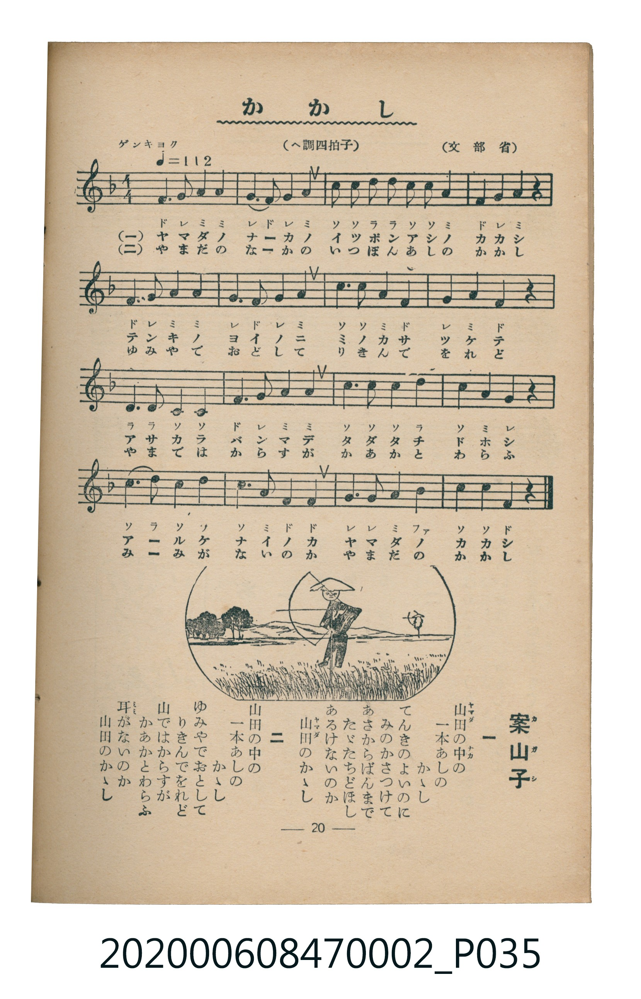

# かかし（稻草人）

> Re:Shōka 使用 AI 協助辨識與重建樂譜，可能會有錯誤。歡迎[回報](https://github.com/TMDLang/reshoka/issues)。

- **鋼琴伴奏版**：<br><audio controls src="kakashi.mp3"></audio>
- **NEUTRINO 歌聲合成版**：<br><audio controls src="kakashi_neutrino.mp3"></audio>

- 文部省
- 臺灣教育會公認《新定兒童唱歌》尋常科第二學年用（2020.006.0847.0002）

## 說明

曲目說明
中文解釋：描寫稻草人站在田裡守護農作物。

原書資訊與歌詞全文（對應 P035.jpg，書頁 p. 20，第二學期第 6 首）：
調性與拍號：ヘ調四拍子（F 大調 4/4 拍），「ゲンキヨク（♩＝112）」


## 歌詞

```text
一
山田のなかの　一ぽんあしの　かかし
てんきがよいのに　みの笠着けて
あさからばんまで　ただたちどほし
あされないか　はなせないか
山田のなかの　一ぽんあしの　かかし

二
山田のなかの　一ぽんあしの　かかし
ゆみやでをどして　田を荒すなと
よるからあさまで　ただたちどほし
ねむくはないか　さびしくないか
山田のなかの　一ぽんあしの　かかし
```

## ABC

<div class="abc-score" data-abc-src="kakashi.abc" aria-label="五線譜載入中"></div>

[下載 ABC 原始檔](kakashi.abc)

## TMD 檔案連結

- [主旋律 TMD 檔案](kakashi.tmd) [[在 TMD Studio 編輯](https://tmdlang.github.io/Tmd-TS/#tmd=s7IKdvYPcrWy4qpTUCpJTLdSSM7PyUlNLsnMz7MqzsjMK0nNjM_KTMmPL87Iz05Ugisry88pzU21Si9KTEmNN4o3MjAyiDcwMIs3sDAxBzIMjBBKi_NLi5JTrYqTM_Lzc-JLUitKkvLzsxHyBUX5Zal5iXlANQVFIBtTwIoQClLLMlNSQdKpKZkl-UWZiTlI7kgtKga7FWxJfElRYl5xclFmAcgDCFUlGalAx5bnFyFZCzQoPTPPKjc_L6kU6DlMidTMrEwszs0vKsnIB_q7IKPSKiOzGOSg5MSc-OzEPKTggTqnIDE91SrAwNhUiUtLS-FxYzcYTX-_p-P5it0vejuf7Nr1fk-ngpYWl6KtgqGhEZe9rYIbl42JvokdyKhn09pfNq94PqcRbPCL9l3PGxc_mzrzRdOmZ3Oan7auebGq93FD17NpG56um_W0ddLz1UufTtn4bG3P44bupxu6n-7Y8Xz5xOdr1jzZ1fN07Y6nO7c8n7ICaDUorvSAcaUHiisgw8AI6AYlLn0thWezNz2fve7FqlXPZvRxKSgoPNmxFuiEF8sXv2zvfr9n1rP-_qfrV8Nd_nz1zKdzVjyfsuHF4oVP13W8WLv9xb5NT_bOed658nFDE5eWPhfITFtqAZCDnvbNfzZ7x4vN7S9WdL3oaAd69cXKeU9bVwBdCfTY0w29z9o7FUDhrZdVkP5-Tw9Q8csFjQoFegpGBkAuPCyezZkPZCuYKbxcNg3oeaDfQKa_WLX_WcNykLndvS9mzgeKPm6eARR8Ons2UOTp2glAO9wUni5ZDhRTAMaRAlAUrBsY4D2PmzY9bt78uGnt4-YVj5vWA5U-mrny_Z65wFgFqnnc0MsFCdEGsD82bgSG2-PGdY8bV4GTxLrHDQ1AuceNex83TX7c2ARMJBBBeJoBaXvcuAws3fu4EWhfx-PGFrARq8Hq9gPZz9cseD4XyJ4IVAnRADRpKsiAps7HjRvAmvc9blwO1jD_ceMCMLnwcePKx4274ZaA9TT1gN0GtKEbrHo9mDsbLkiuN8ChsKuHklBoagP5tgnoiuWPmyaBHQ9UtwyoDmRc06QXvUDBmWBDV0A0dDxuAhsACgVIiBAOhbWPm4DS_TCfwwMCqHkz2EKgFIVhAdRGeb6AAgVQfvNOzE4EltpWAZmJefkONQY11SA7FGwstOzAjBoFQwVdIDRSMAaSIFwDZINEDME0WASs0sewBhhuLWA5YGgB8QIwax1YD9CPYBmQSDdCHKLTiFydNQqmQGgGhCAa4jqQe2EuM0B1XWMLEC8B4r1A-yaD0i0QT0eyCWI-hJwOJONR3UiBfhLDsXEZxMdgW3qRQ6OpAxoWILeAxIC5GS0k26Aq9kNDFZhwoe7rgsqshLoPYg8iLEGykHAEuRbiQhgPPSz3Q81aB_fxVKgtS8C8iXDz0UKxCeaKXrD_kNzXNAns5x6oG1HDzwzE0QVRpiAWmMASqkgubILaMxXmwqZOqAs3IIXuPoQLcKRGkBwwU0P1gkyCmAUsMsAyIPeihyGINgPrALFALgOFJXoYzofasgDKBpYpUFtAvgeWLWASW0qEugKcAiGhvwIahv1wnz5u3IoWhhDXgXILsutA7gOFIzjOMcIPZBrEBlCMIvIjcgoEySO7DpI2IGkQHkIEdMLyAyQuTeCuA2Es6Q9PeUEgF5Oss5aLS9dOAVpSKgCZylwA)]
- [鋼琴伴奏 TMD 檔案](kakashi_piano.tmd) [[在 TMD Studio 編輯](https://tmdlang.github.io/Tmd-TS/#tmd=s7IKdvYPcrWy4qpTUCpJTLdSyC8qychPL0osyKi0ysgsLskvykxOzInPTsxLVIIrKs4vLUpOjS9ITE-1CjAwNlXi0tJSeNzYDUbT3-_peNm95_mELU_2bHm6tP95Z8f7PZ0KWlpcirYKhoZGXPa2Cm5cNib6JnYgA59Na3_ZvOL5nEaw8S_adz1vXPxs6swXTZuezWl-2rrmxarexw1dz6ZteLpu1tPWSc9XL306ZeOztT2PG7qfbuh-umPH8-UTn69Z82RXz9O1O57u3PJ8ygqgA4wMjAz0DAzM9AwsTMyBDAMjoBuUuLi8E7MTizMyrQIyE_PygzwcagxqqrkUgMDGQssOzKhRMFTQBUIjBWMgCcI1QDZIxBBMg0XAKn0MaxQeN7WA5R437gPiBWDWOrCex42rwDIgkW6EOESnEbk6axRMgdAMCEE0xHUg98JcZoDqusYWIF4CxHuB9k0G0k1APB3JJoj5EHI6kIxHdSMF-kkMx8ZlEB-DbelFDo2mDmhYgNwCEnvcuBotJNugKvZDQ_Vx43Ko-7qgMiuh7oPYgwhLkCwkHEGuhbgQxkMPy_1Qs9bBfTwVassSMG8i3Hy0UGyCuaIX7D8k9zVNAvu5B-pG1PAzA3F0QZQpiAUmsIQqkguboPZMhbmwqRPqwg1IobsP4QIcqREk97hxPVQvyCSIWY8bZ4JlQO5FD0MQbQbWAWKBXAYKS_QwnA-1ZQGU_bhxIdQWkO8fN-4Gk9hSItQV4BQICf0V0DDsh_v0ceNWtDCEuA6UW5BdB3IfKBzBcY4RfiDTIDaAYhSRH5FTIEge2XWQtAFJg_AQIqATlh8gcWkCdx0IY0l_eMoLArmYZJ21aAWlD3JBaYIoKOMVog1jYRTQ8fFAlmk8QgSHOiADrBTIMcCpiFjD4OpQjTMBipqg2omsjaBhIALFcUADCRgG1wxn1IDlQWEPMgoYqrp2CtCAjfYBySBxjcBcZS4A)]

## 分析

```text
================================================================================
📊 TMD Song Profile: [ かかし（稻草人） ]
================================================================================
⏱  Duration:       0:34 (34.3s), 16 measures total
🎼 Key & Tempo:    首調基準 F, != 112.0 BPM, <4/4>
   - 分析範圍：      由實際發聲的音符與和弦推測調性；播放脈絡另行呈現
🎤 人聲音域:    C4 (MIDI 60) – D5 (MIDI 74) [跨度: 14 個半音 / 1.2 個八度, 難度: moderate]
   - 最低音:  C4 in [Kakashi #1 @ m.9, 0:18]
   - 最高音: D5 in [Kakashi #1 @ m.3, 0:04]
   - 適合: soprano, mezzo-soprano, contralto, tenor, baritone, bass
🏛  結構:      Kakashi (34.3s)
⚡ 編曲密度:        Peak 1 軌道同時演奏
🗝  調性診斷：       F 調性不明確（純淨自然大調，未偵測到可信轉調）
   - 風格氣質:    純淨自然大調（陽光明朗、易唱易記，無明顯調外色彩）
   - 轉調歷程:    全曲維持單一推測調性（未偵測到可信轉調）
   - 核心骨幹音:  C, A, F, G, D
   - 調性數值:    F 調性不明確 [相關度: 0.80, 穩定度: Ambiguous, 自然音純度: 100.0%]
   - 候選調性 (K-S): F 大調 (0.80), C 大調 (0.79), A 小調 (0.72)
   - 五度圈歷程:   -1
   - 各段落調性細節:
     • [Kakashi #1]: F 調性不明確 (r: 0.80, 自然音純度: 100.0%)

  [ 五度圈游移軌跡 ]
               C  
        [F ]*          G  
      Bb               D  
      Eb               A  
         Ab           E  
            Db       B  
               F# 
     (* = active key center)

  [ 十二半音累積音高分佈 ]
     C  : ████████████████████████  26.7%
     C# :                            0.0%
     D  : ████████                   9.2%
     D# :                            0.0%
     E  :                            0.0%
     F  : █████████████████         19.2%
     F# :                            0.0%
     G  : █████████████████         19.2%
     G# :                            0.0%
     A  : ██████████████████████    24.2%
     A# : ██                         1.7%
     B  :                            0.0%
--------------------------------------------------------------------------------
Assignment 軌道音域：
  - Piano         : C4 – D5 (14 個半音 / 1.2 個八度, 63 個音符)
================================================================================
```


## 原書掃描頁




