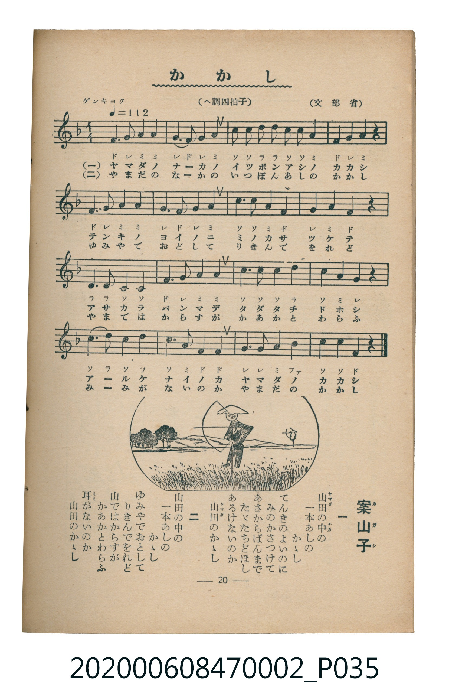

# かかし

> Re:Shoka 使用 AI 協助辨識與重建樂譜，可能會有錯誤。歡迎回報。

<audio controls src="kakashi.mp3"></audio>

- 文部省
- 臺灣教育會公認《新定兒童唱歌》尋常科第二學年用（2020.006.0847.0002）

## 說明

原書資訊與歌詞全文（對應 P035.jpg，書頁 p. 20，第二學期第 6 首）：
調性與拍號：ヘ調四拍子（F 大調 4/4 拍），「ゲンキヨク（♩＝112）」

## 歌詞

```text
一
山田のなかの　一ぽんあしの　かかし
てんきがよいのに　みの笠着けて
あさからばんまで　ただたちどほし
あされないか　はなせないか
山田のなかの　一ぽんあしの　かかし

二
山田のなかの　一ぽんあしの　かかし
ゆみやでをどして　田を荒すなと
よるからあさまで　ただたちどほし
ねむくはないか　さびしくないか
山田のなかの　一ぽんあしの　かかし
```

## ABC

```abc
X:1
T:かかし
M:4/4
L:1/16
Q:1/4=112
K:F
V:V1 name="Piano" snm="Pia"
[V:V1]
F6 G2 A4 A4 | G6 F2 G4 A4 | c3 c d2 c2 A4 c4 | F4 G4 A4 z4 |
F6 G2 A4 A4 | G6 F2 G4 A4 | C6 F2 A4 c4 | G4 A4 F4 z4 |
d6 d2 c4 c4 | F6 G2 A4 A4 | c3 c c2 d2 c4 A4 | G12 z4 |
c4 d4 c4 c4 | c6 A2 F4 F4 | G3 G A2 B2 c4 C4 | F12 z4 |
```

## TMD 檔案連結

- [主旋律 TMD 檔案](kakashi.tmd) [[在 TMD Studio 編輯](https://tmdlang.github.io/Tmd-TS/#tmd=s7IKdvYPcrWy4qpTUCpJTLdSSM7PyUlNLsnMz7MqzsjMK0nNjM_KTMmPL87Iz05Ugisry88pzU21Si9KTEmNN4o3MjAyiDcwMIs3sDAxBzIMjBBKi_NLi5JTrYqTM_Lzc-JLUitKkvLzsxHyBUX5Zal5iXlANQVFIBtTwIoQClLLMlNSQdKpKZkl-UWZiTlI7kgtKga7FWxJfElRYl5xclFmAcgDCFUlGalAx5bnFwGt1dJSeNzYDUbTFbS0uBRtFQwNjbjsbRXcuGxM9E3sQLqeTWt_2bzi-ZxGsBkv2nc9b1z8bOrMF02bns1pftq65sWq3scNXc-mbXi6btbT1knPVy99OmXjs7U9jxu6n27ofrpjx_PlE5-vWfNkV8_TtTue7tzyfMqK93s6QKGkBwwlPVAoARkGRu_3dCpxcelrKdhSC3ApKCg87Zv_bPaOF5vbX6zoetHRDnTXi5XznrauAPoK6IqnG3qftXcqBBgYm-plFaS_39MDVPxyQaNCgZ6CkQGQC3f4sznzgWwFM4WXy6YBXfp-zyyQ6S9W7X_WsBxkbnfvi5nzgaKPm2cABZ_Ong0Uebp2AtAON4WnS5YDxRSAAaoAFAXrBoZOz-OmTY-bNz9uWvu4ecXjpvVApY9mrny_Zy4wCoBqHjf0coGseLKjAeyPjRufT9nwuHHd48ZV4Ahb97ihASj3uHHv46bJjxubgFEIEYTHKEjb48ZlYOnex41A-zoeN7aAjVgNVrcfyH6-ZsHzuUD2RKBKiAagSVNBBjR1Pm7cANa873HjcrCG-Y8bF4DJhY8bVz5u3A23BKynqQfsNqAN3WDV68Hc2XBBcr0BDoVdPZSEQlMbyLdNQFcsf9w0Cex4oLplQHUg45omvegFCs4EG7oCoqHjcRPYAFAoQEKEcCisfdwElO6H-RweEEDNm8EWAqUoDAugNsrzBRQoaOlzcXknZicCCzergMzEvHyHGoMahWqQJQo2hmZadmBWjYKhgi4cGgGxMZQNo2vAojAIUg3jw1VATTIF80yB2QhEIuQh4iCTYHahm2CAZhIV3RSPphDTUehaYZajOwrkLRiEeRG793A6Gy2gQDSySdi9hwzR3QTTCXMbpptgLJj5MDfCaJhJEBuNwGpMkE2CBSCq97A7qpaLS9dOAZrqFIBMZS4uAA)]
- [鋼琴伴奏 TMD 檔案](kakashi_piano.tmd) [[在 TMD Studio 編輯](https://tmdlang.github.io/Tmd-TS/#tmd=s7IKdvYPcrWy4tLSUnjc2A1G09_v6XjZvef5hC1P9mx5urT_eWfH-z2dClpaXIq2CoaGRlz2tgpuXDYm-iZ2XHUKSs-mtb9sXvF8TqMSiPeifdfzxsXPps580bTp2Zzmp61rXqzqfdzQ9WzahqfrZj1tnfR89dKnUzY-W9vzuKH76Ybupzt2PF8-8fmaNU929Txdu-Ppzi3Pp6wAOsDIwMhAz8DATM_AwsQcyDAwArpBiYvLOzE7sTgj0yogMzEvP8jDocagRqGaSwEIbAzNtOzArBoFQwVdODQCYmMoG0bXgEVhEKQaxoergJpkCuaZKpiBSYQ8RBxkEswudBMM0Eyiopvi0RRiOgpdK8xydEeBvAWDMC9i9x5OZ6MFFIhGNgm795AhuptgOmFuw3QTjAUzH-ZGGA0zCWKjEViNCbJJsABE9R52R9WiJToflERngkhz8QrRhrEwChRLQJZpPEIEhzogA6wUyDHAqYhYw-DqUI0zAYqaoNqJrI2gYSACxXFAAwkYBtcMZ9SA5SGBCw5WXTsFaMgqAJnKXFwA)]

## 分析

```text
================================================================================
📊 TMD Song Profile: [ かかし ]
================================================================================
⏱  Duration:       0:34 (34.3s), 16 measures total
🎼 Key & Tempo:    首調基準 F, != 112.0 BPM, <4/4>
   - 分析範圍：      由實際發聲的音符與和弦推測調性；播放脈絡另行呈現
🎤 人聲音域:    C4 (MIDI 60) – D5 (MIDI 74) [跨度: 14 個半音 / 1.2 個八度, 難度: moderate]
   - 最低音:  C4 in [Kakashi #1 @ m.7, 0:12]
   - 最高音: D5 in [Kakashi #1 @ m.3, 0:04]
   - 適合: soprano, mezzo-soprano, contralto, tenor, baritone, bass
🏛  結構:      Kakashi (34.3s)
⚡ 編曲密度:        Peak 1 軌道同時演奏
🗝  調性診斷：       F 調性不明確（純淨自然大調，未偵測到可信轉調）
   - 風格氣質:    純淨自然大調（陽光明朗、易唱易記，無明顯調外色彩）
   - 轉調歷程:    全曲維持單一推測調性（未偵測到可信轉調）
   - 核心骨幹音:  C, A, F, G, D
   - 調性數值:    F 調性不明確 [相關度: 0.80, 穩定度: Ambiguous, 自然音純度: 100.0%]
   - 候選調性 (K-S): F 大調 (0.80), C 大調 (0.79), A 小調 (0.69)
   - 五度圈歷程:   -1
   - 各段落調性細節:
     • [Kakashi #1]: F 調性不明確 (r: 0.80, 自然音純度: 100.0%)

  [ 五度圈游移軌跡 ]
               C  
        [F ]*          G  
      Bb               D  
      Eb               A  
         Ab           E  
            Db       B  
               F# 
     (* = active key center)

  [ 十二半音累積音高分佈 ]
     C  : ████████████████████████  26.7%
     C# :                            0.0%
     D  : ██████                     6.7%
     D# :                            0.0%
     E  :                            0.0%
     F  : ████████████████████      21.7%
     F# :                            0.0%
     G  : ███████████████████       20.8%
     G# :                            0.0%
     A  : █████████████████████     23.3%
     A# : █                          0.8%
     B  :                            0.0%
--------------------------------------------------------------------------------
Assignment 軌道音域：
  - Piano         : C4 – D5 (14 個半音 / 1.2 個八度, 62 個音符)
================================================================================
```


## 原書掃描頁




