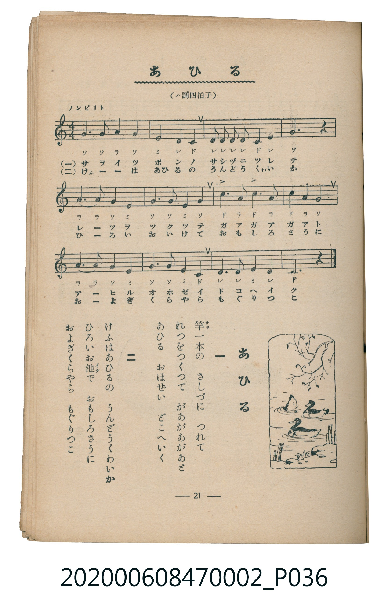

# あひる（鴨子）

> Re:Shōka 使用 AI 協助辨識與重建樂譜，可能會有錯誤。歡迎[回報](https://github.com/TMDLang/reshoka/issues)。

- **鋼琴伴奏版**：<br><audio controls src="ahiru.mp3"></audio>
- **NEUTRINO 歌聲合成版**：<br><audio controls src="ahiru_neutrino.mp3"></audio>

- 臺灣教育會公認《新定兒童唱歌》尋常科第二學年用（2020.006.0847.0002）

## 說明

曲目說明
中文解釋：描寫小鴨走路、游水與發出叫聲的可愛情景。

原書資訊與歌詞全文（對應 P036.jpg，書頁 p. 21，第二學期第 7 首）：
調性與拍號：ハ調四拍子（C 大調 4/4 拍），「ノンビリト」


## 歌詞

```text
一
よちよちあひるは　をかの上
ガーガーガーガー　ないてゆく
どこへいくのか　おもしろさうに
みんななかよく　つれだつて

二
すいすいあひるは　みづの上
ガーガーガーガー　ういてゆく
うををとるのか　もぐつてはうき
ういてはもぐり　おもしろい
```

## ABC

<div class="abc-score" data-abc-src="ahiru.abc" aria-label="五線譜載入中"></div>

[下載 ABC 原始檔](ahiru.abc)

## TMD 檔案連結

- [主旋律 TMD 檔案](ahiru.tmd) [[在 TMD Studio 編輯](https://tmdlang.github.io/Tmd-TS/#tmd=s7IKdvYPcrWy4qpTUCpJTLdSSM7PyUlNLsnMz7MqzsjMK0nNjM_KTMmPL87Iz05Ugisry88pzU21Si9KTEmNN4o3MjAyiDcwMIs3sDAxBzIMjBBKi_NLi5JTrYqTM_Lzc-JLUitKkvLzsxHyBUX5Zal5iXlANQVFIBtTwIoQClLLMlNSQdKpKZkl-UWZiTlI7kgtKga7FWxJfElRYl5xclFmAcgDCFUlGalAxybmZeYi6wUalZ6ZZ1WSmFmemBefn5aWmYxidn5RSUY-0IcFGZVWGZnFIKuTE3PisxPzkAICanFBYnqqVYCBsZkSl5aWwuPGpseNmx43db_f0_Fyy4qnaye839OpoKXFpWirYGnGZW-r4MxlY6JvYgcy5kX7rueNi59NnfmiadOzOc1PW9e8WNX7uKHr2bQNT9fNeto66fnqpU-nbHy2tudxQ_fTDd1Pd-x4vnzi8zVrnuzqebp2x9OdW55PWQG0CBQHesA40APFAZBhYAS0VIlLX0vh2exNz2eve7Fq1bMZfVwKCgpPdqx9Nq39xfLFL9uBLpz1rL__6frVTzf0A536YuuGF9vXP25ofLZjx7MNW150tD-fuedp-66n_atfNG56Pqvlaf_6Zy2znzW3PpsJVNbEpaXPBbLClloA5L6nffOfzd7xYnP7ixVdQBcAff5i5bynrSuAjgb68-mG3mftnQqgwNbLKkh_v6cHqPjlgkaFAj0FI0MgFx40z-bMB7IVzBVeLpsGDAugV0Gmv1i1_1nDcpC53b0vZs4Hij5u7gcKPp09GygCjqsOZ4WnS5YDxRSAkaQAFAXrBoZ_z-PmvsfNmx83T37cvOpxc8fjhl4uSIg2gKjHTR2PGxdCSVgaeNwIDKiGx02THjcC2eue7OiCKF3zuHkPFhKotHHV48aWx43LHje1PW7sB6tuXPm4cfLjxh1giX6gMSDDQEq7HjcB7Zn-uKn3cePUx41ADashGvY_bgJqAJoERN1gJ_WDNSx53NTzuHEBiNG4DOL4XT0QLTPBpkNIVMcDTWtcSqTjgU5Ad3wbyPegAFgBNhLmeJDLJ0AcArIHpLMXpgFiBlAUoqipC8O3LSCllCc4KFAAJWTHjMyiUquAzMS8fIcag5pqkA0KNhZadmBGjYKpgi4QmiqYgUldoIgxWERXwQiIDcEiRlAI4oFEYbog0AAkAjbNx7AG6NGpYFFg2ADZLSBW4xKwnseNe6E6gNEIFl8HFZ8KxNOBeCkQr4aqB0YpVHYZkl3xCLuMQHITHzduRZIGBi5UEyiu4bZ1o9jWBrYfmPwgbGAaauoHKwA5FqQApBzTwhpwEOkCSZDnQYGECDwQDxJ4hnFQRXAGVAwWviCIFFpgX0KcDvH1JKgjQDyQaD9MBhwOIBmIDqAXUdgwGRAbRK5AtQscWogQ6UXxcBfUlBZQiIJZy1FlmkB2TYfrhcUyKPxA5GoUuwgFFCxNQdIYSASSpkDiuNIUyE8QN4L8AIlRZJfvBuI5KH5aCZUBxfQOFBlQZONKTxDzQDZ0gPX0oeh53NQJxOA0DWSBZYAhA7FnApAN0o1I7aA0jmpPLReXrp0COEcqABnKXAA)]
- [鋼琴伴奏 TMD 檔案](ahiru_piano.tmd) [[在 TMD Studio 編輯](https://tmdlang.github.io/Tmd-TS/#tmd=s7IKdvYPcrWy4qpTUCpJTLdSyC8qychPL0osyKi0ysgsLskvykxOzInPTsxLVIIrKs4vLUpOjS9ITE-1CjAwNlPi0tJSeNzY9Lhx0-Om7vd7Ol5273k-YcuTPVueLu1_3tnxfk-ngpYWl6KtgqUZl72tgjOXjYm-iR3IvBftu543Ln42deaLpk3P5jQ_bV3zYlXv44auZ9M2PF0362nrpOerlz6dsvHZ2p7HDd1PN3Q_3bHj-fKJz9esebKr5-naHU93bnk-ZQXQRiMDIwM9AwMzPQMLE3Mgw8AIaKkSF5djRmZRqVVAZmJefpCHQ41BTTWXAhDYWGjZgRk1CqYKukBoqmAGJnWBIsZgEV0FIyA2BIsYQSGIBxKF6YJAA5AI2DQfwxpgOEwFiz5umgRkt4BYjUvAeh437oXqeNw0GSy-Dio-FYinA_EsIF4NVf-4qQcquwzJrniEXUYgud7HTe2PG9uQVDxuXA_VB4oPuIXdKBa2gZ3wuHElhN0IkQU5FiQL4mFaWAMOIl0gCfI8KJAQgQfiQQLPMA6qCM6AisHCFwSRQgvsS4i7Ib6eBHUEiAcS7YfJgMMBJAPRAfQfChsmA2KDyBWodoFDCxEcvSge7oKa0gLEE8Gs5agyTSC7psP1wmIZEvKgOEO2i1BAwdIUJI2BRCBpCiSOK02B_ARxI8gPkOhEdvluIJ6D4qeVUBlQNO9AkelHsgc9PUHMA9nQAdbTh6LncVMnEIPTNJAFlgGGDMSeCUA2SDcitYPSOKo9tSgZ0gc5Q5rAM6RhvEK0YayCCZAyiUXwoRQwKOOBLNP4WAQDrgaEDeCxADUBrhHdIKg83CI09USaQoRzgN7WtVMA-zzaByiG4BiBOcpcAA)]

## 分析

```text
================================================================================
📊 TMD Song Profile: [ あひる（鴨子） ]
================================================================================
⏱  Duration:       0:30 (30.0s), 12 measures total
🎼 Key & Tempo:    首調基準 C, != 96.0 BPM, <4/4>
   - 分析範圍：      由實際發聲的音符與和弦推測調性；播放脈絡另行呈現
🎤 人聲音域:    C4 (MIDI 60) – C5 (MIDI 72) [跨度: 12 個半音 / 1.0 個八度, 難度: easy]
   - 最低音:  C4 in [Ahiru #1 @ m.2, 0:04]
   - 最高音: C5 in [Ahiru #1 @ m.7, 0:15]
   - 適合: soprano, mezzo-soprano, contralto, tenor, baritone, bass
🏛  結構:      Ahiru (30.0s)
⚡ 編曲密度:        Peak 1 軌道同時演奏
🗝  調性診斷：       G 調性不明確（純淨自然大調，未偵測到可信轉調）
   - 風格氣質:    純淨自然大調（陽光明朗、易唱易記，無明顯調外色彩）
   - 轉調歷程:    全曲維持單一推測調性（未偵測到可信轉調）
   - 核心骨幹音:  G, C, D, E, A
   - 調性數值:    G 調性不明確 [相關度: 0.83, 穩定度: Ambiguous, 自然音純度: 100.0%]
   - 候選調性 (K-S): G 大調 (0.83), C 大調 (0.82), E 小調 (0.61)
   - 五度圈歷程:   +1
   - 各段落調性細節:
     • [Ahiru #1]: G 調性不明確 (r: 0.83, 自然音純度: 100.0%)

  [ 五度圈游移軌跡 ]
               C  
         F           [G ]*
      Bb               D  
      Eb               A  
         Ab           E  
            Db       B  
               F# 
     (* = active key center)

  [ 十二半音累積音高分佈 ]
     C  : ████████████████          21.7%
     C# :                            0.0%
     D  : ███████████               15.2%
     D# :                            0.0%
     E  : ███████████               15.2%
     F  :                            0.0%
     F# :                            0.0%
     G  : ████████████████████████  32.6%
     G# :                            0.0%
     A  : ███████████               15.2%
     A# :                            0.0%
     B  :                            0.0%
--------------------------------------------------------------------------------
Assignment 軌道音域：
  - Piano         : C4 – C5 (12 個半音 / 1.0 個八度, 42 個音符)
================================================================================
```


## 原書掃描頁




