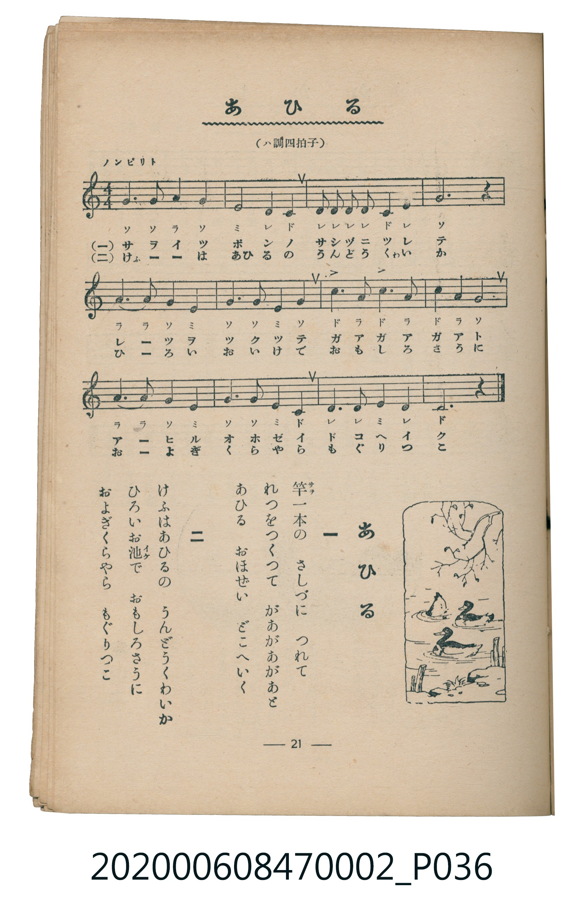

# あひる

<audio controls src="ahiru.mp3"></audio>

- 臺灣教育會公認《新定兒童唱歌》尋常科第二學年用（2020.006.0847.0002）

## 說明

原書資訊與歌詞全文（對應 P036.jpg，書頁 p. 21，第二學期第 7 首）：
調性與拍號：ハ調四拍子（C 大調 4/4 拍），「ノンビリト」

## 歌詞

```text
一
よちよちあひるは　をかの上
ガーガーガーガー　ないてゆく
どこへいくのか　おもしろさうに
みんななかよく　つれだつて

二
すいすいあひるは　みづの上
ガーガーガーガー　ういてゆく
うををとるのか　もぐつてはうき
ういてはもぐり　おもしろい
```

## 原書掃描頁



## 分析

```text
================================================================================
📊 TMD Song Profile: [ あひる ]
================================================================================
⏱  Duration:       0:30 (30.0s), 12 measures total
🎼 Key & Tempo:    首調基準 C, != 96.0 BPM, <4/4>
   - 分析範圍：      由實際發聲的音符與和弦推測調性；播放脈絡另行呈現
🎤 人聲音域:    C4 (MIDI 60) – C5 (MIDI 72) [跨度: 12 個半音 / 1.0 個八度, 難度: easy]
   - 最低音:  C4 in [Ahiru #1 @ m.2, 0:04]
   - 最高音: C5 in [Ahiru #1 @ m.7, 0:15]
   - 適合: soprano, mezzo-soprano, contralto, tenor, baritone, bass
🏛  結構:      Ahiru (30.0s)
⚡ 編曲密度:        Peak 1 軌道同時演奏
🗝  調性診斷：       G 調性不明確（純淨自然大調，未偵測到可信轉調）
   - 風格氣質:    純淨自然大調（陽光明朗、易唱易記，無明顯調外色彩）
   - 轉調歷程:    全曲維持單一推測調性（未偵測到可信轉調）
   - 核心骨幹音:  G, C, D, E, A
   - 調性數值:    G 調性不明確 [相關度: 0.83, 穩定度: Ambiguous, 自然音純度: 100.0%]
   - 候選調性 (K-S): G 大調 (0.83), C 大調 (0.82), E 小調 (0.61)
   - 五度圈歷程:   +1
   - 各段落調性細節:
     • [Ahiru #1]: G 調性不明確 (r: 0.83, 自然音純度: 100.0%)

  [ 五度圈游移軌跡 ]
               C  
         F           [G ]*
      Bb               D  
      Eb               A  
         Ab           E  
            Db       B  
               F# 
     (* = active key center)

  [ 十二半音累積音高分佈 ]
     C  : ████████████████          21.7%
     C# :                            0.0%
     D  : ███████████               15.2%
     D# :                            0.0%
     E  : ███████████               15.2%
     F  :                            0.0%
     F# :                            0.0%
     G  : ████████████████████████  32.6%
     G# :                            0.0%
     A  : ███████████               15.2%
     A# :                            0.0%
     B  :                            0.0%
--------------------------------------------------------------------------------
Assignment 軌道音域：
  - Piano         : C4 – C5 (12 個半音 / 1.0 個八度, 42 個音符)
================================================================================
```

## ABC

```abc
X:1
T:あひる
C:TMD (Chen, Chih-Han / aguai)
M:4/4
L:1/16
Q:1/4=96
K:C
V:V1 name="Piano" snm="Pia"
[V:V1]
g6 g2 a4 g4 | e8 d4 c4 | d2 d2 d2 d2 c4 d4 | g12 z4 |
a6 a2 g4 e4 | g6 g2 e4 g4 | c6 a2 c6 a2 | c4 a4 g8 |
a6 a2 g4 e4 | g6 g2 e4 c4 | d6 d2 e4 d4 | c12 z4 |
```

- [主旋律 TMD 檔案](ahiru.tmd)
- [鋼琴伴奏 TMD 檔案](ahiru_piano.tmd)
