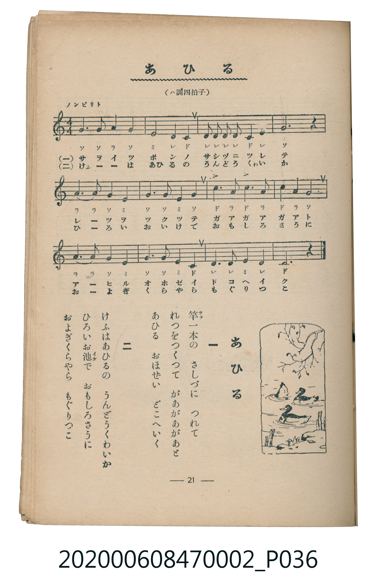

# あひる（鴨子）

> Re:Shōka 使用 AI 協助辨識與重建樂譜，可能會有錯誤。歡迎回報。

- **NEUTRINO 歌聲合成版**：<br><audio controls src="ahiru_neutrino.mp3"></audio>
- **鋼琴伴奏版**：<br><audio controls src="ahiru.mp3"></audio>


- 臺灣教育會公認《新定兒童唱歌》尋常科第二學年用（2020.006.0847.0002）

## 說明

曲目說明
中文解釋：描寫小鴨走路、游水與發出叫聲的可愛情景。

原書資訊與歌詞全文（對應 P036.jpg，書頁 p. 21，第二學期第 7 首）：
調性與拍號：ハ調四拍子（C 大調 4/4 拍），「ノンビリト」


## 歌詞

```text
一
よちよちあひるは　をかの上
ガーガーガーガー　ないてゆく
どこへいくのか　おもしろさうに
みんななかよく　つれだつて

二
すいすいあひるは　みづの上
ガーガーガーガー　ういてゆく
うををとるのか　もぐつてはうき
ういてはもぐり　おもしろい
```

## ABC

```abc
X:1
T:あひる（鴨子）
M:4/4
L:1/16
Q:1/4=96
K:C
V:V1 name="Piano" snm="Pia"
[V:V1]
G6 G2 A4 G4 | E8 D4 C4 | D2 D2 D2 D2 C4 D4 | G12 z4 |
w: 1.~さ を い つ | ぽ ん の | さ し づ に つ れ | て
w: 2.~けふ _ _ は | あひ る の | う ん ど う くわ い | か
A6 A2 G4 E4 | G6 G2 E4 G4 | c6 A2 c6 A2 | c4 A4 G8 |
w: 1.~れ _ つ を | つ く つ て | が あ が あ | が あ と
w: 2.~ひ _ ろ い | お い け で | お も し ろ | さ う に
A6 A2 G4 E4 | G6 G2 E4 C4 | D6 D2 E4 D4 | C12 z4 |
w: 1.~あ _ ひ る | お ほ ぜ い | ど こ へ い | く
w: 2.~お _ よ ぎ | く ら や ら | も ぐ り つ | こ
```

## TMD 檔案連結

- [主旋律 TMD 檔案](ahiru.tmd) [[在 TMD Studio 編輯](https://tmdlang.github.io/Tmd-TS/#tmd=s7IKdvYPcrWy4qpTUCpJTLdSSM7PyUlNLsnMz7MqzsjMK0nNjM_KTMmPL87Iz05Ugisry88pzU21Si9KTEmNN4o3MjAyiDcwMIs3sDAxBzIMjBBKi_NLi5JTrYqTM_Lzc-JLUitKkvLzsxHyBUX5Zal5iXlANQVFIBtTwIoQClLLMlNSQdKpKZkl-UWZiTlI7kgtKga7FWxJfElRYl5xclFmAcgDCFUlGalAxybmZeYi6wUalZ6ZZ1WSmFmemBefn5aWmQw2W0tL4XFj0-PGTY-but_v6Xi5ZcXTtRPe7-lU0NLiUrRVsDTjsrdVcOayMdE3sQMZ9qJ91_PGxc-mznzRtOnZnOanrWterOp93ND1bNqGp-tmPW2d9Hz10qdTNj5b2_O4ofvphu6nO3Y8Xz7x-Zo1T3b1PF274-nOLc-nrABaBApEPWAg6oECEcgwMAJaqsSlr6XwbPam57PXvVi16tmMPi4FBYUnO9Y-m9b-Yvnil-1AF8561t__dP3qpxv6gU59sXXDi-3rHzc0Ptux49mGLS862p_P3PO0fdfT_tUvGjc9n9XytH_9s5bZz5pbn80EKmvi0tLnAllhSy0Act_TvvnPZu94sbn9xYouoAuAPn-xct7T1hVARwP9-XRD77P2ToUAA2MzvayC9Pd7eoCKXy5oVCjQUzAyBHLhQfNsznwgW8Fc4eWyacCwAHoVZPqLVfufNSwHmdvd-2LmfKDo4-Z-oODT2bOBIuC46nBWeLpkOVBMARhJCkBRsG5g-Pc8bu573Lz5cfPkx82rHjd3PG7o5YKEaAOIetzU8bhxIZSEpYHHjcCAanjcNOlxI5C97smOLojSNY-b92AhgUobVz1ubHncuOxxU9vjxn6w6saVjxsnP27cAZboBxoDMgyktOtxE9Ce6Y-beh83Tn3cCNSwGqJh_-MmoAagSUDUDXZSP1jDksdNPY8bF4AYjcsgjt_VA9EyE2w6hER1PNC0xqVEOh7oBHTHt4F8DwqAFWAjYY4HuXwCxCEge0A6e2EaIGYARSGKmrowfNsCUkp5goMCBVBCdszILCq1CshMzMt3qDGoqQbZoGBjoWUHZtQomCroAqGpghmY1AWKGINFdBWMgNgQLGIEhSAeSBSmCwINQCJg03wMa4AenQoWBYYNkN0CYjUuAet53LgXqgMYjWDxdVDxqUA8HYiXAvFqqHpglEJllyHZFY-wywgkN_Fx41YkaWDgQjWB4hpuWzeKbW1g-4HJD8IGpqGmfrACkGNBCkDKMS2sAQeRLpAEeR4USIjAA_EggWcYB1UEZ0DFYOELgkihBfYlxOkQX0-COgLEA4n2w2TA4QCSgegAehGFDZMBsUHkClS7wKGFCJFeFA93QU1pAYUomLUcVaYJZNd0uF5YLIPCD0SuRrGLUEDB0hQkjYFEIGkKJI4rTYH8BHEjyA-QGEV2-W4gnoPip5VQGVBM70CRAUU2rvQEMQ9kQwdYTx-KnsdNnUAMTtNAFlgGGDIQeyYA2SDdiNQOSuOo9tRycenaKYBzpAKQocwFAA)]
- [鋼琴伴奏 TMD 檔案](ahiru_piano.tmd) [[在 TMD Studio 編輯](https://tmdlang.github.io/Tmd-TS/#tmd=s7IKdvYPcrWy4tLSUnjc2PS4cdPjpu73ezpedu95PmHLkz1bni7tf97Z8X5Pp4KWFpeirYKlGZe9rYIzl42JvokdV52C0ov2Xc8bFz-bOvNF06Znc5qftq55sar3cUPXs2kbnq6b9bR10vPVS59O2fhsbc_jhu6nG7qf7tjxfPnE52vWPNnV83Ttjqc7tzyfsgJoo5GBkYGegYGZnoGFiTmQYWAEtFSJi8sxI7Oo1CogMzEvP8jDocagpppLAQhsLLTswIwaBVMFXSA0VTADk7pAEWOwiK6CERAbgkWMoBDEA4nCdEGgAUgEbJqPYQ0wHKaCRR83TQKyW0CsxiVgPY8b90J1PG6aDBZfBxWfCsTTgXgpEK-Gqn_c1AOVXYZkVzzCLiOQ3MTHjVuRpB83rodqAkUG3LZuFNvawPY_blwJYTf2P27qBysAORakAKQc08IacBDpAkmQ50GBhAg8EA8SeIZxUEVwBlQMFr4giBRaYF9CnA7x9SSoI0A8kGg_TAYcDiAZiA6gF1HYMBkQG0SuQLULHFqIEOlF8XAX1JQWUIiCWctRZZpAdk2H64XFMij8QORqFLsIBRQsTUHSGEgEkqZA4rjSFMhPEDeC_ACJUWSX7wbiOSh-WgmVAcX0DhQZUGTjSk8Q80A2dID19KHoedzUCcTgNA1kgWWAIQOxZwKQDdKNSO2gNI5qTy1KhvRBzpAm8AxpGK8QbRirYAKkTGIRfCgFDMp4IMs0PhbBgKsBYQN4LEBNgGtENwgqD7cITT2RphDhHKC3de0UwD6P9gGKIThGYI4yFwA)]

## 分析

```text
================================================================================
📊 TMD Song Profile: [ あひる（鴨子） ]
================================================================================
⏱  Duration:       0:30 (30.0s), 12 measures total
🎼 Key & Tempo:    首調基準 C, != 96.0 BPM, <4/4>
   - 分析範圍：      由實際發聲的音符與和弦推測調性；播放脈絡另行呈現
🎤 人聲音域:    C4 (MIDI 60) – C5 (MIDI 72) [跨度: 12 個半音 / 1.0 個八度, 難度: easy]
   - 最低音:  C4 in [Ahiru #1 @ m.2, 0:04]
   - 最高音: C5 in [Ahiru #1 @ m.7, 0:15]
   - 適合: soprano, mezzo-soprano, contralto, tenor, baritone, bass
🏛  結構:      Ahiru (30.0s)
⚡ 編曲密度:        Peak 1 軌道同時演奏
🗝  調性診斷：       G 調性不明確（純淨自然大調，未偵測到可信轉調）
   - 風格氣質:    純淨自然大調（陽光明朗、易唱易記，無明顯調外色彩）
   - 轉調歷程:    全曲維持單一推測調性（未偵測到可信轉調）
   - 核心骨幹音:  G, C, D, E, A
   - 調性數值:    G 調性不明確 [相關度: 0.83, 穩定度: Ambiguous, 自然音純度: 100.0%]
   - 候選調性 (K-S): G 大調 (0.83), C 大調 (0.82), E 小調 (0.61)
   - 五度圈歷程:   +1
   - 各段落調性細節:
     • [Ahiru #1]: G 調性不明確 (r: 0.83, 自然音純度: 100.0%)

  [ 五度圈游移軌跡 ]
               C  
         F           [G ]*
      Bb               D  
      Eb               A  
         Ab           E  
            Db       B  
               F# 
     (* = active key center)

  [ 十二半音累積音高分佈 ]
     C  : ████████████████          21.7%
     C# :                            0.0%
     D  : ███████████               15.2%
     D# :                            0.0%
     E  : ███████████               15.2%
     F  :                            0.0%
     F# :                            0.0%
     G  : ████████████████████████  32.6%
     G# :                            0.0%
     A  : ███████████               15.2%
     A# :                            0.0%
     B  :                            0.0%
--------------------------------------------------------------------------------
Assignment 軌道音域：
  - Piano         : C4 – C5 (12 個半音 / 1.0 個八度, 42 個音符)
================================================================================
```


## 原書掃描頁




