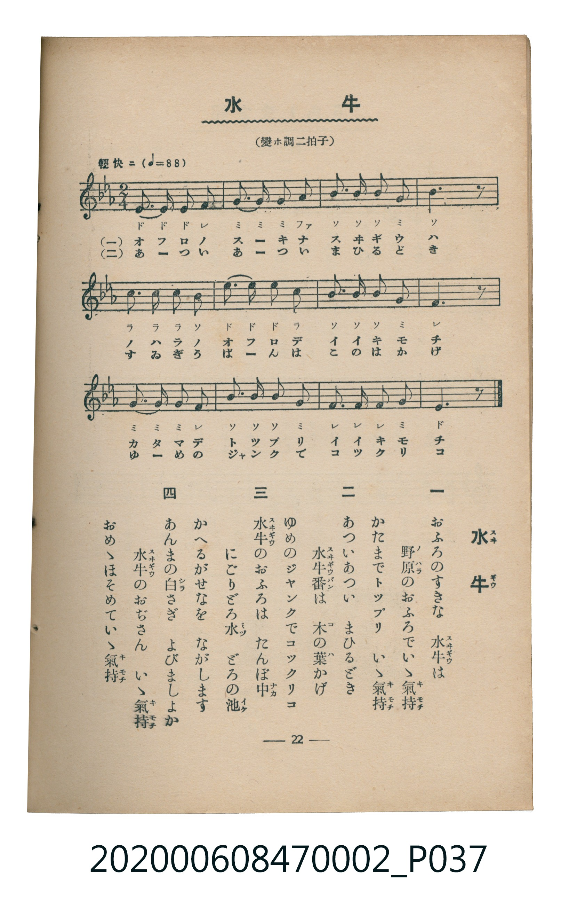

# 水牛

<audio controls src="suigyu.mp3"></audio>

- 臺灣教育會公認《新定兒童唱歌》尋常科第二學年用（2020.006.0847.0002）

## 說明

原書資訊與歌詞全文（對應 P037.jpg，書頁 p. 22，第二學期第 8 首）：
調性與拍號：變ホ調二拍子（降 E 大調 2/4 拍），「輕快ニ（♩＝88）」

## 跨冊／重複收錄參照

> 同名異曲（各冊收錄之不同詞曲版本）

- **[同名異曲]** 《新定兒童唱歌》尋常科第一學年用（2020.006.0847.0001）：[**〈スヰギウ〉**](../../grade_1_2020.006.0847.0001/3_05_suigyu/index.md)（`F` / `2/4` — [原始 TMD](../../grade_1_2020.006.0847.0001/3_05_suigyu/suigyu.tmd)）
- 總表：[跨冊重複與同名歌曲總索引](../../../duplicate_songs.md)

## 歌詞

```text
一
おふろのすきな　水牛（スヰギウ）は
野原（ノハラ）のおふろでいゝ氣持（キモチ）
かたまでトップリ　いゝ氣持（キモチ）

二
あついあつい　まひるどき
水牛番（スヰギウバン）は　木（コ）の葉（ハ）かげ
ゆめのジャンクでコックリコ

三
水牛（スヰギウ）のおふろは　たんぼ中（ナカ）
にごりどろ水（ミヅ）　どろの池（イケ）
かへるがせなを　ながします

四
あんまの白（シラ）さぎ　よびましよか
水牛（スヰギウ）のおぢさん　いゝ氣持（キモチ）
おめゝほそめていゝ氣持（キモチ）
```

## ABC

```abc
X:1
T:水牛
M:2/4
L:1/16
Q:1/4=88
K:Eb
V:V1 name="Piano" snm="Pia"
[V:V1]
E3 E E2 F2 | G3 G G2 A2 | B3 B B2 G2 | B6 z2 |
c3 c c2 B2 | e3 e e2 c2 | B3 B B2 G2 | F6 z2 |
G3 G G2 F2 | B3 B B2 G2 | F3 F F2 G2 | E6 z2 |
```

## TMD 檔案連結

- [主旋律 TMD 檔案](suigyu.tmd) [[在 TMD Studio 編輯](https://tmdlang.github.io/Tmd-TS/#tmd=s7IKdvYPcrWy4tLSUni2YcvzztkKWlpcirYKFhZc9rYKrjpcNkb6JnZcdQpKL9p3PW9c_GzqzBdNm57NaX7auubFqt7HDV3Ppm14um7W09ZJz1cvfTpl47O1PY8bup9u6H66Y8fz5ROfr1nzZFfP07U7nu7c8nzKivd7OowMjAz0DAzM9AwsTMyBDAOj93s6lbi49LUUbKkFuBQUFJ72zX82e8eLze0vVnS96GgHuuvFynlPW1c8m9YOdMXTDb3P2jsVAgyMzfWyCtLf7-kBKn65oFGhQE_BCOiiHrjDn82ZD2QrWCi8XDYN6NL3e2aBTH-xav-zhuUgc7t7X8ycDxR9sa7rcfNsoDhQG1Dw6doJQGtezuxVcFV4umQ5UFwBGJIKQBmwIcBA6nmxZ-rT_asfN3cDFT6aufL9nrkWFkDJxw29XCArnuxoAFGPG7seN2593NT7uHHd48aZjxuBjFWPGxog0QXU-rhp5-PmDY-b1j1uWgbS3rgepO1lex8wBEDSzX2Pm_sfNwPNB8oBjYAbt_xxY8vjprnPNix-1tMINmjt4-ZFj5uB7E6Izd2PG-c_btwHUtoMNKj5cfP0x80gy_HpBLt9Vw_EhKbHjUtAiuEMkF6ggZseNwENXwn0DUgdxC_Pp65C887j5gmPmzdDPAXy8hxQAnrcBBFZ92IiMCCBzuoHc4HGTQLb2dT2uKkR5NOmHY-bFwP1P25aD_JB02aQD4BsoA-aNkODGOxR3EGJHFwgF4DCo2ny48Y9T3asBdvd9bhpNTy4Vj9unPK4CahhJVAD0FCwivmPm1vBsQrUDBIHGvps4wKwZUseN21EDusd4EDpedw4GxTFTZPAelaBRaaDQ20m2NVPZ8-GBS7ILUDxdc9n7gWbuB0Wz1MfN_aBtDd1PG7cDFYzHczuJsa_i0D6gUbjj2do2gSGddPcx427HzfOBYf7MgJ6KM_dUKCgpc_FFVyamV5ZahWQmZiX71BjUKNQDbJDwcbQTMsOzMJWrCiAMveOhhcLexQ0TBSebuh_vr5BB14WaGLRALQKatjLWX1PJ_RaKTxu7gQFAAq5BkjWAOn5YB4yCQzOhSCppr3gFIpEghXAZJABwkoNoFs1gTY2rYKYBSbXgsk-qOadYN4esLEQmS4UmQ1gmXVgchnUlf14LNzVA7KwsQlhbOMSMNkC0YxHZh-YtwlsVTeYvRIq04vdwhoFQwVdIDQE00ZAXKNgDBYxBtMmYBFTsIgpmAaJwkQg0AAkAs4cuCN8Vw-FEQ7yBwoJjjNQUGImBaifccc3OLHgCn5IfINjFxJPMGth8Y2ZEtqhMuDIgJIQmUVQCxvxWAiN75lgbRNAZCPY8sY2iOZGcAKCJrDJYJn1UBkID5y0wGLAMgYqMwm7hTUKZuA4MwPToFgEpoA4SBKIg7BAEtiiHJQ4SInyHZ0URjlmTobmcQIRi0rCZEBJA1cMQLP4arCB-8Ha5oFJaMQ2d4B5zWByOpgEJQJKo7wJFMGwiAUph0QlyFhQ7QmU2gyWAscsPJGBxSBugcrA3AKSwWIjao6G5HFc0WsEpiEikJIBOcJrubh07RQgxb4CkKXMxQUA)]
- [鋼琴伴奏 TMD 檔案](suigyu_piano.tmd) [[在 TMD Studio 編輯](https://tmdlang.github.io/Tmd-TS/#tmd=s7IKdvYPcrWy4tLSUni2Ycvzztnv93S87N7zfMKWJ3u2PF3a_7yz4_2eTgUtLS5FWwULCy57WwVXHS4bI30TO646BaUX7bueNy5-NnXmi6ZNz-Y0P21d82JV7-OGrmfTNjxdN-tp66Tnq5c-nbLx2dqexw3dTzd0P92x4_nyic_XrHmyq-fp2h1Pd255PmUF0EojAyMDPQMDMz0DCxNzIMPACGirEhdXcGlmemWpVUBmYl5-kIdDjUGNQjWXAhDYGJpp2YFZ-loKtuhAAWTDjoYXC3sUNEwUnm7of76-QUchwMDYXC-rIF0TiwYtfbBhNQqGCrpAaAimjYC4RsEYLGIMpk3AIqZgEVMwDRKFiUCgAUiEC7_bdvWQ4zYzsPlmYBpkI9C1cRDnxkFYIAlszgN5hBTn7egkx3nIAQUJOlwuMQLTEBFIgCO7rRY13n1Q4t0EEe0v9kx9un_1sw0TX6xZ8HLRiqfblz3r7IYkW6T4jFeINozFy4CqNAFyTUDicAZcpWk8kGUaj1CLaRhCCUjMAOINXTsFiE8UUFjKXFwA)]

## 分析

```text
================================================================================
📊 TMD Song Profile: [ 水牛 ]
================================================================================
⏱  Duration:       0:16 (16.4s), 12 measures total
🎼 Key & Tempo:    首調基準 E,, != 88.0 BPM, <2/4>
   - 分析範圍：      由實際發聲的音符與和弦推測調性；播放脈絡另行呈現
🎤 人聲音域:    D#4 (MIDI 63) – D#5 (MIDI 75) [跨度: 12 個半音 / 1.0 個八度, 難度: easy]
   - 最低音:  D#4 in [Suigyu #1 @ m.1, 0:00]
   - 最高音: D#5 in [Suigyu #1 @ m.6, 0:06]
   - 適合: soprano, mezzo-soprano, contralto, tenor, baritone, bass
🏛  結構:      Suigyu (16.4s)
⚡ 編曲密度:        Peak 1 軌道同時演奏
🗝  調性診斷：       D# 調性不明確（純淨自然大調，未偵測到可信轉調）
   - 風格氣質:    純淨自然大調（陽光明朗、易唱易記，無明顯調外色彩）
   - 轉調歷程:    全曲維持單一推測調性（未偵測到可信轉調）
   - 核心骨幹音:  A#, G, D#, F, C
   - 調性數值:    D# 調性不明確 [相關度: 0.82, 穩定度: Ambiguous, 自然音純度: 100.0%]
   - 候選調性 (K-S): D# 大調 (0.82), A# 大調 (0.80), G 小調 (0.70)
   - 五度圈歷程:   -3
   - 各段落調性細節:
     • [Suigyu #1]: D# 調性不明確 (r: 0.82, 自然音純度: 100.0%)

  [ 五度圈游移軌跡 ]
               C  
         F            G  
      Bb               D  
     [Eb]*              A  
         Ab           E  
            Db       B  
               F# 
     (* = active key center)

  [ 十二半音累積音高分佈 ]
     C  : ███████                    8.9%
     C# :                            0.0%
     D  :                            0.0%
     D# : █████████████████         20.0%
     E  :                            0.0%
     F  : ███████████████           17.8%
     F# :                            0.0%
     G  : ██████████████████        22.2%
     G# : ██                         2.2%
     A  :                            0.0%
     A# : ████████████████████████  28.9%
     B  :                            0.0%
--------------------------------------------------------------------------------
Assignment 軌道音域：
  - Piano         : D#4 – D#5 (12 個半音 / 1.0 個八度, 39 個音符)
================================================================================
```


## 原書掃描頁




