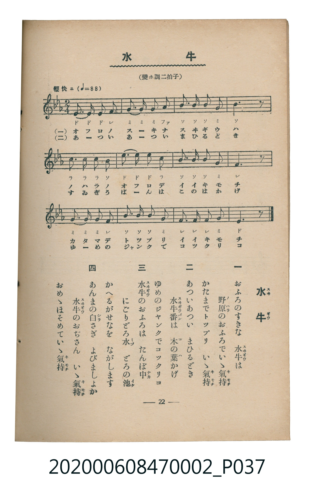

# 水牛

> Re:Shōka 使用 AI 協助辨識與重建樂譜，可能會有錯誤。歡迎回報。

- **NEUTRINO 歌聲合成版**：<br><audio controls src="suigyu_neutrino.mp3"></audio>
- **鋼琴伴奏版**：<br><audio controls src="suigyu.mp3"></audio>


- 臺灣教育會公認《新定兒童唱歌》尋常科第二學年用（2020.006.0847.0002）

## 說明

原書資訊與歌詞全文（對應 P037.jpg，書頁 p. 22，第二學期第 8 首）：
調性與拍號：變ホ調二拍子（降 E 大調 2/4 拍），「輕快ニ（♩＝88）」


## 跨冊／重複收錄參照

> 同曲＋同詞異曲＋同名異曲（御船武作詞；《公學校唱歌》與《新定兒童唱歌》第二學年為同曲，《臺灣の歌》為郭明峯原創譜曲版；《新定兒童唱歌》第一學年〈スヰギウ〉為同名異曲）

- **[同曲]** 《公學校唱歌》第二學年用（昭和11年／1936）：[**〈スヰギウ（水牛）〉**](../../../kogakko_shoka/grade_2/6_suigyu/index.md)（`Eb` / `2/4` — [原始 TMD](../../../kogakko_shoka/grade_2/6_suigyu/suigyu.tmd)）
- **[同名異曲]** 《新定兒童唱歌》尋常科第一學年用（2020.006.0847.0001）：[**〈スヰギウ（水牛）〉**](../../grade_1_2020.006.0847.0001/3_05_suigyu/index.md)（`F` / `2/4` — [原始 TMD](../../grade_1_2020.006.0847.0001/3_05_suigyu/suigyu.tmd)）
- **[同詞異曲]** 《臺灣の歌》（昭和4年／1929，國臺圖 0786 8）：[**〈水牛〉**](../../../taiwan_no_uta/3_suigyu/index.md)（`E,` / `2/4` — [原始 TMD](../../../taiwan_no_uta/3_suigyu/suigyu.tmd)）
- 總表：[跨冊重複與同名歌曲總索引](../../../duplicate_songs.md)

## 歌詞

```text
一
おふろのすきな　水牛（スヰギウ）は
野原（ノハラ）のおふろでいゝ氣持（キモチ）
かたまでトップリ　いゝ氣持（キモチ）

二
あついあつい　まひるどき
水牛番（スヰギウバン）は　木（コ）の葉（ハ）かげ
ゆめのジャンクでコックリコ

三
水牛（スヰギウ）のおふろは　たんぼ中（ナカ）
にごりどろ水（ミヅ）　どろの池（イケ）
かへるがせなを　ながします

四
あんまの白（シラ）さぎ　よびましよか
水牛（スヰギウ）のおぢさん　いゝ氣持（キモチ）
おめゝほそめていゝ氣持（キモチ）
```

## ABC

```abc
X:1
T:水牛
M:2/4
L:1/16
Q:1/4=88
K:Eb
V:V1 name="Piano" snm="Pia"
[V:V1]
E3 E E2 F2 | G3 G G2 A2 | B3 B B2 G2 | B6 z2 |
w: 1.~お ふ ろ の | す _ き な | す ゐ ぎ う | は
w: 2.~あ _ つ い | あ _ つ い | ま ひ る ど | き
w: 3.~す ゐ ぎ うの | お ふ ろ は | た ん ぼ な | か
w: 4.~あ ん ま の | し ら さ ぎ | よ び ま しよ | か
c3 c c2 B2 | e3 e e2 c2 | B3 B B2 G2 | F6 z2 |
w: 1.~の は ら の | お ふ ろ で | い い き も | ち
w: 2.~す ゐ ぎ う | ば _ ん は | こ の は か | げ
w: 3.~に ご り ど | ろ み づ _ | ど ろ の い | け
w: 4.~す ゐ ぎ うの | お ぢ さ ん | い い き も | ち
G3 G G2 F2 | B3 B B2 G2 | F3 F F2 G2 | E6 z2 |
w: 1.~か た ま で | と つ ぷ り | い い き も | ち
w: 2.~ゆ _ め の | じや ん く で | こ つ く り | こ
w: 3.~か へ る が | せ _ な を | な が し ま | す
w: 4.~お め め ほ | そ _ め て | い い き も | ち
```

## TMD 檔案連結

- [主旋律 TMD 檔案](suigyu.tmd) [[在 TMD Studio 編輯](https://tmdlang.github.io/Tmd-TS/#tmd=s7IKdvYPcrWy4qpTUCpJTLdSSM7PyUlNLsnMz7MqzsjMK0nNjM_KTMmPL87Iz05Ugisry88pzU21Si9KTEmNN4o3MjAyiDcwMIs3sDAxBzIMjBBKi_NLi5JTrYqTM_Lzc-JLUitKkvLzsxHyBUX5Zal5iXlANQVFIBtTwIoQClLLMlNSQdKpKZkl-UWZiTlI7kgtKga7FWxJfElRYl5xclFmAcgDCFUlGalAxybmZeYi64WI5iWWlBalKnFpaSk827DleedsBS0tLkVbBQsLLntbBVcdLhsjfRM7kKYX7bueNy5-NnXmi6ZNz-Y0P21d82JV7-OGrmfTNjxdN-tp66Tnq5c-nbLx2dqexw3dTzd0P92x4_nyic_XrHmyq-fp2h1Pd255PmXF-z0doMDSAwaWHiiwgAwDo_d7OpW4uPS1FGypBbgUFBSe9s1_NnvHi83tL1Z0vehoB7rrxcp5T1tXPJvWDnTF0w29z9o7FQIMjM31sgrS3-_pASp-uaBRoUBPwQjooh64w5_NmQ9kK1govFw2DejS93tmgUx_sWr_s4blIHO7e1_MnA8UfbGu63HzbKA4UBtQ8OnaCUBrXs7sVXBVeLpkOVBcARiSCkAZsCHAQOp5sWfq0_2rHzd3AxU-mrny_Z65FhZAyccNvVwgK57saABRjxu7HjdufdzU-7hx3ePGmY8bgYxVjxsaINEF1Pq4aefj5g2Pm9Y9bloG0t64HqTtZXsfMARA0s19j5v7HzcDzQfKAY2AG7f8cWPL46a5zzYsftbTCDZo7ePmRY-bgexOiM3djxvnP27cB1LaDDSo-XHz9MfNIMvx6QS7fVcPxISmx41LQIrhDJBeoIGbHjcBDV8J9A1IHcQvz6euQvPO4-YJj5s3QzwF8vIcUAJ63AQRWfdiIjAggc7qB3OBxk0C29nU9ripEeTTph2PmxcD9T9uWg_yQdNmkA-AbKAPmjZDgxjsUdxBiRxcIBeAwqNp8uPGPU92rAXb3fW4aTU8uFY_bpzyuAmoYSVQA9BQsIr5j5tbwbEK1AwSBxr6bOMCsGVLHjdtRA7rHeBA6XncOBsUxU2TwHpWgUWmg0NtJtjVT2fPhgUuyC1A8XXPZ-4Fm7gdFs9THzf2gbQ3dTxu3AxWMx3M7ibGv4tA-oFG449naNoEhnXT3MeNux83zgWH-zICeijP3VCgoKXPxRVcmpleWWoVkJmYl-9QY1BTDbJCwcbQTMsOzMJWqiiA8vaOhhcLexQ0TBSebuh_vr5BB14UaGLRALQJatjLWX1PJ_RaKTxu7gT5H4VcAyRrgPR8MA-ZBIbmQpBU015wAkUiwQpgMsgAYaUG0K2aQBubVkHMApNrwWQfVPNOMG8P2FiITBeKzAawzDowuQzqyn48Fu7qAVnY2IQwtnEJmGyBaMYjsw_M2wS2qhvMXgmV6cVuYY2CoYIuEBqCaSMgrlEwBosYg2kTsIgpWMQUTINEYSIQaAASAZvmYwiyqgssCsy4QEf0glnrwHqAOQiqA-QcELkKRfxx0wQguw8s0waVWY9kTzzCHiNIMMBMWwImW6B6cInvg4puAgcOiLUSKgNyDRZbjHG4DeEhTK-CHAySmQ_VNhnI3oPiWZDVWCwzQTgdogvkXIRN06EynUD2VLAMyDGgRNYBdcNmuB5QYYPTMvwZc1cPhRkTlN5QSHDeAiV5zCwLTZu48yU4U2NJtUj5EpwLIfkJZi0sX2Lm2HaoDDjTQEmIzCKohY14LITmy5lgbRNAJDAOQGQbRHMjOKNDC4LJYJn1UBkID1wEgMVAEQORmYTdwhoFM3CcmYFpUG4D5tQ4sBCQArNAEtiyJigT48qaoNQESaWglIScvjBT8nKoDCj7QLIRNNs2gVIpSGYh9pQMzpy4s_QGqA5QGCHnGBAP4iKIGCTxQsIId_ZcDdU1BWgeyA_wTA32BYi_H4iXQnWDdIDkQbb3Qn2PKCAmYrcHnDOJKgYWwTIn2GukBh6BKrOTwpyJWTFCq0wC-Q-VhMmAcjCWdItcY64GG7gfrG0emITmv-YOMK8ZTE4Hk6C8SmnObALlQ1j-AymH5DiQsaC2KFBqM1gKnAHhZQFYDOIWqAzMLSAZLDaiVpCQKhNXLjQC0xARSEWLPV9CimlQrQErw2G5bwVUZgkQbwcnIFBiIztfAsMIlvsawbphSXjG4yaogeDKpx_FEbCsCXIEWAbuCIgM9qwJ89QOeH3bA9U1G-YIcKUIbGtDxUE8iDpIhQcJDOSWA7asCc19QA_BPLUbqmsummeXkRF0tVxcunYKkJauApClzAUA)]
- [鋼琴伴奏 TMD 檔案](suigyu_piano.tmd) [[在 TMD Studio 編輯](https://tmdlang.github.io/Tmd-TS/#tmd=s7IKdvYPcrWy4tLSUni2Ycvzztnv93S87N7zfMKWJ3u2PF3a_7yz4_2eTgUtLS5FWwULCy57WwVXHS4bI30TO646BaUX7bueNy5-NnXmi6ZNz-Y0P21d82JV7-OGrmfTNjxdN-tp66Tnq5c-nbLx2dqexw3dTzd0P92x4_nyic_XrHmyq-fp2h1Pd255PmUF0EojAyMDPQMDMz0DCxNzIMPACGirEhdXcGlmemWpVUBmYl5-kIdDjUFNNZcCENgYmmnZgVn6Wgq26EABZMGOhhcLexQ0TBSebuh_vr5BRyHAwNhcL6sgXROLBi19sGE1CoYKukBoCKaNgLhGwRgsYgymTcAipmARUzANEoWJQKABSARsmo9hjcLjxi6w6OPGrQqPm3rBrHVgPY8bZ0J1PG6EiK9CEX_cNAHI7gPLtEFl1iPZE4-wxwgk1wQ3bQmYbIHqwSW-Dyq6CWhTN5i1EioDcg0WW4xxuA3hIUyvghwMkpkP1TYZyN6D4lmQ1VgsM0E4HaIL5FyETdOhMp1A9lSwDMgxQJmmDqgbNsP1TIcIYrcMfxra1UNOGjIDm28GpkEpA5iq4sBCQArMAklgS0agBIcrGYF8DglRkK-RwwIz1JdDZUBRDYlyaBJrAoUoSGYh9lAHJyTcyW8DVAcoRpBjF8SDuAgiBglokMwk7PaAk9JqqK4pQPNAfoAnQLAvQPz9QLwUqhukAyQPsr0X6ntEYp6I3R5wKiIqyS6CJSSw10gNPAIlUSc5qQi53IGURLgSjBGYhohAyi_sSQiS-kGZEZY1YAllBVRmCRBvB_sVFC5kJ6EmUIKBBHojWDcstGc8boIaCM7T_SiOgKUikCPAMnBHQGSwpyKYp3bAi7EeqK7ZMEeAy5rHTaC0CBIH8SDqIOUIJDCQC2RsqQiaUIAegnlqN1TXXDTPLiMj6GpRqzof5KrOBFHTvdgz9en-1c82THyxZsHLRSuebl_2rLMbUlEjVWHxCtGGsXgZUJUmQK4JSBzOgKs0jQeyTOMRajENQygBiRlAfKFrpwDxSLQPUBESzwiFZ4zCA1oN5ClzAQA)]

## 分析

```text
================================================================================
📊 TMD Song Profile: [ 水牛 ]
================================================================================
⏱  Duration:       0:16 (16.4s), 12 measures total
🎼 Key & Tempo:    首調基準 E,, != 88.0 BPM, <2/4>
   - 分析範圍：      由實際發聲的音符與和弦推測調性；播放脈絡另行呈現
🎤 人聲音域:    D#4 (MIDI 63) – D#5 (MIDI 75) [跨度: 12 個半音 / 1.0 個八度, 難度: easy]
   - 最低音:  D#4 in [Suigyu #1 @ m.1, 0:00]
   - 最高音: D#5 in [Suigyu #1 @ m.6, 0:06]
   - 適合: soprano, mezzo-soprano, contralto, tenor, baritone, bass
🏛  結構:      Suigyu (16.4s)
⚡ 編曲密度:        Peak 1 軌道同時演奏
🗝  調性診斷：       D# 調性不明確（純淨自然大調，未偵測到可信轉調）
   - 風格氣質:    純淨自然大調（陽光明朗、易唱易記，無明顯調外色彩）
   - 轉調歷程:    全曲維持單一推測調性（未偵測到可信轉調）
   - 核心骨幹音:  A#, G, D#, F, C
   - 調性數值:    D# 調性不明確 [相關度: 0.82, 穩定度: Ambiguous, 自然音純度: 100.0%]
   - 候選調性 (K-S): D# 大調 (0.82), A# 大調 (0.80), G 小調 (0.70)
   - 五度圈歷程:   -3
   - 各段落調性細節:
     • [Suigyu #1]: D# 調性不明確 (r: 0.82, 自然音純度: 100.0%)

  [ 五度圈游移軌跡 ]
               C  
         F            G  
      Bb               D  
     [Eb]*              A  
         Ab           E  
            Db       B  
               F# 
     (* = active key center)

  [ 十二半音累積音高分佈 ]
     C  : ███████                    8.9%
     C# :                            0.0%
     D  :                            0.0%
     D# : █████████████████         20.0%
     E  :                            0.0%
     F  : ███████████████           17.8%
     F# :                            0.0%
     G  : ██████████████████        22.2%
     G# : ██                         2.2%
     A  :                            0.0%
     A# : ████████████████████████  28.9%
     B  :                            0.0%
--------------------------------------------------------------------------------
Assignment 軌道音域：
  - Piano         : D#4 – D#5 (12 個半音 / 1.0 個八度, 39 個音符)
================================================================================
```


## 原書掃描頁




