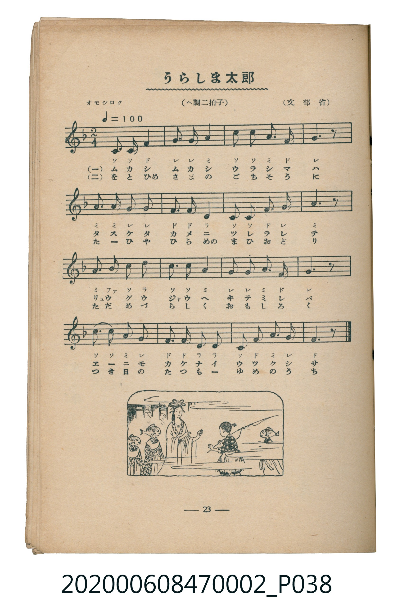
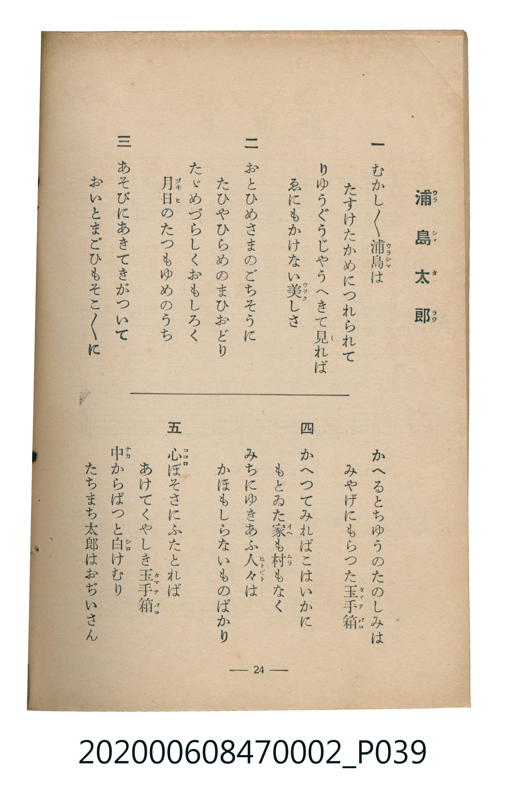

# うらしま太郎

> Re:Shōka 使用 AI 協助辨識與重建樂譜，可能會有錯誤。歡迎回報。

- **NEUTRINO 歌聲合成版**：<br><audio controls src="urashima_taro_neutrino.mp3"></audio>
- **鋼琴伴奏版**：<br><audio controls src="urashima_taro.mp3"></audio>


- 文部省
- 臺灣教育會公認《新定兒童唱歌》尋常科第二學年用（2020.006.0847.0002）

## 說明

原書資訊與歌詞全文（對應 P038.jpg – P039.jpg，書頁 pp. 23–24，第二學期第 9 首）：
調性與拍號：ヘ調二拍子（F 大調 2/4 拍），「オモシロク（♩＝100）」


## 跨冊／重複收錄參照

> 同曲＋同名異曲（《公學校唱歌》第二學年、《新定兒童唱歌》第二學年與《うたのほん》下卷為 1911 年『尋常小學唱歌』「むかしむかし浦島は…」同曲；《公學校唱歌集》〈浦島太郎〉為同名異曲）

- **[同名異曲]** 《公學校唱歌》第二學年用（昭和11年／1936）：[**〈うらしまたらう（浦島太郎）〉**](../../../kogakko_shoka/grade_2/12_urashimataro/index.md)（`F` / `2/4` — [原始 TMD](../../../kogakko_shoka/grade_2/12_urashimataro/urashimataro.tmd)）
- **[同名異曲]** 《うたのほん》（唱歌課本）下卷（2006.006.0878）：[**〈うらしま太郎（浦島太郎）〉**](../../../utanohon/ge_2006.006.0878/14_urashimataro/index.md)（`G` / `2/4` — [原始 TMD](../../../utanohon/ge_2006.006.0878/14_urashimataro/urashimataro.tmd)）
- 總表：[跨冊重複與同名歌曲總索引](../../../duplicate_songs.md)

## 歌詞

```text
一
むかしむかしうらしまは
たすけたかめにつれられて
りゆうぐうじようへきてみれば
ゑにもかかれぬうつくしさ

二
おとひめさまのごちそうに
たいやひらめのまひおどり
ただめづらしくおもしろく
月日のたつのもゆめのうち

三
あそびあきてかへる日に
おとひめさまのたまてばこ
あけてはならぬといはれしが
あけてびっくりしらがあたま
```

## ABC

```abc
X:1
T:うらしま太郎
M:2/4
L:1/16
Q:1/4=100
K:F
V:V1 name="Piano" snm="Pia"
[V:V1]
C2 C2 F4 | G2 G2 A4 | c2 c2 A2 F2 | G6 z2 |
w: 1.~む か し | む か し | う ら し ま | は
w: 2.~お と ひめ | さ ま の | ご ち そ う | に
w: 3.~あ そ びに | あ き て | き が つ い | て
w: 4.~か へ つて | み れ ば | こ は い か | に
w: 5.~こ ころ ぼ | そ さ に | ふ た と れ | ば
A3 A G2 G2 | F2 F2 D4 | C2 C2 F2 G2 | A6 z2 |
w: 1.~た す け た | か め に | つ れ ら れ | て
w: 2.~た ひ や ひ | ら め の | ま ひ お ど | り
w: 3.~お い と ま | ご ひ も | そ こ そ こ | に
w: 4.~も と み た | い へ も | む ら も な | く
w: 5.~あ け て く | や し き | た ま て ば | こ
A3 B c2 d2 | c3 c A4 | G2 G2 A2 F2 | G6 z2 |
w: 1.~りゆ う ぐ う | じや う へ | き て み れ | ば
w: 2.~た だ め づ | ら し く | お も し ろ | く
w: 3.~か へ る と | ちゆ う の | た の し み | は
w: 4.~み ち に ゆ | き あ ふ | ひ と び と | は
w: 5.~な か か ら | ぱ つ と | し ろ け む | り
c3 c A2 G2 | F2 F2 D2 D2 | C2 F2 A2 G2 | F6 z2 |
w: 1.~ゑ _ に も | か け な い | う つ く し | さ
w: 2.~つ き ひ の | た つ も _ | ゆ め の う | ち
w: 3.~み や げ に | も ら つ た | た ま て ば | こ
w: 4.~か ほ も し | ら な い _ | も の ば か | り
w: 5.~た ち ま ち | た ら う は | お ぢ い さ | ん
```

## TMD 檔案連結

- [主旋律 TMD 檔案](urashima_taro.tmd) [[在 TMD Studio 編輯](https://tmdlang.github.io/Tmd-TS/#tmd=s7IKdvYPcrWy4qpTUCpJTLdSSM7PyUlNLsnMz7MqzsjMK0nNjM_KTMmPL87Iz05Ugisry88pzU21Si9KTEmNN4o3MjAyiDcwMIs3sDAxBzIMjBBKi_NLi5JTrYqTM_Lzc-JLUitKkvLzsxHyBUX5Zal5iXlANQVFIBtTwIoQClLLMlNSQdKpKZkl-UWZiTlI7kgtKga7FWxJfElRYl5xclFmAcgDCFUlGalAx6bl52Tn5BelKnFpaSk8bmx73NT5uHH648Z9T5esetncp6ClxaVoq2BoYMBlb6vgxmVjpG9iBzLi2bT2l80rns9pBBv4on3X88bFz6bOfNG06dmc5qeta16s6n3c0PVs2oan62Y9bZ30fPXSp1M2Plvb87ih--mG7qc7djxfPvH5mjVPdvU8Xbvj6c4tz6eseL-nAxRkesAg0wMFGZBhYPR-T6cSF5e-loIttQCXgoLC0775z2bveLG5_cWKrhcd7UB3vVg572nrCqCvgK54uqH3WXunQoCBsYVeVkG6wqOGySCOJYjzfk8PUOfLBY0KBQV6CkbGQDkjE6Ag3C_P5swHshUsFV4umwZ0_Ps9s0AWvli1_1nDcpBV3b0vZs4Hij5ungEUBOoBijxdOwForZvC0yXLgWIKwDBWAIqCdQMDrOdx06rHzYseN21_3Lz2cdN6oNJHM1e-3zMXGCtANY8berlAVjzZ0QCiHjc1PG7sBsUhnIEUq48b14MVNc5_3DjzceNEMKP7cVPj48bVjxuXPG4CWtYJIhuXQQzretzUBjKgcQKYnPG4qQPM2PG4sReo6HHjfrDqDRDVQPNWP25qAtsLNBUosQasesnjxn6wA6ZCnLqrB-KKrseNKx43bgLbPxXsvHWPG6c8blz4uHEuWONquGtbHje1gJUCnQdUDVQHVL0JbMRKoDPh6haApZfCfAy0FugFoIuA4QF0cD9I3bM5Hc-mLwWbAdQAdNs6kAqgP6EGA-1dCA3SToi5QP1A92wGMyDeBnpwx-OmbrA5UEdi9QzQAiADqGHD48bJcMOA4QQUWv-4cRXYncBAAuoEem89OMyAzoaGD1wp0OrFIM8A4wPkE6AeoDqgLMh4kFLKswUUKGjpc3GFFiUCy7ncxJDEonyrgMzEvHyHGoOaapBFCjaGZlp2YFaNgmm8gi6EMARiEKxRMAKSIGwMFzEFKYKKgNRB1MCgAUgEbJ6PYQ0o9QL5wOAFk9PhZuAUb2wDiTR1wsWBAQKVWY9kC8iNUFuMQHJdYJUrwCQoxpAMnAo3BBiBSOJTwCILweRcMAmyGiSzGrtFxiC5JiT1wEiEKUVI9YLJZUjiEJEeMLkETLZAZWCq0CwyAclBQmYHRBeqgfvBQQQxcAOS-GSwCCiYIFZADMHjI1OErsnA7ARm7EEyEOJNSAAi-3QrWGQ-mASHOdgxIBmYc1AtqoGmHmN4aqoBpxwQNgMpgyYslOQHUQZLdliSFtgBICfMBOKJcCfBAw-cClAdDg5-SMhBkhjc4TiiApy4YPZsAqqHhOsmiC6oGRB7kNMWJLWBVMGS5kqoDhAPV9qCyIHiDpaUYUkfklbB5jWBkhlqBEFiEMHGE-OgpAU1AWQHNC3Bww3iO3CiQ7YHklmhvoUk81VQHf3Y7QGnLJg9E6HhC1ENMg9iDyR7g5IdzD-QJAUJPYgOUIKCpVLcCcsEXCCZgdWCWKACClFgIRdhhAssUA0JdXgbEE-AsiDOANaXILfDJEEhBXM7JPtAXI3IobgzBWraWgBPR0uhYQQKbUgoIUIZXtRBYwEcguCMiycuwGkLlCMgcQus5cAsUAoDySxE9S9yMoZEB0gEFlkgj-Epi8ElF0gNSO1CaDKEmA8LIpBMExCDyhCYPZCMAknym1Ech8MecPICJUGQ2m6o9yBBBpLZCJVZAjUJZg8iuKAFBjhh486WqIkJS7kFJqAFF0gQVRmuFAayGuJASPCA4hJR5ENKMpDnEBUFuFKEVh6gWIZ4BVa74UpbIPWQHAYLYlBUIiIWUhoi53NI5YsozxAJH1RP4kpb0AgH5ozHjZPg_oKVNLDKHOJ6WElDak5HVIogtbtRcgC8JEYKNZiPIKogfgHZAK8TcZXE4KQFy5WgJAxxI8j_cHdDbYPECiiJwvNl4yK4CyBxA7IJ00e1XFy6dgrIzTIFIF-ZCwA)]
- [鋼琴伴奏 TMD 檔案](urashima_taro_piano.tmd) [[在 TMD Studio 編輯](https://tmdlang.github.io/Tmd-TS/#tmd=s7IKdvYPcrWy4tLSUnjc2Pa4qfNx4_THjfueLln1srnv_Z6Ol917nk_Y8mTPlqdL-593drzf06mgpcWlaKtgaGDAZW-r4MZlY6RvYsdVp6D0bFr7y-YVz-c0KoF4L9p3PW9c_GzqzBdNm57NaX7auubFqt7HDV3Ppm14um7W09ZJz1cvfTpl47O1PY8bup9u6H66Y8fz5ROfr1nzZFfP07U7nu7c8nzKCqADjAyMDPQMDMz0DCxMzIEMAyOgG5S4uEKLEoszMnMTQxKL8q0CMhPz8oM8HGoMaqq5FIDAxtBMyw7MqlEwjVfQhRCGQAyCNQpGQBKEjeEipiBFUBGQOogaGDQAiYDN8zGsUXjc1ADkP27sBpPT4WbgFG9sA4k0dcLFgUEMlVmPZAvIjVBbjEByXWCVK8DkpsdNjUgGToUb8rhxHZL4FLDIQjA5F0yCrAbJrMZukTFIrglJ_WaEUoRUL5hchiQOEekBk0vAZAtUBqYKzSITkBwkZHZAdKEauB8cRBADNyCJTwaLgIIJYgXEEDw-MkXomvy4CeLOPUgGQrwJCUBkn24Fi8wHk-AwBzsGJANzDqpFNdDUYwxPTTXglAPCZiBl0ISFkvwgymDJDkvSAjsA5ISZQDwR7iR44IFTAarDwcEPCTlIEoM7HEdUgBMXzJ5NQPWQcN0E0QU1A2IPctqCpDaQKljSXAnVAeLhSlsQOVDcwZIyLOlD0irYvCZQMkONIEgMIth4YhyUtKAmgOyApiV4uEF8B050yPZAMivUt5Bkvgqqox-7PeCUBbNnIjR8IapB5kHsgWRvULKD-QeSpCChB9EBSlCwVIo7YZmACyQzsFoQC1RAIQos5CKMcIHV9bgJVBBACoTHjROgLIgzZkDcDpMEhRTM7ZDsA3E1IofizhSoaWsBPB0thYYRKLQhoYQIZXhRB40FcAiCMy6euACnLVCOgMTt4yZI0QJKYSCZhaj-RU7GkOgAicAiC-QxPGUxuOQCqQGpXQhNhhDzYUEEkmkCYlAZArMHklEgSX4ziuNw2ANOXqAkCFLbDfUeJMhAMhuhMkugJsHsQQQXtMAAJ2zc2RI1MWEpt8AEtOACCaIqw5XCQFZDHAgJHlBcIop8SEkG8hyiogBXitDKAxTLEK_AajdcaQukHpLDYEEMikpExEJKQ-R8Dql8EeUZIuGD6klcaQsa4cCc8bhxEtxfsJIGVplDXA8raUjN6YhKEaR2N0oOgJfESKEG8xFEFcQvIBvgdSKukhictGC5EpSEIW4E-R_ubqhtkFgBJVF4vmxcBHcBJG5ANmH6qBZbq8wHuVVmAm-UGcYrRBvGglMZjIUiZABPrCBh03iYAhM4Cy6GqtQEwyiyDQX6R9dOAdlL0T5AszDEjLCIGWMRAzoNQ8wULKbMBQA)]

## 分析

```text
================================================================================
📊 TMD Song Profile: [ うらしま太郎 ]
================================================================================
⏱  Duration:       0:19 (19.2s), 16 measures total
🎼 Key & Tempo:    首調基準 F, != 100.0 BPM, <2/4>
   - 分析範圍：      由實際發聲的音符與和弦推測調性；播放脈絡另行呈現
🎤 人聲音域:    C4 (MIDI 60) – D5 (MIDI 74) [跨度: 14 個半音 / 1.2 個八度, 難度: moderate]
   - 最低音:  C4 in [UrashimaTaro #1 @ m.1, 0:00]
   - 最高音: D5 in [UrashimaTaro #1 @ m.9, 0:10]
   - 適合: soprano, mezzo-soprano, contralto, tenor, baritone, bass
🏛  結構:      UrashimaTaro (19.2s)
⚡ 編曲密度:        Peak 1 軌道同時演奏
🗝  調性診斷：       F 調性不明確（純淨自然大調，未偵測到可信轉調）
   - 風格氣質:    純淨自然大調（陽光明朗、易唱易記，無明顯調外色彩）
   - 轉調歷程:    全曲維持單一推測調性（未偵測到可信轉調）
   - 核心骨幹音:  G, A, F, C, D
   - 調性數值:    F 調性不明確 [相關度: 0.76, 穩定度: Ambiguous, 自然音純度: 100.0%]
   - 候選調性 (K-S): F 大調 (0.76), C 大調 (0.73), A 小調 (0.63)
   - 五度圈歷程:   -1
   - 各段落調性細節:
     • [UrashimaTaro #1]: F 調性不明確 (r: 0.76, 自然音純度: 100.0%)

  [ 五度圈游移軌跡 ]
               C  
        [F ]*          G  
      Bb               D  
      Eb               A  
         Ab           E  
            Db       B  
               F# 
     (* = active key center)

  [ 十二半音累積音高分佈 ]
     C  : ███████████████████       20.0%
     C# :                            0.0%
     D  : ████████                   8.3%
     D# :                            0.0%
     E  :                            0.0%
     F  : █████████████████████     21.7%
     F# :                            0.0%
     G  : ████████████████████████  25.0%
     G# :                            0.0%
     A  : ███████████████████████   24.2%
     A# : █                          0.8%
     B  :                            0.0%
--------------------------------------------------------------------------------
Assignment 軌道音域：
  - Piano         : C4 – D5 (14 個半音 / 1.2 個八度, 48 個音符)
================================================================================
```


## 原書掃描頁






