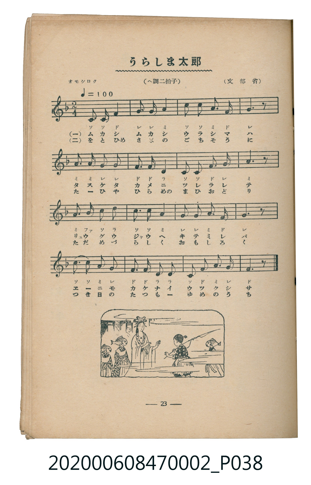
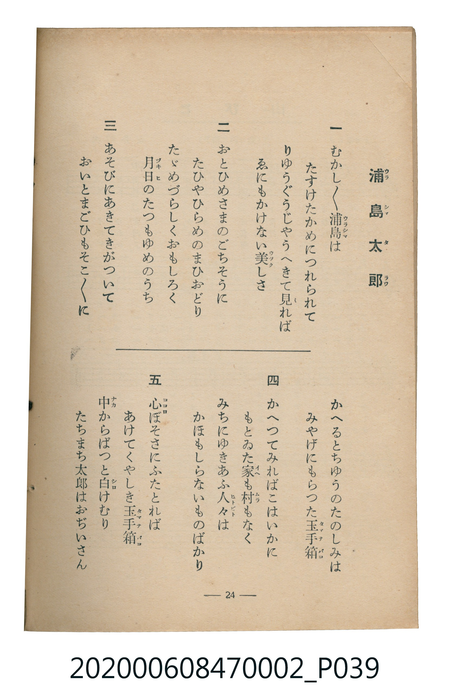

# うらしま太郎

<audio controls src="urashima_taro.mp3"></audio>

- 文部省
- 臺灣教育會公認《新定兒童唱歌》尋常科第二學年用（2020.006.0847.0002）

## 說明

原書資訊與歌詞全文（對應 P038.jpg – P039.jpg，書頁 pp. 23–24，第二學期第 9 首）：
調性與拍號：ヘ調二拍子（F 大調 2/4 拍），「オモシロク（♩＝100）」

## 歌詞

```text
一
むかしむかしうらしまは
たすけたかめにつれられて
りゆうぐうじようへきてみれば
ゑにもかかれぬうつくしさ

二
おとひめさまのごちそうに
たいやひらめのまひおどり
ただめづらしくおもしろく
月日のたつのもゆめのうち

三
あそびあきてかへる日に
おとひめさまのたまてばこ
あけてはならぬといはれしが
あけてびっくりしらがあたま
```

## ABC

```abc
X:1
T:うらしま太郎
C:TMD (Chen, Chih-Han / aguai)
M:2/4
L:1/16
Q:1/4=100
K:F
V:V1 name="Piano" snm="Pia"
[V:V1]
c2 c2 f4 | g2 g2 a4 | c2 c2 a2 f2 | g6 z2 |
a3 a g2 g2 | f2 f2 d4 | c2 c2 f2 g2 | a6 z2 |
a3 b c2 d2 | c3 c a4 | g2 g2 a2 f2 | g6 z2 |
c3 c a2 g2 | f2 f2 d2 d2 | c2 f2 a2 g2 | f6 z2 |
```

## TMD 檔案連結

- [主旋律 TMD 檔案](urashima_taro.tmd)
- [鋼琴伴奏 TMD 檔案](urashima_taro_piano.tmd)

## 分析

```text
================================================================================
📊 TMD Song Profile: [ うらしま太郎 ]
================================================================================
⏱  Duration:       0:19 (19.2s), 16 measures total
🎼 Key & Tempo:    首調基準 F, != 100.0 BPM, <2/4>
   - 分析範圍：      由實際發聲的音符與和弦推測調性；播放脈絡另行呈現
🎤 人聲音域:    C4 (MIDI 60) – D5 (MIDI 74) [跨度: 14 個半音 / 1.2 個八度, 難度: moderate]
   - 最低音:  C4 in [UrashimaTaro #1 @ m.1, 0:00]
   - 最高音: D5 in [UrashimaTaro #1 @ m.9, 0:10]
   - 適合: soprano, mezzo-soprano, contralto, tenor, baritone, bass
🏛  結構:      UrashimaTaro (19.2s)
⚡ 編曲密度:        Peak 1 軌道同時演奏
🗝  調性診斷：       F 調性不明確（純淨自然大調，未偵測到可信轉調）
   - 風格氣質:    純淨自然大調（陽光明朗、易唱易記，無明顯調外色彩）
   - 轉調歷程:    全曲維持單一推測調性（未偵測到可信轉調）
   - 核心骨幹音:  G, A, F, C, D
   - 調性數值:    F 調性不明確 [相關度: 0.76, 穩定度: Ambiguous, 自然音純度: 100.0%]
   - 候選調性 (K-S): F 大調 (0.76), C 大調 (0.73), A 小調 (0.63)
   - 五度圈歷程:   -1
   - 各段落調性細節:
     • [UrashimaTaro #1]: F 調性不明確 (r: 0.76, 自然音純度: 100.0%)

  [ 五度圈游移軌跡 ]
               C  
        [F ]*          G  
      Bb               D  
      Eb               A  
         Ab           E  
            Db       B  
               F# 
     (* = active key center)

  [ 十二半音累積音高分佈 ]
     C  : ███████████████████       20.0%
     C# :                            0.0%
     D  : ████████                   8.3%
     D# :                            0.0%
     E  :                            0.0%
     F  : █████████████████████     21.7%
     F# :                            0.0%
     G  : ████████████████████████  25.0%
     G# :                            0.0%
     A  : ███████████████████████   24.2%
     A# : █                          0.8%
     B  :                            0.0%
--------------------------------------------------------------------------------
Assignment 軌道音域：
  - Piano         : C4 – D5 (14 個半音 / 1.2 個八度, 48 個音符)
================================================================================
```


## 原書掃描頁






