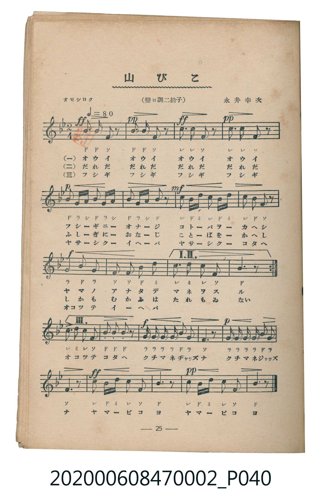
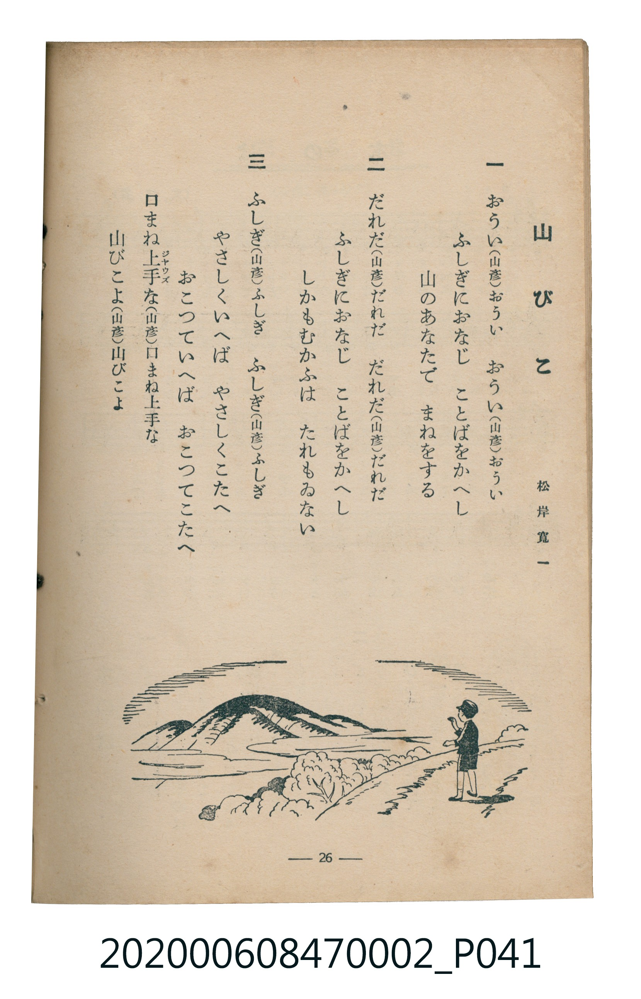

# 山びこ

> Re:Shōka 使用 AI 協助辨識與重建樂譜，可能會有錯誤。歡迎回報。

- **鋼琴伴奏版**：<br><audio controls src="yamabiko.mp3"></audio>
- **NEUTRINO 歌聲合成版**：<br><audio controls src="yamabiko_neutrino.mp3"></audio>

- 詞：松岸寬一
- 曲：永井幸次
- 臺灣教育會公認《新定兒童唱歌》尋常科第二學年用（2020.006.0847.0002）

## 說明

原書資訊與歌詞全文（對應 P040.jpg – P041.jpg，書頁 pp. 25–26，第二學期第 10 首）：
調性與拍號：變ロ調二拍子（降 B 大調 2/4 拍），「オモシロク（♩＝80）」


## 歌詞

```text
一
おうい（山彥）おうい　おうい（山彥）おうい
ふしぎにおなじ　ことばをかへし
山のあなたで　まねをする

二
だれだ（山彥）だれだ　だれだ（山彥）だれだ
ふしぎにおなじ　ことばをかへし
しかもむかふは　たれもゐない

三
ふしぎ（山彥）ふしぎ　ふしぎ（山彥）ふしぎ
やさしくいへば　やさしくこたへ
おこつていへば　おこつてこたへ
口まね上手な（山彥）口まね上手な
山びこよ（山彥）山びこよ
```

## ABC

<div class="abc-score" data-abc-src="yamabiko.abc" aria-label="五線譜載入中"></div>

[下載 ABC 原始檔](yamabiko.abc)

## TMD 檔案連結

- [主旋律 TMD 檔案](yamabiko.tmd) [[在 TMD Studio 編輯](https://tmdlang.github.io/Tmd-TS/#tmd=s7IKdvYPcrWy4qpTUCpJTLdSSM7PyUlNLsnMz7MqzsjMK0nNjM_KTMmPL87Iz05Ugisry88pzU21Si9KTEmNN4o3MjAyiDcwMIs3sDAxBzIMjBBKi_NLi5JTrYqTM_Lzc-JLUitKkvLzsxHyBUX5Zal5iXlANQVFIBtTwIoQClLLMlNSQdKpKZkl-UWZiTlI7kgtKga7FWxJfElRYl5xclFmAcgDCFUlGalAx-YllpQWpSJEgUalZ-ZZlSRmAj0H8mB5YnxuYmZeTmJeihKXlpbC040bHzduftw4WUFLi0vRVsHCgMveVsFJh8vGSN_EDmTOi5Xz3u-Z9Wzuvqebdjxdv-bJjgaw8c9mbwIJb9jxZNfUpzt3PFuzECz8on3X88bFz6bOfNG06dmc5qeta16s6n3c0PVs2oan62Y9bZ30fPXSp1M2Plvb87ih--mG7qc7djxfPvH5mjVPdvU8Xbvj6c4tz6eseL-nAxTaesDQ1gOFNpBhYPR-T6cSF5e-loIttQCXgoLC0775z2bveLG5_cWKrhcd7UB3Af37tHXFs2ntQFc83dD7rL1TIcDAxEAvqyBd4VHDZBDHEMR5v6cHqPPlgkaFggI9BSNToJyRGVAQ7pdnc-YD2QqGBgovl00Duh4YXCAbX6za_6xhOciu7t4XM-cDRV-s63rcvBYoDtQHFHy6dgLQ6pczexWcFJ4uWQ4UVwDGhQJQBmwIMOB6Hjetety86HHTdqC-x03rgcofzVz5fs9cCwOgkscNvVwgi4AxBaIeN3Y9bmx73NgC8s_GjU_3LgWpgQk-bmjArwBixNbHjdMfN_Y9blwNllj1uHEGWOfkx40rHjdueNw06XFj9-PGHUBl4FAFpap1jxubwErnP25cDla973Ej0LlApTMfN3VD3LirB2LBgsdNPUAS1QlQQbBefArIciNYdffjpqbHTUBFQAmg_vVgDfNBpoLEJ4BNaYGGZieKNagOgdkN0o5PAdiIppbHjVPB_H5QDIBctAGkE0Uc6GpguO2AxyCQv-Rx4zIUDSjiSBqe9i-GBPaTHV3POoFeW4XsGExZeJSBCoLHTR0oqpHEQeooz3ZQoKClz8UVmZibmJSZnW8VkJmYl-9QY1BTDbJEwcbQTMsOzKpRMFTQBUJDBdN4IGUAxFiFjMBCRviFwCb6GNaAghQsCUzjQNwCZIHUUE0cYo8RSH4BRL6pB8qG6aOKOMQeY5D8Vqg7pgNxH5I-qogjxYRZvIJ5PBILXRQR9IYKxnAaJqKLPTJAloKsBJEgS4F5GCl4gSkUTM5AcuZksMgKMLkBHDCToDLdYLEdcBPRI4ROdoEipQmUIIB5GsnGfqhOiAxEJ8hMqF14dEBcMR-uDzligMEPyRBQBkgHOKDBBCjYjeHRAmKBaLAULCtBIFq0gB0Dsm4fEK-DGwws1pECCuKg5VCZfWDeWnggAYt6qMdAQQWD6FEC8ihIbTdQHchsqD1NDVBREAmJtvVQe8C2AvMCiAS7pmkCVAZUYGO3CpxNQCUm1LYlQLwMyVcwbcjRUgM2ABlDRDCNxxm4MAzJGMAIgiNoxoFHFvZowO4AdBEYxO9IUHBT1TxImIKDC5I-l4BJULDiTLPgNP24cSE0Ya0F5TZw3dcGVjcLqgaUvLAFM9EhiFIIEUztRHgZKkdsMFPRPHAwkxVo8CIFkjM3g0lQtIBkOrDaRnLAkRIoJHiYJIfXcnHp2inAmhMKQLYyFwA)]
- [鋼琴伴奏 TMD 檔案](yamabiko_piano.tmd) [[在 TMD Studio 編輯](https://tmdlang.github.io/Tmd-TS/#tmd=s7IKdvYPcrWy4tLSUni6cePjxs2PGye_39PxsnvP8wlbnuzZ8nRp__POjvd7OhW0tLgUbRUsDLjsbRWcdLhsjPRN7LjqFJRerJz3fs-sZ3P3Pd204-n6NU92NCiBhJ_N3gQS3rDjya6pT3fueLZmIVj4Rfuu542Ln02d-aJp07M5zU9b17xY1fu4oevZtA1P18162jrp-eqlT6dsfLa253FD99MN3U937Hi-fOLzNWue7Op5unbH051bnk9ZAXSgkYGRgZ6BgZmegYWJOZBhYAR0oxIXV2RibmJSZna-VUBmYl5-kIdDjUFNNZcCENgYmmnZgVk1CoYKukBoqGAaD6QMgBirkBFYyAi_ENhEH8MahceNXWDJx41tQNwCZIHUUE0cYo8RSH4BRL6pB8qG6aOKOMQeY5D8Vqg7pgNxH5I-qogjxYRZvIJ5PBILXRQR9IYKxnAaJqKLPTJAloKsBJEgSx83rkYK3seNq8DkDCRnTgaLrACTG8ABMwkq0w0W2wE3ET1C6GQXKFKaQAniceNUJBv7oTohMhCdIDOhduHRAXHFfLg-5IgBBj8kQ0AZIB3ggAYToGA3hkcLiAWiwVKwrASBaNECdgzIun1AvA5u8OPGJqSAgjhoOVRmH5i3Fh5IjxtnQj0GCioYRI8SkEdBaruB6kBmQ-1paoCKgkhItK2H2gO2FZgXQCTYNU0ToDKrIGGLxSpwNumCBCTIrCVAvAzJVzBtyNFSAzYAGUNEMI3HGbgwDMkYwAiCI2jGgUcW9mjA7gB0ERjE70hQcFPVPEiYgoMLkj6XgElQsOJMs-A0_bhxITRhrQXlNmBaAxWhIHWzoGpAyQtbMBMdgiiFEMHUToSXoXLEBjMVzQMHM1mBBi9SIDlzM5gERQtIpgOrbSQHHCmBQoKHSXJ4LXprwge5NWGCaEzExytEG8bHojJN40FsIInOwa7LAF0LSBAsANNgApI0wWsN1CCoBmxS6KYgVGNKkGo2KMB07RRgYRbtYxirgMI3QuMbg_nKXAA)]

## 分析

```text
================================================================================
📊 TMD Song Profile: [ 山びこ ]
================================================================================
⏱  Duration:       0:33 (33.0s), 22 measures total
🎼 Key & Tempo:    首調基準 B,, != 80.0 BPM, <2/4>
   - 分析範圍：      由實際發聲的音符與和弦推測調性；播放脈絡另行呈現
🎤 人聲音域:    F4 (MIDI 65) – D5 (MIDI 74) [跨度: 9 個半音 / 0.8 個八度, 難度: easy]
   - 最低音:  F4 in [Yamabiko #1 @ m.1, 0:00]
   - 最高音: D5 in [Yamabiko #1 @ m.7, 0:09]
   - 適合: soprano, mezzo-soprano, contralto, tenor, baritone, bass
🏛  結構:      Yamabiko (33.0s)
⚡ 編曲密度:        Peak 1 軌道同時演奏
🗝  調性診斷：       A# 大調（純淨自然大調，未偵測到可信轉調）
   - 風格氣質:    純淨自然大調（陽光明朗、易唱易記，無明顯調外色彩）
   - 轉調歷程:    全曲維持單一推測調性（未偵測到可信轉調）
   - 核心骨幹音:  A#, F, C, G, D
   - 調性數值:    A# 大調 [相關度: 0.85, 穩定度: High, 自然音純度: 100.0%]
   - 候選調性 (K-S): A# 大調 (0.85), F 大調 (0.71), G 小調 (0.58)
   - 五度圈歷程:   -2
   - 各段落調性細節:
     • [Yamabiko #1]: A# 大調 (r: 0.85, 自然音純度: 100.0%)

  [ 五度圈游移軌跡 ]
               C  
         F            G  
     [Bb]*              D  
      Eb               A  
         Ab           E  
            Db       B  
               F# 
     (* = active key center)

  [ 十二半音累積音高分佈 ]
     C  : ██████████████            19.7%
     C# :                            0.0%
     D  : █████                      6.6%
     D# :                            0.0%
     E  :                            0.0%
     F  : ███████████████           22.4%
     F# :                            0.0%
     G  : ██████████                14.5%
     G# :                            0.0%
     A  : █                          2.0%
     A# : ████████████████████████  34.9%
     B  :                            0.0%
--------------------------------------------------------------------------------
Assignment 軌道音域：
  - Piano         : F4 – D5 (9 個半音 / 0.8 個八度, 76 個音符)
================================================================================
```


## 原書掃描頁






