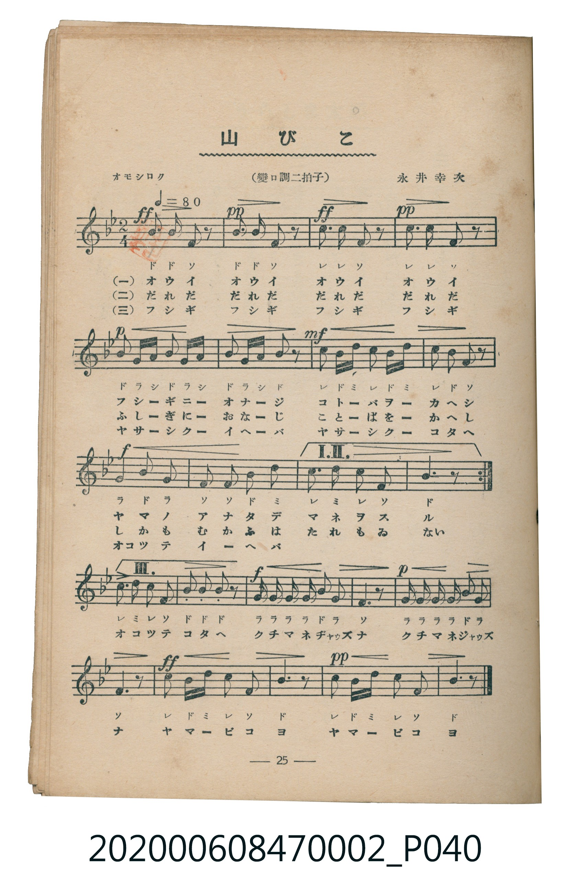
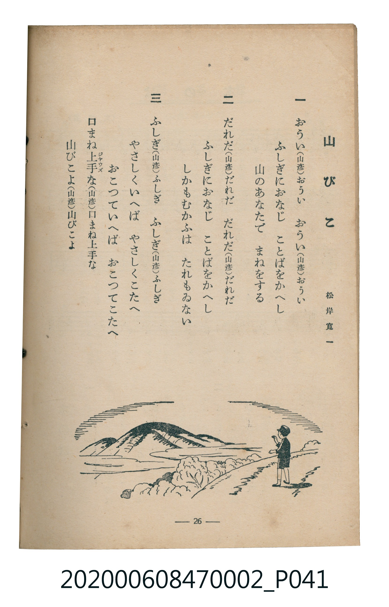

# 山びこ

<audio controls src="yamabiko.mp3"></audio>

- 詞：松岸寬一
- 曲：永井幸次
- 臺灣教育會公認《新定兒童唱歌》尋常科第二學年用（2020.006.0847.0002）

## 說明

原書資訊與歌詞全文（對應 P040.jpg – P041.jpg，書頁 pp. 25–26，第二學期第 10 首）：
調性與拍號：變ロ調二拍子（降 B 大調 2/4 拍），「オモシロク（♩＝80）」

## 歌詞

```text
一
おうい（山彥）おうい　おうい（山彥）おうい
ふしぎにおなじ　ことばをかへし
山のあなたで　まねをする

二
だれだ（山彥）だれだ　だれだ（山彥）だれだ
ふしぎにおなじ　ことばをかへし
しかもむかふは　たれもゐない

三
ふしぎ（山彥）ふしぎ　ふしぎ（山彥）ふしぎ
やさしくいへば　やさしくこたへ
おこつていへば　おこつてこたへ
口まね上手な（山彥）口まね上手な
山びこよ（山彥）山びこよ
```

## 原書掃描頁





## 分析

```text
================================================================================
📊 TMD Song Profile: [ 山びこ ]
================================================================================
⏱  Duration:       0:33 (33.0s), 22 measures total
🎼 Key & Tempo:    首調基準 B,, != 80.0 BPM, <2/4>
   - 分析範圍：      由實際發聲的音符與和弦推測調性；播放脈絡另行呈現
🎤 人聲音域:    F4 (MIDI 65) – D5 (MIDI 74) [跨度: 9 個半音 / 0.8 個八度, 難度: easy]
   - 最低音:  F4 in [Yamabiko #1 @ m.1, 0:00]
   - 最高音: D5 in [Yamabiko #1 @ m.7, 0:09]
   - 適合: soprano, mezzo-soprano, contralto, tenor, baritone, bass
🏛  結構:      Yamabiko (33.0s)
⚡ 編曲密度:        Peak 1 軌道同時演奏
🗝  調性診斷：       A# 大調（純淨自然大調，未偵測到可信轉調）
   - 風格氣質:    純淨自然大調（陽光明朗、易唱易記，無明顯調外色彩）
   - 轉調歷程:    全曲維持單一推測調性（未偵測到可信轉調）
   - 核心骨幹音:  A#, F, C, G, D
   - 調性數值:    A# 大調 [相關度: 0.85, 穩定度: High, 自然音純度: 100.0%]
   - 候選調性 (K-S): A# 大調 (0.85), F 大調 (0.71), G 小調 (0.58)
   - 五度圈歷程:   -2
   - 各段落調性細節:
     • [Yamabiko #1]: A# 大調 (r: 0.85, 自然音純度: 100.0%)

  [ 五度圈游移軌跡 ]
               C  
         F            G  
     [Bb]*              D  
      Eb               A  
         Ab           E  
            Db       B  
               F# 
     (* = active key center)

  [ 十二半音累積音高分佈 ]
     C  : ██████████████            19.7%
     C# :                            0.0%
     D  : █████                      6.6%
     D# :                            0.0%
     E  :                            0.0%
     F  : ███████████████           22.4%
     F# :                            0.0%
     G  : ██████████                14.5%
     G# :                            0.0%
     A  : █                          2.0%
     A# : ████████████████████████  34.9%
     B  :                            0.0%
--------------------------------------------------------------------------------
Assignment 軌道音域：
  - Piano         : F4 – D5 (9 個半音 / 0.8 個八度, 76 個音符)
================================================================================
```

## ABC

```abc
X:1
T:山びこ
C:曲：永井幸次
M:2/4
L:1/16
Q:1/4=80
K:Bb
V:V1 name="Piano" snm="Pia"
[V:V1]
b3 b f2 z2 | b3 b f2 z2 | c3 c f2 z2 | c3 c f2 z2 |
b2 g a b2 g a | b2 g a b2 z2 | c2 b d c2 b d | c2 b2 f2 z2 |
g3 b g4 | f2 f2 b2 d2 | c2 d2 c2 f2 | b6 z2 |
c2 d2 c2 f2 | b2 b2 b2 z2 | g g g g b2 g2 | f6 z2 |
g g g g b2 g2 | f6 z2 | c2 b d c2 f2 | b6 z2 |
c2 b d c2 f2 | b6 z2 |
```

- [主旋律 TMD 檔案](yamabiko.tmd)
- [鋼琴伴奏 TMD 檔案](yamabiko_piano.tmd)
