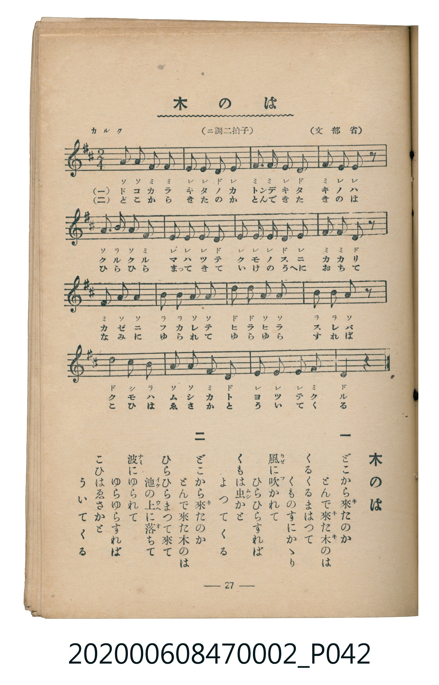

# 木のは

> Re:Shōka 使用 AI 協助辨識與重建樂譜，可能會有錯誤。歡迎回報。

- **鋼琴伴奏版**：<br><audio controls src="ki_no_ha.mp3"></audio>
- **NEUTRINO 歌聲合成版**：<br><audio controls src="ki_no_ha_neutrino.mp3"></audio>

- 文部省
- 臺灣教育會公認《新定兒童唱歌》尋常科第二學年用（2020.006.0847.0002）

## 說明

原書資訊與歌詞全文（對應 P042.jpg，書頁 p. 27，第二學期第 11 首）：
調性與拍號：ニ調二拍子（D 大調 2/4 拍），「カルク」


## 歌詞

```text
一
ちらちらちるは　まがきのもみぢ
あかやきのいろ　とりどりまじり
にはの面に　にしきをしくよ
あはれ秋かぜ　心してふけ

二
ひらひらまふは　のきばのいちよう
さながらきいろき　こてふのごとく
そらにむれては　あちらこちらに
おもしろさうに　とびちがふなり
```

## ABC

<div class="abc-score" data-abc-src="ki_no_ha.abc" aria-label="五線譜載入中"></div>

[下載 ABC 原始檔](ki_no_ha.abc)

## TMD 檔案連結

- [主旋律 TMD 檔案](ki_no_ha.tmd) [[在 TMD Studio 編輯](https://tmdlang.github.io/Tmd-TS/#tmd=s7IKdvYPcrWy4qpTUCpJTLdSSM7PyUlNLsnMz7MqzsjMK0nNjM_KTMmPL87Iz05Ugisry88pzU21Si9KTEmNN4o3MjAyiDcwMIs3sDAxBzIMjBBKi_NLi5JTrYqTM_Lzc-JLUitKkvLzsxHyBUX5Zal5iXlANQVFIBtTwIoQClLLMlNSQdKpKZkl-UWZiTlI7kgtKga7FWxJfElRYl5xclFmAcgDCFUlGalAxxbkJOYhGQs0KT0zzyo3Py-pFOg7ZImSjHygzwoyKq0yMotBViYn5sRnJ-YhBQDUwoLE9FSrAAMToH-1tBSezVnxuHHd48b1ClpaXIq2CoYGBlz2tgouXDZG-iZ2IL3PprW_bF7xfE4j2KQX7bueNy5-NnXmi6ZNz-Y0P21d82JV7-OGrmfTNjxdN-tp66Tnq5c-nbLx2dqexw3dTzd0P92x4_nyic_XrHmyq-fp2h1Pd255PmXF-z0doODXAwa_Hij4gQwDo_d7OpW4uPS1FGypBbgUFBSe9s1_NnvHi83tL1Z0vehoB7rrxcp5T1tXAH0FdMXTDb3P2jsVQKGhl1WQ_n5PD1DxywWNCgV6CkbmQC7c4c_mzAeyFQwNFV4umwZ06vs9s0DGv1i1_1nDcpDB3b0vZs4Hij5u7gYKAjUBRZ6unQC0xEXh6ZLlQDEFYIgqAEXBuoHB0_O4afXj5tWPm9Y_bujlApn2ZEcDiHrcuPBxUycS2Q2Mn8cNDY8b9z1u7Hnc2AuKsaamx437HzcugmgAcrofN7VA5RpbHjcBIwWoYcXjpq7HjSvBJFDzDCADomE1yMjGdS_nLgKxQUqBItNB-psmgRn9j5s64Gavf9zU83w50BlANAeo-un-ZrCiZY8btz5unAhx_K4eiPpNYGdDSKCdQAUQxwPdBXTdBqgDQf7qeNzYBtEz9XHjKpDfQHqAisDuBzJA2ibDrAFqmwLyUWM_RM9csGpg-DUAXQdWBLEH6F5IyAF1QhirIRq6wIE2HWw20MI2mM-BRm4GKQWFLdCeVdBAojwBQoGClj4Xl3emX75HolVAZmJevkONQU01yAoFG0MzLTswq0bBVEEXjI2huEbBCEiCsCGUrgGLg2RhohARmDoDkAjYNB_DGqCHVwL5wGAAk90gsqkTrAcYtGCx-WByHVweJANMMSANIKHlKAoR2iAa1gPJeISFRnS2EBJeugpm8DBDhBcidCA8I7QQBGGQCHp49UPc0dQNZYNYEHfsg7vgceMSMLkMKgNR1wR25ePGmWC51VA5cBBAA6ILS3BtgtrXCWUjgguYbxbDrYEFA8zKFjBvItRKYDLegWIryCZgcoZrQQ4zkM9h6QwEa4DhBwpDhGiNgmEcKHhABEIMWRV6qEF8OQfuBoi5wKyE5PseFA8g_Irub3D4QVVvwBJiq8Ay-9HtampDmIhqF4oMgo3fLmgYgKA51OOo2RM5cUEwJAGCxEEQFERgp2EkLkhigSUmkAMbwLzpiMBqXAGV6QDzEMkNYgZIBqQOBEFORrIHHESQzAQPWrg9E8G8qZj2NIKDBZqqCNlTy8Wla6cAKcwUgCxlLgA)]
- [鋼琴伴奏 TMD 檔案](ki_no_ha_piano.tmd) [[在 TMD Studio 編輯](https://tmdlang.github.io/Tmd-TS/#tmd=s7IKdvYPcrWy4qpTUCpJTLdSyC8qychPL0osyKi0ysgsLskvykxOzInPTsxLVIIrKs4vLUpOjS9ITE-1CjAwMVLi0tJSeDZnxePGdY8b17_f0_Gye8_zCVue7NnydGn_886O93s6FbS0uBRtFQwNDLjsbRVcuGyM9E3sQAY-m9b-snnF8zmNYONftO963rj42dSZL5o2PZvT_LR1zYtVvY8bup5N2_B03aynrZOer176dMrGZ2t7Hjd0P93Q_XTHjufLJz5fs-bJrp6na3c83bnl-ZQVQAcYGRgZ6BkYmOkZWJiYAxkGRkA3KHFxeWf65XskWgVkJublB3k41BjUVHMpAIGNoZmWHZhVo2CqoAvGxlBco2AEJEHYEErXgMVBsjBRiAhMnQFIBGyaj2GNwuPGlUD-48bJYLIbRDZ1gvU8buwFi80Hk-vg8iCZFY-bQBpAQstRFCK0QTSsB5LxCAuN6GwhJLx0FczgYYYIL0ToQHhGaCEIwiAR9PDqh7ijqRvKBrEg7tgHd8HjxiVgchlUBqKuCezKx40zwXKroXLgIIAGRBeW4NoEta8TykYE177HjYvh1sCCAWZlC5g3EWpl2-PGHSi2gmx63LgQrgU5zEA-h6UzEKwBhh8oDBGiNQqGcaDgAREIMWRV6KEG8eUcuBsg5j5u3Irk-x4UDyD8iu5vcPhBVW_AEmKrwDL70e1qakOYiGoXigyCjd8uaBiAoDnU46jZEzlxQTAkAYLEQRAURGCnYSQuSGKBJSaQAxvAvOmIwGpcAZXpAPMQyQ1iBkgGpA4EQU5GsgccRJDMBA9amD2NENOmYtrTCA4WaKoiZE8talnmg1yWmcCLMsN4hWjDWFCgxcNYICHTeBQWVsUQNUhMoLQBploTZHPhDBOEqSAFpigKMM0EekbXTgHin2gfoCIknhGYp8wFAA)]

## 分析

```text
================================================================================
📊 TMD Song Profile: [ 木のは ]
================================================================================
⏱  Duration:       0:19 (19.2s), 16 measures total
🎼 Key & Tempo:    首調基準 D, != 100.0 BPM, <2/4>
   - 分析範圍：      由實際發聲的音符與和弦推測調性；播放脈絡另行呈現
🎤 人聲音域:    D4 (MIDI 62) – D5 (MIDI 74) [跨度: 12 個半音 / 1.0 個八度, 難度: easy]
   - 最低音:  D4 in [KiNoHa #1 @ m.2, 0:01]
   - 最高音: D5 in [KiNoHa #1 @ m.11, 0:12]
   - 適合: soprano, mezzo-soprano, contralto, tenor, baritone, bass
🏛  結構:      KiNoHa (19.2s)
⚡ 編曲密度:        Peak 1 軌道同時演奏
🗝  調性診斷：       A 大調（純淨自然大調，未偵測到可信轉調）
   - 風格氣質:    純淨自然大調（陽光明朗、易唱易記，無明顯調外色彩）
   - 轉調歷程:    全曲維持單一推測調性（未偵測到可信轉調）
   - 核心骨幹音:  E, A, D, F#, B
   - 調性數值:    A 大調 [相關度: 0.84, 穩定度: Moderate, 自然音純度: 100.0%]
   - 候選調性 (K-S): A 大調 (0.84), D 大調 (0.75), F# 小調 (0.60)
   - 五度圈歷程:   +3
   - 各段落調性細節:
     • [KiNoHa #1]: A 大調 (r: 0.84, 自然音純度: 100.0%)

  [ 五度圈游移軌跡 ]
               C  
         F            G  
      Bb               D  
      Eb              [A ]*
         Ab           E  
            Db       B  
               F# 
     (* = active key center)

  [ 十二半音累積音高分佈 ]
     C  :                            0.0%
     C# : ██                         1.7%
     D  : ███████████████████       20.3%
     D# :                            0.0%
     E  : ████████████████████████  25.4%
     F  :                            0.0%
     F# : ██████████████████        18.6%
     G  :                            0.0%
     G# :                            0.0%
     A  : ███████████████████████   24.6%
     A# :                            0.0%
     B  : █████████                  9.3%
--------------------------------------------------------------------------------
Assignment 軌道音域：
  - Piano         : D4 – D5 (12 個半音 / 1.0 個八度, 57 個音符)
================================================================================
```


## 原書掃描頁




