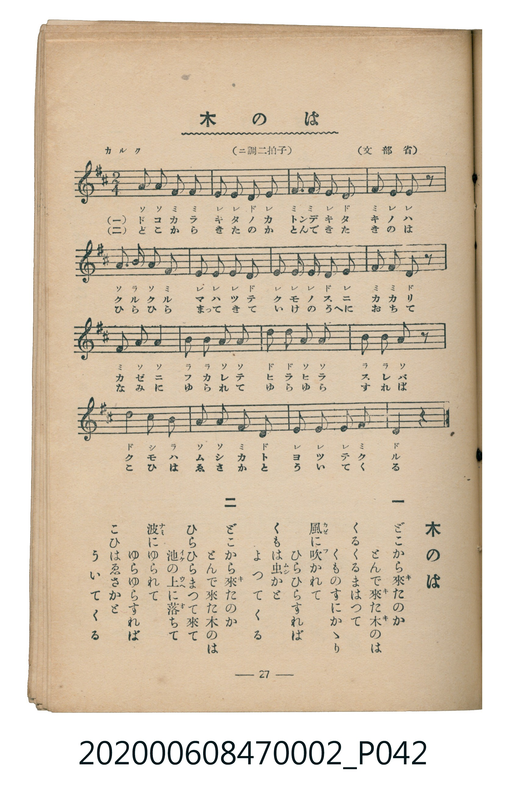

# 木のは

<audio controls src="ki_no_ha.mp3"></audio>

- 文部省
- 臺灣教育會公認《新定兒童唱歌》尋常科第二學年用（2020.006.0847.0002）

## 說明

原書資訊與歌詞全文（對應 P042.jpg，書頁 p. 27，第二學期第 11 首）：
調性與拍號：ニ調二拍子（D 大調 2/4 拍），「カルク」

## 歌詞

```text
一
ちらちらちるは　まがきのもみぢ
あかやきのいろ　とりどりまじり
にはの面に　にしきをしくよ
あはれ秋かぜ　心してふけ

二
ひらひらまふは　のきばのいちよう
さながらきいろき　こてふのごとく
そらにむれては　あちらこちらに
おもしろさうに　とびちがふなり
```

## ABC

```abc
X:1
T:木のは
M:2/4
L:1/16
Q:1/4=100
K:D
V:V1 name="Piano" snm="Pia"
[V:V1]
A2 A2 F2 F2 | E2 E2 D2 E2 | F2 F2 E2 D2 | F2 E2 E2 z2 |
A2 B2 A2 F2 | E2 E2 E2 D2 | E2 E2 D2 E2 | F2 F2 D2 z2 |
F2 A2 A4 | B2 B2 A2 A2 | d2 A2 A2 d2 | A2 B2 B2 A2 |
d4 c2 B2 | A2 A2 F2 D2 | E2 E2 E2 F2 | D4 z4 |
```

## TMD 檔案連結

- [主旋律 TMD 檔案](ki_no_ha.tmd) [[在 TMD Studio 編輯](https://tmdlang.github.io/Tmd-TS/#tmd=s7IKdvYPcrWy4qpTUCpJTLdSSM7PyUlNLsnMz7MqzsjMK0nNjM_KTMmPL87Iz05Ugisry88pzU21Si9KTEmNN4o3MjAyiDcwMIs3sDAxBzIMjBBKi_NLi5JTrYqTM_Lzc-JLUitKkvLzsxHyBUX5Zal5iXlANQVFIBtTwIoQClLLMlNSQdKpKZkl-UWZiTlI7kgtKga7FWxJfElRYl5xclFmAcgDCFUlGalAxxbkJOYBjdXSUng2Z8XjxnWPG9craGlxKdoqGBoYcNnbKrhw2Rjpm9iBtD2b1v6yecXzOY1gQ16073reuPjZ1JkvmjY9m9P8tHXNi1W9jxu6nk3b8HTdrKetk56vXvp0ysZna3seN3Q_3dD9dMeO58snPl-z5smunqdrdzzdueX5lBXv93SAgkkPGEx6oGACMgyM3u_pVOLi0tdSsKUW4FJQUHjaN__Z7B0vNre_WNH1oqMd6K4XK-c9bV0B9BXQFU839D5r71QIMDAx0ssqSH-_pweo-OWCRoUCPQUjcyAX7vBnc-YD2QqGhgovl00DOvX9nlkg41-s2v-sYTnI4O7eFzPnA0UfN3cDBYGagCJP104AWuKi8HTJcqCYAjBEFYCiYN3A4Ol53LT6cfPqx03rHzf0coFMe7KjAUQ9blz4uKkTiewGxs_jhobHjfseN_Y8buwFxVhT0-PG_Y8bF0E0ADndj5taoHKNLY-bgJEC1LDicVPX48aVYBKoeQaQAdGwGmRk47qXcxeB2CClQJHpIP1Nk8CM_sdNHXCz1z9u6nm-HOgMIJoDVP10fzNY0bLHjVsfN06EOH5XD0T9JrCzISTQTqACiOOB7gK6bgPUgSB_dTxubIPomfq4cRXIbyA9QEVg9wMZIG2TYdYAtU0B-aixH6JnLlg1MPwagK4DK4LYA3QvJOSAOiGM1RANXeBAmw42G2hhG8znQCM3g5SCwhZozypoIFGeAKFAQUufi8s70y_fI9EqIDMxL9-hxqBGoRpkh4KNoZmWHZhVo2CqoAvGxlBco2AEJEHYEErXwOVgohARmDoDkAiSaWZIJiJMQ-jFbT5IBNk0kBjMfSBYAzYbZj4I1ygYxiFxwRyEK2AqYeaBpUHQHCqJ6n1U54EwxAsgcRAEOQ3sDK5aLi5dOwVI6CoAWcpcXAA)]
- [鋼琴伴奏 TMD 檔案](ki_no_ha_piano.tmd) [[在 TMD Studio 編輯](https://tmdlang.github.io/Tmd-TS/#tmd=s7IKdvYPcrWy4tLSUng2Z8XjxnWPG9e_39PxsnvP8wlbnuzZ8nRp__POjvd7OhW0tLgUbRUMDQy47G0VXLhsjPRN7LjqFJSeTWt_2bzi-ZxGJRDvRfuu542Ln02d-aJp07M5zU9b17xY1fu4oevZtA1P18162jrp-eqlT6dsfLa253FD99MN3U937Hi-fOLzNWue7Op5unbH051bnk9ZAXSAkYGRgZ6BgZmegYWJOZBhYAR0gxIXl3emX75HolVAZmJefpCHQ41BjUI1lwIQ2BiaadmBWTUKpgq6YGwMxTUKRkAShA2hdA1cDiYKEYGpMwCJIJlmhmQiwjSEXtzmg0SQTQOJwdwHgjVgs2Hmg3CNgmEcEhfMQbgCphJmHlgaBM2hkqjeR3UeCEO8ABIHQZDTwM7gqkUNXB-UwDWBh61hvEK0YSzIlngYCyRkGo_CwqoYogaJCZQ2wFRrgmwunGGCMBWkwBRFAaaZQN_o2ilAPKQAZClzcQEA)]

## 分析

```text
================================================================================
📊 TMD Song Profile: [ 木のは ]
================================================================================
⏱  Duration:       0:19 (19.2s), 16 measures total
🎼 Key & Tempo:    首調基準 D, != 100.0 BPM, <2/4>
   - 分析範圍：      由實際發聲的音符與和弦推測調性；播放脈絡另行呈現
🎤 人聲音域:    D4 (MIDI 62) – D5 (MIDI 74) [跨度: 12 個半音 / 1.0 個八度, 難度: easy]
   - 最低音:  D4 in [KiNoHa #1 @ m.2, 0:01]
   - 最高音: D5 in [KiNoHa #1 @ m.11, 0:12]
   - 適合: soprano, mezzo-soprano, contralto, tenor, baritone, bass
🏛  結構:      KiNoHa (19.2s)
⚡ 編曲密度:        Peak 1 軌道同時演奏
🗝  調性診斷：       A 大調（純淨自然大調，未偵測到可信轉調）
   - 風格氣質:    純淨自然大調（陽光明朗、易唱易記，無明顯調外色彩）
   - 轉調歷程:    全曲維持單一推測調性（未偵測到可信轉調）
   - 核心骨幹音:  E, A, D, F#, B
   - 調性數值:    A 大調 [相關度: 0.85, 穩定度: Moderate, 自然音純度: 100.0%]
   - 候選調性 (K-S): A 大調 (0.85), D 大調 (0.76), F# 小調 (0.61)
   - 五度圈歷程:   +3
   - 各段落調性細節:
     • [KiNoHa #1]: A 大調 (r: 0.85, 自然音純度: 100.0%)

  [ 五度圈游移軌跡 ]
               C  
         F            G  
      Bb               D  
      Eb              [A ]*
         Ab           E  
            Db       B  
               F# 
     (* = active key center)

  [ 十二半音累積音高分佈 ]
     C  :                            0.0%
     C# : ██                         1.7%
     D  : ███████████████████       20.0%
     D# :                            0.0%
     E  : ████████████████████████  25.0%
     F  :                            0.0%
     F# : ██████████████████        18.3%
     G  :                            0.0%
     G# :                            0.0%
     A  : ████████████████████████  25.0%
     A# :                            0.0%
     B  : ██████████                10.0%
--------------------------------------------------------------------------------
Assignment 軌道音域：
  - Piano         : D4 – D5 (12 個半音 / 1.0 個八度, 57 個音符)
================================================================================
```


## 原書掃描頁




