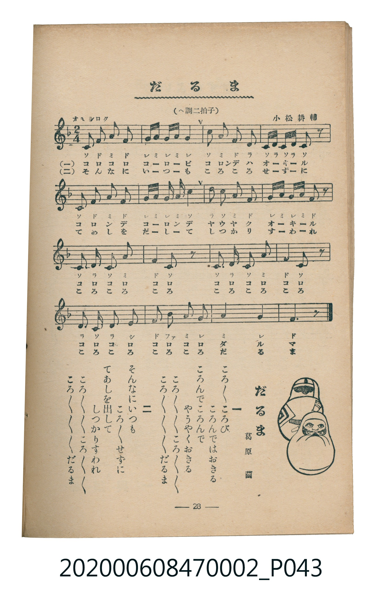

# だるま（達摩）

> Re:Shōka 使用 AI 協助辨識與重建樂譜，可能會有錯誤。歡迎回報。

- **鋼琴伴奏版**：<br><audio controls src="daruma.mp3"></audio>
- **NEUTRINO 歌聲合成版**：<br><audio controls src="daruma_neutrino.mp3"></audio>

- 詞：葛原齒
- 曲：小松耕輔
- 臺灣教育會公認《新定兒童唱歌》尋常科第二學年用（2020.006.0847.0002）

## 說明

曲目說明
中文解釋：描寫日本傳統達摩玩偶，帶有祈願與不倒的象徵。

原書資訊與歌詞全文（對應 P043.jpg，書頁 p. 28，第三學期第 1 首）：
調性與拍號：ヘ調二拍子（F 大調 2/4 拍），「オモシロク」


## 歌詞

```text
一
ころ／＼ころび　ころんではおきる
ころんでころんで　やうやくおきる
ころ／＼／＼ころ／＼／＼だるま
ころ／＼／＼ころ／＼／＼だるま

二
そんなにいつも　ころ／＼せずに
てあしを出して　しつかりすわれ
ころ／＼／＼ころ／＼／＼だるま
ころ／＼／＼ころ／＼／＼だるま
```

## ABC

<div class="abc-score" data-abc-src="daruma.abc" aria-label="五線譜載入中"></div>

[下載 ABC 原始檔](daruma.abc)

## TMD 檔案連結

- [主旋律 TMD 檔案](daruma.tmd) [[在 TMD Studio 編輯](https://tmdlang.github.io/Tmd-TS/#tmd=s7IKdvYPcrWy4qpTUCpJTLdSSM7PyUlNLsnMz7MqzsjMK0nNjM_KTMmPL87Iz05Ugisry88pzU21Si9KTEmNN4o3MjAyiDcwMIs3sDAxBzIMjBBKi_NLi5JTrYqTM_Lzc-JLUitKkvLzsxHyBUX5Zal5iXlANQVFIBtTwIoQClLLMlNSQdKpKZkl-UWZiTlI7kgtKga7FWxJfElRYl5xclFmAcgDCFUlGalAx6bl52Tn5BelIsSBhqVn5lmVJGYCvQfyYnlifG5iZl5OYl4KsqqSjHygTwsyKq0yMotBTkhOzInPTsxDChCoAwoS01OtAgxMjJW4tLQUHjcueNzU_bhx3_s9HS8bpzybuPL9nk4FLS0uRVsFQwMDLntbBTcuGyN9EzuQOS9Wznu_Z9aLibOf9s1_uXcS2OxnszcBxZ5u6H82d9-Lhqkv9kwBC79o3_W8cfGzqTNfNG16Nqf5aeuaF6t6Hzd0PZu24em6WU9bJz1fvfTplI3P1vY8buh-uqH76Y4dz5dPfL5mzZNdPU_X7ni6c8vzKSuAjgLFmx4w3vRA8QZkGBgBHajEpa-lALT4-ex1L1atejajj0tBQeHJjrXPprW_WL74ZXs30EXP-vufrl_9bPrSZ3PWPG3a_HzrRoj_nvetfNq47f2enqc7tj2b0_l8acfLhTNedLQ_2dH7tGHS81ktLzYufLpv6-OGJi4tfS6QRbbUAiBXAkPu2ewdLza3v1jRBbQV6H9goD5tXQF0OtC3Tzf0PmvvVABFj15WQTrQlUDFLxc0KhToKRhZALmgANrRCQygZ3PmA9kKhgovl00DhgjQwyDTX6za_6xhOcjc7t4XM-cDRR83zwAKAgMVKPJ07QSgHW4KT5csB4opAGNVASgK1g2MhZ7HTaseNy963LT9cfPax03rHzf0ckHCtQFEPW6c_LgJqLj__Z49EPbjxs2PGxqg7KbJjxuXP25c_7ix63EjkNuN0AOTQ2IDtTW1PG5sA5P9WPRA7EG2DVUEmmpJ1wD20a4eiMa5YOesety4-nEj0CFLHjc1wX0E0zj7ceMsoAKIhmWPG5seN05_3DTpafsuEAMoAtIAZCx53Nj9uAnokZmPm_ofN0FtoKlfgBooT5RQoABK7C6JRaW5iVYBmYl5-Q41BjXVICsUbAzNtOzArBoF03gFXWCi01UwhtI1CkZANgTrgiFUEUyBGYgDFgOy4KSuggFIGGyqj2ENyONAPtCnIBKJjS6zGW4JXBwYh2Cp5WByPVSyC8wDa2rqBpJgV0CsMwLJzwXLQHSuApOroTpbwLwlYPkmTOuwOHA2WGwW3BSEXXgDzBRuuBmQBPEw1YB4eEIKyes4QgTq-iaIr9rACiDsfiJDahlYHhQSwHQOVjUJqnMBQgysChZSEBFwCDaCTARmC6jMTDAPZDMwh2ALKXBqgaefGrD_QRCRZIhVR3TSAkGICCSlkqgeKaRobw8wqcA9DmaZQ8wCed8EGhigfFgDZoEgIlfCgggEyct8qDKg2Ie4ERTHsLjfh2QLaeFDmS21XFy6dgqQAkwByFLmAgA)]
- [鋼琴伴奏 TMD 檔案](daruma_piano.tmd) [[在 TMD Studio 編輯](https://tmdlang.github.io/Tmd-TS/#tmd=s7IKdvYPcrWy4qpTUCpJTLdSyC8qychPL0osyKi0ysgsLskvykxOzInPTsxLVIIrKs4vLUpOjS9ITE-1CjAwMVbi0tJSeNy44HFT9-PGfe_3dLzs3vN8wpYne7Y8Xdr_vLPj_Z5OBS0tLkVbBUMDAy57WwU3LhsjfRM7kIEvVs57v2fWi4mzn_bNf7l3EtiSZ7M3AcWebuh_Nnffi4apL_ZMAQu_aN_1vHHxs6kzXzRtejan-Wnrmhereh83dD2btuHpullPWyc9X7306ZSNz9b2PG7ofrqh--mOHc-XT3y-Zs2TXT1P1-54unPL8ykrgK4zMjAy0DMwMNMzsDAxBzIMjIAOVOLickksKs1NtArITMzLD_JwqDGoqeZSAAIbQzMtOzCrRsE0XkFXwRCIjaF0jYIRkA3BumAIVQRTYAbigMWALDipq2AAEgab6mNYAwy9yUD-46ZeEInERpfZDLcELv64CcxoXA4m10Mlu8A8sKambiAJdgXEOiOQ_FywDETnKjC5GqqzBcxbApZvwrQOiwNng8VmwU1B2IU3wEzhhpsBSRAPUw2IhyekkLyOI0Sgrm-C-KoNrADC7icypJaB5UEh8bhxOljVJKjOBQgxsCpYSEFEwCHYCDLxcRPIDpDMTDAPZPPjph5sIQVOLfD0UwP2Pwgikgyx6ohOWiAIEYGkVBLVI4UU7e0BJhW4x8Esc4hZIO-bQAMDlA9rwCwQRORKWBCBIHmZD1UGFPsQN4LiGBb3-5BsIS18KLOlFrX88kEuv0zgxZdhvEK0YSw4EQFZpvEgJkjMBMYygAc0qlIwywRZCCiPoRTIAElhEYGqNIFYi2kvXBvIAUC_6NopQLwT7QM0B4lnBOYpcwEA)]

## 分析

```text
================================================================================
📊 TMD Song Profile: [ だるま（達摩） ]
================================================================================
⏱  Duration:       0:19 (19.2s), 16 measures total
🎼 Key & Tempo:    首調基準 F, != 100.0 BPM, <2/4>
   - 分析範圍：      由實際發聲的音符與和弦推測調性；播放脈絡另行呈現
🎤 人聲音域:    C4 (MIDI 60) – D5 (MIDI 74) [跨度: 14 個半音 / 1.2 個八度, 難度: moderate]
   - 最低音:  C4 in [Daruma #1 @ m.1, 0:00]
   - 最高音: D5 in [Daruma #1 @ m.7, 0:07]
   - 適合: soprano, mezzo-soprano, contralto, tenor, baritone, bass
🏛  結構:      Daruma (19.2s)
⚡ 編曲密度:        Peak 1 軌道同時演奏
🗝  調性診斷：       F 大調（純淨自然大調，未偵測到可信轉調）
   - 風格氣質:    純淨自然大調（陽光明朗、易唱易記，無明顯調外色彩）
   - 轉調歷程:    全曲維持單一推測調性（未偵測到可信轉調）
   - 核心骨幹音:  C, F, A, G, D
   - 調性數值:    F 大調 [相關度: 0.90, 穩定度: High, 自然音純度: 100.0%]
   - 候選調性 (K-S): F 大調 (0.90), C 大調 (0.75), A 小調 (0.69)
   - 五度圈歷程:   -1
   - 各段落調性細節:
     • [Daruma #1]: F 大調 (r: 0.90, 自然音純度: 100.0%)

  [ 五度圈游移軌跡 ]
               C  
        [F ]*          G  
      Bb               D  
      Eb               A  
         Ab           E  
            Db       B  
               F# 
     (* = active key center)

  [ 十二半音累積音高分佈 ]
     C  : ████████████████████████  25.4%
     C# :                            0.0%
     D  : ███████████               11.9%
     D# :                            0.0%
     E  : ██                         1.7%
     F  : ████████████████████████  25.4%
     F# :                            0.0%
     G  : █████████████             13.6%
     G# :                            0.0%
     A  : ███████████████████       20.3%
     A# : ██                         1.7%
     B  :                            0.0%
--------------------------------------------------------------------------------
Assignment 軌道音域：
  - Piano         : C4 – D5 (14 個半音 / 1.2 個八度, 59 個音符)
================================================================================
```


## 原書掃描頁




