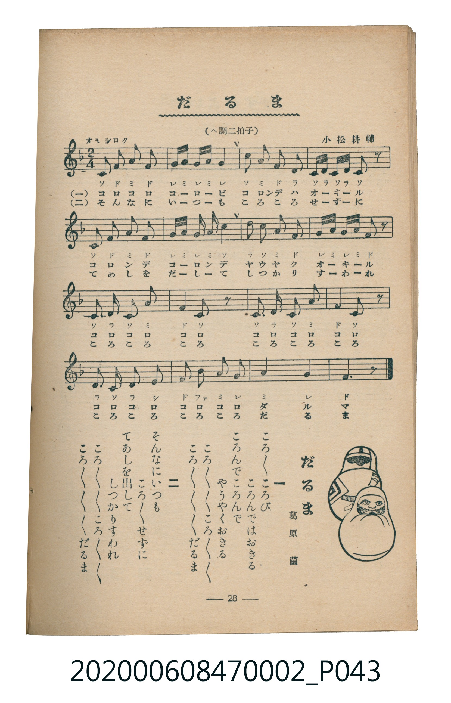

# だるま

<audio controls src="daruma.mp3"></audio>

- 詞：葛原齒
- 曲：小松耕輔
- 臺灣教育會公認《新定兒童唱歌》尋常科第二學年用（2020.006.0847.0002）

## 說明

原書資訊與歌詞全文（對應 P043.jpg，書頁 p. 28，第三學期第 1 首）：
調性與拍號：ヘ調二拍子（F 大調 2/4 拍），「オモシロク」

## 歌詞

```text
一
ころ／＼ころび　ころんではおきる
ころんでころんで　やうやくおきる
ころ／＼／＼ころ／＼／＼だるま
ころ／＼／＼ころ／＼／＼だるま

二
そんなにいつも　ころ／＼せずに
てあしを出して　しつかりすわれ
ころ／＼／＼ころ／＼／＼だるま
ころ／＼／＼ころ／＼／＼だるま
```

## ABC

```abc
X:1
T:だるま
C:曲：小松耕輔
M:2/4
L:1/16
Q:1/4=100
K:F
V:V1 name="Piano" snm="Pia"
[V:V1]
C2 F2 A2 F2 | G A G A G4 | C2 A2 F2 D2 | C D C D C2 z2 |
C2 F2 A2 F2 | G A G A c4 | d2 c2 A2 F2 | G A G A F2 z2 |
C2 D2 C2 A2 | F4 C2 z2 | C2 D2 C2 A2 | F4 C2 z2 |
D2 C2 D2 E2 | F2 B2 A2 G2 | A4 G4 | F6 z2 |
```

## TMD 檔案連結

- [主旋律 TMD 檔案](daruma.tmd) [[在 TMD Studio 編輯](https://tmdlang.github.io/Tmd-TS/#tmd=s7IKdvYPcrWy4tLSUnjcuOBxU_fjxn0KWlpcirYKhgYGXPa2Cm5cNkb6JnZcdQpKL1bOe79n1ouJs5_2zX-5d5ISSOzZ7E1Asacb-p_N3feiYeqLPVPAwi_adz1vXPxs6swXTZuezWl-2rrmxarexw1dz6ZteLpu1tPWSc9XL306ZeOztT2PG7qfbuh-umPH8-UTn69Z82RXz9O1O57u3PJ8yor3ezqMDIwM9AwMzPQMLEzMgQwDo_d7OpW4uPS1FGypBbgUFBSAPno2e8eLze0vVnS96GgHugvo2aetK55Nawe64umG3mftnQoBBibGelkF6e_39AAVv1zQqFCgp2BkAeSCHL6jE-jwZ3PmA9kKhgovl00DuhQYNCDTX6za_6xhOcjc7t4XM-cDRR83zwAKAj0LFHm6dgLQDjeFp0uWA8UUgKGtABQF6waGTs_jplWPmxc9btr-uHnt46b1jxt6uUBmPtnRAKIeN05-3ARU3P9-zx4I-3Hj5scNDVB20-THjcsfN65_3Nj1uBHI7UbogckhsYHamloeN7aByX4seiD2INuGKgJNQaRrAPtoVw9E41ywc1Y9blz9uBHokCWPm5rgPoJpnP24cRZQAUTDsseNTY8bpz9umvS0fReIARQBaQAyljxu7H7cBPTIzMdN_Y-boDbQ1C9ADZQnSihQ0NLn4nJJLCrNTbQKyEzMy3eoMahRqAbZoWBjaKZlB2bVKJjGK-gCU52ugjGUrlEwArIhWBcMoYpgCsxAHLAYkAUndRUMQMKETTWFm2oGJEE8TDUgHoZxYHvhLqkBKwJBhOXEqoOailAIZplD_AVSbgLVDAqBGjALBBHhATMSBCEm1nJx6dopQMJbAchS5uICAA)]
- [鋼琴伴奏 TMD 檔案](daruma_piano.tmd) [[在 TMD Studio 編輯](https://tmdlang.github.io/Tmd-TS/#tmd=s7IKdvYPcrWy4tLSUnjcuOBxU_fjxn3v93S87N7zfMKWJ3u2PF3a_7yz4_2eTgUtLS5FWwVDAwMue1sFNy4bI30TO646BaUXK-e93zPrxcTZT_vmv9w7SQkk9mz2JqDY0w39z-bue9Ew9cWeKWDhF-27njcufjZ15oumTc_mND9tXfNiVe_jhq5n0zY8XTfraeuk56uXPp2y8dnanscN3U83dD_dseP58onP16x5sqvn6dodT3dueT5lBdB1RgZGBnoGBmZ6BhYm5kCGgRHQgUpcXC6JRaW5iVYBmYl5-UEeDjUGNQrVXApAYGNopmUHZtUomMYr6CoYArExlK5RMAKyIVgXDKGKYArMQBywGJAFJ3UVDEDChE01hZtqBiRBPEw1IB6GcWB74S6pASsCQYTlxKqDmopQCGaZQ_wFUm4C1QwKgRowCwQR4QEzEgQhJtaiBrcPSnCbwEPbMF4h2jAW7FIgyzQexASJmcBYBnDXoSoFs0yQhYDyGEqBDJAUFhGoShOItZj2wrWBHAD0jK6dAsQ_CkCWMhcXAA)]

## 分析

```text
================================================================================
📊 TMD Song Profile: [ だるま ]
================================================================================
⏱  Duration:       0:19 (19.2s), 16 measures total
🎼 Key & Tempo:    首調基準 F, != 100.0 BPM, <2/4>
   - 分析範圍：      由實際發聲的音符與和弦推測調性；播放脈絡另行呈現
🎤 人聲音域:    C4 (MIDI 60) – D5 (MIDI 74) [跨度: 14 個半音 / 1.2 個八度, 難度: moderate]
   - 最低音:  C4 in [Daruma #1 @ m.1, 0:00]
   - 最高音: D5 in [Daruma #1 @ m.7, 0:07]
   - 適合: soprano, mezzo-soprano, contralto, tenor, baritone, bass
🏛  結構:      Daruma (19.2s)
⚡ 編曲密度:        Peak 1 軌道同時演奏
🗝  調性診斷：       F 大調（純淨自然大調，未偵測到可信轉調）
   - 風格氣質:    純淨自然大調（陽光明朗、易唱易記，無明顯調外色彩）
   - 轉調歷程:    全曲維持單一推測調性（未偵測到可信轉調）
   - 核心骨幹音:  C, F, A, G, D
   - 調性數值:    F 大調 [相關度: 0.90, 穩定度: High, 自然音純度: 100.0%]
   - 候選調性 (K-S): F 大調 (0.90), C 大調 (0.75), A 小調 (0.69)
   - 五度圈歷程:   -1
   - 各段落調性細節:
     • [Daruma #1]: F 大調 (r: 0.90, 自然音純度: 100.0%)

  [ 五度圈游移軌跡 ]
               C  
        [F ]*          G  
      Bb               D  
      Eb               A  
         Ab           E  
            Db       B  
               F# 
     (* = active key center)

  [ 十二半音累積音高分佈 ]
     C  : ████████████████████████  25.4%
     C# :                            0.0%
     D  : ███████████               11.9%
     D# :                            0.0%
     E  : ██                         1.7%
     F  : ████████████████████████  25.4%
     F# :                            0.0%
     G  : █████████████             13.6%
     G# :                            0.0%
     A  : ███████████████████       20.3%
     A# : ██                         1.7%
     B  :                            0.0%
--------------------------------------------------------------------------------
Assignment 軌道音域：
  - Piano         : C4 – D5 (14 個半音 / 1.2 個八度, 59 個音符)
================================================================================
```


## 原書掃描頁




