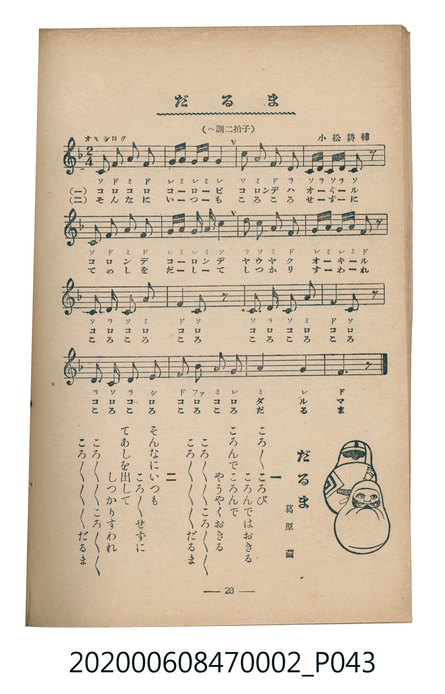

# だるま（達摩）

> Re:Shōka 使用 AI 協助辨識與重建樂譜，可能會有錯誤。歡迎回報。

- **NEUTRINO 歌聲合成版**：<br><audio controls src="daruma_neutrino.mp3"></audio>
- **鋼琴伴奏版**：<br><audio controls src="daruma.mp3"></audio>


- 詞：葛原齒
- 曲：小松耕輔
- 臺灣教育會公認《新定兒童唱歌》尋常科第二學年用（2020.006.0847.0002）

## 說明

曲目說明
中文解釋：描寫日本傳統達摩玩偶，帶有祈願與不倒的象徵。

原書資訊與歌詞全文（對應 P043.jpg，書頁 p. 28，第三學期第 1 首）：
調性與拍號：ヘ調二拍子（F 大調 2/4 拍），「オモシロク」


## 歌詞

```text
一
ころ／＼ころび　ころんではおきる
ころんでころんで　やうやくおきる
ころ／＼／＼ころ／＼／＼だるま
ころ／＼／＼ころ／＼／＼だるま

二
そんなにいつも　ころ／＼せずに
てあしを出して　しつかりすわれ
ころ／＼／＼ころ／＼／＼だるま
ころ／＼／＼ころ／＼／＼だるま
```

## ABC

```abc
X:1
T:だるま（達摩）
C:曲：小松耕輔
M:2/4
L:1/16
Q:1/4=100
K:F
V:V1 name="Piano" snm="Pia"
[V:V1]
C2 F2 A2 F2 | G A G A G4 | C2 A2 F2 D2 | C D C D C2 z2 |
w: 1.~こ ろ こ ろ | こ _ ろ _ び | こ ろん で は | お _ き _ る
w: 2.~そ ん な に | い _ つ _ も | こ ろ こ ろ | せ _ ず _ に
C2 F2 A2 F2 | G A G A c4 | d2 c2 A2 F2 | G A G A F2 z2 |
w: 1.~こ ろ ん で | こ _ ろん _ で | や う や く | お _ き _ る
w: 2.~て あ し を | だ _ し _ て | し つ か り | す _ わ _ れ
C2 D2 C2 A2 | F4 C2 z2 | C2 D2 C2 A2 | F4 C2 z2 |
w: 1.~こ ろ こ ろ | こ ろ | こ ろ こ ろ | こ ろ
w: 2.~こ ろ こ ろ | こ ろ | こ ろ こ ろ | こ ろ
D2 C2 D2 E2 | F2 B2 A2 G2 | A4 G4 | F6 z2 |
w: 1.~こ ろ こ ろ | こ ろ こ ろ | だ る | ま
w: 2.~こ ろ こ ろ | こ ろ こ ろ | だ る | ま
```

## TMD 檔案連結

- [主旋律 TMD 檔案](daruma.tmd) [[在 TMD Studio 編輯](https://tmdlang.github.io/Tmd-TS/#tmd=s7IKdvYPcrWy4qpTUCpJTLdSSM7PyUlNLsnMz7MqzsjMK0nNjM_KTMmPL87Iz05Ugisry88pzU21Si9KTEmNN4o3MjAyiDcwMIs3sDAxBzIMjBBKi_NLi5JTrYqTM_Lzc-JLUitKkvLzsxHyBUX5Zal5iXlANQVFIBtTwIoQClLLMlNSQdKpKZkl-UWZiTlI7kgtKga7FWxJfElRYl5xclFmAcgDCFUlGalAx6bl52Tn5BelIsSBhqVn5lmVJGYCvQfyYnlifG5iZl5OYl6KEpeWlsLjxgWPm7ofN-57v6fjZeOUZxNXvt_TqaClxaVoq2BoYMBlb6vgxmVjpG9iBzLzxcp57_fMejFx9tO--S_3TgLb82z2JqDY0w39z-bue9Ew9cWeKWDhF-27njcufjZ15oumTc_mND9tXfNiVe_jhq5n0zY8XTfraeuk56uXPp2y8dnanscN3U83dD_dseP58onP16x5sqvn6dodT3dueT5lBdBRoIDXAwa8HijggQwDI6ADlbj0tRSAFj-fve7FqlXPZvRxKSgoPNmx9tm09hfLF79s7wa66Fl__9P1q59NX_pszpqnTZufb90I8d_zvpVPG7e939PzdMe2Z3M6ny_teLlwxouO9ic7ep82THo-q-XFxoVP92193NDEpaXPBbLIlloA5EpgyD2bvePF5vYXK7qAtgL9DwzUp60rgE4H-vbpht5n7Z0KAQYmxnpZBelAVwIVv1zQqFCgp2BkAeSCAmhHJzCAns2ZD2QrGCq8XDYNGCJAD4NMf7Fq_7OG5SBzu3tfzJwPFH3cPAMoCAxUoMjTtROAdrgpPF2yHCimAIxVBaAoWDcwFnoeN6163LzocdP2x81rHzetf9zQywUJ1wYQ9bhx8uMmoOL-93v2QNiPGzc_bmiAspsmP25c_rhx_ePGrseNQG43Qg9MDokN1NbU8rixDUz2Y9EDsQfZNlQRaKolXQPYR7t6IBrngp2z6nHj6seNQIcsedzUBPcRTOPsx42zgAogGpY9bmx63Dj9cdOkp-27QAygCEgDkLHkcWP34yagR2Y-bup_3AS1gaZ-AWqgPFFCgQIosbskFpXmJloFZCbm5TvUGNRUg6xQsDE007IDs2oUTOMVdIGJTlfBGErXKBgB2RCsC4ZQRTAFZiAOWAzIgpO6CgYgYbCpPoY1II8D-UCfgkgkNrrMZrglcHFgHIKlloPJ9VDJLjAPrKmpG0iCXQGxzggkPxcsA9G5CkyuhupsAfOWgOWbMK3D4sDZYLFZcFMQduENMFO44WZAEsTDVAPi4QkpJK_jCBGo65sgvmoDK4Cw-4kMqWVgeVBIANM5WNUkqM4FCDGwKlhIQUTAIdgIMhGYLaAyM8E8kM3AHIItpMCpBZ5-asD-B0FEkiFWHdFJCwQhIpCUSqJ6pJCivT3ApAL3OJhlDjEL5H0TaGCA8mENmAWCiFwJCyIQJC_zocqAYh_iRlAcw-J-H5ItpIUPZbbUcnHp2ilACjAFIEuZCwA)]
- [鋼琴伴奏 TMD 檔案](daruma_piano.tmd) [[在 TMD Studio 編輯](https://tmdlang.github.io/Tmd-TS/#tmd=s7IKdvYPcrWy4tLSUnjcuOBxU_fjxn3v93S87N7zfMKWJ3u2PF3a_7yz4_2eTgUtLS5FWwVDAwMue1sFNy4bI30TO646BaUXK-e93zPrxcTZT_vmv9w7SQkk9mz2JqDY0w39z-bue9Ew9cWeKWDhF-27njcufjZ15oumTc_mND9tXfNiVe_jhq5n0zY8XTfraeuk56uXPp2y8dnanscN3U83dD_dseP58onP16x5sqvn6dodT3dueT5lBdB1RgZGBnoGBmZ6BhYm5kCGgRHQgUpcXC6JRaW5iVYBmYl5-UEeDjUGNdVcCkBgY2imZQdm1SiYxivoKhgCsTGUrlEwArIhWBcMoYpgCsxAHLAYkAUndRUMQMJgU30Ma4ChNxnIf9zUCyKR2Ogym-GWwMUfN4EZjcvB5HqoZBeYB9bU1A0kwa6AWGcEkp8LloHoXAUmV0N1toB5S8DyTZjWYXHgbLDYLLgpCLvwBpgp3HAzIAniYaoB8fCEFJLXcYQI1PVNEF-1gRVA2P1EhtQysDwoJB43TgermgTVuQAhBlYFCymICDgEG0EmPm4C2QGSmQnmgWx-3NSDLaTAqQWefmrA_gdBRJIhVh3RSQsEISKQlEqieqSQor09wKQC9ziYZQ4xC-R9E2hggPJhDZgFgohcCQsiECQv86HKgGIf4kZQHMPifh-SLaSFD2W21KKWXz7I5ZcJvPgyjFeINowFJyIgyzQexASJmcBYBvCARlUKZpkgCwHlMZQCGSApLCJQlSYQazHthWsDOQDoF107BYh3on2A5iDxjMA8ZS4A)]

## 分析

```text
================================================================================
📊 TMD Song Profile: [ だるま（達摩） ]
================================================================================
⏱  Duration:       0:19 (19.2s), 16 measures total
🎼 Key & Tempo:    首調基準 F, != 100.0 BPM, <2/4>
   - 分析範圍：      由實際發聲的音符與和弦推測調性；播放脈絡另行呈現
🎤 人聲音域:    C4 (MIDI 60) – D5 (MIDI 74) [跨度: 14 個半音 / 1.2 個八度, 難度: moderate]
   - 最低音:  C4 in [Daruma #1 @ m.1, 0:00]
   - 最高音: D5 in [Daruma #1 @ m.7, 0:07]
   - 適合: soprano, mezzo-soprano, contralto, tenor, baritone, bass
🏛  結構:      Daruma (19.2s)
⚡ 編曲密度:        Peak 1 軌道同時演奏
🗝  調性診斷：       F 大調（純淨自然大調，未偵測到可信轉調）
   - 風格氣質:    純淨自然大調（陽光明朗、易唱易記，無明顯調外色彩）
   - 轉調歷程:    全曲維持單一推測調性（未偵測到可信轉調）
   - 核心骨幹音:  C, F, A, G, D
   - 調性數值:    F 大調 [相關度: 0.90, 穩定度: High, 自然音純度: 100.0%]
   - 候選調性 (K-S): F 大調 (0.90), C 大調 (0.75), A 小調 (0.69)
   - 五度圈歷程:   -1
   - 各段落調性細節:
     • [Daruma #1]: F 大調 (r: 0.90, 自然音純度: 100.0%)

  [ 五度圈游移軌跡 ]
               C  
        [F ]*          G  
      Bb               D  
      Eb               A  
         Ab           E  
            Db       B  
               F# 
     (* = active key center)

  [ 十二半音累積音高分佈 ]
     C  : ████████████████████████  25.4%
     C# :                            0.0%
     D  : ███████████               11.9%
     D# :                            0.0%
     E  : ██                         1.7%
     F  : ████████████████████████  25.4%
     F# :                            0.0%
     G  : █████████████             13.6%
     G# :                            0.0%
     A  : ███████████████████       20.3%
     A# : ██                         1.7%
     B  :                            0.0%
--------------------------------------------------------------------------------
Assignment 軌道音域：
  - Piano         : C4 – D5 (14 個半音 / 1.2 個八度, 59 個音符)
================================================================================
```


## 原書掃描頁




