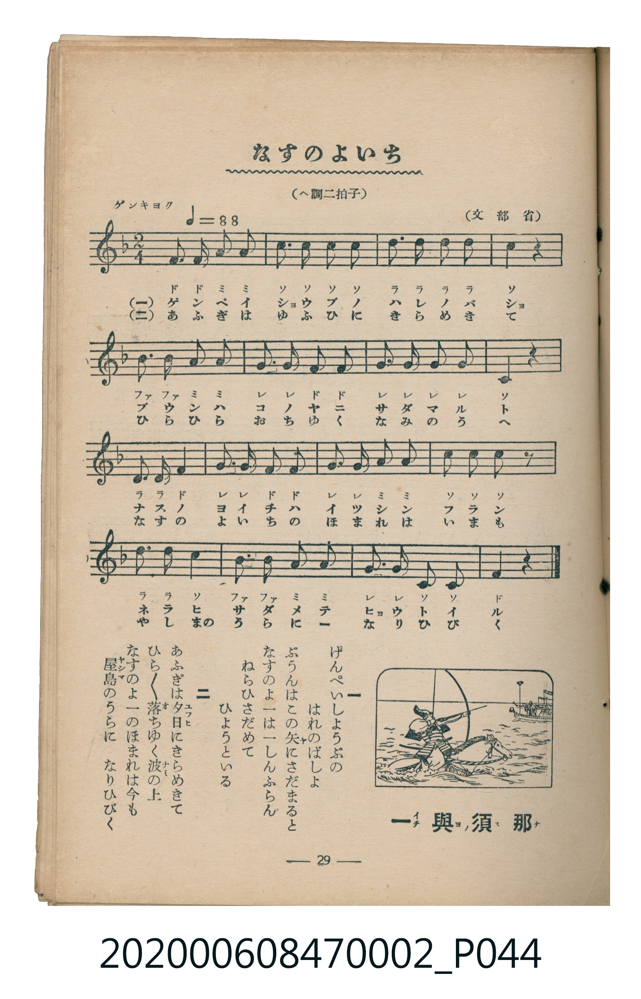

# なすのよいち（那須與一）

> Re:Shōka 使用 AI 協助辨識與重建樂譜，可能會有錯誤。歡迎[回報](https://github.com/TMDLang/reshoka/issues)。

- **鋼琴伴奏版**：<br><audio controls src="nasu_no_yoichi.mp3"></audio>
- **NEUTRINO 歌聲合成版**：<br><audio controls src="nasu_no_yoichi_neutrino.mp3"></audio>

- 文部省
- 臺灣教育會公認《新定兒童唱歌》尋常科第二學年用（2020.006.0847.0002）

## 說明

曲目說明
中文解釋：描寫源平故事中的武將那須與一，在海上射中扇子的英勇事蹟。

原書資訊與歌詞全文（對應 P044.jpg，書頁 p. 29，第三學期第 2 首）：
調性與拍號：ヘ調二拍子（F 大調 2/4 拍），「ゲンキヨク（♩＝88）」


## 歌詞

```text
一
げんぺいしようぶの　はれのばしよ
ぶうんはこの矢にさだまると
なすのよ一は一しんふらん
ねらひさだめて　ひようといる

二
あふぎは夕日にきらめきて
ひら／＼落ちゆく波の上
なすのよ一のほまれは今も
屋島のうらに　なりひびく
```

## ABC

<div class="abc-score" data-abc-src="nasu_no_yoichi.abc" aria-label="五線譜載入中"></div>

[下載 ABC 原始檔](nasu_no_yoichi.abc)

## TMD 檔案連結

- [主旋律 TMD 檔案](nasu_no_yoichi.tmd) [[在 TMD Studio 編輯](https://tmdlang.github.io/Tmd-TS/#tmd=s7IKdvYPcrWy4qpTUCpJTLdSSM7PyUlNLsnMz7MqzsjMK0nNjM_KTMmPL87Iz05Ugisry88pzU21Si9KTEmNN4o3MjAyiDcwMIs3sDAxBzIMjBBKi_NLi5JTrYqTM_Lzc-JLUitKkvLzsxHyBUX5Zal5iXlANQVFIBtTwIoQClLLMlNSQdKpKZkl-UWZiTlI7kgtKga7FWxJfElRYl5xclFmAcgDCFUlGalAx6bl52Tn5BelootnZBYDja1ECAPtSM_Ms8rNz0sqBfobWaIkIx_o54KMSqiuzOTEnPjsxDykoIE6pSAxPdUqwMDERIlLS0vhceOqx40zHzeue9zU8bix5XHjwvd7Ol42LX65oONFR_uTHQ3v93QqaGlxKdoqWFhw2dsquHHZGOmb2IFMfTat_WXziudzGsF2vGjf9bxx8bOpM180bXo2p_lp65oXq3ofN3Q9m7bh6bpZT1snPV-99OmUjc_W9jxu6H66ofvpjh3Pl098vmbNk109T9fueLpzy_MpK4CWg6JMDxhleqAoAzIMjIBOUOLS11J4NnvT89nrXqxa9WxGH5eCgsKTHWuBTnixfPHL9u73e2Y96-9_un71s10Tnu7c_Gxq65Nd3UAFz2e1PFu77OmGdlQ_9Tyds-LZ1u1PdnQ93dACMqez_enaCUDFL7o3Pu1uB-p9sXP-44YmLi19LpDVttQCIHc_7Zv_bPaOF5vbX6zoAjoIGCIvVs572roC6Bmg_59u6H3W3qkAiiG9rIJ0oFuBil8uaFQo0FMwsgRyQUG2oxMYZM_mzAeyFYwUXi6bBgwjYBCATH-xav-zhuUgc7t7X8ycDxR93DwDKAgMZqAI0JdAO9wUni5ZDhRTAEalAlAUrBsYLz2PmzY9bt78uGnt4-YVj5vWA5U-mrny_Z65FhZAJY8berkg4d4Aoh43TnrcNPlx4y5wupkOTkBtjxu3gRJTQ8PjxvWPm3pA7MYNEFmIHqB0G1jb-seNQHLd8_mLHjeuftw49XHjgseN-x43dT9uXAFRikiZQBuBGsAk0CSgtq2PmzqBDIi6tSBO4yaoGU2NjxuXgR2wCeakFSAXNnVDHL-rB6KrCWRKYx_Q3KdLpj6bvhTsil6wuUATeoGGQNQBTQEGTv_7PXteTNgLzB-Pm4Am9j_bDHT2OmD6wepUoKd3gz0DDID1T3Z3PW5qAkf8xu6nm8HhAwoDoJtXg9256nFTF9j9m4EGg9RRnsygQAGUfP0Si0v98iPzM5MzMq0CMhPz8h1qDGqqQRYp2BiaadmBWTUKhgq6QGioYAwkQbhGwRQsYgqmQbhGwQwsYgamQRimRlfBAErXgE3zMawBpQ-wCDCegOxdIFZjC1gPJD1AJBvbQIkCzFoHlVwP1dYDFQOmIHRtugrxqPYZgaSboEZuBeI-MAtkFFCmqQ1JZhOYtRpqZC_Usk4gbgTLgERAMsuw2lSjYALmmSCFkxFYxAgcgiCMEAHRIAwMJ5gx2AIK5H9oWAADC8nhjSAeJGweN4ECD-HwqVCZBUC8D-yFbqjMCjxBBPI81LuQgACyILq6oOYthAYXMC1CZVZBZfbD4wMkD5LZgSOIzCACQAozSDBFsCc4UDghhxHMFTOhrgDbB3QrLB21gN2OHHag8ALxl4BSDtivoNAEyWxFhAJYDORc5FAi3i5Ymt0NldkHTrfYXAGSASVQhF2I7ATyLyhZ4Utc4AQEJmBZFXtaWovwGzSpg1IKSGYBVKYRKXGD0wRqZgQlH3hOBScqHIkJnCBBaqeDvIeWNsDpCpZeEXZBQ7apC-66zVAZUGpDtaiWi0vXTgG5-FIA8pW5AA)]
- [鋼琴伴奏 TMD 檔案](nasu_no_yoichi_piano.tmd) [[在 TMD Studio 編輯](https://tmdlang.github.io/Tmd-TS/#tmd=s7IKdvYPcrWy4qpTUCpJTLdSyC8qychPL0osyKi0ysgsLskvykxOzInPTsxLVIIrKs4vLUpOjS9ITE-1CjAwMVHi0tJSeNy46nHjzMeN6x43dTxubHncuPD9no6X3XueT9jyZM-Wp0v7n3d2vN_TqaClxaVoq2BhwWVvq-DGZWOkb2IHMvjZtPaXzSuez2kEW_OifdfzxsXPps580bTp2Zzmp61rXqzqfdzQ9WzahqfrZj1tnfR89dKnUzY-W9vzuKH76Ybupzt2PF8-8fmaNU929Txdu-Ppzi3Pp6wA2m9kYGSgZ2BgpmdgYWIOZBgYAZ2gxMXll1hc6pcfmZ-ZnJFpFZCZmJcf5OFQY1BTzaUABDaGZlp2YFaNgqGCLhAaKhgDSRCuUTAFi5iCaRCuUTADi5iBaRCGqdFVMIDSNWDTfAxrgME0CSzyuGkykL0LxGpsAet53Dj9cVM7RLKxDYi3gVnroJLrodp6oGKPGzega9NViEe1zwgk3QQ1cisQ94FZIKOAMk1tSDKbwKzVUCN7oZZ1AnEjWAYkApJZhtWmGgUTMM8EKZyMwCJG4BAEYYQIiAZhYDjBjMEWUCD_Q8MCGFhIDm8E8SBh87gJFHgIh0-FyiwA4n1gL3RDZVbgCSKQ56HehQQEkAXR1QU1byE0uB439kNlVkFl9sPjAyQPktmBI4jMIAJACjNIMEWwJzhQOCGHEcwVM6GuANsHdGsHVLwF7HbksAOFF4i_BJRywH4FhSZIZisiFMBiIOcihxLxdsHS7G6ozD5wusXmCpAMKIEi7EJkJ5B_QckKX-ICJyAwAcuq2NPSWoTfoEkdlFJAMgugMo1IiRucJlAzIyj5wHMqOFHhSEzgBAlSOx3kPbS0AU5XsPSKsAsask1dcNdthsqAUhuqRbXYSi8f5NLLBFF4xStEG8YiM0yADBOoiAEi88KkTeNRWKbxMCayWhyKYRahGgu2DNV8iKlQlUDv6NopIPso2geoFEPMCCymzAUA)]

## 分析

```text
================================================================================
📊 TMD Song Profile: [ なすのよいち（那須與一） ]
================================================================================
⏱  Duration:       0:21 (21.8s), 16 measures total
🎼 Key & Tempo:    首調基準 F, != 88.0 BPM, <2/4>
   - 分析範圍：      由實際發聲的音符與和弦推測調性；播放脈絡另行呈現
🎤 人聲音域:    C4 (MIDI 60) – D5 (MIDI 74) [跨度: 14 個半音 / 1.2 個八度, 難度: moderate]
   - 最低音:  C4 in [NasuNoYoichi #1 @ m.8, 0:09]
   - 最高音: D5 in [NasuNoYoichi #1 @ m.3, 0:02]
   - 適合: soprano, mezzo-soprano, contralto, tenor, baritone, bass
🏛  結構:      NasuNoYoichi (21.8s)
⚡ 編曲密度:        Peak 1 軌道同時演奏
🗝  調性診斷：       F 調性不明確（純淨自然大調，未偵測到可信轉調）
   - 風格氣質:    純淨自然大調（陽光明朗、易唱易記，無明顯調外色彩）
   - 轉調歷程:    全曲維持單一推測調性（未偵測到可信轉調）
   - 核心骨幹音:  C, G, F, D, A
   - 調性數值:    F 調性不明確 [相關度: 0.82, 穩定度: Ambiguous, 自然音純度: 100.0%]
   - 候選調性 (K-S): F 大調 (0.82), C 大調 (0.79), G 小調 (0.56)
   - 五度圈歷程:   -1
   - 各段落調性細節:
     • [NasuNoYoichi #1]: F 調性不明確 (r: 0.82, 自然音純度: 100.0%)

  [ 五度圈游移軌跡 ]
               C  
        [F ]*          G  
      Bb               D  
      Eb               A  
         Ab           E  
            Db       B  
               F# 
     (* = active key center)

  [ 十二半音累積音高分佈 ]
     C  : ████████████████████████  24.6%
     C# :                            0.0%
     D  : ██████████████            14.0%
     D# :                            0.0%
     E  :                            0.0%
     F  : █████████████████         17.5%
     F# :                            0.0%
     G  : █████████████████████     21.1%
     G# :                            0.0%
     A  : ██████████████            14.0%
     A# : █████████                  8.8%
     B  :                            0.0%
--------------------------------------------------------------------------------
Assignment 軌道音域：
  - Piano         : C4 – D5 (14 個半音 / 1.2 個八度, 54 個音符)
================================================================================
```


## 原書掃描頁




